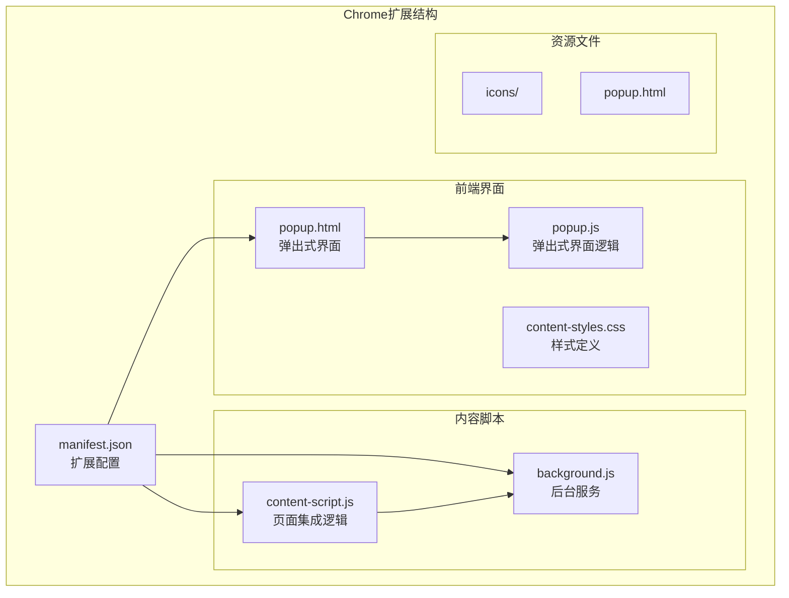
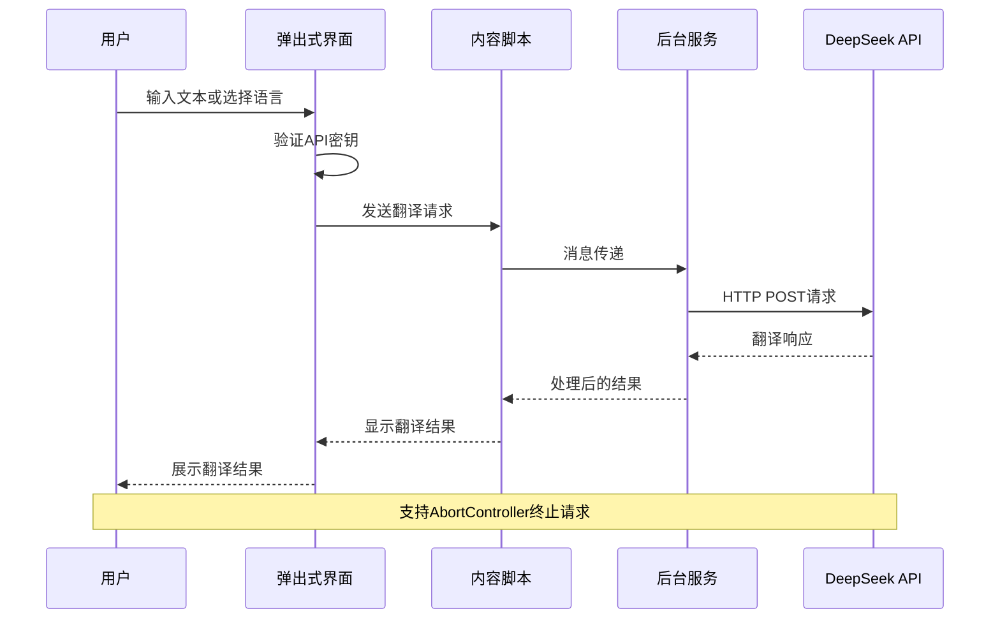
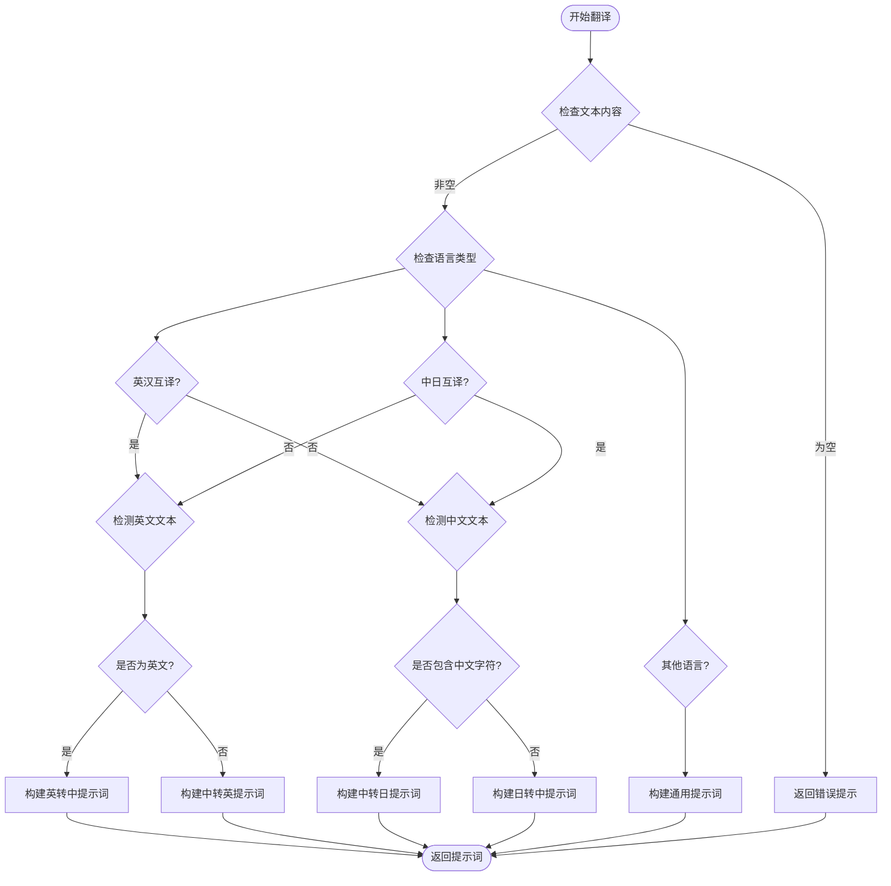
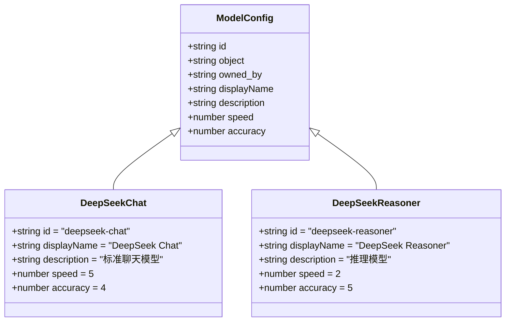
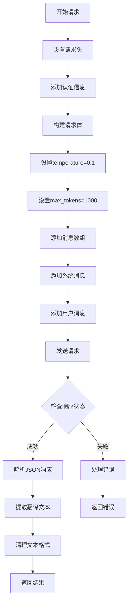
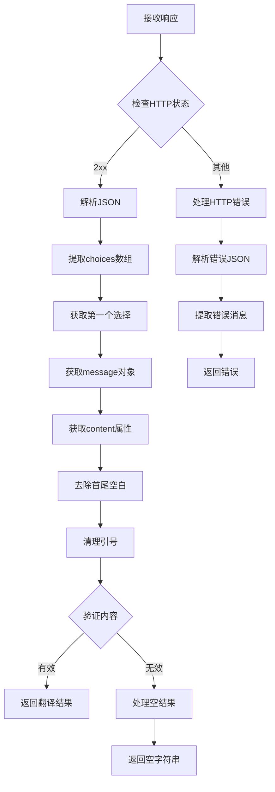
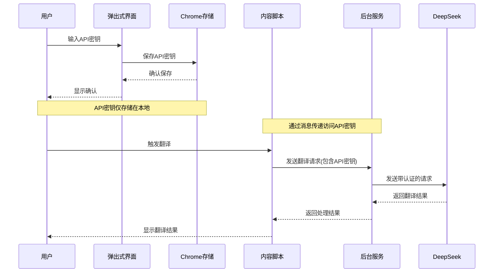
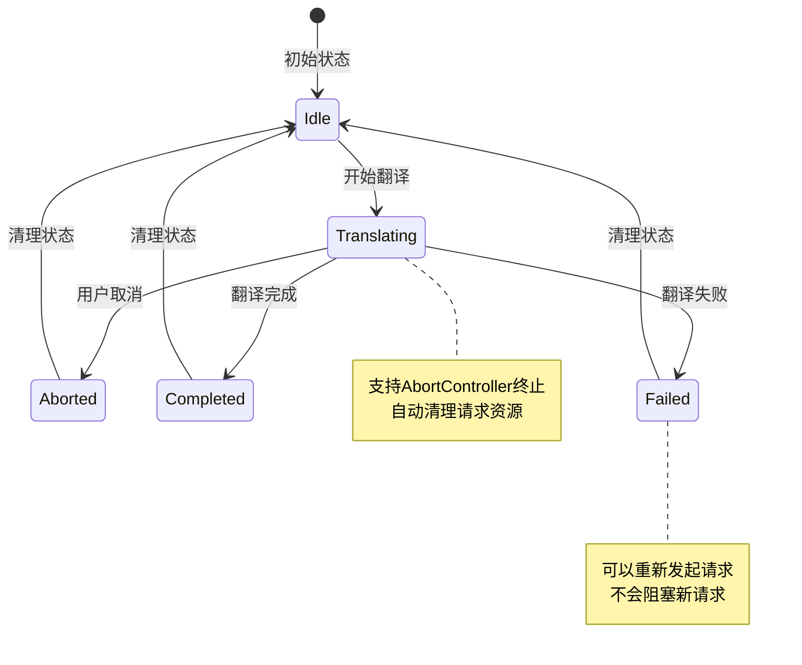
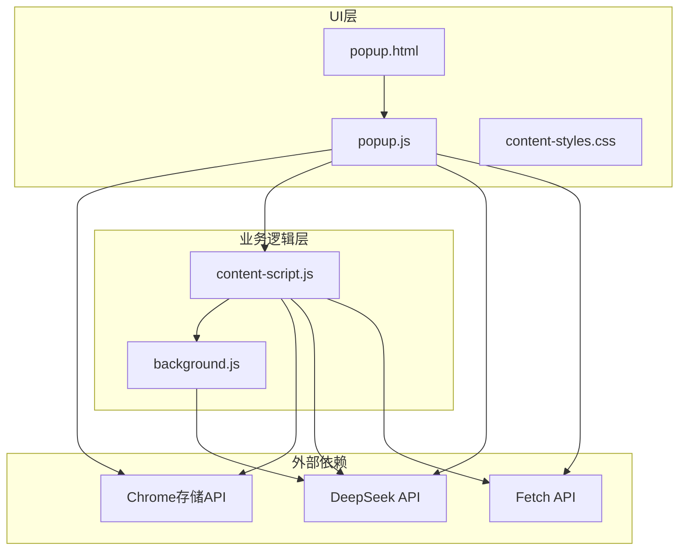

# API集成

<cite>
**本文档引用的文件**
- [README.md](file://README.md)
- [manifest.json](file://manifest.json)
- [background.js](file://background.js)
- [content-script.js](file://content-script.js)
- [popup.js](file://popup.js)
- [popup.html](file://popup.html)
- [content-styles.css](file://content-styles.css)
</cite>

## 目录
1. [简介](#简介)
2. [项目结构](#项目结构)
3. [核心组件](#核心组件)
4. [架构概览](#架构概览)
5. [详细组件分析](#详细组件分析)
6. [依赖关系分析](#依赖关系分析)
7. [性能考虑](#性能考虑)
8. [故障排除指南](#故障排除指南)
9. [结论](#结论)

## 简介

这是一个基于Chrome扩展的DeepSeek AI翻译工具，集成了DeepSeek API进行文本翻译服务。该扩展提供了多种翻译模式，支持多种语言对，并实现了智能的翻译提示词生成逻辑。

**章节来源**
- [README.md](file://README.md#L12-L50)

## 项目结构

该项目采用Chrome扩展的标准结构，包含以下关键文件：



**图表来源**
- [manifest.json](file://manifest.json#L1-L32)
- [popup.html](file://popup.html#L1-L226)
- [content-script.js](file://content-script.js#L1-L868)
- [background.js](file://background.js#L1-L95)

**章节来源**
- [manifest.json](file://manifest.json#L1-L32)
- [popup.html](file://popup.html#L1-L226)

## 核心组件

### API集成架构

该扩展实现了三层API集成架构：

1. **弹出式界面层**：处理用户输入和显示结果
2. **内容脚本层**：集成到网页中，处理文本选择和实时翻译
3. **后台服务层**：处理异步翻译请求和消息传递

### DeepSeek API配置

扩展支持两种DeepSeek模型：
- **deepseek-chat**：标准聊天模型，速度快，适合日常翻译
- **deepseek-reasoner**：推理模型，准确性更高但速度较慢

**章节来源**
- [README.md](file://README.md#L24-L28)
- [popup.js](file://popup.js#L14-L28)

## 架构概览



**图表来源**
- [popup.js](file://popup.js#L262-L341)
- [content-script.js](file://content-script.js#L565-L665)
- [background.js](file://background.js#L10-L55)

## 详细组件分析

### 翻译提示词生成逻辑

#### 语言检测算法

系统实现了智能的语言检测机制，根据文本内容自动判断语言类型：



**图表来源**
- [content-script.js](file://content-script.js#L532-L562)
- [popup.js](file://popup.js#L344-L370)

#### 提示词模板系统

系统使用统一的提示词模板格式：
- **系统提示词**："You are a translation assistant. Provide only the translated text without any explanations or additional text."
- **用户提示词**：根据不同语言对构建特定的翻译指令

**章节来源**
- [content-script.js](file://content-script.js#L532-L562)
- [popup.js](file://popup.js#L344-L370)

### 模型选择与性能差异

#### 模型配置



**图表来源**
- [popup.js](file://popup.js#L14-L28)
- [README.md](file://README.md#L24-L28)

#### 性能对比

| 特性 | DeepSeek Chat | DeepSeek Reasoner |
|------|---------------|-------------------|
| 响应速度 | 快速 | 较慢 |
| 准确性 | 良好 | 优秀 |
| 适用场景 | 日常翻译、批量处理 | 复杂文本、专业文档 |
| 成本 | 低 | 高 |

**章节来源**
- [README.md](file://README.md#L24-L28)

### HTTP请求构建

#### 请求参数配置

系统构建标准化的HTTP请求：



**图表来源**
- [popup.js](file://popup.js#L280-L306)
- [content-script.js](file://content-script.js#L591-L617)

#### 请求头配置

- **Content-Type**: application/json
- **Authorization**: Bearer [API密钥]
- **Accept**: application/json

#### 请求体参数

- **model**: 选择的DeepSeek模型
- **messages**: 包含系统消息和用户消息的数组
- **temperature**: 0.1（确保确定性输出）
- **max_tokens**: 1000（最大生成令牌数）

**章节来源**
- [popup.js](file://popup.js#L280-L306)
- [content-script.js](file://content-script.js#L591-L617)

### 响应数据处理

#### 数据解析流程



**图表来源**
- [background.js](file://background.js#L46-L50)
- [content-script.js](file://content-script.js#L629-L635)

**章节来源**
- [background.js](file://background.js#L46-L50)
- [content-script.js](file://content-script.js#L629-L635)

### 认证机制

#### API密钥管理

系统采用安全的API密钥存储机制：



**图表来源**
- [popup.js](file://popup.js#L70-L87)
- [content-script.js](file://content-script.js#L27-L53)

#### 安全特性

- API密钥仅存储在Chrome本地存储中
- 不通过网络传输API密钥
- 使用HTTPS协议进行所有通信
- 支持API密钥的动态更新

**章节来源**
- [popup.js](file://popup.js#L70-L87)
- [manifest.json](file://manifest.json#L19-L20)

### 错误处理策略

#### 错误分类与处理

```mermaid
flowchart TD
StartError[发生错误] --> CheckErrorType{检查错误类型}
CheckErrorType --> NetworkError{网络错误?}
CheckErrorType --> APIError{API错误?}
CheckErrorType --> AbortError{请求终止?}
CheckErrorType --> UnknownError{未知错误?}
NetworkError --> ShowNetworkError[显示网络错误]
APIError --> ParseAPIMessage[解析API错误消息]
ParseAPIMessage --> ShowAPIError[显示API错误]
AbortError --> SuppressError[静默处理(终止)]
UnknownError --> ShowGenericError[显示通用错误]
ShowNetworkError --> LogError[记录错误日志]
ShowAPIError --> LogError
SuppressError --> LogError
ShowGenericError --> LogError
LogError --> ReturnError[返回错误信息]
```

**图表来源**
- [content-script.js](file://content-script.js#L656-L665)
- [popup.js](file://popup.js#L329-L341)

#### 错误恢复机制

- **网络错误**：显示连接失败提示
- **API错误**：显示具体的API错误信息
- **请求终止**：静默处理，不显示错误
- **超时处理**：通过AbortController实现

**章节来源**
- [content-script.js](file://content-script.js#L656-L665)
- [popup.js](file://popup.js#L329-L341)

### 重试机制

#### 请求终止与重试

系统实现了灵活的请求管理机制：



**图表来源**
- [content-script.js](file://content-script.js#L587-L588)
- [popup.js](file://popup.js#L276-L277)

**章节来源**
- [content-script.js](file://content-script.js#L587-L588)
- [popup.js](file://popup.js#L276-L277)

### 超时处理

#### 请求超时配置

系统支持请求超时控制：

- **AbortController**: 用于主动终止请求
- **signal参数**: 在fetch请求中传递超时信号
- **自动清理**: 请求完成后自动清理资源

**章节来源**
- [content-script.js](file://content-script.js#L615-L617)
- [popup.js](file://popup.js#L304-L305)

## 依赖关系分析

### 组件耦合度



**图表来源**
- [manifest.json](file://manifest.json#L19-L30)
- [popup.js](file://popup.js#L1-L452)
- [content-script.js](file://content-script.js#L1-L868)

### 权限管理

扩展需要以下权限：

| 权限 | 用途 | 安全性 |
|------|------|--------|
| storage | 存储用户设置和API密钥 | 本地存储，仅扩展可见 |
| activeTab | 访问当前标签页 | 仅当前标签页 |
| scripting | 注入脚本到页面 | 仅注入内容脚本 |
| https://api.deepseek.com/* | 访问DeepSeek API | 仅DeepSeek域名 |

**章节来源**
- [manifest.json](file://manifest.json#L19-L20)

## 性能考虑

### 翻译性能优化

#### 实时翻译优化

- **防抖机制**: 文本输入防抖300ms，避免频繁请求
- **请求终止**: 新请求自动终止旧请求
- **缓存策略**: 翻译历史缓存，避免重复翻译

#### 网页翻译优化

- **批量处理**: 网页翻译采用20个文本块的批次处理
- **进度反馈**: 实时显示翻译进度
- **内存管理**: 及时清理DOM元素和事件监听器

### API使用效率

#### 请求参数优化

- **temperature=0.1**: 确定性输出，减少不必要的计算
- **max_tokens=1000**: 合理的令牌限制，平衡质量和性能
- **系统提示词**: 精简的提示词设计，提高响应速度

**章节来源**
- [content-script.js](file://content-script.js#L147-L189)
- [content-script.js](file://content-script.js#L765-L793)

## 故障排除指南

### 常见问题诊断

#### API密钥相关问题

**问题**: "API key not set"
**原因**: 用户未正确输入或保存API密钥
**解决方法**: 
1. 检查API密钥格式是否正确
2. 确认API密钥具有翻译权限
3. 重新保存API密钥

#### 网络连接问题

**问题**: 翻译请求超时或失败
**原因**: 网络连接不稳定或API服务不可用
**解决方法**:
1. 检查网络连接状态
2. 稍后重试请求
3. 检查DeepSeek API状态

#### 语言检测问题

**问题**: 翻译方向不正确
**原因**: 文本语言检测失败
**解决方法**:
1. 手动选择正确的语言对
2. 确保输入文本包含明确的语言特征
3. 使用更清晰的文本内容

### 调试技巧

#### 开发者工具使用

1. **Console面板**: 查看详细的错误信息和日志
2. **Network面板**: 监控API请求和响应
3. **Storage面板**: 检查Chrome存储中的数据
4. **Elements面板**: 分析UI组件状态

#### 日志分析

系统在关键步骤添加了详细的日志输出：
- 请求发送前的日志
- 响应接收后的日志
- 错误处理的日志
- 性能指标的日志

**章节来源**
- [content-script.js](file://content-script.js#L567-L578)
- [popup.js](file://popup.js#L262-L274)

### 性能监控

#### 性能指标

- **响应时间**: 从请求到响应的时间
- **翻译质量**: 通过用户反馈评估
- **资源使用**: 内存和CPU使用情况
- **错误率**: API错误的发生频率

#### 优化建议

1. **合理使用模型**: 根据需求选择合适的模型
2. **批量处理**: 对大量文本使用批量翻译
3. **缓存策略**: 利用翻译历史减少重复请求
4. **网络优化**: 在稳定的网络环境下使用

## 结论

该DeepSeek API集成方案实现了完整的Chrome扩展翻译功能，具有以下特点：

### 技术优势

- **模块化设计**: 清晰的三层架构分离
- **安全性**: API密钥本地存储和HTTPS传输
- **用户体验**: 实时翻译和丰富的交互功能
- **性能优化**: 防抖、请求终止和缓存机制

### 功能完整性

- 支持多种语言对的双向翻译
- 提供两种DeepSeek模型选择
- 实现网页级翻译功能
- 完整的错误处理和重试机制

### 扩展性考虑

该架构为未来的功能扩展提供了良好的基础：
- 易于添加新的语言支持
- 可以集成更多AI模型
- 支持自定义提示词模板
- 可以扩展翻译历史管理功能

通过合理的API集成设计和完善的错误处理机制，该扩展为用户提供了稳定可靠的DeepSeek翻译服务体验。