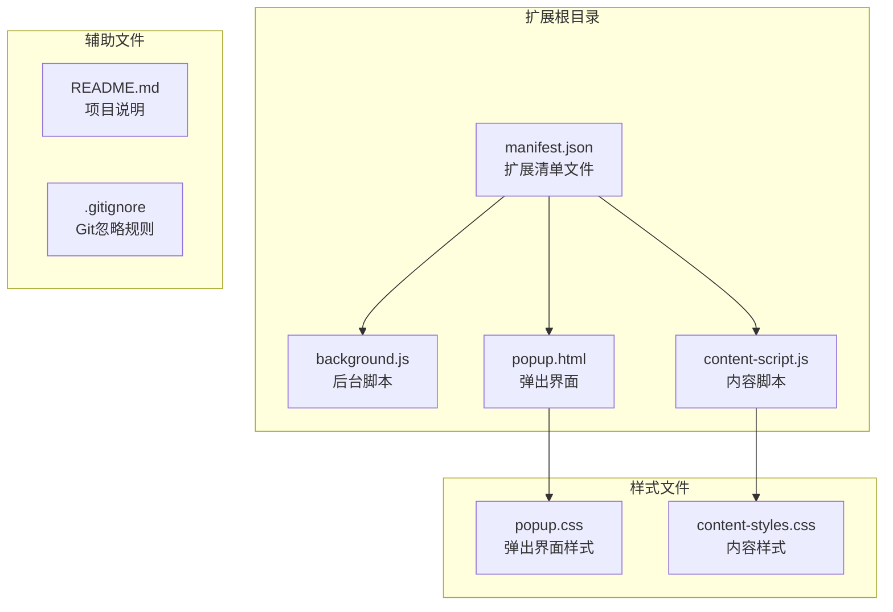
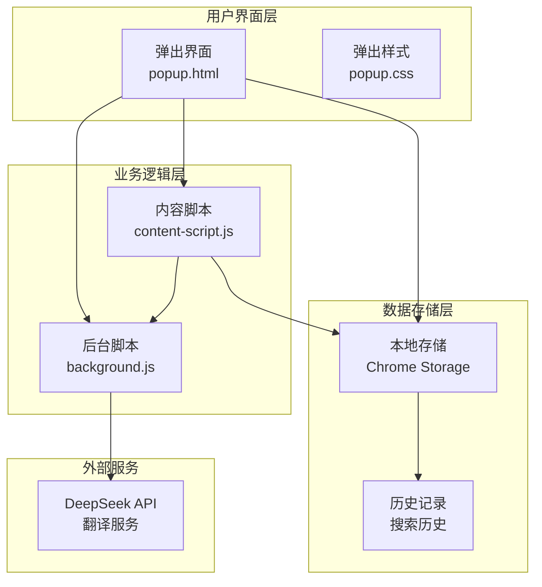
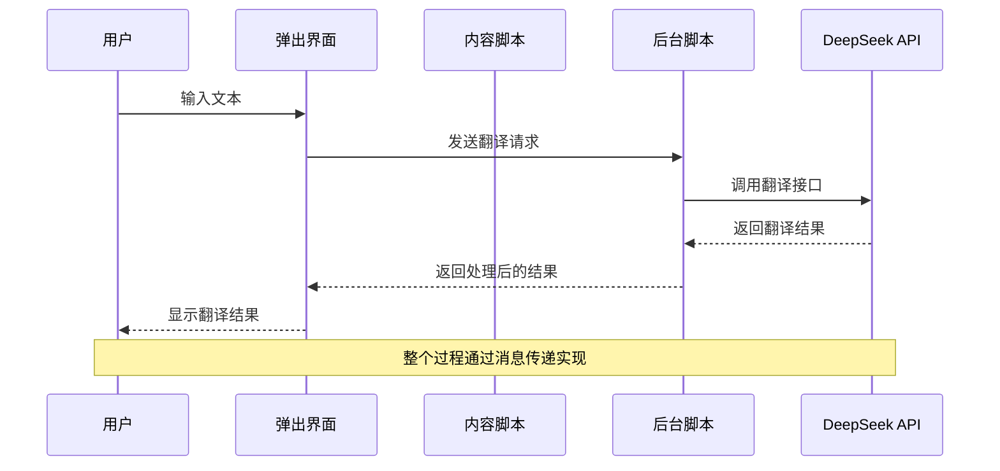
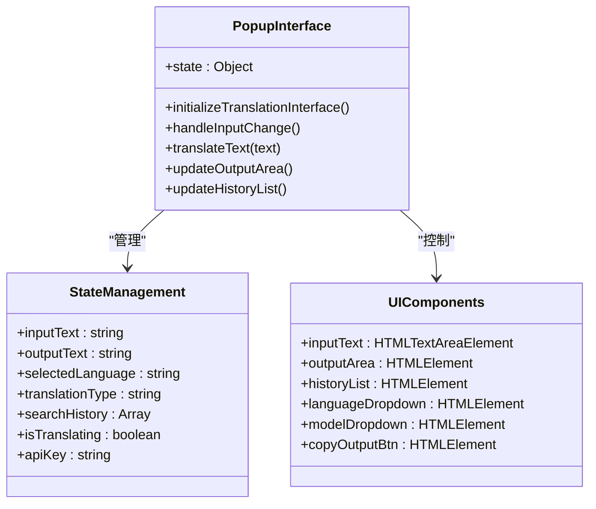
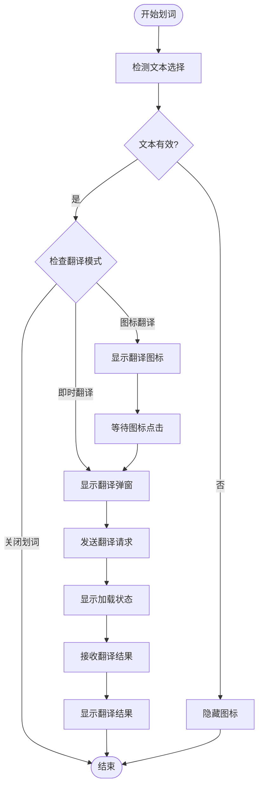
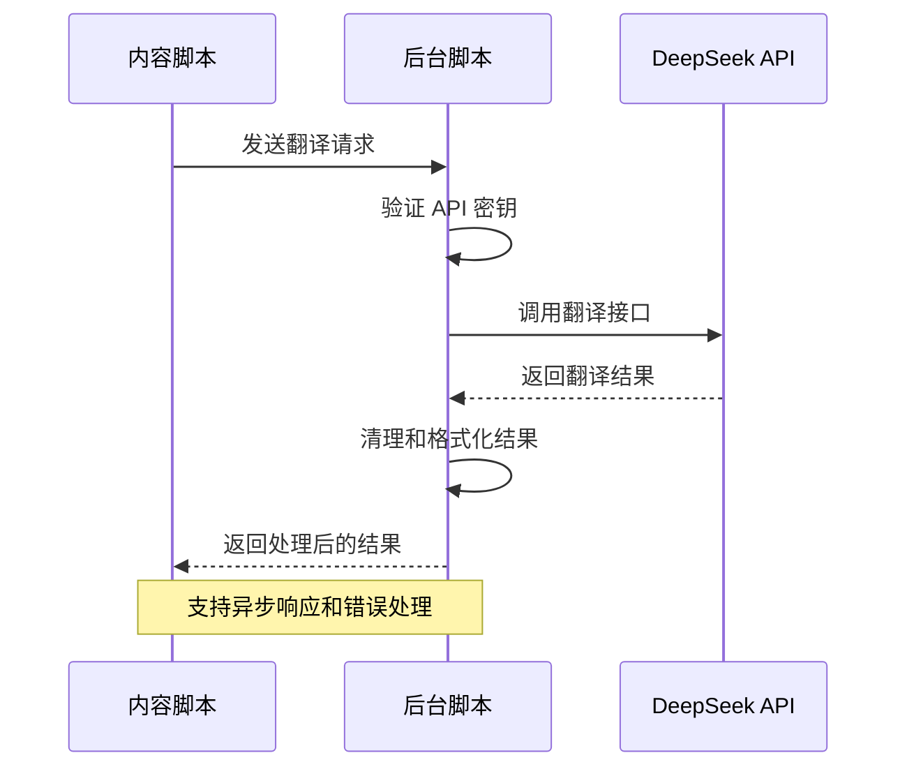
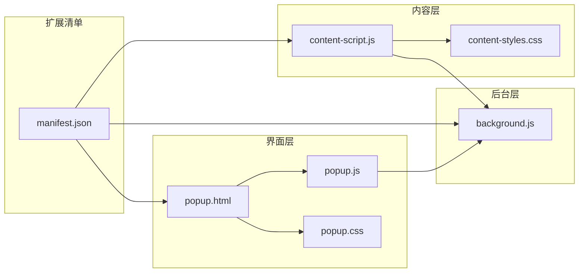
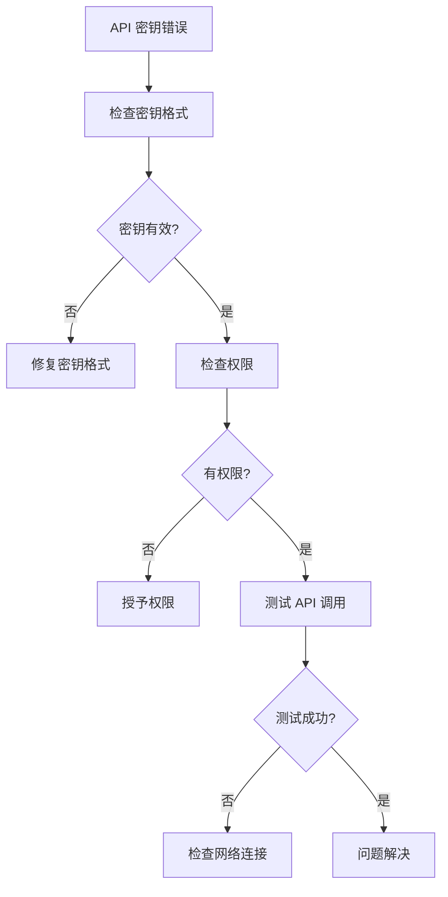
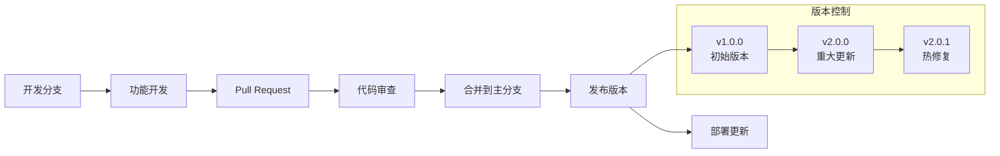

# 开发者指南

<cite>
**本文档引用的文件**
- [manifest.json](file://manifest.json)
- [background.js](file://background.js)
- [content-script.js](file://content-script.js)
- [popup.js](file://popup.js)
- [popup.html](file://popup.html)
- [popup.css](file://popup.css)
- [content-styles.css](file://content-styles.css)
- [README.md](file://README.md)
- [.gitignore](file://.gitignore)
</cite>

## 目录
1. [简介](#简介)
2. [项目结构](#项目结构)
3. [核心组件](#核心组件)
4. [架构概览](#架构概览)
5. [详细组件分析](#详细组件分析)
6. [依赖关系分析](#依赖关系分析)
7. [性能考虑](#性能考虑)
8. [调试指南](#调试指南)
9. [最佳实践](#最佳实践)
10. [版本管理与发布](#版本管理与发布)
11. [故障排除](#故障排除)
12. [结论](#结论)

## 简介

AI Translator 是一个基于 Chrome 扩展框架开发的翻译工具，集成了 DeepSeek AI 的强大翻译能力。该扩展支持多种翻译模式，包括图标翻译、即时翻译和网页翻译功能，为用户提供便捷的跨语言交流体验。

该项目采用现代 Chrome Extension Manifest V3 架构，实现了内容脚本、后台脚本和弹出界面的完整翻译生态系统。扩展支持多语言对翻译，包括英语-中文互译、中文-日语互译以及多种其他语言的单向翻译。

## 项目结构

该项目采用简洁而清晰的文件组织结构，遵循 Chrome Extension 的标准布局：

**图表来源**
- [manifest.json](file://manifest.json#L1-L32)
- [popup.html](file://popup.html#L1-L226)

**章节来源**
- [manifest.json](file://manifest.json#L1-L32)
- [README.md](file://README.md#L1-L50)

## 核心组件

### 扩展清单配置

扩展的核心配置由 manifest.json 文件定义，该文件声明了扩展的基本信息、权限需求和资源文件关联。

关键配置要素：
- **Manifest V3**: 采用最新的 Chrome 扩展架构
- **权限系统**: 包含 storage、activeTab、scripting 权限
- **主机权限**: 对 DeepSeek API 的访问授权
- **内容脚本**: 全局注入到所有网页
- **后台服务**: 使用 service worker 实现

### 后台脚本架构

background.js 实现了扩展的核心翻译逻辑，作为内容脚本与外部 API 的中介层。

主要功能模块：
- **消息处理**: 监听来自内容脚本的消息
- **API 调用**: 与 DeepSeek AI 进行通信
- **错误处理**: 完善的异常捕获和错误报告
- **语言识别**: 智能的语言方向判断

**章节来源**
- [background.js](file://background.js#L1-L95)
- [manifest.json](file://manifest.json#L19-L30)

## 架构概览

该扩展采用了典型的 Chrome Extension 三层架构设计：

**图表来源**
- [popup.html](file://popup.html#L1-L226)
- [background.js](file://background.js#L1-L95)
- [content-script.js](file://content-script.js#L1-L868)

### 数据流图

**图表来源**
- [popup.js](file://popup.js#L262-L341)
- [background.js](file://background.js#L10-L55)

## 详细组件分析

### 弹出界面系统

弹出界面是用户与扩展交互的主要入口，提供了完整的翻译功能界面。

#### 界面结构分析

**图表来源**
- [popup.js](file://popup.js#L1-L452)

#### 功能特性

1. **多语言支持**: 支持英语-中文互译、中文-日语互译等多种语言组合
2. **模型选择**: 提供 deepseek-chat 和 deepseek-reasoner 两种 AI 模型
3. **翻译模式**: 图标翻译、即时翻译、关闭划词三种工作模式
4. **历史记录**: 自动保存翻译历史，支持快速访问
5. **网页翻译**: 支持整页翻译功能

**章节来源**
- [popup.html](file://popup.html#L50-L221)
- [popup.js](file://popup.js#L89-L451)

### 内容脚本系统

内容脚本负责在目标网页中实现划词翻译功能，是扩展与网页交互的核心组件。

#### 划词翻译机制

**图表来源**
- [content-script.js](file://content-script.js#L129-L190)

#### 核心功能模块

1. **文本选择处理**: 实现智能的文本选择检测和防抖机制
2. **翻译图标管理**: 动态创建和定位翻译图标
3. **弹窗系统**: 创建可拖拽的翻译结果显示弹窗
4. **TTS 语音合成**: 支持原文和翻译结果的语音朗读
5. **网页翻译**: 实现整页文本的批量翻译功能

**章节来源**
- [content-script.js](file://content-script.js#L27-L83)
- [content-script.js](file://content-script.js#L564-L665)

### 后台脚本架构

后台脚本作为扩展的中枢处理器，负责协调各个组件之间的通信。

#### 消息处理流程

**图表来源**
- [background.js](file://background.js#L2-L7)

#### 翻译逻辑实现

后台脚本实现了复杂的翻译逻辑，包括：

1. **智能语言识别**: 根据文本内容自动判断语言方向
2. **API 请求构建**: 构造符合 DeepSeek API 规范的请求
3. **响应处理**: 解析和清理翻译结果
4. **错误恢复**: 处理各种网络和 API 错误情况

**章节来源**
- [background.js](file://background.js#L10-L95)

## 依赖关系分析

### 文件间依赖关系

**图表来源**
- [manifest.json](file://manifest.json#L19-L30)
- [popup.html](file://popup.html#L1-L226)

### 外部依赖

项目对外部依赖的管理相对简单，主要依赖于：

1. **Chrome Extension API**: 使用内置的 runtime、storage、tabs 等 API
2. **DeepSeek AI API**: 通过 HTTPS 请求调用外部翻译服务
3. **Web 标准**: 使用标准的 JavaScript、CSS 和 HTML 技术

**章节来源**
- [manifest.json](file://manifest.json#L19-L20)
- [content-script.js](file://content-script.js#L590-L617)

## 性能考虑

### 内存管理

扩展在内存管理方面采用了多项优化策略：

1. **对象复用**: 重用 DOM 元素和事件监听器
2. **及时清理**: 在不需要时及时移除事件监听器和 DOM 节点
3. **防抖机制**: 使用防抖技术减少不必要的计算和网络请求

### 网络优化

1. **请求取消**: 支持中止正在进行的翻译请求
2. **批量处理**: 网页翻译功能支持批量处理文本
3. **缓存策略**: 利用浏览器的 HTTP 缓存机制

### 用户体验优化

1. **加载状态**: 提供清晰的加载指示器
2. **响应式设计**: 适配不同的屏幕尺寸
3. **平滑动画**: 使用 CSS3 动画提升用户体验

## 调试指南

### 开发环境搭建

#### Chrome 扩展加载步骤

1. **启用开发者模式**: 在 Chrome 地址栏输入 `chrome://extensions/`
2. **加载扩展**: 点击"加载已解压的扩展程序"，选择项目目录
3. **启用开发者模式**: 在右上角切换开发者模式
4. **刷新扩展**: 修改代码后记得刷新扩展页面

#### 调试工具使用

1. **扩展页面**: 通过 `chrome://extensions/` 查看扩展状态
2. **后台页面**: 在扩展详情页查看后台脚本日志
3. **内容脚本**: 通过页面的开发者工具查看内容脚本输出
4. **网络面板**: 监控 API 请求和响应

### 常见问题诊断

#### API 密钥问题

#### 网页翻译失败

1. **检查目标页面**: 确认页面允许脚本注入
2. **查看控制台**: 检查是否有 JavaScript 错误
3. **验证权限**: 确认扩展具有必要的权限
4. **测试 API**: 直接调用 API 接口验证服务状态

**章节来源**
- [README.md](file://README.md#L30-L38)

## 最佳实践

### 代码规范

1. **模块化设计**: 每个功能模块保持独立性和可重用性
2. **错误处理**: 实现完善的错误捕获和用户友好的错误提示
3. **异步编程**: 正确使用 Promise 和 async/await
4. **事件管理**: 合理管理事件监听器，避免内存泄漏

### 性能优化

1. **懒加载**: 只在需要时初始化复杂的功能模块
2. **节流防抖**: 对频繁触发的事件使用节流或防抖
3. **DOM 操作**: 最小化 DOM 操作次数，使用文档片段
4. **缓存策略**: 合理使用 localStorage 缓存用户设置

### 安全考虑

1. **API 密钥保护**: 确保密钥存储在安全的存储空间
2. **输入验证**: 对用户输入进行严格的验证和清理
3. **权限最小化**: 只请求必要的权限
4. **CSP 策略**: 遵循内容安全策略的最佳实践

## 版本管理与发布

### Git 工作流程

### 发布流程

1. **版本标记**: 使用语义化版本控制
2. **代码审查**: 所有变更必须经过代码审查
3. **测试验证**: 确保功能正常运行
4. **文档更新**: 更新相关文档和说明
5. **发布部署**: 通过官方渠道发布更新

**章节来源**
- [.gitignore](file://.gitignore#L1-L27)

## 故障排除

### 常见问题及解决方案

#### 扩展无法加载

1. **检查开发者模式**: 确认已启用开发者模式
2. **验证清单文件**: 检查 manifest.json 是否正确
3. **清理缓存**: 清除浏览器缓存后重新加载
4. **检查权限**: 确认扩展具有必要权限

#### 翻译功能异常

1. **API 密钥验证**: 确认 API 密钥正确且有效
2. **网络连接检查**: 验证网络连接状态
3. **服务状态监控**: 检查 DeepSeek API 服务状态
4. **浏览器兼容性**: 确认浏览器版本支持所需功能

#### 性能问题

1. **内存泄漏检查**: 使用开发者工具检查内存使用
2. **事件监听器清理**: 确认不再使用的监听器已被移除
3. **DOM 操作优化**: 减少不必要的 DOM 操作
4. **缓存策略**: 实现合理的缓存机制

### 调试技巧

1. **使用 console.log**: 在关键位置添加日志输出
2. **断点调试**: 在 Chrome 开发者工具中设置断点
3. **网络监控**: 使用网络面板监控 API 请求
4. **性能分析**: 使用性能面板分析运行时性能

## 结论

AI Translator Chrome 扩展是一个功能完整、架构清晰的翻译工具。通过合理的设计和实现，该扩展提供了优秀的用户体验和强大的翻译能力。

### 主要优势

1. **架构清晰**: 采用标准的 Chrome Extension 架构
2. **功能丰富**: 支持多种翻译模式和语言对
3. **用户体验**: 提供直观易用的界面设计
4. **性能优化**: 实现了多项性能优化措施

### 改进建议

1. **国际化支持**: 添加多语言界面支持
2. **自定义配置**: 允许用户自定义更多翻译参数
3. **离线功能**: 考虑实现部分离线翻译能力
4. **插件扩展**: 设计插件化的功能扩展机制

该扩展为 Chrome Extension 开发提供了良好的参考案例，展示了如何构建功能完整、性能优良的浏览器扩展应用。