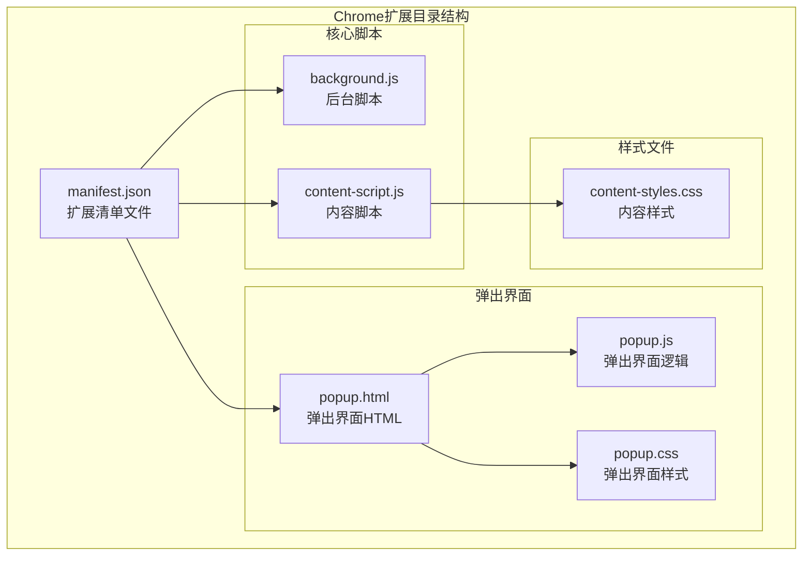
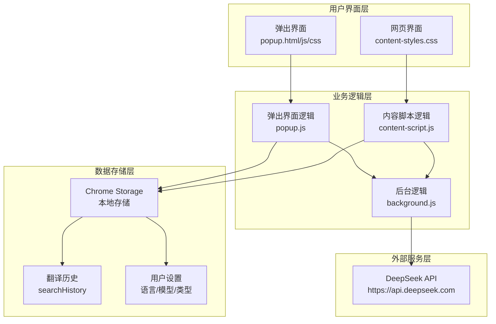
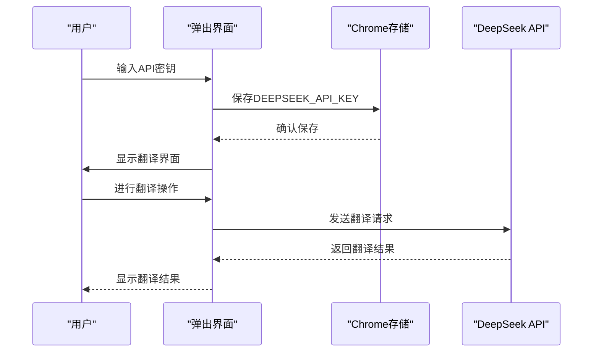
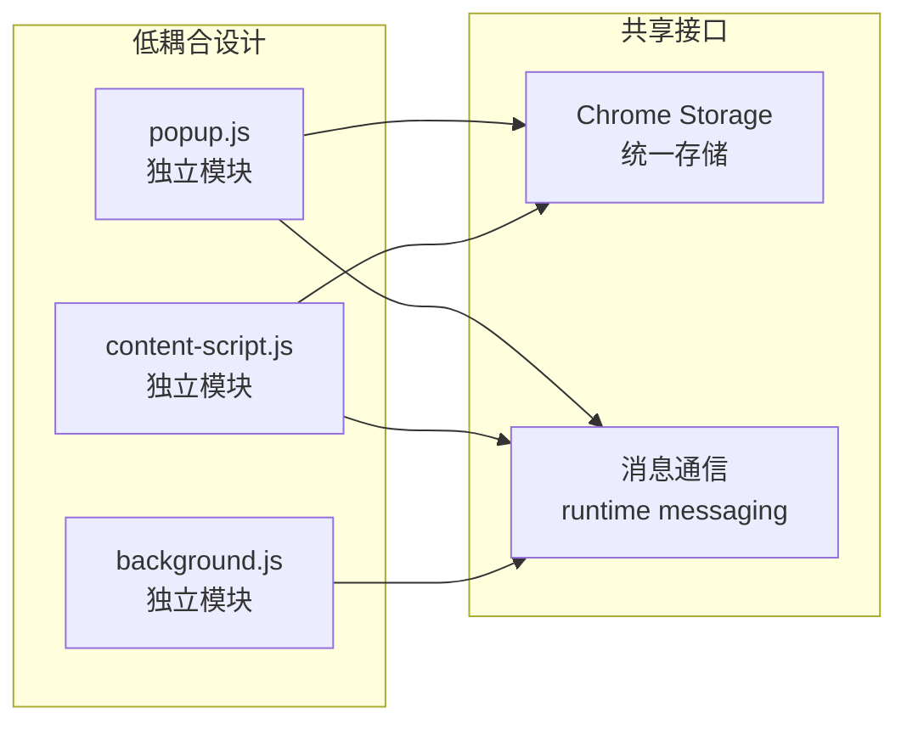

# 快速开始

<cite>
**本文引用的文件**
- [manifest.json](file://manifest.json)
- [background.js](file://background.js)
- [content-script.js](file://content-script.js)
- [popup.js](file://popup.js)
- [popup.html](file://popup.html)
- [popup.css](file://popup.css)
- [content-styles.css](file://content-styles.css)
- [README.md](file://README.md)
</cite>

## 目录
1. [简介](#简介)
2. [项目结构](#项目结构)
3. [核心组件](#核心组件)
4. [架构概览](#架构概览)
5. [详细组件分析](#详细组件分析)
6. [依赖关系分析](#依赖关系分析)
7. [性能考虑](#性能考虑)
8. [故障排除指南](#故障排除指南)
9. [结论](#结论)

## 简介

AI翻译器Chrome扩展是一款基于DeepSeek AI的智能翻译工具，支持文本翻译、网页翻译、翻译历史管理等功能。该扩展采用Chrome扩展标准架构，包含后台脚本、内容脚本和弹出界面三个主要组件，为用户提供便捷的跨语言翻译体验。

## 项目结构

该项目采用标准的Chrome扩展目录结构，包含以下核心文件：

**图表来源**
- [manifest.json](file://manifest.json#L1-L32)
- [popup.html](file://popup.html#L1-L226)

**章节来源**
- [manifest.json](file://manifest.json#L1-L32)
- [README.md](file://README.md#L12-L50)

## 核心组件

### 扩展清单配置

扩展通过manifest.json定义了完整的权限和功能配置：

- **权限声明**：`storage`、`activeTab`、`scripting`
- **主机权限**：`https://api.deepseek.com/*`
- **内容脚本**：对所有URL生效的脚本注入
- **后台服务**：service worker实现

### 后台脚本功能

background.js负责处理API请求和翻译逻辑：
- 接收来自内容脚本的消息
- 调用DeepSeek API进行翻译
- 错误处理和响应格式化

### 内容脚本功能

content-script.js提供网页级翻译能力：
- 文本选择监听和处理
- 翻译图标显示和交互
- 翻译弹窗管理和TTS功能
- 网页整体翻译功能

### 弹出界面功能

popup.js管理扩展的用户界面：
- API密钥输入和验证
- 翻译历史管理
- 语言和模型选择
- 实时翻译功能

**章节来源**
- [manifest.json](file://manifest.json#L19-L30)
- [background.js](file://background.js#L1-L95)
- [content-script.js](file://content-script.js#L1-L868)
- [popup.js](file://popup.js#L1-L452)

## 架构概览

该扩展采用分层架构设计，实现了清晰的职责分离：

**图表来源**
- [popup.js](file://popup.js#L1-L452)
- [content-script.js](file://content-script.js#L1-L868)
- [background.js](file://background.js#L1-L95)

## 详细组件分析

### 安装和配置步骤

#### 从Chrome Web Store安装

1. 打开Chrome浏览器
2. 访问Chrome Web Store
3. 搜索"AI Translator"扩展
4. 点击"添加至Chrome"
5. 确认权限授权

#### 从源码手动加载

1. 下载项目压缩包
2. 解压到指定目录
3. 打开Chrome浏览器，导航到 `chrome://extensions/`
4. 启用"开发者模式"
5. 点击"加载已解压的扩展程序"
6. 选择解压后的项目目录
7. 将扩展添加到浏览器工具栏

**章节来源**
- [README.md](file://README.md#L30-L38)

### API密钥配置

#### 获取DeepSeek API密钥

1. 访问DeepSeek官方网站
2. 注册开发者账号
3. 在控制台生成API密钥
4. 复制API密钥字符串

#### 配置API密钥

1. 打开扩展弹出界面
2. 在欢迎屏幕上输入API密钥
3. 点击"保存API密钥"
4. 密钥将存储在Chrome本地存储中

**图表来源**
- [popup.js](file://popup.js#L69-L87)
- [content-script.js](file://content-script.js#L27-L53)

**章节来源**
- [popup.js](file://popup.js#L33-L51)
- [content-script.js](file://content-script.js#L30-L53)

### 基本使用方法

#### 翻译选定文本

1. 在网页中选中文本
2. 点击出现的翻译图标
3. 查看翻译结果弹窗
4. 可选择复制翻译结果或进行TTS朗读

#### 使用网页翻译功能

1. 在弹出界面点击"翻译此网页"
2. 等待进度条显示翻译状态
3. 查看翻译后的网页内容
4. 翻译完成后可继续浏览

#### 管理翻译历史

1. 在弹出界面查看历史列表
2. 点击历史项重新翻译
3. 点击"清空"按钮清除历史记录
4. 历史记录最多保存20条

**章节来源**
- [content-script.js](file://content-script.js#L129-L190)
- [popup.js](file://popup.js#L196-L225)
- [popup.js](file://popup.js#L387-L406)

### 功能特性详解

#### 翻译模式

扩展提供三种翻译模式：

1. **图标翻译**（默认）：选中文本后显示图标，点击图标进行翻译
2. **立即翻译**：选中文本后自动显示翻译结果
3. **关闭划词**：禁用文本选择翻译功能

#### 语言支持

支持多种语言对：
- 英汉互译（智能识别语言方向）
- 中日互译（智能识别语言方向）
- 印尼语、葡萄牙语、法语、泰语、葡萄牙利语

#### AI模型选择

- **deepseek-chat**：基础对话模型，响应速度快
- **deepseek-reasoner**：推理模型，准确性更高但响应较慢

**章节来源**
- [popup.html](file://popup.html#L189-L218)
- [content-script.js](file://content-script.js#L58-L94)
- [popup.js](file://popup.js#L14-L26)

## 依赖关系分析

### 组件耦合度

**图表来源**
- [popup.js](file://popup.js#L1-L452)
- [content-script.js](file://content-script.js#L1-L868)
- [background.js](file://background.js#L1-L95)

### 数据流分析

扩展的数据流遵循单向原则，确保数据一致性：

1. **用户输入** → 弹出界面 → 内容脚本 → 后台脚本
2. **API响应** → 后台脚本 → 内容脚本 → 弹出界面
3. **存储操作** → 各组件 → Chrome存储

**章节来源**
- [manifest.json](file://manifest.json#L19-L30)
- [background.js](file://background.js#L2-L7)

## 性能考虑

### 翻译性能优化

1. **防抖处理**：文本选择防抖300ms，避免频繁触发
2. **请求取消**：支持翻译请求中断，提升用户体验
3. **批量处理**：网页翻译采用20个文本一批的批量处理
4. **缓存策略**：翻译结果在内存中缓存，减少重复请求

### 内存管理

1. **对象清理**：及时清理DOM元素和事件监听器
2. **存储优化**：翻译历史最多保存20条，避免无限增长
3. **资源释放**：弹窗关闭时自动释放相关资源

## 故障排除指南

### 常见问题及解决方案

#### API密钥相关问题

**问题**：翻译结果显示"API key not set"
**解决方案**：
1. 确认API密钥正确性
2. 检查网络连接
3. 重新保存API密钥

**问题**：API请求超时
**解决方案**：
1. 检查DeepSeek服务状态
2. 确认网络连接稳定
3. 尝试稍后重试

#### 翻译功能异常

**问题**：无法选中文本翻译
**解决方案**：
1. 检查扩展权限设置
2. 刷新页面重新加载
3. 重启浏览器

**问题**：网页翻译失败
**解决方案**：
1. 检查网页内容是否包含可翻译文本
2. 确认API密钥有效
3. 尝试翻译较小的网页片段

#### 用户界面问题

**问题**：弹出界面显示异常
**解决方案**：
1. 清除浏览器缓存
2. 重新加载扩展
3. 检查浏览器兼容性

**章节来源**
- [content-script.js](file://content-script.js#L565-L665)
- [popup.js](file://popup.js#L261-L341)

## 结论

AI翻译器Chrome扩展提供了完整的翻译解决方案，具有以下优势：

1. **易用性强**：简洁直观的用户界面，支持多种翻译模式
2. **功能丰富**：支持文本翻译、网页翻译、历史管理等核心功能
3. **性能优秀**：采用防抖、请求取消等优化技术
4. **安全可靠**：API密钥本地存储，不上传用户数据

通过本文档的快速开始指南，用户可以快速安装和配置扩展，享受高效的跨语言翻译体验。建议新用户先从基础的文本翻译功能开始，逐步探索高级功能如网页翻译和历史管理。