# 技术架构

<cite>
**本文档引用的文件**
- [manifest.json](file://manifest.json)
- [background.js](file://background.js)
- [content-script.js](file://content-script.js)
- [popup.js](file://popup.js)
- [popup.html](file://popup.html)
- [popup.css](file://popup.css)
- [content-styles.css](file://content-styles.css)
- [README.md](file://README.md)
</cite>

## 目录
1. [简介](#简介)
2. [项目结构](#项目结构)
3. [核心组件](#核心组件)
4. [架构概览](#架构概览)
5. [详细组件分析](#详细组件分析)
6. [依赖关系分析](#依赖关系分析)
7. [性能考虑](#性能考虑)
8. [故障排除指南](#故障排除指南)
9. [结论](#结论)

## 简介

这是一个基于Chrome扩展框架的AI翻译器应用，使用Manifest V3规范构建。该扩展提供了三种主要功能：文本翻译、网页翻译和翻译历史管理。系统采用事件驱动的架构模式，通过后台脚本、内容脚本和弹出界面三个核心组件协同工作，实现了高效的跨域通信和异步处理机制。

## 项目结构

该项目采用简洁的文件组织结构，遵循Chrome扩展的标准布局：

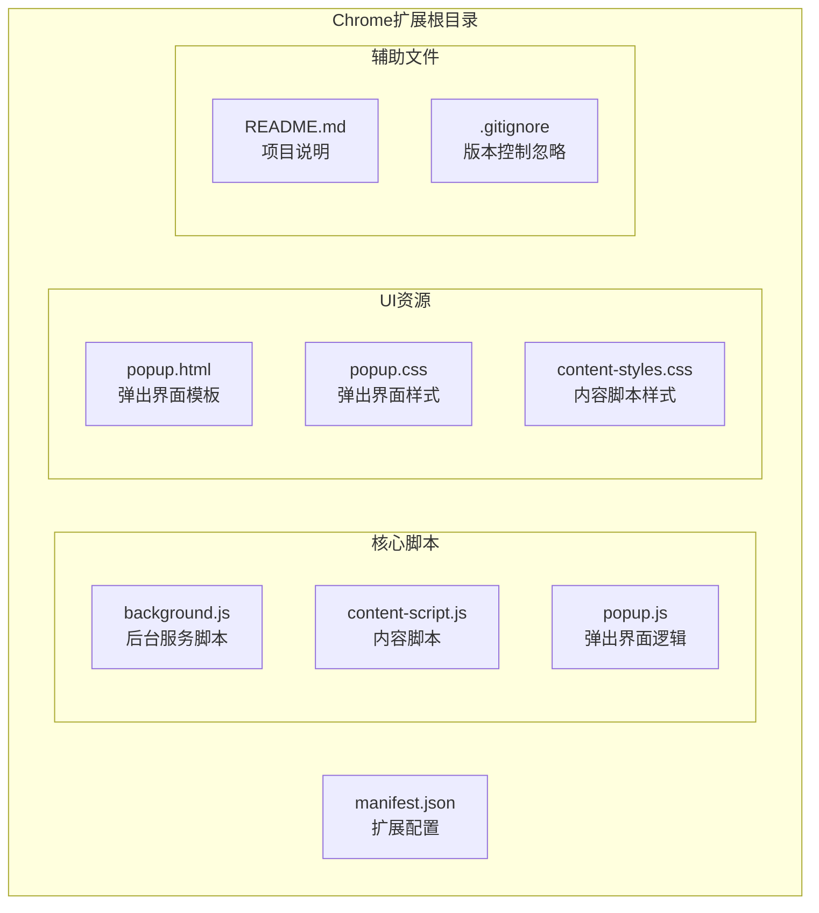

**图表来源**
- [manifest.json](file://manifest.json#L1-L32)
- [background.js](file://background.js#L1-L95)
- [content-script.js](file://content-script.js#L1-L868)
- [popup.js](file://popup.js#L1-L452)

**章节来源**
- [manifest.json](file://manifest.json#L1-L32)
- [README.md](file://README.md#L12-L50)

## 核心组件

### 组件职责概述

系统由四个核心组件构成，每个组件都有明确的职责分工：

1. **后台脚本 (Background Script)**: 处理AI翻译API调用，管理异步通信
2. **内容脚本 (Content Script)**: 在目标页面中执行翻译，处理用户交互
3. **弹出界面 (Popup)**: 提供用户配置和手动翻译功能
4. **样式系统**: 管理UI组件的视觉呈现

### 组件间通信机制

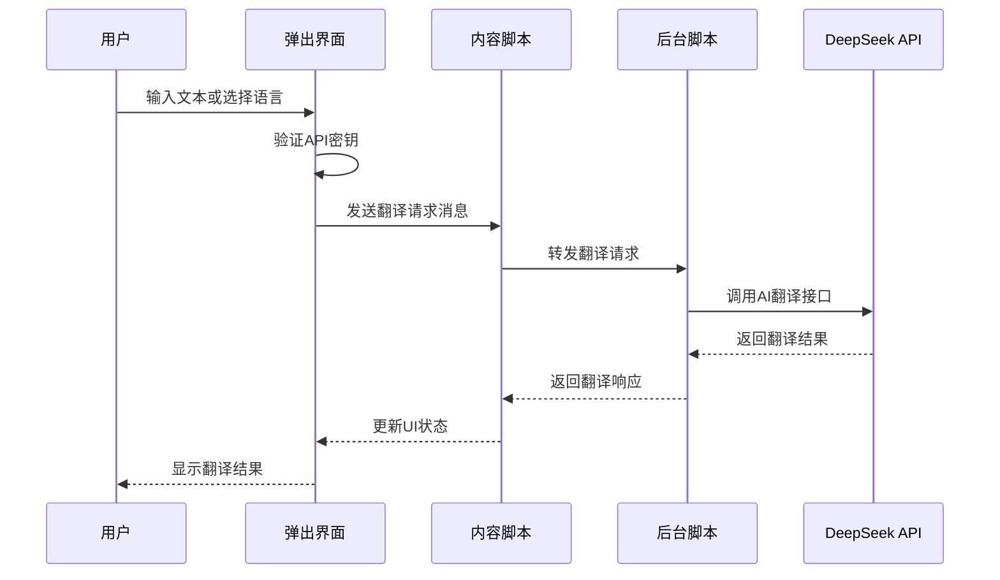

**图表来源**
- [popup.js](file://popup.js#L262-L341)
- [content-script.js](file://content-script.js#L565-L665)
- [background.js](file://background.js#L10-L55)

**章节来源**
- [popup.js](file://popup.js#L1-L452)
- [content-script.js](file://content-script.js#L1-L868)
- [background.js](file://background.js#L1-L95)

## 架构概览

### 整体架构设计

该系统采用分层架构模式，通过Chrome扩展的事件驱动机制实现组件间的松耦合通信：

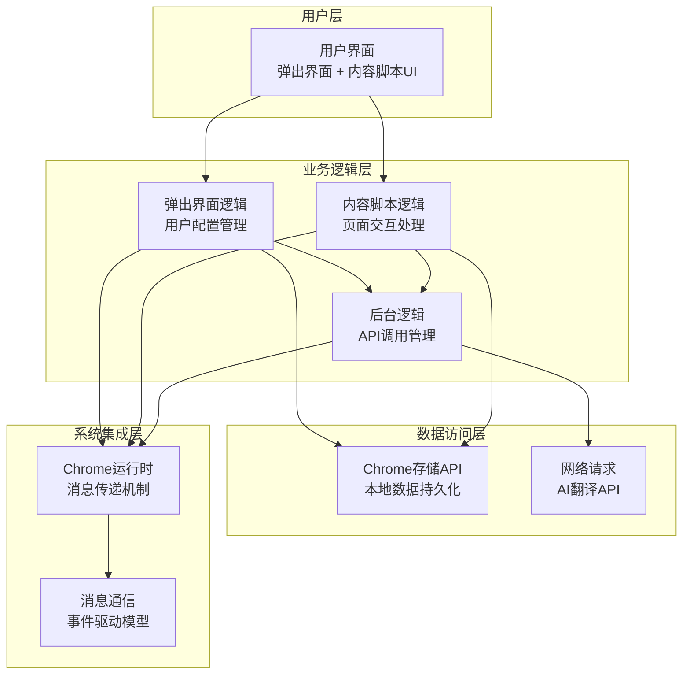

**图表来源**
- [manifest.json](file://manifest.json#L19-L30)
- [popup.js](file://popup.js#L34-L51)
- [content-script.js](file://content-script.js#L27-L83)

### 事件驱动模型

系统采用Chrome扩展的事件驱动架构，所有组件通过事件监听和消息传递实现解耦：

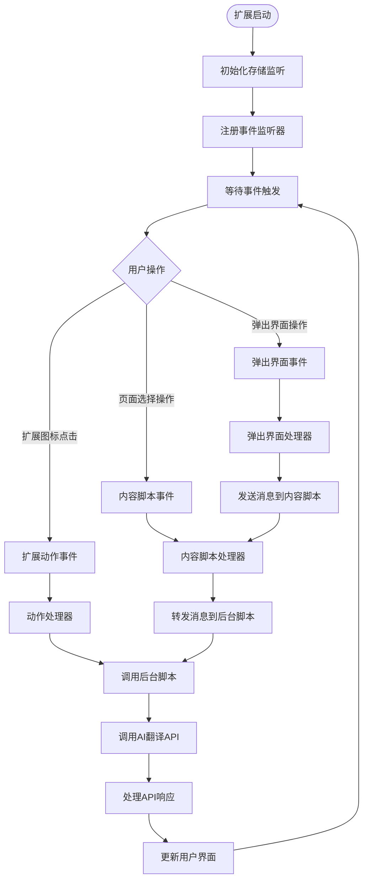

**图表来源**
- [background.js](file://background.js#L2-L7)
- [content-script.js](file://content-script.js#L565-L665)
- [popup.js](file://popup.js#L262-L341)

**章节来源**
- [manifest.json](file://manifest.json#L6-L30)
- [background.js](file://background.js#L1-L95)
- [content-script.js](file://content-script.js#L1-L868)
- [popup.js](file://popup.js#L1-L452)

## 详细组件分析

### 后台脚本 (Background Script)

后台脚本是系统的核心协调者，负责处理所有AI翻译API调用和异步通信。

#### 主要功能模块

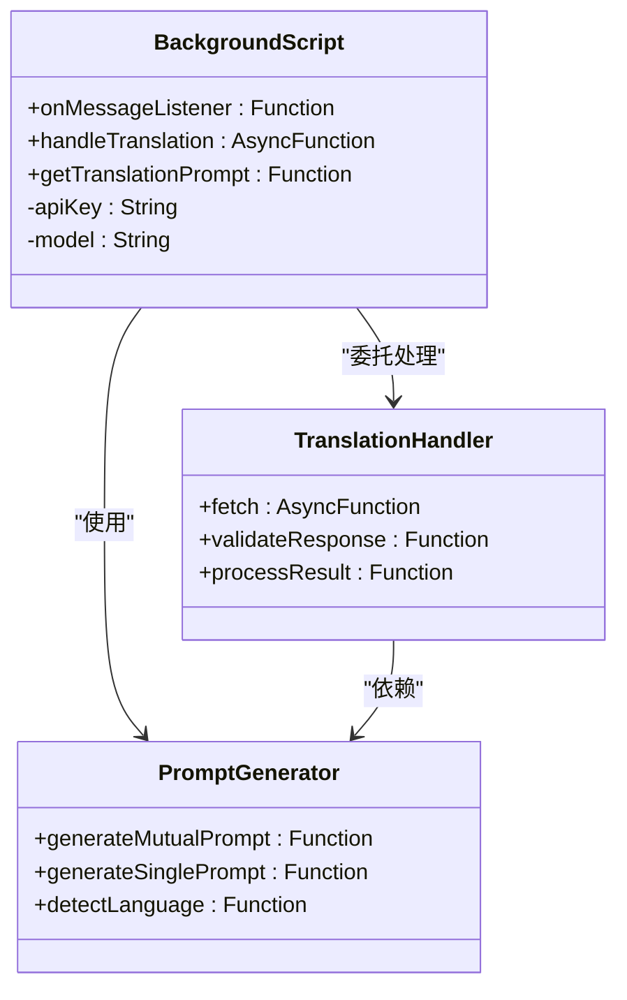

**图表来源**
- [background.js](file://background.js#L10-L55)
- [background.js](file://background.js#L58-L94)

#### 异步处理模式

后台脚本采用Promise链式调用和async/await语法处理异步操作：

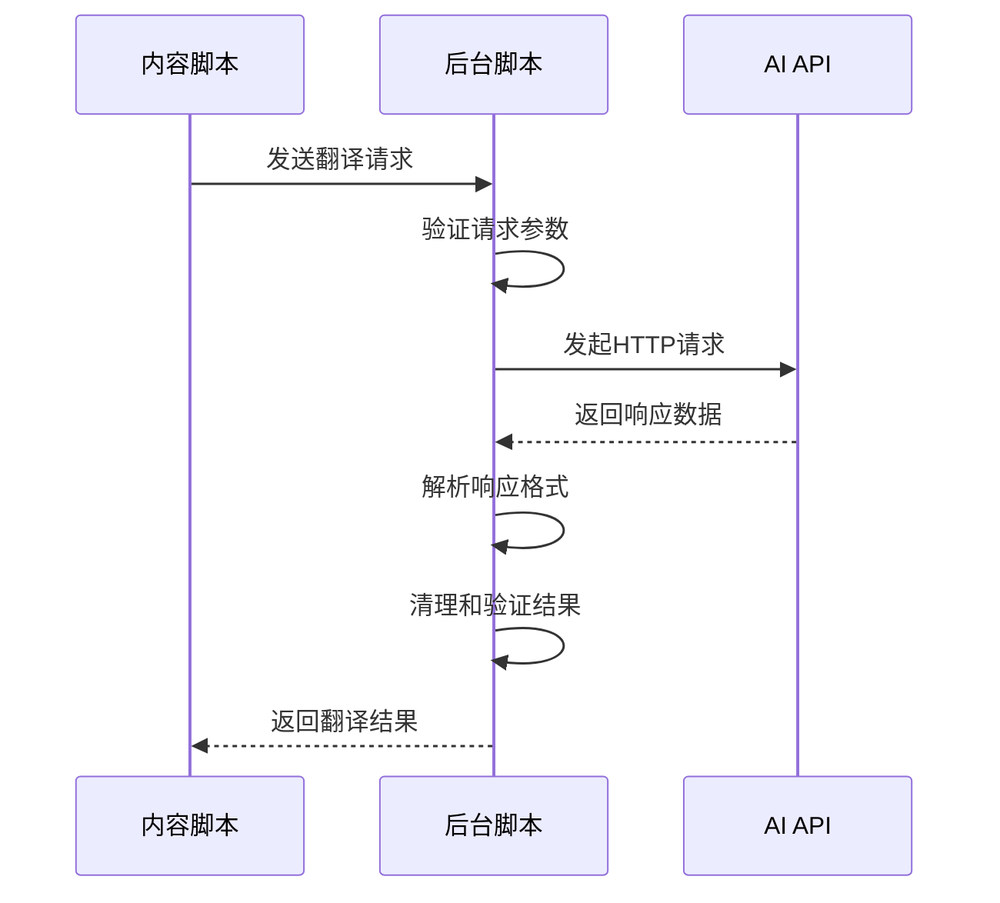

**图表来源**
- [background.js](file://background.js#L10-L55)

#### 错误处理策略

后台脚本实现了多层次的错误处理机制：

- **网络错误处理**: 捕获HTTP响应异常和网络超时
- **API错误处理**: 解析AI服务返回的错误信息
- **参数验证**: 确保请求参数的有效性
- **降级策略**: 提供友好的错误提示信息

**章节来源**
- [background.js](file://background.js#L1-L95)

### 内容脚本 (Content Script)

内容脚本在目标网页环境中运行，负责处理用户交互和页面翻译功能。

#### 核心交互模式

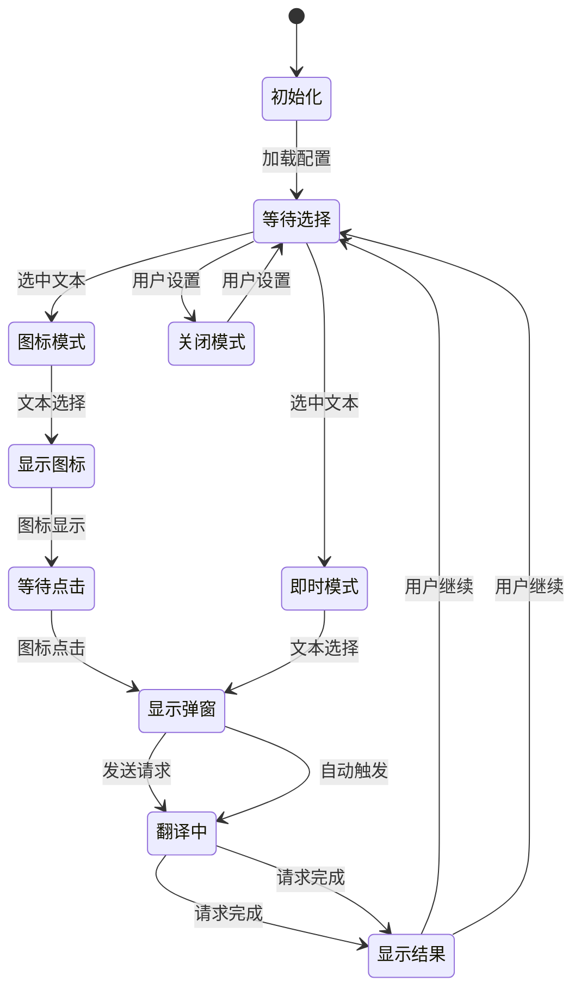

**图表来源**
- [content-script.js](file://content-script.js#L129-L190)
- [content-script.js](file://content-script.js#L426-L467)

#### 翻译流程管理

内容脚本实现了复杂的翻译流程控制：

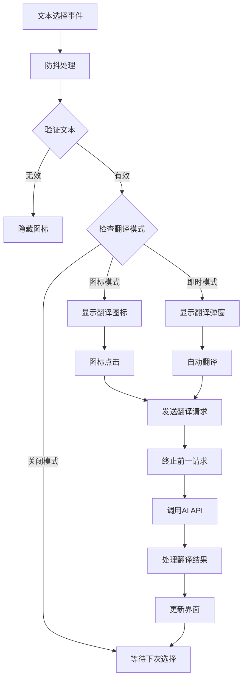

**图表来源**
- [content-script.js](file://content-script.js#L565-L665)
- [content-script.js](file://content-script.js#L690-L800)

#### 性能优化措施

内容脚本采用了多项性能优化策略：

- **请求终止**: 使用AbortController终止不必要的网络请求
- **防抖机制**: 防止频繁的文本选择触发重复翻译
- **内存管理**: 及时清理DOM元素和事件监听器
- **批量处理**: 对网页翻译实现分批处理以避免阻塞

**章节来源**
- [content-script.js](file://content-script.js#L1-L868)

### 弹出界面 (Popup)

弹出界面提供用户配置和手动翻译功能，是用户与扩展交互的主要入口。

#### 界面状态管理

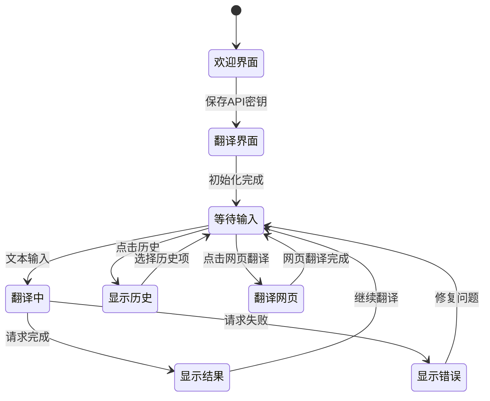

**图表来源**
- [popup.js](file://popup.js#L1-L452)
- [popup.html](file://popup.html#L11-L221)

#### 数据流处理

弹出界面实现了完整的数据流管理：

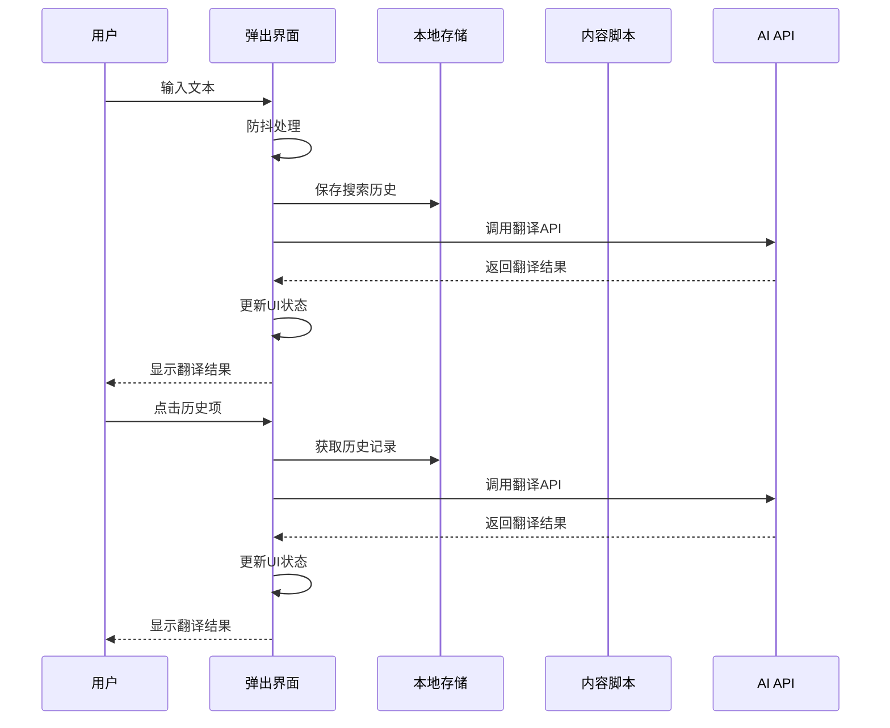

**图表来源**
- [popup.js](file://popup.js#L262-L341)
- [popup.js](file://popup.js#L387-L406)

**章节来源**
- [popup.js](file://popup.js#L1-L452)
- [popup.html](file://popup.html#L1-L226)

### 样式系统

样式系统分为两个独立的部分，分别服务于不同的组件：

#### 内容脚本样式

内容脚本样式专注于在目标页面中提供翻译功能的视觉效果：

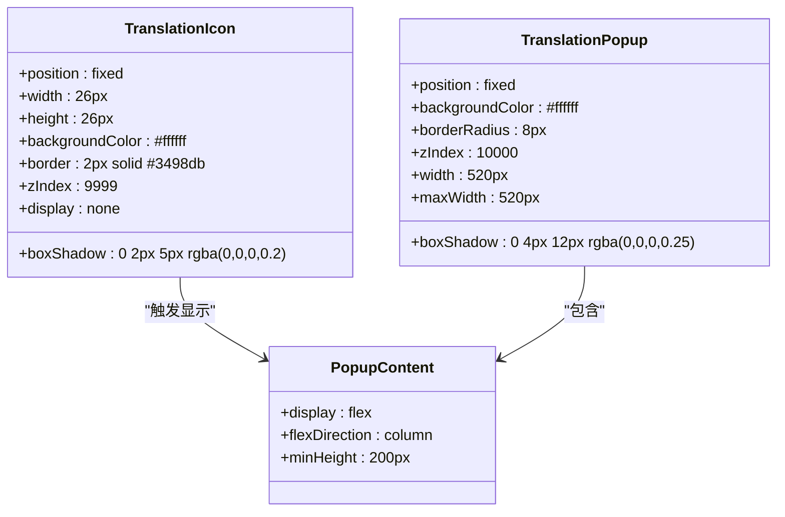

**图表来源**
- [content-styles.css](file://content-styles.css#L1-L196)

#### 弹出界面样式

弹出界面样式提供完整的用户交互体验：

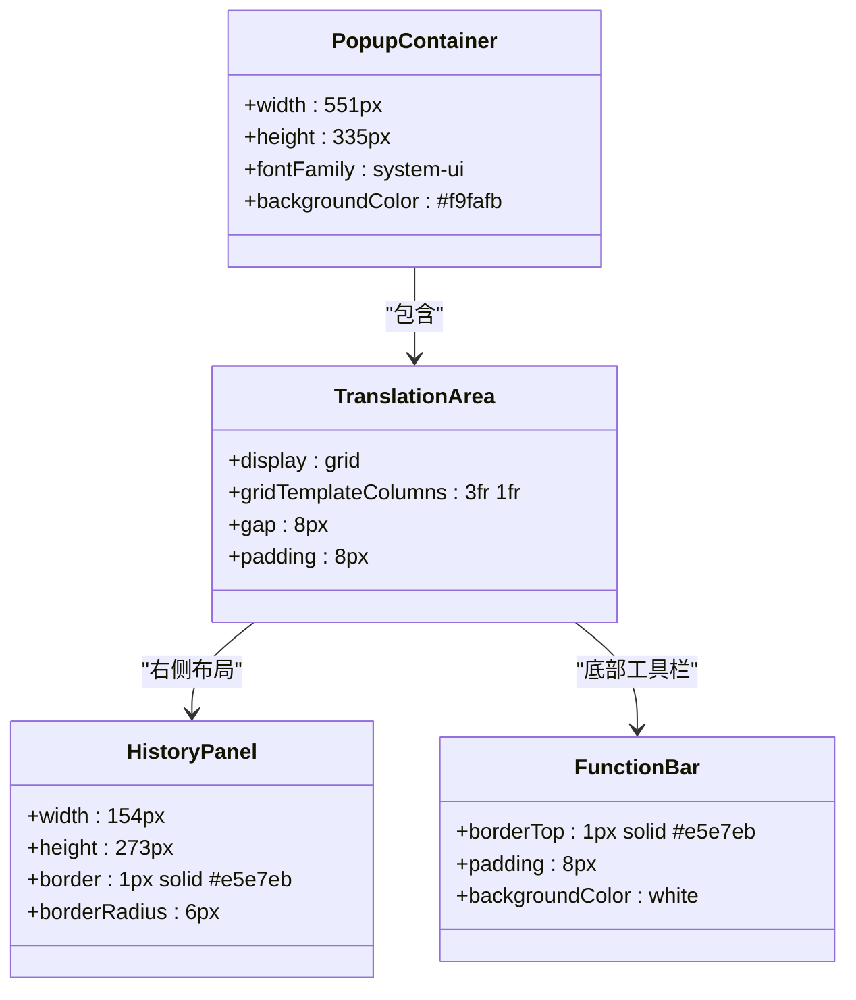

**图表来源**
- [popup.css](file://popup.css#L1-L349)

**章节来源**
- [content-styles.css](file://content-styles.css#L1-L196)
- [popup.css](file://popup.css#L1-L349)

## 依赖关系分析

### 组件依赖图

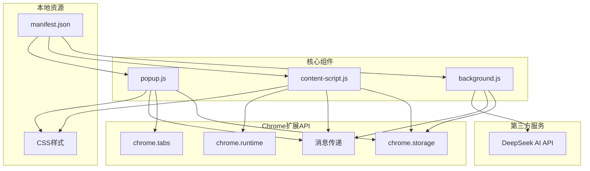

**图表来源**
- [manifest.json](file://manifest.json#L19-L30)
- [background.js](file://background.js#L1-L95)
- [content-script.js](file://content-script.js#L1-L868)
- [popup.js](file://popup.js#L1-L452)

### 数据依赖关系

系统中的数据流遵循严格的依赖关系：

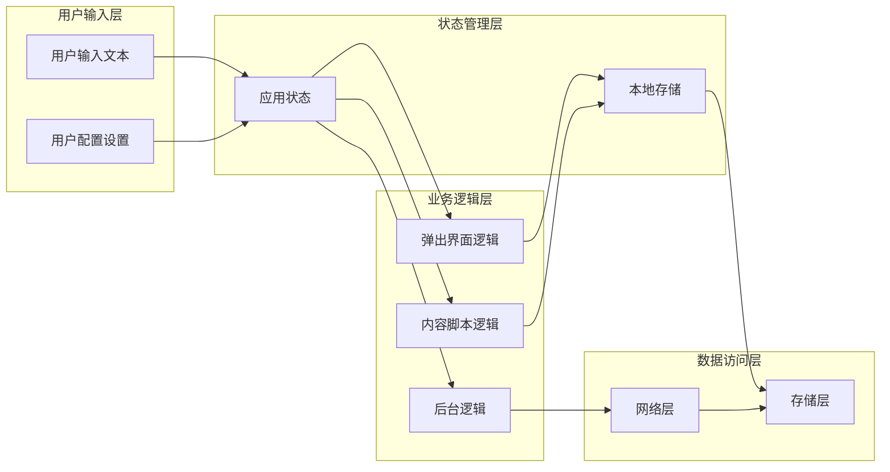

**图表来源**
- [popup.js](file://popup.js#L3-L29)
- [content-script.js](file://content-script.js#L8-L13)
- [background.js](file://background.js#L10-L55)

**章节来源**
- [manifest.json](file://manifest.json#L19-L30)
- [popup.js](file://popup.js#L1-L452)
- [content-script.js](file://content-script.js#L1-L868)
- [background.js](file://background.js#L1-L95)

## 性能考虑

### 异步处理优化

系统采用了多种异步处理优化策略：

1. **请求取消机制**: 使用AbortController确保不会同时进行多个翻译请求
2. **防抖处理**: 防止频繁的文本选择触发重复翻译
3. **批量处理**: 网页翻译采用分批处理避免长时间阻塞
4. **缓存策略**: 利用Chrome存储API减少重复的数据访问

### 内存管理

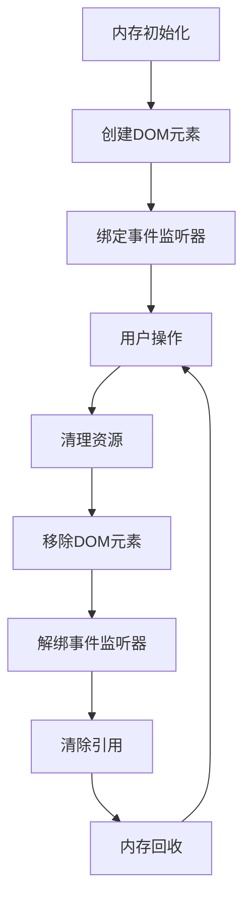

**图表来源**
- [content-script.js](file://content-script.js#L479-L489)
- [content-script.js](file://content-script.js#L667-L687)

### 网络优化

系统在网络层面实现了多项优化：

- **连接复用**: 复用HTTP连接减少建立连接的开销
- **请求合并**: 将多个小请求合并为批量请求
- **超时控制**: 设置合理的请求超时时间
- **重试机制**: 实现智能的失败重试策略

## 故障排除指南

### 常见问题诊断

#### API密钥相关问题

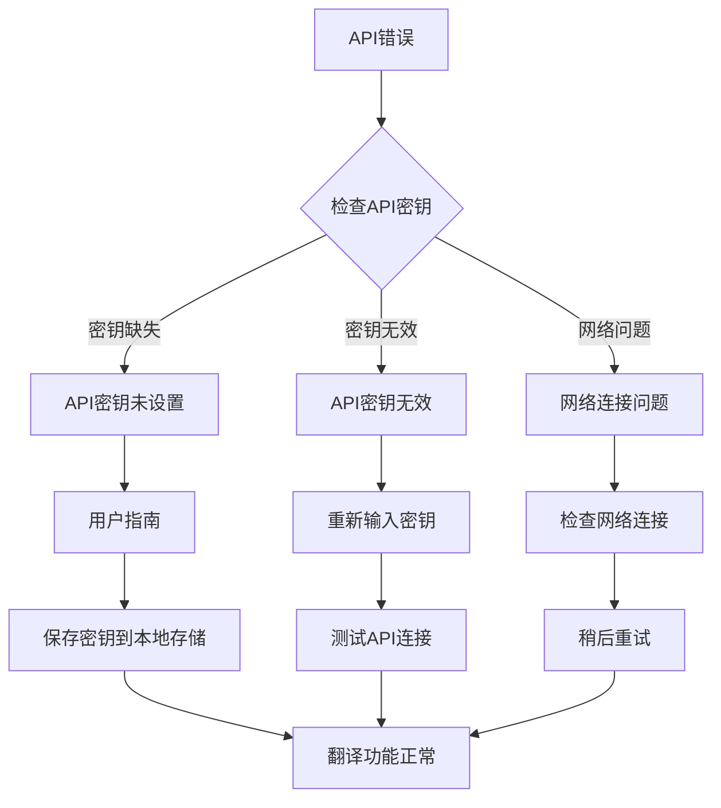

**图表来源**
- [popup.js](file://popup.js#L70-L87)
- [content-script.js](file://content-script.js#L567-L569)

#### 翻译功能异常

当翻译功能出现异常时，可以按照以下步骤排查：

1. **检查API密钥**: 确认密钥已正确保存并在有效期内
2. **验证网络连接**: 确保能够访问DeepSeek AI API
3. **查看浏览器控制台**: 检查JavaScript错误信息
4. **重启扩展**: 重新加载Chrome扩展以重置状态

#### 性能问题排查

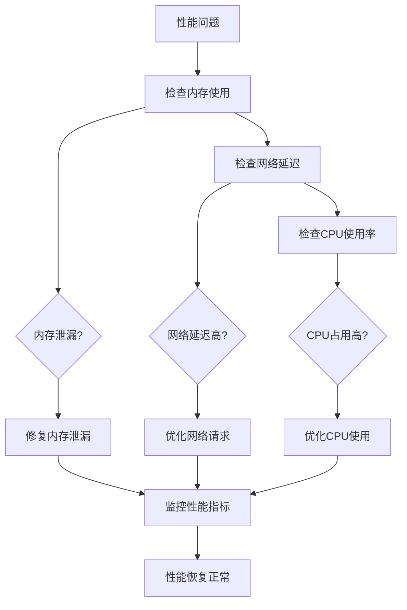

**图表来源**
- [content-script.js](file://content-script.js#L587-L589)
- [popup.js](file://popup.js#L276-L277)

**章节来源**
- [popup.js](file://popup.js#L1-L452)
- [content-script.js](file://content-script.js#L1-L868)
- [background.js](file://background.js#L1-L95)

## 结论

该AI翻译器Chrome扩展采用现代化的事件驱动架构，通过后台脚本、内容脚本和弹出界面的协同工作，实现了高效、可靠的文本翻译功能。系统的设计充分考虑了Chrome扩展的最佳实践，包括：

- **模块化设计**: 每个组件都有明确的职责分工
- **异步处理**: 采用Promise和async/await处理异步操作
- **错误处理**: 实现了多层次的错误处理和恢复机制
- **性能优化**: 通过防抖、请求取消和批量处理提升用户体验
- **安全性**: 严格遵守Chrome扩展的安全规范

该架构为后续的功能扩展和维护奠定了良好的基础，特别是在处理复杂的跨域通信和异步数据流方面展现了优秀的工程实践。