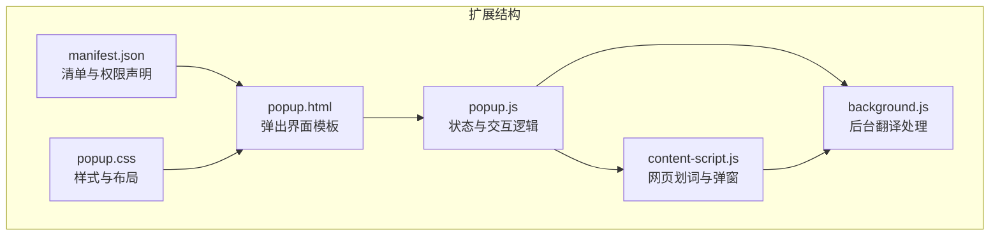
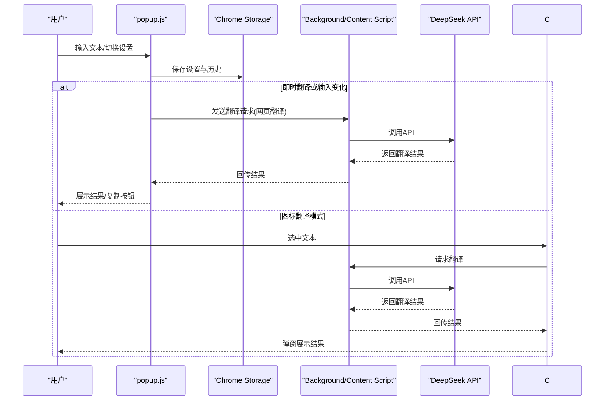
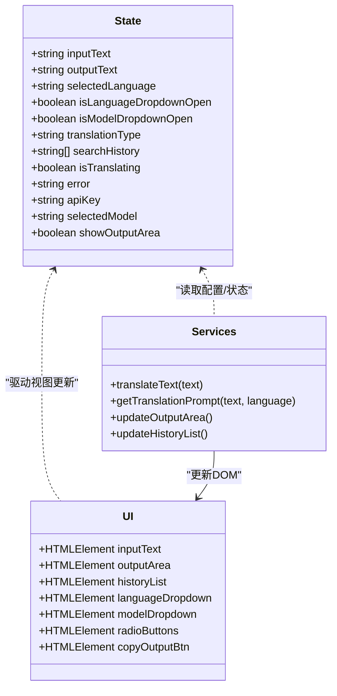
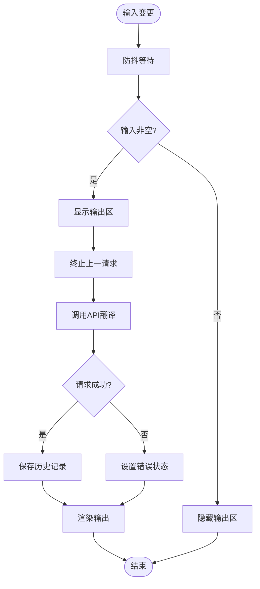
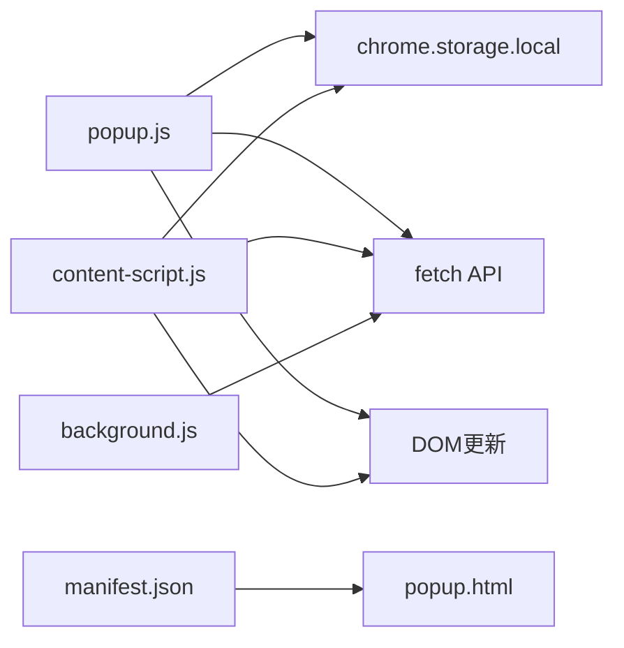

# 用户界面模块

<cite>
**本文引用的文件**
- [popup.html](file://popup.html)
- [popup.js](file://popup.js)
- [popup.css](file://popup.css)
- [manifest.json](file://manifest.json)
- [content-script.js](file://content-script.js)
- [background.js](file://background.js)
</cite>

## 目录
1. [简介](#简介)
2. [项目结构](#项目结构)
3. [核心组件](#核心组件)
4. [架构总览](#架构总览)
5. [详细组件分析](#详细组件分析)
6. [依赖关系分析](#依赖关系分析)
7. [性能考量](#性能考量)
8. [故障排查指南](#故障排查指南)
9. [结论](#结论)
10. [附录](#附录)

## 简介
本文件聚焦于AI翻译器的用户界面模块，系统性解析popup.html与popup.js如何协同工作，提供完整的用户交互体验。内容涵盖：
- 翻译输入处理与实时翻译
- 结果展示与复制功能
- 历史记录管理与持久化
- MVVM模式应用与数据绑定
- API密钥管理界面与设置持久化
- 翻译模式切换（图标翻译、立即翻译、关闭划词）
- 响应式布局、用户体验与可访问性
- 扩展与定制建议

## 项目结构
该扩展采用Manifest V3，UI由弹出页面popup.html承载，业务逻辑与状态管理集中在popup.js，样式由popup.css控制；同时配合content-script.js与background.js实现网页级翻译能力。

图表来源
- [popup.html](file://popup.html#L1-L226)
- [popup.js](file://popup.js#L1-L452)
- [popup.css](file://popup.css#L1-L349)
- [manifest.json](file://manifest.json#L1-L32)
- [content-script.js](file://content-script.js#L1-L868)
- [background.js](file://background.js#L1-L95)

章节来源
- [manifest.json](file://manifest.json#L1-L32)

## 核心组件
- 弹出界面容器与欢迎页：负责首次API密钥录入与引导。
- 翻译界面：包含输入区、输出区、历史面板、功能栏（语言选择、模型选择、翻译模式）。
- 状态机与数据流：集中于popup.js的状态对象，结合Chrome Storage实现设置持久化。
- 事件驱动：输入变更、下拉选择、复制按钮、历史项点击、网页翻译按钮等。
- 与内容脚本/后台通信：通过消息传递实现网页翻译与API调用。

章节来源
- [popup.html](file://popup.html#L10-L221)
- [popup.js](file://popup.js#L3-L29)

## 架构总览
弹出界面采用“视图-状态-行为”的组织方式：
- 视图层：popup.html定义DOM结构与类名。
- 状态层：popup.js维护state对象，包含输入文本、输出文本、所选语言、模型、翻译类型、历史记录、API密钥等。
- 行为层：事件监听器与异步函数处理用户交互与网络请求，并通过DOM更新与Chrome Storage同步状态。

图表来源
- [popup.js](file://popup.js#L262-L341)
- [content-script.js](file://content-script.js#L564-L665)
- [background.js](file://background.js#L10-L55)

## 详细组件分析

### 弹出界面结构与布局（popup.html）
- 欢迎屏：包含API密钥输入与保存按钮，提示本地存储与用途。
- 翻译界面：左侧输入区与输出区，右侧历史面板与“翻译此网页”按钮。
- 功能栏：语言下拉、模型下拉、翻译模式单选组（图标翻译、立即翻译、关闭划词）。

章节来源
- [popup.html](file://popup.html#L12-L221)

### 样式与响应式设计（popup.css）
- 容器与网格布局：使用CSS Grid与Flex实现三栏两列布局，适配固定尺寸窗口。
- 下拉菜单与滚动：下拉内容支持最大高度与垂直滚动，避免溢出。
- 加载动画与错误提示：加载态与错误态分别渲染不同内容。
- 复制按钮：绝对定位在输出区右下角，仅在有结果时显示。

章节来源
- [popup.css](file://popup.css#L1-L349)

### 状态管理与MVVM模式应用（popup.js）
- 状态对象：集中存放输入/输出文本、语言/模型选择、翻译类型、历史记录、API密钥、加载与错误状态等。
- 数据绑定策略：通过事件监听器更新state，再调用DOM更新函数统一刷新视图，形成“单向数据流”。
- 设置持久化：使用chrome.storage.local读取/写入selectedLanguage、translationType、searchHistory、DEEPSEEK_API_KEY、selectedModel等键值。

图表来源
- [popup.js](file://popup.js#L3-L29)
- [popup.js](file://popup.js#L89-L450)

章节来源
- [popup.js](file://popup.js#L3-L29)
- [popup.js](file://popup.js#L372-L385)

### 翻译输入处理与实时翻译
- 输入变更：监听textarea输入，使用防抖（约800ms）触发翻译，避免频繁请求。
- 输出区动态更新：根据isTranslating与error状态切换加载动画或错误信息；正常时显示翻译文本并显示复制按钮。
- 历史记录：去重并限制长度（最多20条），自动保存至Chrome Storage。

图表来源
- [popup.js](file://popup.js#L242-L259)
- [popup.js](file://popup.js#L262-L341)
- [popup.js](file://popup.js#L372-L385)

章节来源
- [popup.js](file://popup.js#L242-L341)

### 历史记录管理
- 渲染：遍历searchHistory生成历史项，支持点击恢复输入并触发翻译。
- 清空：清空后同步Storage并重新渲染。
- 存储：最多保留20条，重复项去重并保持最近优先。

章节来源
- [popup.js](file://popup.js#L387-L406)
- [popup.js](file://popup.js#L321-L328)

### API密钥管理界面
- 首次使用：欢迎屏要求输入密钥，保存至chrome.storage.local的DEEPSEEK_API_KEY键。
- 隐藏/显示：无密钥时显示欢迎屏；有密钥时切换到翻译界面并初始化。

章节来源
- [popup.js](file://popup.js#L60-L87)

### 翻译模式切换
- 图标翻译：选中文本后显示翻译图标，点击弹出翻译结果。
- 立即翻译：选中文本后立即弹出翻译结果。
- 关闭划词：禁用划词翻译功能。
- 模式持久化：通过chrome.storage.local保存translationType并在初始化时恢复。

章节来源
- [popup.js](file://popup.js#L187-L194)
- [content-script.js](file://content-script.js#L129-L190)

### 语言与模型选择
- 语言下拉：支持“英汉互译”“中日互译”及多语种；根据输入内容自动判断方向。
- 模型下拉：支持“deepseek-chat”“deepseek-reasoner”，切换后若输入区有内容会立即使用新模型翻译。
- 选择持久化：每次选择均写入Storage并触发必要翻译。

章节来源
- [popup.js](file://popup.js#L152-L185)
- [popup.js](file://popup.js#L344-L370)

### “翻译此网页”功能
- 通过chrome.tabs.sendMessage向content-script.js发送translatePage消息，携带当前语言、模型与API密钥。
- content-script.js遍历可见文本节点，批量请求翻译并替换节点文本，同时显示进度提示。

章节来源
- [popup.js](file://popup.js#L196-L225)
- [content-script.js](file://content-script.js#L689-L800)

### 复制功能与可访问性
- 输出区复制：点击复制按钮将输出文本写入剪贴板，并短暂提示“已复制”。
- 可访问性：按钮具备title提示；下拉菜单支持键盘导航；复制按钮具备明确的可点击语义。

章节来源
- [popup.js](file://popup.js#L227-L240)
- [popup.css](file://popup.css#L69-L89)

### 与内容脚本/后台的协作
- 内容脚本：负责网页划词、弹窗展示、TTS朗读、网页翻译（批量替换文本节点）。
- 后台脚本：接收消息后直接调用DeepSeek API，返回翻译结果给调用方。

章节来源
- [content-script.js](file://content-script.js#L564-L665)
- [background.js](file://background.js#L10-L55)

## 依赖关系分析
- popup.js依赖Chrome Storage进行设置持久化，依赖fetch调用API，依赖DOM进行视图更新。
- content-script.js依赖Chrome Storage读取设置，依赖fetch调用API，依赖DOM创建翻译图标与弹窗。
- background.js依赖fetch调用API，作为消息处理的后端服务。
- manifest.json声明权限与入口，确保popup.html被正确加载。

图表来源
- [popup.js](file://popup.js#L33-L51)
- [content-script.js](file://content-script.js#L30-L53)
- [background.js](file://background.js#L10-L55)
- [manifest.json](file://manifest.json#L6-L13)

章节来源
- [manifest.json](file://manifest.json#L19-L20)

## 性能考量
- 防抖优化：输入防抖减少API调用频率，提升响应速度与节省资源。
- 请求终止：使用AbortController终止过时请求，避免竞态与无效渲染。
- 历史记录截断：限制历史数量，降低存储压力。
- 网页翻译批处理：content-script.js按批次翻译文本节点，平衡吞吐与延迟。
- 样式与布局：固定尺寸与网格布局减少重排成本。

章节来源
- [popup.js](file://popup.js#L242-L259)
- [popup.js](file://popup.js#L275-L277)
- [content-script.js](file://content-script.js#L765-L793)

## 故障排查指南
- API密钥问题：确认DEEPSEEK_API_KEY已保存且格式正确；检查网络权限与host_permissions。
- 翻译无响应：检查isTranslating状态与AbortController是否被正确复位；查看错误状态与控制台日志。
- 历史记录异常：确认chrome.storage.local中searchHistory键存在且格式正确；检查去重与截断逻辑。
- 网页翻译失败：检查content-script.js对可见文本节点的过滤条件与批量翻译流程；关注进度提示与错误反馈。
- 下拉菜单无法关闭：确认handleDropdownOutsideClick事件未被输出区阻止冒泡；检查stopPropagation使用。

章节来源
- [popup.js](file://popup.js#L329-L340)
- [popup.js](file://popup.js#L430-L444)
- [content-script.js](file://content-script.js#L689-L800)

## 结论
该用户界面模块通过清晰的MVVM分层与事件驱动机制，实现了从API密钥管理、翻译输入处理、结果展示、历史记录到网页翻译的完整闭环。配合内容脚本与后台脚本，扩展在浏览器环境中提供了高效、稳定的翻译体验。建议后续可在无障碍与国际化方面进一步增强，并考虑引入更细粒度的错误边界与重试策略。

## 附录
- 扩展建议
  - 可访问性：为下拉菜单与按钮增加ARIA属性与键盘快捷键支持。
  - 国际化：将文案抽取为本地化资源，支持多语言。
  - 错误处理：细化错误分类与用户提示，增加重试与降级策略。
  - 主题与定制：提供浅色/深色主题选项与字体大小调节。
  - 性能：对历史列表进行虚拟滚动，对长文本翻译增加分片处理。