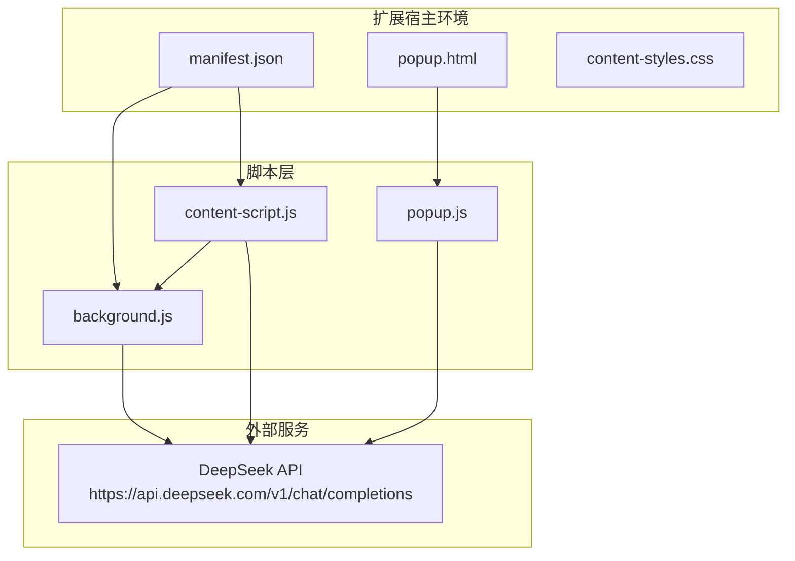
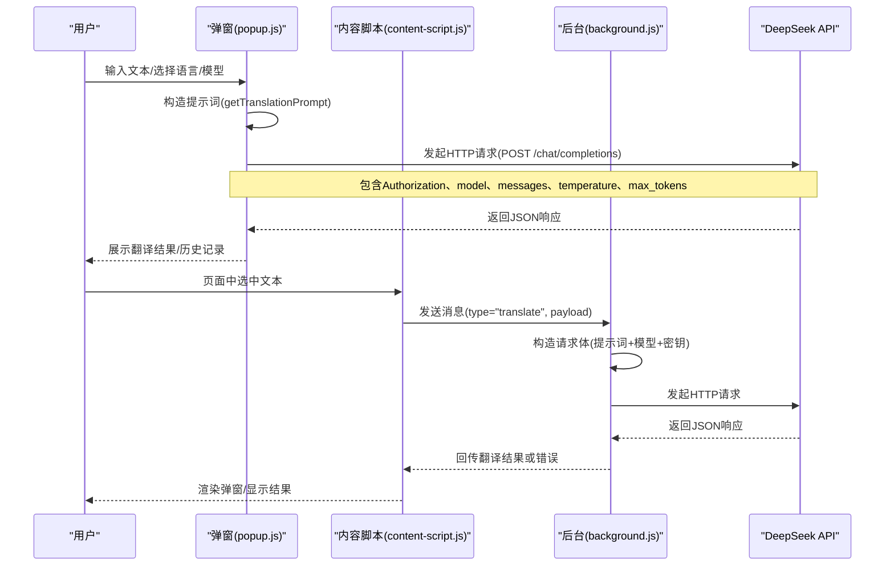
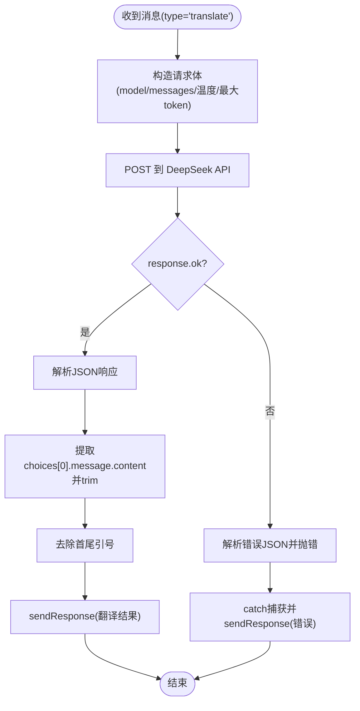
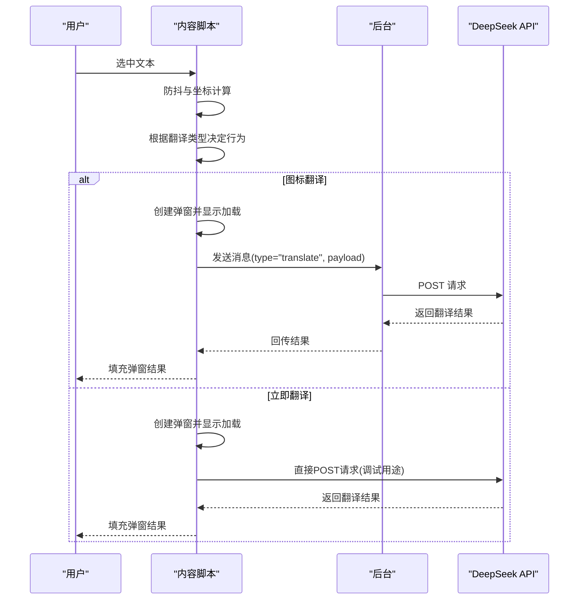
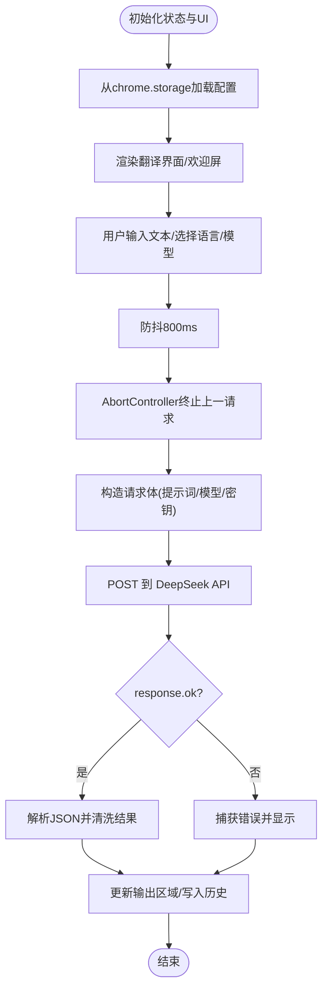
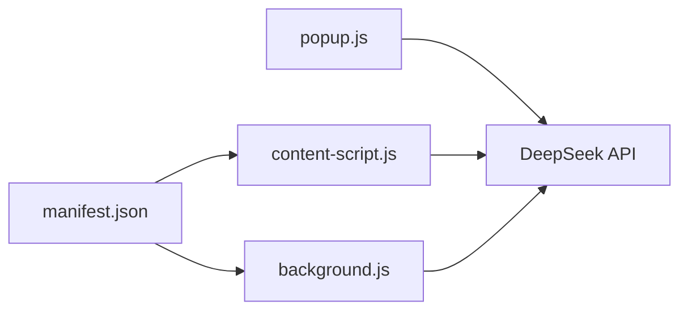

# 翻译引擎模块

<cite>
**本文引用的文件**
- [background.js](file://background.js)
- [content-script.js](file://content-script.js)
- [popup.js](file://popup.js)
- [manifest.json](file://manifest.json)
- [popup.html](file://popup.html)
- [content-styles.css](file://content-styles.css)
- [README.md](file://README.md)
</cite>

## 目录
1. [简介](#简介)
2. [项目结构](#项目结构)
3. [核心组件](#核心组件)
4. [架构总览](#架构总览)
5. [详细组件分析](#详细组件分析)
6. [依赖关系分析](#依赖关系分析)
7. [性能考量](#性能考量)
8. [故障排查指南](#故障排查指南)
9. [结论](#结论)
10. [附录](#附录)

## 简介
本文件聚焦于AI翻译器的翻译引擎模块，系统性梳理background.js中的翻译逻辑实现，包括DeepSeek API的HTTP请求处理、翻译提示词生成算法、错误处理与重试机制、异步处理模式与Promise链式调用、以及从用户输入到API响应的完整数据流。同时覆盖API密钥管理、请求参数构建、响应数据解析、性能优化建议与调试技巧，帮助开发者快速理解并维护该模块。

## 项目结构
该项目采用Chrome扩展的标准结构，核心翻译逻辑分布在后台脚本与内容脚本中：
- background.js：负责接收来自内容脚本的消息，向DeepSeek API发起HTTP请求，并将翻译结果回传给调用方。
- content-script.js：负责页面交互、文本选择、弹窗展示、翻译请求的发起与取消（AbortController）。
- popup.js：负责扩展弹窗界面的交互、API密钥管理、模型与语言配置、以及直接文本翻译。
- manifest.json：声明权限、主机权限、内容脚本与后台脚本。
- popup.html、content-styles.css：弹窗UI与样式。
- README.md：项目说明与使用指引。

图表来源
- [manifest.json](file://manifest.json#L1-L32)
- [background.js](file://background.js#L1-L95)
- [content-script.js](file://content-script.js#L1-L868)
- [popup.js](file://popup.js#L1-L452)

章节来源
- [manifest.json](file://manifest.json#L1-L32)
- [README.md](file://README.md#L1-L50)

## 核心组件
- 后台翻译处理器：监听来自内容脚本的消息，构造DeepSeek API请求，解析响应并回传翻译结果或错误信息。
- 内容脚本翻译器：负责页面交互、文本选择、弹窗渲染、翻译请求的发起与中断（AbortController），以及网页整体翻译流程。
- 弹窗翻译器：负责扩展弹窗界面、API密钥输入与持久化、模型与语言配置、直接文本翻译与历史记录。
- 提示词生成器：根据语言对与文本特征动态生成系统提示与用户提示，确保翻译方向正确。
- 错误处理与取消机制：统一的异常捕获、AbortError处理、错误消息回传与状态清理。

章节来源
- [background.js](file://background.js#L1-L95)
- [content-script.js](file://content-script.js#L1-L868)
- [popup.js](file://popup.js#L1-L452)

## 架构总览
翻译引擎采用“前端交互 + 后台处理”的分层设计：
- 用户在弹窗或页面中触发翻译请求。
- 弹窗或内容脚本将请求封装为消息，携带API密钥、模型、语言与待翻译文本。
- 后台脚本基于消息类型分派处理，向DeepSeek API发起HTTP请求。
- API返回JSON响应，后台脚本解析choices[0].message.content，清理多余引号后回传结果。
- 错误统一捕获并回传错误信息，支持AbortController中断请求。

图表来源
- [popup.js](file://popup.js#L262-L341)
- [content-script.js](file://content-script.js#L565-L665)
- [background.js](file://background.js#L10-L55)

## 详细组件分析

### 后台翻译处理器（background.js）
- 消息监听与路由
  - 监听来自内容脚本的消息，当type为“translate”时进入处理流程。
  - 返回true以支持异步响应。
- HTTP请求处理
  - 目标端点：https://api.deepseek.com/v1/chat/completions
  - 方法：POST
  - 请求头：Content-Type为application/json，Authorization为Bearer {apiKey}
  - 请求体：
    - model：来自请求payload
    - messages：
      - system：固定提示词，要求仅输出翻译文本
      - user：由getTranslationPrompt生成的提示词
    - temperature：0.1
    - max_tokens：1000
- 响应解析与清洗
  - 若response.ok为false，解析JSON错误并抛出错误
  - 正常响应：取choices[0].message.content，trim后去除首尾引号
  - 将cleanedText通过sendResponse回传
- 错误处理
  - try/catch捕获异常，记录控制台错误并回传错误消息
- 提示词生成
  - getTranslationPrompt(text, language)：
    - 英汉互译：根据正则判断英文/中文，生成相应方向的提示
    - 中日互译：根据是否包含中日汉字判断，生成相应方向的提示
    - 其他语言：根据映射表确定目标语言，生成直译提示

图表来源
- [background.js](file://background.js#L10-L55)
- [background.js](file://background.js#L58-L94)

章节来源
- [background.js](file://background.js#L1-L95)

### 内容脚本翻译器（content-script.js）
- 设置加载与持久化
  - 从chrome.storage.local加载翻译类型、语言、模型、API密钥
  - 监听storage变化，实时更新内存状态
- 文本选择与防抖
  - handleTextSelection：防抖300ms，过滤空文本，计算选区坐标
  - 根据翻译类型执行“立即翻译”或“图标翻译”
- 弹窗渲染与交互
  - showTranslationPopup：创建并插入翻译弹窗，显示原文与加载动画
  - 支持复制、TTS朗读、拖拽、关闭与终止请求
  - AbortController：每次新弹窗时终止上一请求，避免并发污染
- 翻译请求与取消
  - translateText：校验API密钥，生成提示词，构造请求体，发送fetch请求
  - 支持AbortController信号，捕获AbortError并静默处理
  - 解析响应，清洗结果，写入历史（非图标/立即翻译模式）
- 提示词生成
  - getTranslationPrompt：与后台一致的语言对判断与提示词拼装
- 网页翻译
  - translateWholePage：遍历可见文本节点，批量拼接为多段提示，分批请求翻译并替换节点文本
  - 进度提示与错误处理

图表来源
- [content-script.js](file://content-script.js#L129-L190)
- [content-script.js](file://content-script.js#L426-L467)
- [content-script.js](file://content-script.js#L565-L665)
- [background.js](file://background.js#L10-L55)

章节来源
- [content-script.js](file://content-script.js#L1-L868)

### 弹窗翻译器（popup.js）
- 初始化与状态管理
  - 从chrome.storage.local加载语言、翻译类型、模型、API密钥与历史
  - 根据是否存在API密钥决定显示欢迎屏或翻译界面
- 界面与交互
  - 语言与模型下拉、翻译类型单选、复制按钮、清空历史
  - 翻译网页按钮：查询当前标签页并发送消息到内容脚本
- 翻译流程
  - translateText：防抖800ms，AbortController终止上一请求
  - 构造请求体，调用DeepSeek API，解析响应，清洗结果
  - 更新输出区域状态（加载/错误/结果），写入历史
- 提示词生成
  - getTranslationPrompt：与后台一致的语言对判断与提示词拼装

图表来源
- [popup.js](file://popup.js#L1-L452)

章节来源
- [popup.js](file://popup.js#L1-L452)
- [popup.html](file://popup.html#L1-L226)

### 提示词生成算法（getTranslationPrompt）
- 英汉互译
  - 使用正则判断是否为英文字符，若为英文则生成“英→中”提示，否则“中→英”
- 中日互译
  - 使用Unicode范围判断是否包含中日汉字，生成相应方向提示
- 其他语言
  - 通过映射表确定目标语言，生成直译提示
- 设计要点
  - 动态判断输入语言，避免方向错误
  - 系统提示限定仅输出翻译文本，减少多余解释

章节来源
- [background.js](file://background.js#L58-L94)
- [content-script.js](file://content-script.js#L532-L562)
- [popup.js](file://popup.js#L344-L370)

### 错误处理与重试机制
- 错误处理
  - fetch响应非ok时解析错误JSON并抛出错误
  - 统一try/catch捕获异常，记录控制台日志并回传错误消息
  - AbortError静默处理，避免干扰用户体验
- 重试机制
  - 当前实现未内置自动重试逻辑
  - 建议：可在外层包装一层指数退避重试（如最多3次，延迟1s、2s、4s），并在网络错误或超时场景触发
- 请求取消
  - AbortController在弹窗创建、按钮点击、全局点击等场景主动终止上一请求，防止并发污染

章节来源
- [background.js](file://background.js#L39-L54)
- [content-script.js](file://content-script.js#L619-L664)
- [popup.js](file://popup.js#L308-L340)

### 异步处理模式与Promise链式调用
- Promise链
  - fetch返回Promise，使用await等待响应
  - 对响应进行ok判断与JSON解析，再进行数据提取与清洗
- 异步回调
  - runtime.onMessage监听消息，返回true以支持异步sendResponse
  - UI侧使用setTimeout实现防抖，避免频繁请求
- 并发控制
  - AbortController确保同一时间仅有一个活跃请求
  - 弹窗关闭或新建弹窗时及时终止旧请求

章节来源
- [background.js](file://background.js#L10-L55)
- [content-script.js](file://content-script.js#L129-L190)
- [popup.js](file://popup.js#L242-L259)

## 依赖关系分析
- 权限与主机权限
  - permissions：storage、activeTab、scripting
  - host_permissions：https://api.deepseek.com/*
- 脚本注入
  - content_scripts：匹配所有URL，注入content-script.js与content-styles.css
  - background：service_worker指向background.js
- 数据流
  - 弹窗(popup.js) ↔ 内容脚本(content-script.js) ↔ 后台(background.js) ↔ DeepSeek API

图表来源
- [manifest.json](file://manifest.json#L19-L31)

章节来源
- [manifest.json](file://manifest.json#L1-L32)

## 性能考量
- 请求频率控制
  - 弹窗与输入均采用防抖（300ms/800ms），减少无效请求
- 并发与取消
  - AbortController确保同一时刻仅有一个活跃请求，避免资源浪费
- 网页翻译批处理
  - content-script.js对可见文本节点进行分批处理，降低单次请求负载
- 响应解析优化
  - 仅解析必要字段choices[0].message.content，减少不必要的数据处理
- UI渲染节流
  - 加载状态与错误状态通过innerHTML切换，避免频繁DOM操作

[本节为通用性能建议，无需特定文件来源]

## 故障排查指南
- API密钥问题
  - 弹窗与内容脚本均会检查API密钥是否存在，若缺失则返回明确错误提示
  - 建议：在弹窗中重新保存密钥并确认已生效
- 网络与超时
  - 若响应非ok，解析错误JSON并抛出错误；建议检查网络连通性与API配额
- 请求被中断
  - AbortError不会显示错误，属正常行为；可通过重新触发翻译验证
- 提示词方向错误
  - 检查getTranslationPrompt的语言对判断逻辑，确认输入文本的语言特征
- 弹窗无法关闭或重复弹窗
  - 检查handleGlobalClick与shouldSuppressSelection逻辑，确保点击区域判断正确

章节来源
- [content-script.js](file://content-script.js#L565-L665)
- [popup.js](file://popup.js#L262-L341)
- [background.js](file://background.js#L39-L54)

## 结论
翻译引擎模块通过清晰的职责划分与稳健的异步处理，实现了从用户输入到API响应的完整链路。后台脚本专注于HTTP请求与响应解析，内容脚本负责页面交互与请求控制，弹窗脚本提供便捷的配置与直接翻译能力。建议后续增强自动重试与更细粒度的错误分类，以进一步提升稳定性与用户体验。

[本节为总结性内容，无需特定文件来源]

## 附录
- API端点与请求参数
  - 端点：https://api.deepseek.com/v1/chat/completions
  - 方法：POST
  - 请求头：Content-Type: application/json, Authorization: Bearer {apiKey}
  - 请求体字段：model、messages（system+user）、temperature、max_tokens
- 响应解析
  - 成功：取choices[0].message.content，trim并去除首尾引号
  - 失败：解析错误JSON，回传错误消息
- UI与样式
  - 弹窗样式由content-styles.css定义，包含图标、复制、关闭、TTS等功能按钮的视觉与交互

章节来源
- [background.js](file://background.js#L12-L37)
- [content-script.js](file://content-script.js#L591-L617)
- [popup.js](file://popup.js#L280-L306)
- [content-styles.css](file://content-styles.css#L1-L196)