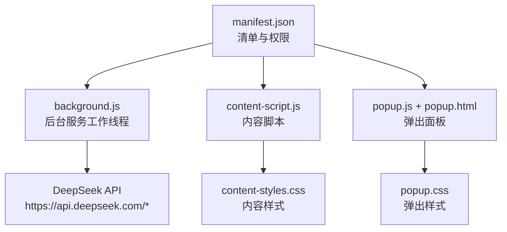
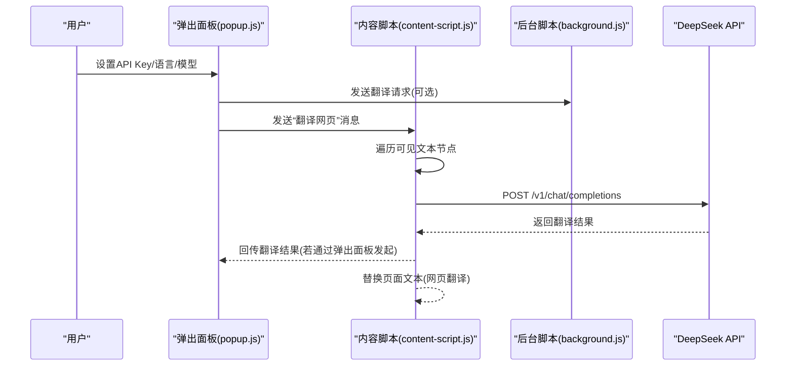
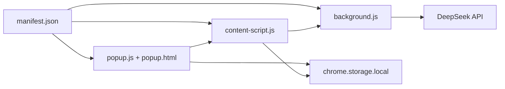

# 配置管理模块

<cite>
**本文引用的文件**
- [manifest.json](file://manifest.json)
- [background.js](file://background.js)
- [content-script.js](file://content-script.js)
- [popup.js](file://popup.js)
- [popup.html](file://popup.html)
- [content-styles.css](file://content-styles.css)
- [popup.css](file://popup.css)
- [README.md](file://README.md)
</cite>

## 目录
1. [简介](#简介)
2. [项目结构](#项目结构)
3. [核心组件](#核心组件)
4. [架构总览](#架构总览)
5. [详细组件分析](#详细组件分析)
6. [依赖关系分析](#依赖关系分析)
7. [性能考量](#性能考量)
8. [故障排查指南](#故障排查指南)
9. [结论](#结论)
10. [附录](#附录)

## 简介
本文件聚焦于AI翻译器的配置管理模块，系统性解析Manifest V3配置文件的结构与字段作用，覆盖扩展元数据、权限声明、脚本加载策略、后台脚本的service worker配置，以及DeepSeek API主机权限设置。同时结合实际代码实现，说明content_scripts匹配规则、权限模型（storage、activeTab、scripting）的安全考量，并给出基于功能需求的权限与脚本加载最佳实践与安全建议。

## 项目结构
该扩展采用典型的Manifest V3布局：
- manifest.json：扩展清单，定义元数据、权限、脚本加载、后台服务工作线程等
- background.js：后台脚本（service worker），负责与DeepSeek API通信、消息路由
- content-script.js：内容脚本，注入页面UI、处理选中文本、发起翻译请求
- popup.js + popup.html：弹出面板逻辑与界面，提供API Key输入、翻译历史、网页翻译等功能
- content-styles.css + popup.css：样式资源
- README.md：项目说明与使用指南

图表来源
- [manifest.json](file://manifest.json#L1-L32)
- [background.js](file://background.js#L1-L95)
- [content-script.js](file://content-script.js#L1-L868)
- [popup.js](file://popup.js#L1-L452)
- [popup.html](file://popup.html#L1-L226)
- [content-styles.css](file://content-styles.css#L1-L196)
- [popup.css](file://popup.css#L1-L349)

章节来源
- [manifest.json](file://manifest.json#L1-L32)
- [README.md](file://README.md#L1-L50)

## 核心组件
- 清单与权限
  - manifest_version：V3
  - 元数据：name、version、description、icons、action（默认弹窗与图标）
  - 权限：storage、activeTab、scripting
  - 主机权限：https://api.deepseek.com/*
  - content_scripts：匹配所有URL，注入content-script.js与content-styles.css
  - background：service_worker指向background.js
- 后台脚本（background.js）
  - 监听来自内容脚本的消息，转发至DeepSeek API，处理响应并回传
  - 提供翻译提示词构造逻辑
- 内容脚本（content-script.js）
  - 注入翻译图标与弹窗UI，处理选中文本，支持即时翻译与图标翻译两种模式
  - 支持网页整体翻译（批量提取可见文本节点，分批请求翻译并替换）
  - 与Chrome存储交互，持久化用户设置
- 弹出面板（popup.js + popup.html）
  - 输入API Key、选择语言/模型、切换翻译模式、查看翻译历史、网页翻译
  - 与后台脚本交互，实现跨标签页消息传递

章节来源
- [manifest.json](file://manifest.json#L1-L32)
- [background.js](file://background.js#L1-L95)
- [content-script.js](file://content-script.js#L1-L868)
- [popup.js](file://popup.js#L1-L452)
- [popup.html](file://popup.html#L1-L226)

## 架构总览
从配置到功能的端到端流程如下：
- 用户在弹出面板设置API Key与偏好
- 内容脚本监听选中文本，按模式生成翻译提示词
- 内容脚本可直接向DeepSeek API发起请求（调试用途），或通过后台脚本转发
- 后台脚本统一处理网络请求与错误，将结果回传给内容脚本或弹出面板
- 网页翻译场景中，弹出面板通过消息发送到当前活动标签页的内容脚本，由其遍历可见文本节点并批量替换

图表来源
- [popup.js](file://popup.js#L196-L225)
- [content-script.js](file://content-script.js#L700-L800)
- [background.js](file://background.js#L10-L55)

## 详细组件分析

### Manifest V3配置文件详解
- 清单版本与元数据
  - manifest_version：V3，启用现代扩展模型
  - name/version/description：扩展名称、版本与描述
  - icons：扩展图标资源路径
  - action：默认弹窗与图标尺寸映射
- 权限声明
  - storage：读写本地存储，用于持久化用户设置与翻译历史
  - activeTab：访问当前活动标签页信息，用于网页翻译场景的消息传递
  - scripting：允许动态注入脚本与执行脚本（Manifest V3中通常用于高级注入能力）
- 主机权限
  - host_permissions：仅授权访问DeepSeek API域，降低攻击面
- 脚本加载
  - content_scripts：匹配所有URL，注入content-script.js与content-styles.css
- 后台脚本
  - background.service_worker：指向background.js，作为service worker运行

章节来源
- [manifest.json](file://manifest.json#L1-L32)

### 权限模型与安全考量
- storage权限
  - 用途：读取/写入chrome.storage.local，保存API Key、语言/模型选择、翻译历史等
  - 安全建议：仅存储必要数据；避免在代码中硬编码敏感信息；使用最小权限原则
- activeTab权限
  - 用途：获取当前标签页信息，用于向当前页面发送消息（如网页翻译）
  - 安全建议：仅在需要时访问活动标签页；避免滥用以减少潜在风险
- scripting权限
  - 用途：在受控环境下进行脚本注入与执行（Manifest V3中更严格）
  - 安全建议：谨慎使用；确保注入逻辑可控且经过审查

章节来源
- [manifest.json](file://manifest.json#L19-L19)
- [content-script.js](file://content-script.js#L30-L68)
- [popup.js](file://popup.js#L203-L224)

### content_scripts匹配规则与注入策略
- 匹配规则
  - matches：<all_urls>，意味着在所有页面加载时都会注入
- 注入策略
  - js：content-script.js
  - css：content-styles.css
- 实际行为
  - 内容脚本在页面加载时初始化，创建翻译图标与弹窗UI，监听选中文本事件
  - 支持即时翻译与图标翻译两种模式，均通过消息或直接API请求实现

章节来源
- [manifest.json](file://manifest.json#L21-L27)
- [content-script.js](file://content-script.js#L27-L83)
- [content-styles.css](file://content-styles.css#L1-L196)

### 后台脚本service worker配置与职责
- 配置
  - background.service_worker：指向background.js
- 职责
  - 监听来自内容脚本的消息，转发至DeepSeek API
  - 统一处理网络请求与错误，回传翻译结果
  - 提供翻译提示词构造逻辑

章节来源
- [manifest.json](file://manifest.json#L28-L30)
- [background.js](file://background.js#L1-L95)

### DeepSeek API主机权限设置
- 主机权限
  - host_permissions：https://api.deepseek.com/*
- 实践要点
  - 仅授予必要域名，避免过度授权
  - 在代码中明确使用该域名进行请求，便于审计与维护

章节来源
- [manifest.json](file://manifest.json#L20-L20)
- [background.js](file://background.js#L12-L37)
- [content-script.js](file://content-script.js#L591-L617)
- [popup.js](file://popup.js#L280-L306)

### 弹出面板与内容脚本的交互
- 弹出面板
  - 输入API Key、选择语言/模型、切换翻译模式、查看翻译历史、网页翻译
  - 通过chrome.storage.local持久化设置
- 内容脚本
  - 加载设置、监听存储变化、注入UI、处理选中文本
  - 支持网页翻译：遍历可见文本节点，分批请求翻译并替换

章节来源
- [popup.js](file://popup.js#L1-L452)
- [popup.html](file://popup.html#L1-L226)
- [content-script.js](file://content-script.js#L1-L868)

## 依赖关系分析
- 清单对各模块的依赖
  - manifest.json声明了权限、主机权限、content_scripts与background.service_worker
- 模块间耦合
  - content-script.js与popup.js通过chrome.storage.local进行状态同步
  - popup.js与content-script.js通过消息传递实现网页翻译
  - background.js与content-script.js通过消息传递实现翻译请求转发
- 外部依赖
  - DeepSeek API：仅访问https://api.deepseek.com/*

图表来源
- [manifest.json](file://manifest.json#L1-L32)
- [content-script.js](file://content-script.js#L1-L868)
- [popup.js](file://popup.js#L1-L452)
- [background.js](file://background.js#L1-L95)

章节来源
- [manifest.json](file://manifest.json#L1-L32)
- [content-script.js](file://content-script.js#L1-L868)
- [popup.js](file://popup.js#L1-L452)
- [background.js](file://background.js#L1-L95)

## 性能考量
- content_scripts匹配范围
  - 使用<all_urls>会增加注入成本，建议在生产环境中根据实际需要缩小匹配范围，仅对目标站点生效
- 网页翻译的批处理
  - content-script.js对可见文本节点进行分批翻译，batchSize控制并发与内存占用
- 存储访问
  - 频繁读写chrome.storage.local可能带来I/O开销，建议合并更新与去重
- 网络请求
  - 统一通过后台脚本或内容脚本直接请求API，注意超时与重试策略，避免阻塞UI

章节来源
- [manifest.json](file://manifest.json#L23-L23)
- [content-script.js](file://content-script.js#L765-L793)
- [popup.js](file://popup.js#L320-L340)

## 故障排查指南
- API Key未设置
  - 现象：内容脚本直接请求API时返回错误
  - 处理：在弹出面板输入并保存API Key，确保chrome.storage.local中存在对应键值
- 网页翻译失败
  - 现象：弹出面板提示失败
  - 处理：检查当前活动标签页是否存在、消息发送是否成功、API响应状态
- 选中文本无反应
  - 现象：选中文本后未出现翻译图标或弹窗
  - 处理：确认content-script.js已注入、翻译模式设置正确、未被抑制
- 网络请求异常
  - 现象：API错误或超时
  - 处理：检查host_permissions是否正确、网络连通性、API密钥有效性

章节来源
- [content-script.js](file://content-script.js#L567-L569)
- [popup.js](file://popup.js#L198-L224)
- [background.js](file://background.js#L39-L44)

## 结论
本配置管理模块以Manifest V3为核心，通过精简的权限声明与明确的主机权限，实现了内容脚本与后台脚本的协同工作。content_scripts的注入策略与后台脚本的消息转发机制，使得扩展具备良好的可维护性与安全性。建议在生产环境中进一步收紧content_scripts匹配范围与权限，以降低不必要的暴露面。

## 附录

### 最佳实践与安全建议
- 权限最小化
  - 仅授予storage、activeTab、scripting所需范围内的权限
  - 主机权限限定为https://api.deepseek.com/*
- 内容脚本注入
  - 评估是否需要对所有URL注入；如仅针对特定站点，建议使用更精确的匹配规则
- 网络安全
  - 通过后台脚本统一处理API请求，避免在内容脚本中泄露API Key
  - 对API响应进行严格校验与错误处理
- 用户隐私
  - 仅在必要时访问活动标签页；避免收集无关数据
- 版本升级
  - 保持manifest_version为V3，遵循Chrome扩展最新规范

章节来源
- [manifest.json](file://manifest.json#L19-L20)
- [background.js](file://background.js#L1-L95)
- [content-script.js](file://content-script.js#L591-L617)