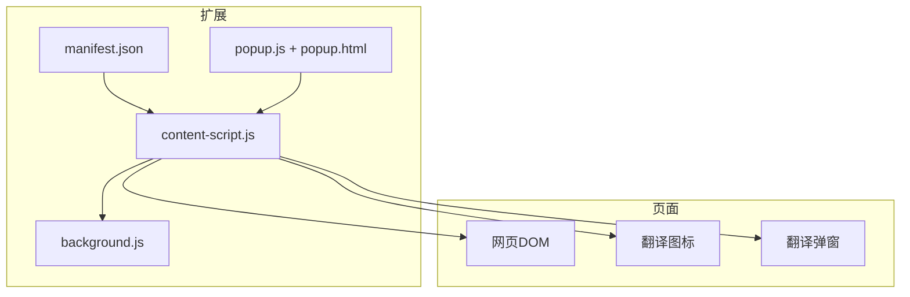
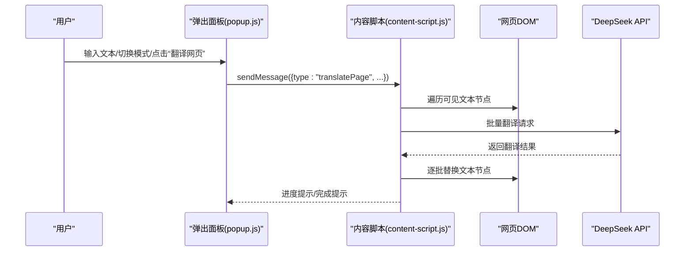
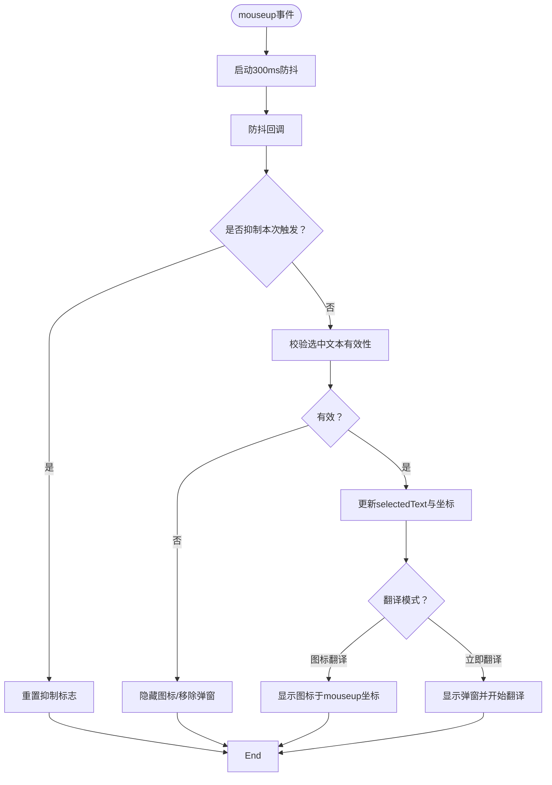
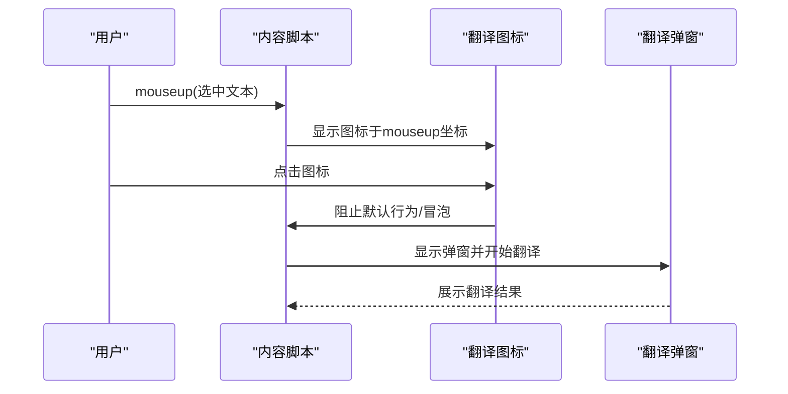
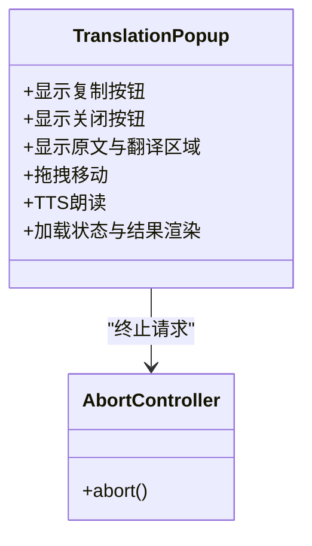
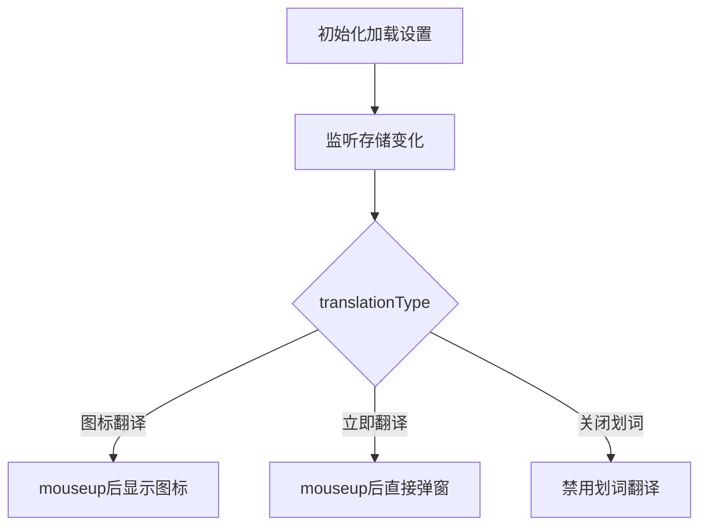
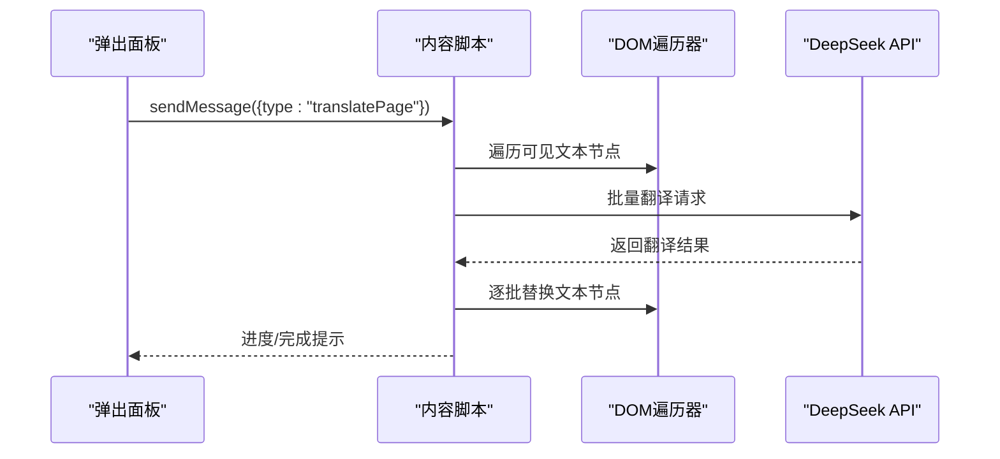
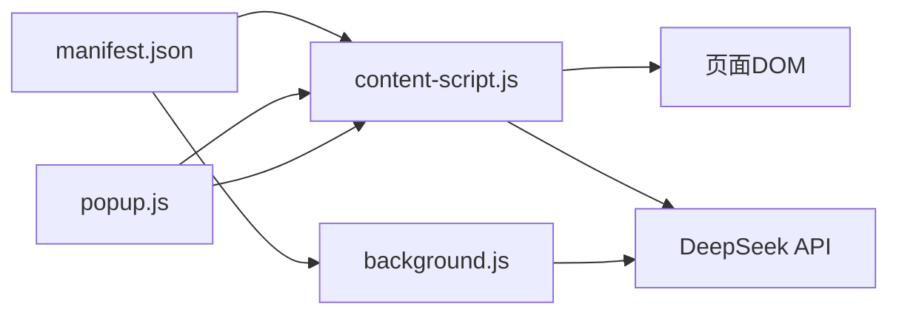

# 页面集成模块

<cite>
**本文引用的文件**
- [content-script.js](file://content-script.js)
- [manifest.json](file://manifest.json)
- [background.js](file://background.js)
- [popup.js](file://popup.js)
- [popup.html](file://popup.html)
- [content-styles.css](file://content-styles.css)
- [popup.css](file://popup.css)
- [README.md](file://README.md)
</cite>

## 目录
1. [简介](#简介)
2. [项目结构](#项目结构)
3. [核心组件](#核心组件)
4. [架构总览](#架构总览)
5. [详细组件分析](#详细组件分析)
6. [依赖关系分析](#依赖关系分析)
7. [性能考量](#性能考量)
8. [故障排查指南](#故障排查指南)
9. [结论](#结论)
10. [附录](#附录)

## 简介
本文件面向AI翻译器的页面集成模块，系统性阐述content-script.js如何与网页内容交互，覆盖文本选择监听机制、翻译图标显示逻辑、翻译弹窗创建与管理、DOM操作策略、事件处理机制、与页面元素的协调方式。同时，文档深入解析翻译模式（图标翻译、即时翻译、关闭划词）的实现原理与切换逻辑，并讨论跨域脚本注入的安全考虑与最佳实践，最后提供调试方法与性能优化建议。

## 项目结构
该扩展采用Manifest V3，核心文件如下：
- manifest.json：声明权限、匹配规则、内容脚本注入策略与后台服务工作线程
- content-script.js：页面侧内容脚本，负责文本选择监听、图标与弹窗管理、翻译请求与网页整页翻译
- background.js：后台服务脚本，处理异步翻译请求（可选，当前内容脚本直接调用API）
- popup.js/popup.html：弹出面板UI与交互逻辑，提供API Key配置、翻译模式切换、历史记录、网页翻译入口
- content-styles.css/popup.css：样式定义，确保图标与弹窗在页面中的视觉一致性与层级控制

图表来源
- [manifest.json](file://manifest.json#L19-L27)
- [content-script.js](file://content-script.js#L27-L83)
- [popup.js](file://popup.js#L196-L225)

章节来源
- [manifest.json](file://manifest.json#L1-L32)
- [content-script.js](file://content-script.js#L1-L868)
- [popup.js](file://popup.js#L1-L452)
- [popup.html](file://popup.html#L1-L226)

## 核心组件
- 内容脚本初始化与设置加载：在加载时从Chrome存储读取翻译类型、语言、模型与API Key，并监听存储变化以动态更新设置
- 文本选择监听与防抖：通过mouseup事件监听选中文本，使用防抖避免频繁触发，仅在有效文本时执行后续逻辑
- 翻译图标管理：根据翻译模式在鼠标释放位置显示或隐藏图标；点击图标后立即展示弹窗并发起翻译
- 翻译弹窗管理：创建弹窗容器，支持复制、关闭、拖拽、TTS朗读、加载状态与结果渲染
- 翻译请求与中断：封装fetch请求，支持AbortController中断上一次请求；根据API Key与模型参数构造请求体
- 网页整页翻译：遍历可见文本节点，批量拼接与翻译，逐步替换文本节点内容，提供进度提示

章节来源
- [content-script.js](file://content-script.js#L27-L83)
- [content-script.js](file://content-script.js#L129-L190)
- [content-script.js](file://content-script.js#L192-L204)
- [content-script.js](file://content-script.js#L206-L424)
- [content-script.js](file://content-script.js#L564-L665)
- [content-script.js](file://content-script.js#L689-L802)

## 架构总览
页面集成模块围绕“内容脚本 + 弹出面板 + 后台脚本”的三段式协作展开。内容脚本负责与页面交互与UI呈现；弹出面板负责用户配置与触发翻译；后台脚本负责处理异步翻译请求（当前版本内容脚本也可直接调用API）。manifest声明了权限与注入策略，确保脚本在所有URL生效。

图表来源
- [popup.js](file://popup.js#L196-L225)
- [content-script.js](file://content-script.js#L690-L802)

章节来源
- [manifest.json](file://manifest.json#L19-L27)
- [popup.js](file://popup.js#L196-L225)
- [content-script.js](file://content-script.js#L690-L802)

## 详细组件分析

### 文本选择监听与防抖
- 监听mouseup事件，使用setTimeout实现300ms防抖，避免快速多次选择导致的重复触发
- 防抖回调中再次检查shouldSuppressSelection标志，确保抑制由图标点击或弹窗关闭引发的二次触发
- 仅当选中文本非空且去除空白字符后仍有内容时，才更新selectedText与selectedTextRect，并进入翻译流程

图表来源
- [content-script.js](file://content-script.js#L129-L190)
- [content-script.js](file://content-script.js#L192-L204)
- [content-script.js](file://content-script.js#L176-L189)

章节来源
- [content-script.js](file://content-script.js#L129-L190)
- [content-script.js](file://content-script.js#L192-L204)

### 翻译图标显示与交互
- 初始化时创建固定定位的SVG图标容器，设置z-index高于页面元素，禁用用户选择以保持选中态
- 在图标点击时，阻止默认行为与冒泡，确保不清理当前选中；随后根据上次选区或当前选区计算坐标，显示弹窗并发起翻译
- 图标点击与全局点击之间通过shouldSuppressSelection进行协调，避免图标点击后立即出现弹窗

图表来源
- [content-script.js](file://content-script.js#L86-L127)
- [content-script.js](file://content-script.js#L426-L467)
- [content-script.js](file://content-script.js#L491-L511)

章节来源
- [content-script.js](file://content-script.js#L86-L127)
- [content-script.js](file://content-script.js#L426-L467)
- [content-script.js](file://content-script.js#L491-L511)

### 翻译弹窗创建与管理
- 创建弹窗容器，设置固定定位与高z-index，确保覆盖页面元素
- 弹窗包含标题栏（复制、关闭）、原文与翻译区域，支持复制翻译结果、关闭弹窗、拖拽移动
- TTS朗读：分别对原文与翻译文本进行语音合成，自动识别语言并播放
- 加载与结果渲染：显示加载动画，翻译完成后隐藏加载并插入结果；支持AbortController中断请求

图表来源
- [content-script.js](file://content-script.js#L206-L424)
- [content-script.js](file://content-script.js#L564-L665)

章节来源
- [content-script.js](file://content-script.js#L206-L424)
- [content-script.js](file://content-script.js#L564-L665)

### 翻译模式实现原理与切换逻辑
- 图标翻译：mouseup后显示图标，点击图标弹窗立即出现并翻译
- 即时翻译：mouseup后直接显示弹窗并开始翻译，无需点击图标
- 关闭划词：禁用划词翻译功能，不显示图标也不弹窗
- 模式切换通过Chrome存储同步，内容脚本监听变化并即时生效

图表来源
- [content-script.js](file://content-script.js#L27-L68)
- [content-script.js](file://content-script.js#L176-L189)

章节来源
- [content-script.js](file://content-script.js#L27-L68)
- [content-script.js](file://content-script.js#L176-L189)

### 网页整页翻译
- 遍历可见文本节点，排除空白、脚本、样式、隐藏元素等
- 分批请求翻译，每批约20个文本，使用特殊分隔符拼接与拆分结果
- 逐步替换文本节点内容，提供进度提示，完成后给出完成提示

图表来源
- [popup.js](file://popup.js#L196-L225)
- [content-script.js](file://content-script.js#L700-L802)
- [content-script.js](file://content-script.js#L822-L868)

章节来源
- [popup.js](file://popup.js#L196-L225)
- [content-script.js](file://content-script.js#L700-L802)
- [content-script.js](file://content-script.js#L822-L868)

### DOM操作策略与事件处理机制
- 固定定位与层级：图标与弹窗均使用fixed定位与高z-index，确保覆盖页面元素
- 事件捕获与冒泡：在捕获阶段注册事件监听，避免第三方脚本干扰；通过stopPropagation与preventDefault控制交互
- 抑制标志：shouldSuppressSelection用于协调图标点击与全局点击，防止二次弹窗
- 拖拽实现：通过mousedown计算偏移，mousemove实时更新位置，mouseup结束拖拽

章节来源
- [content-script.js](file://content-script.js#L70-L76)
- [content-script.js](file://content-script.js#L80-L83)
- [content-script.js](file://content-script.js#L130-L190)
- [content-script.js](file://content-script.js#L374-L421)

### 与页面元素的协调工作方式
- 图标与弹窗样式：通过独立CSS类控制外观与层级，避免污染页面原有样式
- 复制与TTS：复制按钮与TTS按钮均阻止事件冒泡，确保不触发全局点击关闭逻辑
- 全局点击关闭：仅当点击不在图标与弹窗内部时才关闭弹窗并终止请求

章节来源
- [content-styles.css](file://content-styles.css#L1-L196)
- [content-script.js](file://content-script.js#L274-L301)
- [content-script.js](file://content-script.js#L303-L353)
- [content-script.js](file://content-script.js#L491-L511)

## 依赖关系分析
- manifest.json声明content_scripts对所有URL生效，并注入content-script.js与content-styles.css
- content-script.js依赖Chrome存储与runtime消息通信，与页面DOM交互并通过fetch访问API
- popup.js依赖popup.html与Chrome存储，向内容脚本发送翻译网页消息
- background.js作为可选的后台处理层，当前内容脚本也可直接调用API

图表来源
- [manifest.json](file://manifest.json#L19-L27)
- [content-script.js](file://content-script.js#L564-L665)
- [popup.js](file://popup.js#L211-L218)

章节来源
- [manifest.json](file://manifest.json#L19-L27)
- [content-script.js](file://content-script.js#L564-L665)
- [popup.js](file://popup.js#L211-L218)

## 性能考量
- 防抖与抑制：mouseup防抖300ms减少频繁触发；shouldSuppressSelection避免图标点击后的二次弹窗
- 请求中断：AbortController在新请求前终止旧请求，避免资源浪费与结果错乱
- 批量翻译：网页翻译按批次处理，降低单次请求负载与内存占用
- 样式与层级：固定定位与z-index避免频繁重排，提升渲染性能
- 事件委托与局部更新：仅在必要时创建/移除DOM元素，减少全局DOM变更

章节来源
- [content-script.js](file://content-script.js#L146-L190)
- [content-script.js](file://content-script.js#L270-L273)
- [content-script.js](file://content-script.js#L765-L793)
- [content-styles.css](file://content-styles.css#L1-L196)

## 故障排查指南
- API Key未设置：翻译函数会返回错误提示，请在弹出面板中正确填写并保存
- 网页翻译失败：检查网络连通性与API Key有效性；查看控制台错误信息
- 弹窗无法拖拽：确认头部元素存在且未被其他样式覆盖
- TTS无声音：检查浏览器语音合成可用性与语言设置
- 选中文本无效：确保选中文本非空白或仅包含空白字符；检查页面是否禁用了选择

章节来源
- [content-script.js](file://content-script.js#L567-L569)
- [content-script.js](file://content-script.js#L656-L665)
- [content-script.js](file://content-script.js#L374-L421)
- [content-script.js](file://content-script.js#L303-L353)

## 结论
页面集成模块通过内容脚本实现了与网页的深度协作：以防抖与抑制机制保障交互稳定性，以图标与弹窗提供直观的翻译体验，以AbortController与批量处理优化性能与用户体验。结合弹出面板的配置与网页翻译能力，整体方案在易用性与性能之间取得良好平衡。建议持续关注浏览器兼容性与API稳定性，完善错误提示与日志记录，进一步提升可靠性。

## 附录
- 安全与最佳实践
  - 权限最小化：manifest仅声明storage、activeTab、scripting与host_permissions
  - 数据本地化：API Key存储于Chrome存储，避免在页面中暴露
  - 跨域请求：通过host_permissions授权API域名，避免CORS问题
  - 事件隔离：使用捕获阶段与stopPropagation避免第三方脚本干扰
  - UI隔离：独立CSS类与固定定位，避免污染页面样式

章节来源
- [manifest.json](file://manifest.json#L19-L21)
- [content-script.js](file://content-script.js#L70-L76)
- [content-script.js](file://content-script.js#L80-L83)