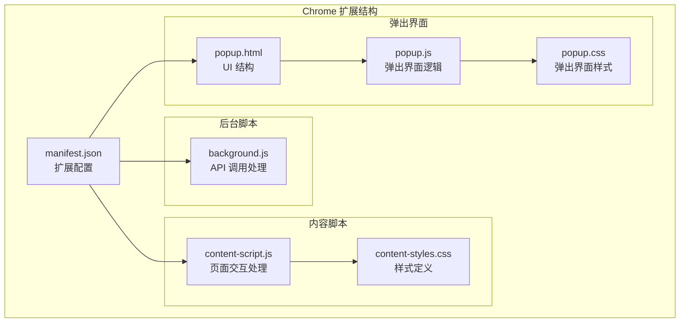
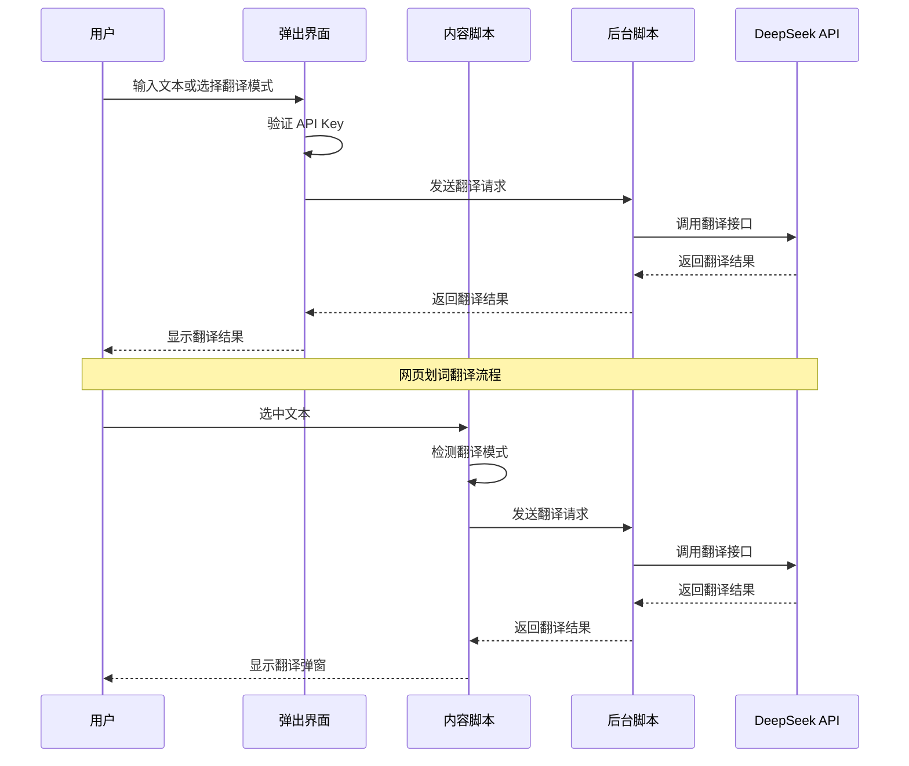
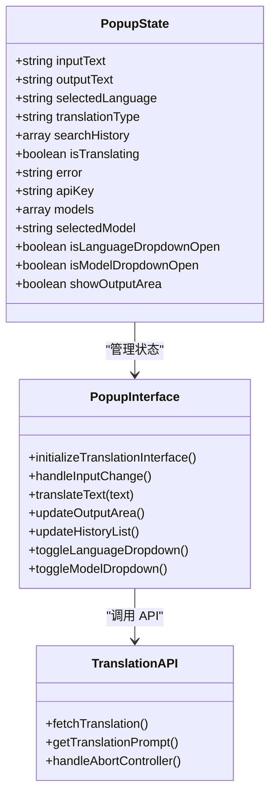
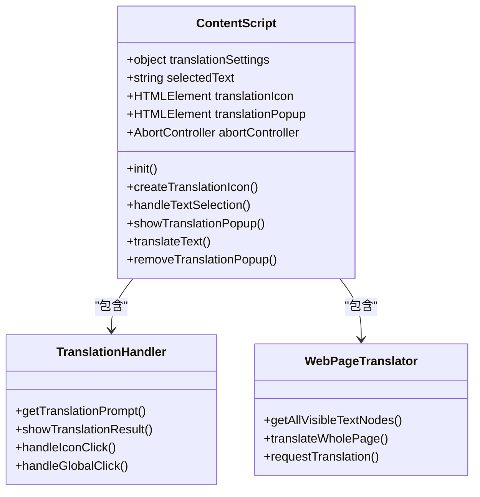
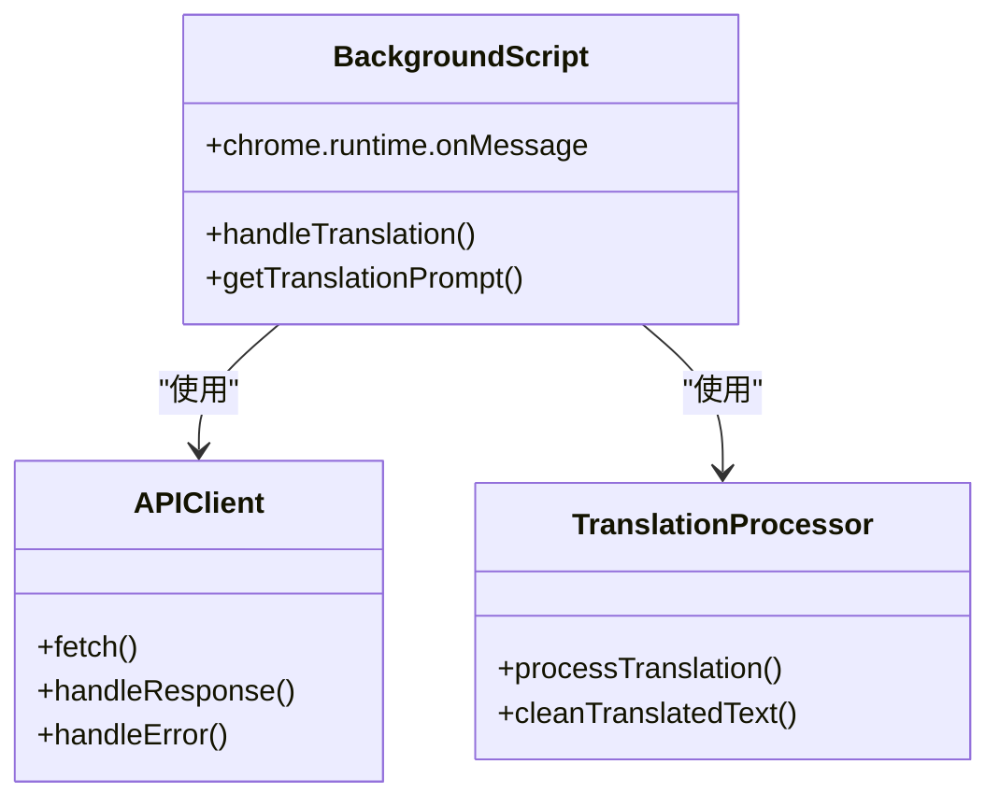
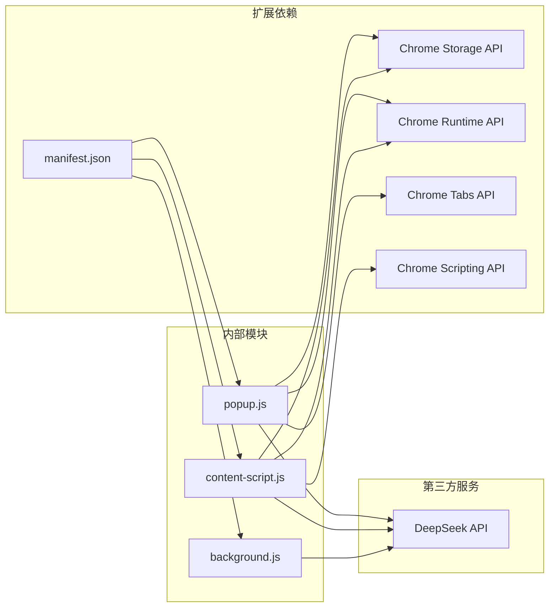

# 故障排除

<cite>
**本文档引用的文件**
- [README.md](file://README.md)
- [manifest.json](file://manifest.json)
- [background.js](file://background.js)
- [content-script.js](file://content-script.js)
- [popup.js](file://popup.js)
- [popup.html](file://popup.html)
- [content-styles.css](file://content-styles.css)
- [popup.css](file://popup.css)
</cite>

## 目录
1. [简介](#简介)
2. [项目结构](#项目结构)
3. [核心组件](#核心组件)
4. [架构概览](#架构概览)
5. [详细组件分析](#详细组件分析)
6. [依赖关系分析](#依赖关系分析)
7. [性能考虑](#性能考虑)
8. [故障排除指南](#故障排除指南)
9. [结论](#结论)

## 简介

DeepSeek Translator 是一款基于 Chrome 扩展的翻译工具，集成了 DeepSeek AI 的翻译能力。该扩展提供了网页划词翻译、即时翻译、网页整体翻译等多种翻译模式，支持多种语言对和 AI 模型选择。

## 项目结构

该项目采用标准的 Chrome 扩展架构，包含以下主要文件：

**图表来源**
- [manifest.json](file://manifest.json#L1-L32)
- [background.js](file://background.js#L1-L95)
- [content-script.js](file://content-script.js#L1-L868)
- [popup.js](file://popup.js#L1-L452)

**章节来源**
- [manifest.json](file://manifest.json#L1-L32)
- [README.md](file://README.md#L1-L50)

## 核心组件

### 扩展权限与配置

扩展具有以下关键权限：
- **storage**: 存储用户设置和翻译历史
- **activeTab**: 访问当前活动标签页
- **scripting**: 动态注入脚本
- **host_permissions**: 访问 DeepSeek API

### 翻译模式

扩展支持三种翻译模式：
1. **图标翻译**: 选中文本后显示翻译图标
2. **即时翻译**: 自动翻译选中的文本
3. **关闭划词**: 禁用划词翻译功能

### AI 模型支持

- **deepseek-chat**: 主要翻译模型，响应速度快
- **deepseek-reasoner**: 推理模型，翻译质量高但响应慢

**章节来源**
- [manifest.json](file://manifest.json#L19-L30)
- [popup.html](file://popup.html#L189-L218)
- [README.md](file://README.md#L24-L26)

## 架构概览

**图表来源**
- [popup.js](file://popup.js#L262-L341)
- [content-script.js](file://content-script.js#L565-L665)
- [background.js](file://background.js#L10-L55)

## 详细组件分析

### 弹出界面组件

弹出界面是用户与扩展交互的主要入口，包含以下功能模块：

**图表来源**
- [popup.js](file://popup.js#L3-L29)
- [popup.js](file://popup.js#L89-L451)

### 内容脚本组件

内容脚本负责处理网页中的翻译交互：

**图表来源**
- [content-script.js](file://content-script.js#L8-L13)
- [content-script.js](file://content-script.js#L129-L190)
- [content-script.js](file://content-script.js#L700-L800)

### 后台脚本组件

后台脚本处理与 DeepSeek API 的通信：

**图表来源**
- [background.js](file://background.js#L1-L95)

**章节来源**
- [popup.js](file://popup.js#L1-L452)
- [content-script.js](file://content-script.js#L1-L868)
- [background.js](file://background.js#L1-L95)

## 依赖关系分析

**图表来源**
- [manifest.json](file://manifest.json#L19-L30)
- [popup.js](file://popup.js#L35-L51)
- [content-script.js](file://content-script.js#L30-L53)

**章节来源**
- [manifest.json](file://manifest.json#L19-L30)

## 性能考虑

### 翻译性能优化

1. **防抖机制**: 文本选择处理使用 300ms 防抖，避免频繁触发翻译
2. **请求取消**: 支持中止正在进行的翻译请求，防止资源浪费
3. **批量处理**: 网页翻译支持批量处理，提高效率
4. **缓存策略**: 翻译历史本地存储，减少重复请求

### 内存管理

1. **DOM 元素清理**: 弹窗关闭时自动清理 DOM 元素
2. **事件监听器管理**: 正确绑定和解绑事件监听器
3. **AbortController 使用**: 及时取消未完成的网络请求

**章节来源**
- [content-script.js](file://content-script.js#L147-L189)
- [content-script.js](file://content-script.js#L270-L273)
- [popup.js](file://popup.js#L275-L278)

## 故障排除指南

### API 连接问题

#### 问题症状
- 翻译结果显示 "API error" 或 "Unknown error occurred"
- 网络请求超时或失败
- 弹出界面显示网络错误

#### 诊断步骤
1. **验证 API Key**
   - 检查弹出界面是否正确保存 API Key
   - 确认 API Key 格式正确（以 sk- 开头）

2. **检查网络连接**
   - 确认浏览器可以访问 https://api.deepseek.com/
   - 检查防火墙或代理设置

3. **验证扩展权限**
   - 检查 manifest.json 中的 host_permissions 配置
   - 确认扩展具有必要的权限

#### 解决方案
1. **重新输入 API Key**
   - 在弹出界面重新输入正确的 API Key
   - 点击保存按钮确认

2. **检查网络设置**
   - 确保网络连接正常
   - 尝试在其他设备上测试 API Key

3. **刷新扩展**
   - 重新加载 Chrome 扩展
   - 清除浏览器缓存

**章节来源**
- [popup.js](file://popup.js#L70-L87)
- [content-script.js](file://content-script.js#L567-L569)
- [background.js](file://background.js#L39-L44)

### 翻译结果异常

#### 问题症状
- 翻译结果为空或显示错误信息
- 翻译质量差或不符合预期
- 特定语言对翻译失败

#### 诊断步骤
1. **检查输入文本**
   - 确认选中的文本有效且不为空
   - 检查文本编码和格式

2. **验证语言设置**
   - 确认选择了正确的语言对
   - 检查自动语言检测功能

3. **测试不同模型**
   - 尝试切换到 deepseek-chat 模型
   - 验证推理模型的可用性

#### 解决方案
1. **重新选择文本**
   - 确保选中文本包含有效内容
   - 避免选择空白或特殊字符

2. **调整翻译设置**
   - 更换语言对设置
   - 选择合适的 AI 模型

3. **清理缓存**
   - 清除浏览器缓存和扩展数据
   - 重新启动浏览器

**章节来源**
- [content-script.js](file://content-script.js#L532-L562)
- [popup.js](file://popup.js#L344-L370)

### 扩展功能失效

#### 问题症状
- 划词翻译功能不工作
- 翻译图标不显示
- 弹出界面无法打开

#### 诊断步骤
1. **检查扩展状态**
   - 确认扩展已启用
   - 检查扩展版本兼容性

2. **验证内容脚本**
   - 检查 content-script 是否正确加载
   - 确认 CSS 样式应用正常

3. **测试事件监听器**
   - 验证鼠标事件处理
   - 检查全局点击事件

#### 解决方案
1. **重新安装扩展**
   - 完全卸载后重新安装
   - 确认开发模式正确启用

2. **检查页面兼容性**
   - 测试在不同网站上的表现
   - 验证内容脚本注入

3. **更新扩展**
   - 检查是否有新版本发布
   - 应用最新的安全补丁

**章节来源**
- [content-script.js](file://content-script.js#L27-L83)
- [content-script.js](file://content-script.js#L86-L127)
- [manifest.json](file://manifest.json#L21-L27)

### 性能问题

#### 问题症状
- 翻译响应缓慢
- 浏览器占用内存过高
- 网页加载变慢

#### 诊断步骤
1. **监控网络请求**
   - 检查 API 请求响应时间
   - 监控并发请求数量

2. **分析内存使用**
   - 检查 DOM 元素数量
   - 监控事件监听器数量

3. **评估系统资源**
   - 检查 CPU 使用率
   - 监控磁盘空间

#### 解决方案
1. **优化翻译频率**
   - 调整防抖延迟时间
   - 减少不必要的翻译请求

2. **清理资源**
   - 定期清理翻译历史
   - 移除未使用的事件监听器

3. **系统优化**
   - 关闭不必要的扩展
   - 清理浏览器缓存

**章节来源**
- [content-script.js](file://content-script.js#L147-L189)
- [content-script.js](file://content-script.js#L270-L273)
- [popup.js](file://popup.js#L275-L278)

### 配置错误

#### 常见配置问题
1. **API Key 配置错误**
   - 格式不正确
   - 权限不足
   - 已过期

2. **语言设置问题**
   - 语言对不匹配
   - 自动检测失败
   - 编码问题

3. **模型选择问题**
   - 模型不可用
   - 配额限制
   - 价格问题

#### 解决方案
1. **重新配置 API Key**
   - 从 DeepSeek 控制台获取新密钥
   - 验证密钥权限范围
   - 设置适当的配额

2. **调整语言设置**
   - 手动选择语言对
   - 检查文本编码
   - 验证字符集支持

3. **优化模型使用**
   - 优先使用 deepseek-chat
   - 避免频繁切换模型
   - 监控使用成本

**章节来源**
- [popup.html](file://popup.html#L138-L153)
- [popup.html](file://popup.html#L180-L186)
- [README.md](file://README.md#L20-L22)

### 兼容性问题

#### 浏览器兼容性
1. **Chrome 版本要求**
   - 确认 Chrome 版本满足要求
   - 检查扩展 API 支持情况

2. **网站兼容性**
   - 某些网站可能阻止脚本注入
   - 内容安全策略限制
   - 动态内容加载

#### 解决方案
1. **更新浏览器**
   - 使用最新版本的 Chrome
   - 确保扩展 API 最新

2. **调整网站设置**
   - 在不受支持的网站上禁用扩展
   - 使用开发者模式测试
   - 检查网站的 JavaScript 执行

**章节来源**
- [README.md](file://README.md#L30-L38)
- [manifest.json](file://manifest.json#L2-L4)

### 用户支持指南

#### 如何收集调试信息
1. **启用开发者工具**
   - 打开 Chrome 开发者工具
   - 切换到 Console 标签页

2. **重现问题**
   - 执行导致问题的操作
   - 观察控制台输出

3. **捕获错误信息**
   - 复制完整的错误堆栈
   - 截取网络请求详情
   - 记录时间戳和操作步骤

#### 报告问题的步骤
1. **收集必要信息**
   - 扩展版本号
   - Chrome 版本
   - 操作系统信息
   - 重现步骤

2. **描述问题**
   - 详细描述问题现象
   - 提供预期行为
   - 说明已尝试的解决方案

3. **提交反馈**
   - 通过 GitHub Issues 提交
   - 包含所有调试信息
   - 保持问题跟踪

#### 常见问题快速解决
1. **扩展无法加载**
   - 检查开发模式设置
   - 验证文件完整性
   - 重新安装扩展

2. **翻译功能异常**
   - 检查 API Key 有效性
   - 确认网络连接
   - 清理浏览器缓存

3. **界面显示问题**
   - 刷新页面
   - 清除扩展数据
   - 重启浏览器

**章节来源**
- [README.md](file://README.md#L30-L38)
- [popup.js](file://popup.js#L49-L51)

## 结论

DeepSeek Translator 扩展提供了完整的翻译解决方案，通过合理的架构设计和错误处理机制，能够有效应对大多数使用场景中的问题。用户可以通过本文档提供的故障排除指南，快速识别和解决常见的技术问题。

建议用户定期更新扩展版本，保持 API Key 的有效性，并根据实际需求调整翻译设置。对于复杂的技术问题，建议按照用户支持指南收集详细的调试信息，以便及时获得技术支持。

通过理解扩展的工作原理和各组件之间的交互关系，用户可以更好地利用这个工具提升翻译效率，同时也能更有效地进行问题诊断和解决。