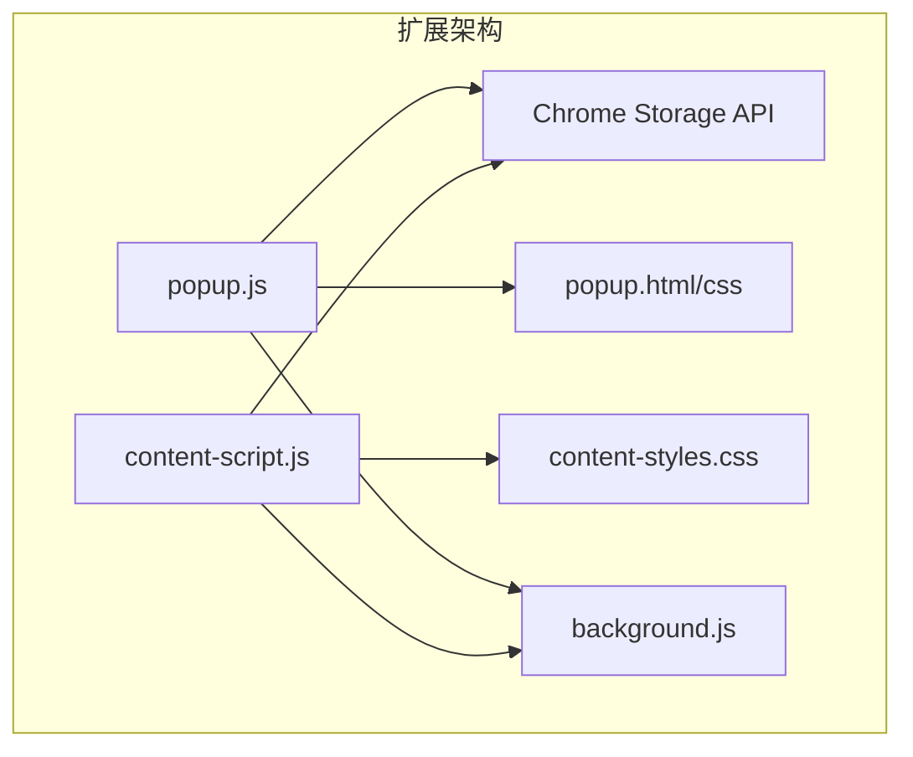
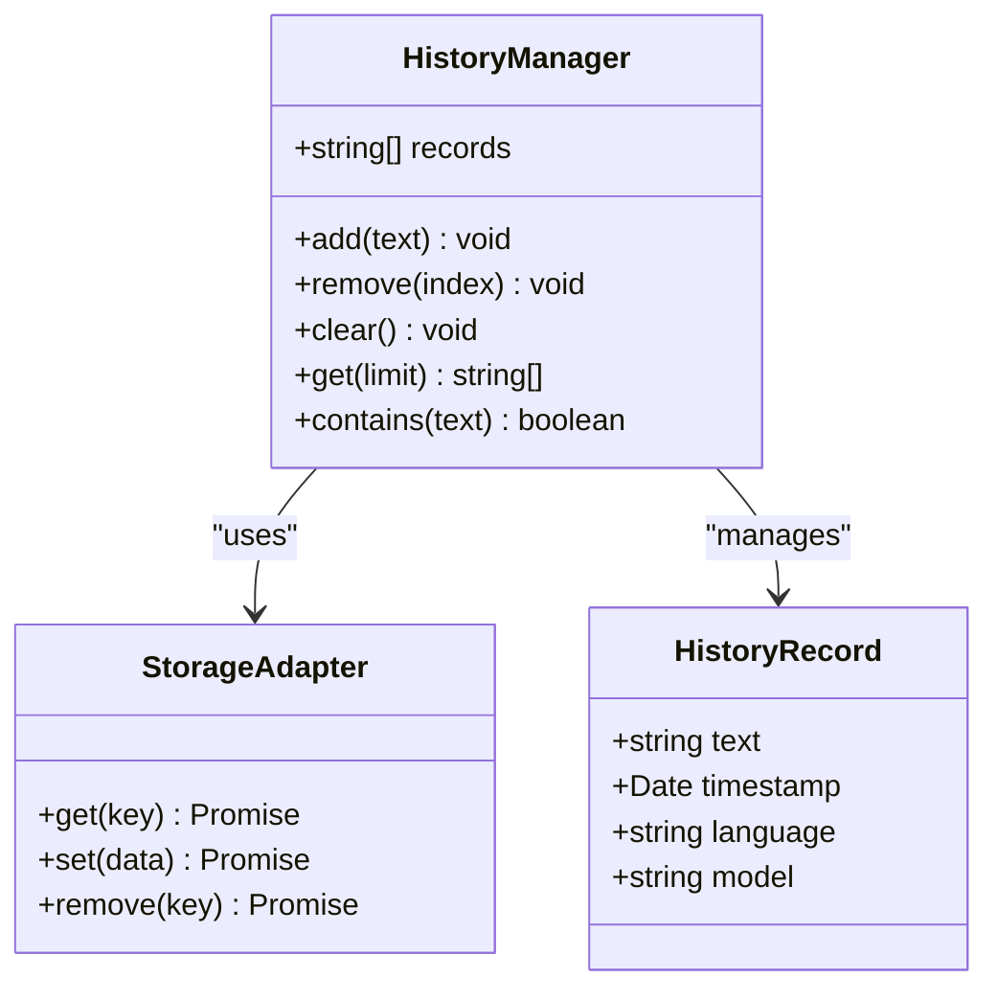
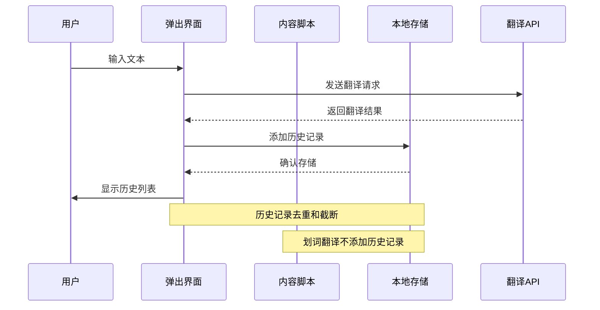
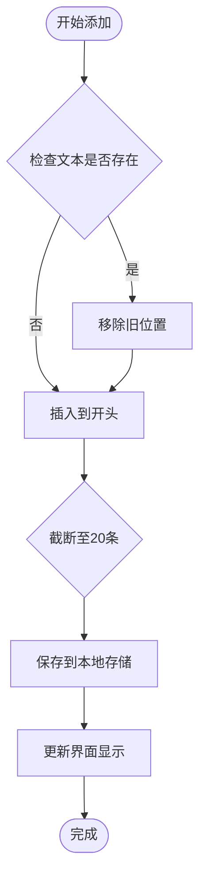
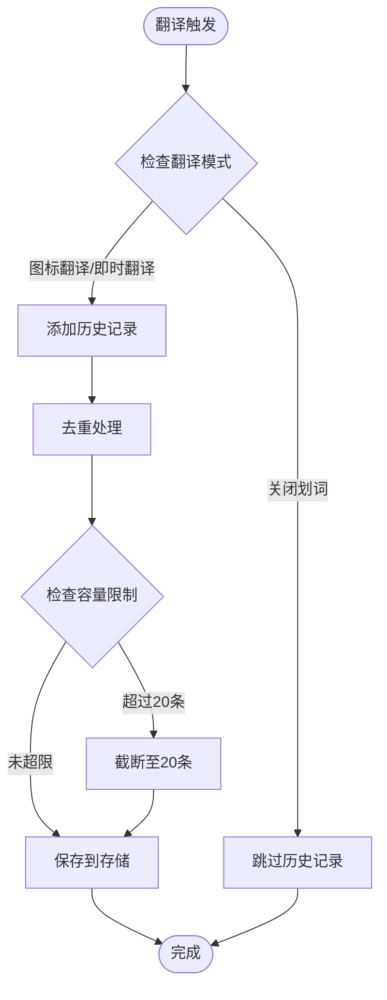
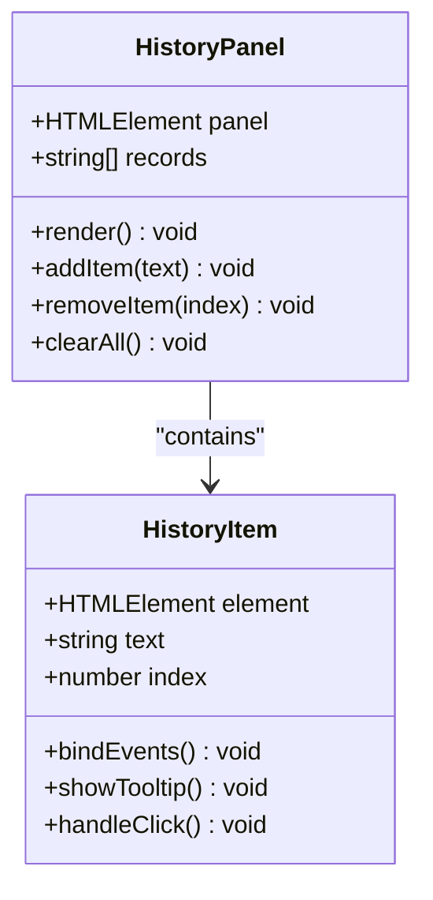
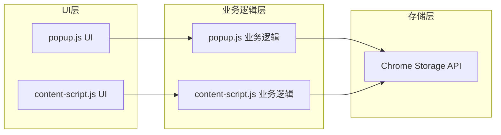
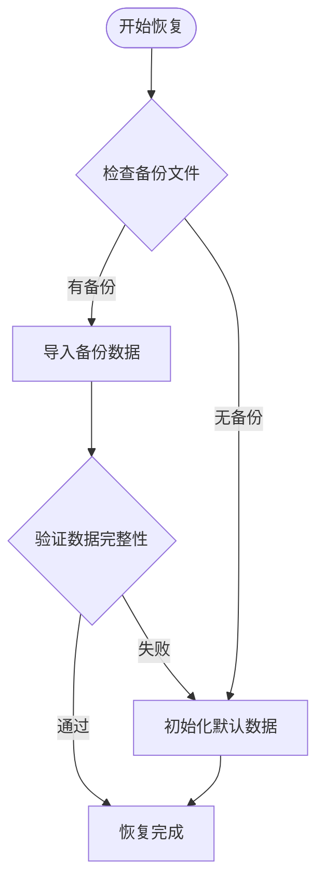

# 历史记录系统

<cite>
**本文档引用的文件**
- [background.js](file://background.js)
- [popup.js](file://popup.js)
- [content-script.js](file://content-script.js)
- [manifest.json](file://manifest.json)
- [popup.html](file://popup.html)
- [popup.css](file://popup.css)
- [content-styles.css](file://content-styles.css)
- [README.md](file://README.md)
</cite>

## 目录
1. [简介](#简介)
2. [项目结构](#项目结构)
3. [核心组件](#核心组件)
4. [架构概览](#架构概览)
5. [详细组件分析](#详细组件分析)
6. [依赖关系分析](#依赖关系分析)
7. [性能考量](#性能考量)
8. [故障排除指南](#故障排除指南)
9. [结论](#结论)
10. [附录](#附录)

## 简介
本文件详细阐述了AI翻译器扩展的历史记录系统，重点解释了翻译历史的本地存储机制、数据结构设计、去重逻辑以及完整的增删改查操作实现。该系统基于Chrome Storage API实现，支持最多20条历史记录，并通过智能去重确保数据质量。文档还涵盖了历史记录与翻译模式的关系、UI展示与交互设计、以及数据迁移和备份恢复的考虑事项。

## 项目结构
该项目采用Chrome扩展的标准架构，包含以下关键文件：
- popup.js：弹出界面的主逻辑，负责历史记录的增删改查
- content-script.js：网页内容脚本，处理划词翻译和历史记录管理
- background.js：后台服务脚本，处理API调用
- manifest.json：扩展配置文件，声明权限和入口点
- popup.html/css：弹出界面的HTML结构和样式
- content-styles.css：网页翻译弹窗的样式



**图表来源**
- [popup.js](file://popup.js#L1-L452)
- [content-script.js](file://content-script.js#L1-L868)
- [background.js](file://background.js#L1-L95)

**章节来源**
- [manifest.json](file://manifest.json#L1-L32)
- [popup.js](file://popup.js#L1-L452)
- [content-script.js](file://content-script.js#L1-L868)

## 核心组件
历史记录系统由三个核心组件构成：

### 1. 存储层（Chrome Storage API）
- 使用chrome.storage.local进行本地持久化存储
- 存储键名：searchHistory
- 数据类型：字符串数组
- 最大容量：20条记录

### 2. 业务逻辑层
- popup.js：处理用户界面交互和历史记录操作
- content-script.js：处理网页划词翻译和历史记录管理
- background.js：处理API调用和翻译逻辑

### 3. 数据结构设计


**图表来源**
- [popup.js](file://popup.js#L321-L328)
- [content-script.js](file://content-script.js#L642-L652)

**章节来源**
- [popup.js](file://popup.js#L321-L328)
- [content-script.js](file://content-script.js#L642-L652)

## 架构概览
历史记录系统采用分层架构，确保数据一致性的同时提供良好的用户体验：



**图表来源**
- [popup.js](file://popup.js#L262-L341)
- [content-script.js](file://content-script.js#L565-L665)

## 详细组件分析

### 历史记录数据结构
历史记录采用简化的字符串数组格式，每个元素代表一条翻译记录的原文本。这种设计具有以下特点：

#### 存储格式
- 键名：searchHistory
- 类型：Array<string>
- 结构：["原文本1", "原文本2", ...]

#### 容量限制
系统通过切片操作确保历史记录不超过20条：
```javascript
// 保持最新记录在前，最多20条
state.searchHistory = [
    text,
    ...state.searchHistory.filter((item) => item !== text).slice(0, 19)
];
```

#### 去重逻辑
系统实现了智能去重机制：
1. **存在性检查**：使用includes()方法检查文本是否已存在
2. **位置调整**：如果存在则先移除旧位置，再插入到开头
3. **容量控制**：超过20条时自动截断

**章节来源**
- [popup.js](file://popup.js#L321-L328)
- [content-script.js](file://content-script.js#L645-L649)

### 增删改查操作实现

#### 添加操作（Add）


**图表来源**
- [popup.js](file://popup.js#L321-L328)
- [content-script.js](file://content-script.js#L645-L652)

#### 查询操作（Query）
查询操作主要通过UI列表展示，支持点击历史项进行重新翻译：
```javascript
historyList.addEventListener("click", (e) => {
    const historyItem = e.target.closest(".history-item");
    if (historyItem) {
        const index = Number.parseInt(historyItem.dataset.index);
        const item = state.searchHistory[index];
        if (item) {
            state.inputText = item;
            translateText(item);
        }
    }
});
```

#### 删除操作（Delete）
单个删除通过点击历史项实现：
```javascript
function handleClearHistory() {
    state.searchHistory = [];
    chrome.storage.local.set({ searchHistory: [] });
    updateHistoryList();
}
```

#### 清理操作（Clear）
批量清理所有历史记录：
```javascript
function updateHistoryList() {
    if (state.searchHistory.length > 0) {
        historyList.innerHTML = state.searchHistory
            .map((item, index) => 
                `<div class="history-item" data-index="${index}" title="${item}">${item}</div>`
            )
            .join("");
    } else {
        historyList.innerHTML = `<div class="history-item">无历史记录</div>`;
    }
}
```

**章节来源**
- [popup.js](file://popup.js#L136-L150)
- [popup.js](file://popup.js#L401-L406)
- [popup.js](file://popup.js#L387-L399)

### 历史记录与翻译模式的关系

#### 翻译模式分类
系统支持三种翻译模式，每种模式对历史记录有不同的处理策略：

| 模式 | 特征 | 历史记录行为 |
|------|------|-------------|
| 图标翻译 | 选中文本后点击图标翻译 | 添加历史记录 |
| 即时翻译 | 自动翻译选中文本 | 添加历史记录 |
| 关闭划词 | 禁用翻译功能 | 不添加历史记录 |

#### 模式检测逻辑


**图表来源**
- [content-script.js](file://content-script.js#L637-L652)
- [content-script.js](file://content-script.js#L177-L188)

**章节来源**
- [content-script.js](file://content-script.js#L637-L652)
- [popup.js](file://popup.js#L179-L184)

### UI展示与交互设计

#### 历史记录列表渲染
历史记录列表采用响应式设计，支持滚动和悬停效果：



**图表来源**
- [popup.js](file://popup.js#L387-L399)
- [popup.html](file://popup.html#L99-L105)

#### 交互功能
- **点击重译**：点击历史项可重新翻译该文本
- **悬停显示**：完整文本通过title属性显示
- **批量清理**：一键清空所有历史记录
- **容量提示**：当历史记录为空时显示提示信息

**章节来源**
- [popup.js](file://popup.js#L136-L150)
- [popup.js](file://popup.js#L401-L406)
- [popup.css](file://popup.css#L129-L148)

### 数据持久化策略

#### 存储机制
系统使用Chrome Storage API的local存储：
```javascript
// 读取历史记录
const result = await chrome.storage.local.get(["searchHistory"]);

// 保存历史记录
await chrome.storage.local.set({ searchHistory: state.searchHistory });

// 监听存储变化
chrome.storage.onChanged.addListener((changes) => {
    if (changes.searchHistory) {
        state.searchHistory = changes.searchHistory.newValue;
    }
});
```

#### 数据完整性保障
- **异步操作**：所有存储操作都是异步的，避免阻塞UI
- **错误处理**：包含try-catch块处理存储异常
- **默认值**：当存储中没有数据时使用空数组作为默认值

**章节来源**
- [popup.js](file://popup.js#L35-L51)
- [popup.js](file://popup.js#L326-L328)
- [content-script.js](file://content-script.js#L32-L53)

## 依赖关系分析

### 组件耦合度
历史记录系统各组件之间保持低耦合高内聚的设计：



**图表来源**
- [popup.js](file://popup.js#L1-L452)
- [content-script.js](file://content-script.js#L1-L868)

### 外部依赖
- **Chrome Storage API**：提供本地数据持久化
- **Fetch API**：用于翻译请求
- **Manifest Permissions**：声明storage权限

**章节来源**
- [manifest.json](file://manifest.json#L19-L20)

## 性能考量

### 时间复杂度分析
- **添加操作**：O(n)，其中n为现有历史记录数量
- **查询操作**：O(1)，直接通过索引访问
- **删除操作**：O(n)，需要查找和重建数组
- **容量控制**：O(1)，固定切片操作

### 优化策略
1. **去重优化**：使用includes()和filter()组合实现高效去重
2. **内存管理**：自动截断至20条，防止内存泄漏
3. **异步处理**：所有存储操作异步执行，避免UI阻塞
4. **事件委托**：使用事件委托减少DOM绑定数量

## 故障排除指南

### 常见问题及解决方案

#### 历史记录不显示
**症状**：历史记录列表为空
**原因**：
- 存储权限未授权
- 数据损坏或格式错误
- 浏览器缓存问题

**解决方法**：
1. 检查manifest.json中的storage权限
2. 清空浏览器存储数据
3. 重启扩展重新初始化

#### 历史记录重复
**症状**：相同文本出现多次
**原因**：去重逻辑失效
**解决方法**：检查includes()和filter()的实现

#### 存储空间不足
**症状**：历史记录无法保存
**原因**：Chrome存储配额限制
**解决方法**：定期清理历史记录或增加容量限制

**章节来源**
- [manifest.json](file://manifest.json#L19-L20)
- [popup.js](file://popup.js#L49-L51)

## 结论
历史记录系统通过简洁而高效的实现，提供了可靠的翻译历史管理功能。系统采用智能去重、容量控制和异步存储等策略，在保证用户体验的同时确保数据质量和性能表现。通过合理的架构设计和完善的错误处理机制，该系统能够稳定地支持用户的翻译需求。

## 附录

### 数据迁移和备份恢复

#### 备份策略
1. **手动导出**：用户可通过开发者工具查看和导出存储数据
2. **版本升级**：新版本发布时自动迁移历史记录格式
3. **跨设备同步**：利用Chrome账户同步功能实现数据共享

#### 恢复流程


#### 迁移注意事项
- 保持向后兼容性
- 处理数据格式变更
- 提供降级方案
- 记录迁移日志