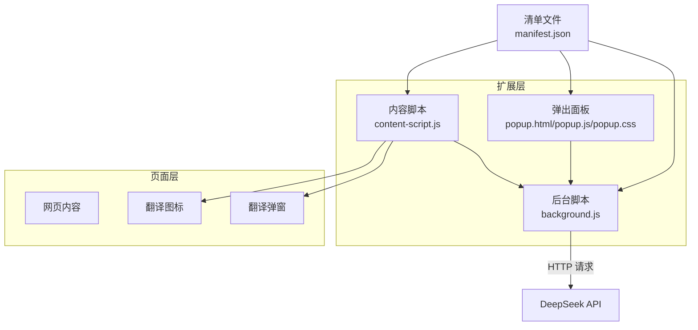
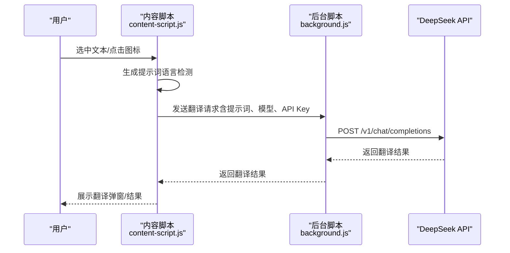
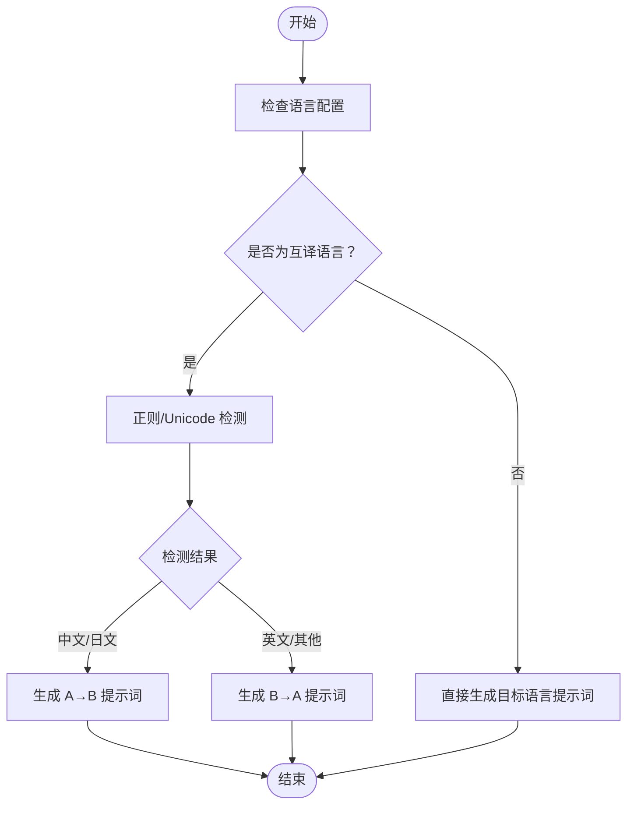
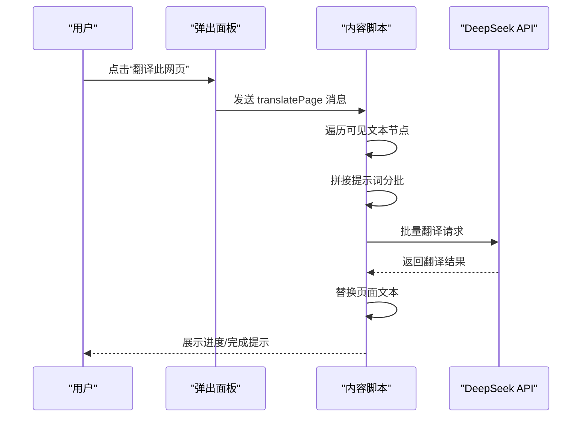
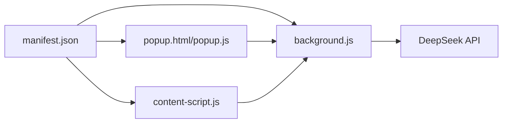

# 多语言翻译支持

<cite>
**本文引用的文件**
- [README.md](file://README.md)
- [manifest.json](file://manifest.json)
- [background.js](file://background.js)
- [content-script.js](file://content-script.js)
- [popup.js](file://popup.js)
- [popup.html](file://popup.html)
- [popup.css](file://popup.css)
- [content-styles.css](file://content-styles.css)
</cite>

## 目录
1. [简介](#简介)
2. [项目结构](#项目结构)
3. [核心组件](#核心组件)
4. [架构总览](#架构总览)
5. [详细组件分析](#详细组件分析)
6. [依赖关系分析](#依赖关系分析)
7. [性能考虑](#性能考虑)
8. [故障排查指南](#故障排查指南)
9. [结论](#结论)
10. [附录](#附录)

## 简介
本项目是一个基于 Chrome 扩展的网页划词翻译工具，集成了 DeepSeek AI 的翻译能力。其多语言翻译支持覆盖以下语言对：
- 英汉互译（双向）
- 中日互译（双向）
- 印尼语、葡萄牙语、法语、泰语等多语言直译

系统通过“自动语言检测”机制，结合正则表达式判断文本所属语言，从而动态生成合适的翻译提示词（prompt），确保翻译方向正确。同时，系统支持即时翻译、图标翻译、关闭划词等多种翻译模式，并提供网页整体翻译能力。

## 项目结构
该扩展采用典型的 Chrome Extension 结构，包含清单文件、后台脚本、内容脚本、弹出界面及其样式文件。关键文件职责如下：
- manifest.json：声明扩展元信息、权限、内容脚本与后台服务工作线程
- background.js：处理跨页面消息、向 DeepSeek API 发起翻译请求
- content-script.js：监听页面选中文本、构建翻译弹窗、调用翻译接口
- popup.js/popup.html/popup.css：扩展弹出面板，管理语言选择、模型选择、历史记录与网页翻译
- content-styles.css：内容脚本渲染的翻译图标与弹窗样式

图表来源
- [manifest.json](file://manifest.json#L1-L32)
- [popup.js](file://popup.js#L1-L452)
- [content-script.js](file://content-script.js#L1-L868)
- [background.js](file://background.js#L1-L95)

章节来源
- [manifest.json](file://manifest.json#L1-L32)
- [popup.html](file://popup.html#L1-L226)
- [popup.css](file://popup.css#L1-L349)
- [content-styles.css](file://content-styles.css#L1-L196)

## 核心组件
- 自动语言检测与提示词生成
  - 在内容脚本与弹出面板中均实现了语言检测与提示词生成函数，分别用于即时翻译与弹出面板交互。
  - 英汉互译：通过 ASCII 字母与基础标点的正则判断英文；否则视为中文。
  - 中日互译：通过 Unicode 范围判断中文字符（汉字）；否则视为日文。
  - 其他语言：直接按目标语言生成提示词。
- 翻译流程
  - 用户在页面选中文本或在弹出面板输入文本后，系统根据所选语言生成提示词，调用 DeepSeek API 获取翻译结果。
  - 结果清洗后展示在弹窗或输出区域，并可复制到剪贴板。
- 网页翻译
  - 支持一键翻译当前页面可见文本节点，按批处理请求 API 并替换页面文本。

章节来源
- [content-script.js](file://content-script.js#L531-L562)
- [popup.js](file://popup.js#L343-L370)
- [background.js](file://background.js#L57-L94)

## 架构总览
从用户交互到 AI 翻译的整体流程如下：

图表来源
- [content-script.js](file://content-script.js#L564-L665)
- [background.js](file://background.js#L10-L55)

章节来源
- [content-script.js](file://content-script.js#L564-L665)
- [background.js](file://background.js#L10-L55)

## 详细组件分析

### 自动语言检测与提示词生成
- 英汉互译
  - 检测逻辑：使用正则表达式判断文本是否仅由英文字母、数字与常见标点组成，若是则判定为英文，否则为中文。
  - 提示词生成：根据检测结果决定“英文→中文”或“中文→英文”的翻译方向。
- 中日互译
  - 检测逻辑：使用 Unicode 范围匹配中文字符（汉字），若命中则判定为中文，否则为日文。
  - 提示词生成：根据检测结果决定“中文→日文”或“日文→中文”的翻译方向。
- 其他语言（印尼语、葡萄牙语、法语、泰语等）
  - 直接生成“将文本翻译为目标语言”的提示词，无需双向检测。

图表来源
- [content-script.js](file://content-script.js#L531-L562)
- [popup.js](file://popup.js#L343-L370)
- [background.js](file://background.js#L57-L94)

章节来源
- [content-script.js](file://content-script.js#L531-L562)
- [popup.js](file://popup.js#L343-L370)
- [background.js](file://background.js#L57-L94)

### 正则表达式与 Unicode 判定逻辑
- 英文判定（英汉互译）
  - 使用字母、数字与常见标点的正则表达式，避免误判为中文。
- 中文判定（中日互译）
  - 使用汉字的 Unicode 范围，准确识别中文文本。
- 日文判定（中日互译）
  - 未显式写正则时，通过“非中文即日文”的反向判定实现，适用于以中日混排较少的场景。

章节来源
- [content-script.js](file://content-script.js#L537-L547)
- [content-script.js](file://content-script.js#L316-L322)
- [content-script.js](file://content-script.js#L343-L350)
- [popup.js](file://popup.js#L345-L355)

### 翻译提示词生成函数实现细节
- 输入参数
  - 文本：待翻译文本
  - 语言：当前选择的语言配置（如“英汉互译”、“中日互译”、“印尼语”等）
- 输出
  - 返回符合 DeepSeek API 规范的提示词字符串，明确翻译方向与目标语言
- 实现要点
  - 对互译语言先做检测再拼接提示词
  - 对非互译语言直接映射目标语言并生成提示词
  - 在内容脚本与弹出面板中分别实现，确保不同入口的一致性

章节来源
- [content-script.js](file://content-script.js#L531-L562)
- [popup.js](file://popup.js#L343-L370)
- [background.js](file://background.js#L57-L94)

### 语言配置数据结构与存储方式
- 配置项
  - selectedLanguage：当前语言配置（如“英汉互译”、“中日互译”、“印尼语”等）
  - selectedModel：当前使用的 DeepSeek 模型（如“deepseek-chat”、“deepseek-reasoner”）
  - translationType：翻译模式（图标翻译、立即翻译、关闭划词）
  - DEEPSEEK_API_KEY：用户密钥（本地存储）
  - searchHistory：翻译历史（本地存储）
- 存储位置
  - 使用浏览器存储 API（chrome.storage.local）持久化上述配置
- 扩展新语言对
  - 在语言下拉列表中新增选项
  - 在提示词生成函数中增加对应分支，映射到目标语言
  - 若为互译语言，补充正则/Unicode 检测逻辑

章节来源
- [popup.html](file://popup.html#L138-L152)
- [popup.js](file://popup.js#L3-L29)
- [content-script.js](file://content-script.js#L8-L13)

### 网页翻译功能
- 功能概述
  - 遍历页面可见文本节点，批量生成提示词并请求翻译，随后替换页面文本
- 关键步骤
  - 获取可见文本节点集合
  - 分批拼接提示词（使用特定分隔符）
  - 调用翻译接口并按批次替换
  - 展示进度与完成状态

图表来源
- [popup.js](file://popup.js#L196-L225)
- [content-script.js](file://content-script.js#L700-L800)

章节来源
- [popup.js](file://popup.js#L196-L225)
- [content-script.js](file://content-script.js#L700-L800)

## 依赖关系分析
- 清单文件声明
  - 权限：storage、activeTab、scripting
  - 主机权限：api.deepseek.com
  - 内容脚本：匹配所有 URL，注入 content-script.js 与 content-styles.css
  - 后台：service_worker 指向 background.js
- 组件耦合
  - 弹出面板与内容脚本通过消息通信协作
  - 内容脚本与后台脚本通过消息传递翻译请求
  - 所有翻译逻辑共享提示词生成函数，降低重复与维护成本

图表来源
- [manifest.json](file://manifest.json#L19-L31)

章节来源
- [manifest.json](file://manifest.json#L19-L31)

## 性能考虑
- 请求终止与防抖
  - 使用 AbortController 在用户快速切换或重复触发时终止上一请求，避免资源浪费
  - 内容脚本对文本选择事件采用防抖策略，减少频繁触发
- 批量翻译网页
  - 采用分批处理（默认每批 20 个文本节点），降低单次请求负载
- UI 响应
  - 加载状态与错误状态分离显示，提升用户体验
- 模型选择
  - “deepseek-chat”适合大多数场景，“deepseek-reasoner”推理较慢，适合复杂任务

章节来源
- [content-script.js](file://content-script.js#L147-L189)
- [content-script.js](file://content-script.js#L587-L589)
- [content-script.js](file://content-script.js#L765-L793)
- [popup.js](file://popup.js#L275-L277)
- [README.md](file://README.md#L24-L26)

## 故障排查指南
- API Key 未设置
  - 现象：翻译报错“API key not set”
  - 处理：在弹出面板输入并保存 API Key
- 网络请求失败
  - 现象：API error 或网络超时
  - 处理：检查网络连接、确认主机权限已授权、查看控制台错误详情
- 翻译方向错误
  - 现象：互译语言方向不正确
  - 处理：确认文本是否符合预期语言特征（英文/中文/日文），必要时手动切换语言配置
- 网页翻译无响应
  - 现象：点击“翻译此网页”后无变化
  - 处理：确认当前标签页存在可翻译文本节点，检查控制台是否有异常

章节来源
- [content-script.js](file://content-script.js#L567-L569)
- [content-script.js](file://content-script.js#L621-L627)
- [popup.js](file://popup.js#L262-L341)

## 结论
本项目通过简洁的正则与 Unicode 检测，实现了对英汉、中日等互译语言的自动方向判断，并以统一的提示词生成函数支撑弹出面板与内容脚本两端。配合分批网页翻译与请求终止机制，兼顾了易用性与性能。未来可通过扩展语言配置与检测规则，进一步完善多语言支持矩阵。

## 附录
- 快速参考
  - 语言配置项：selectedLanguage、selectedModel、translationType、DEEPSEEK_API_KEY、searchHistory
  - 扩展新语言对：在 UI 下拉列表与提示词生成函数中新增映射
  - 翻译模式：图标翻译、立即翻译、关闭划词
  - 模型选择：deepseek-chat（推荐）、deepseek-reasoner（推理较慢）

章节来源
- [popup.html](file://popup.html#L138-L152)
- [popup.js](file://popup.js#L3-L29)
- [README.md](file://README.md#L24-L26)