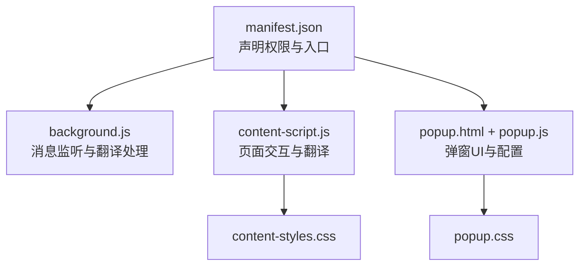
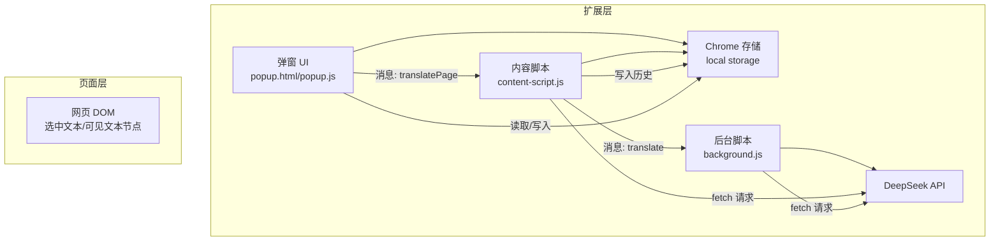
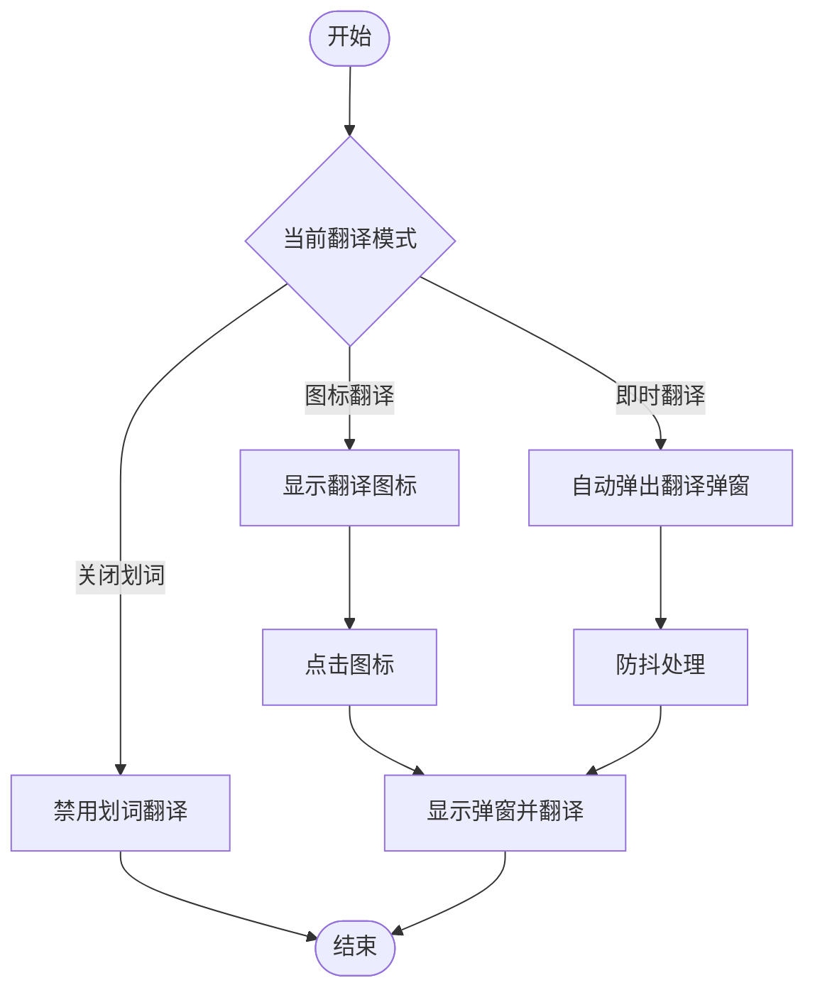
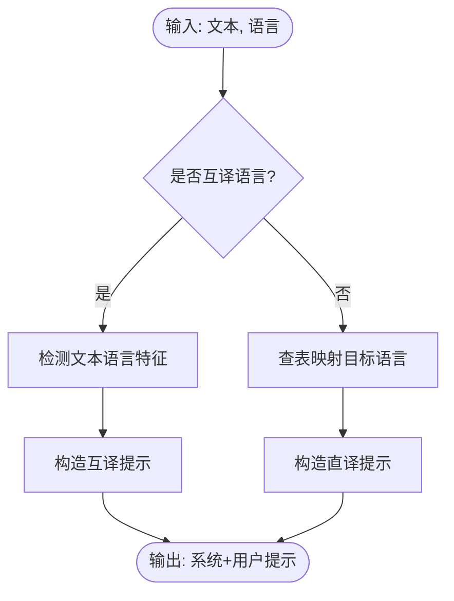
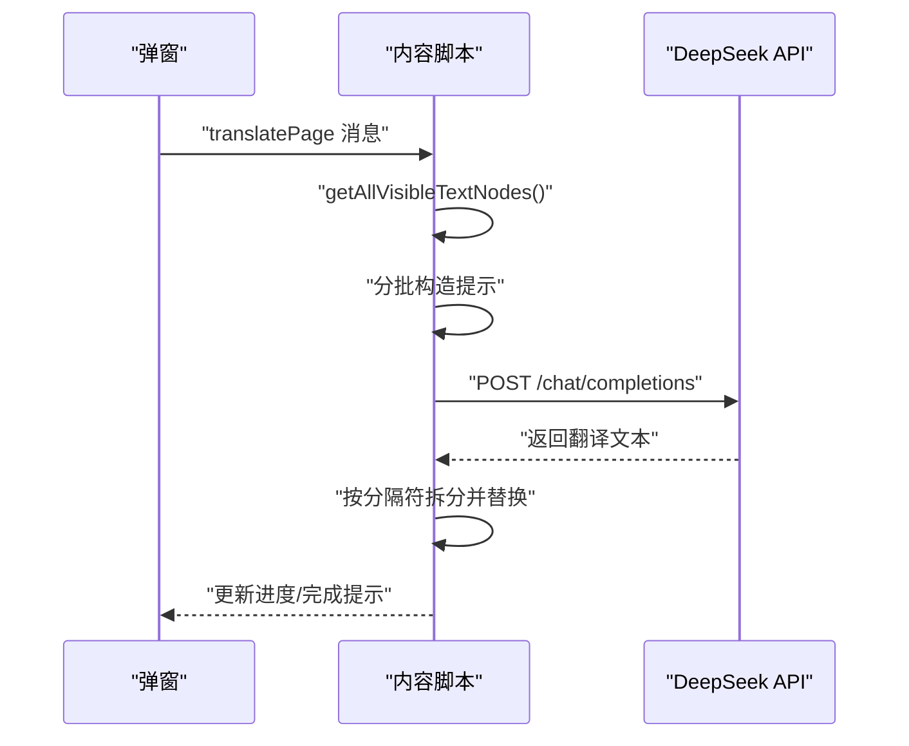
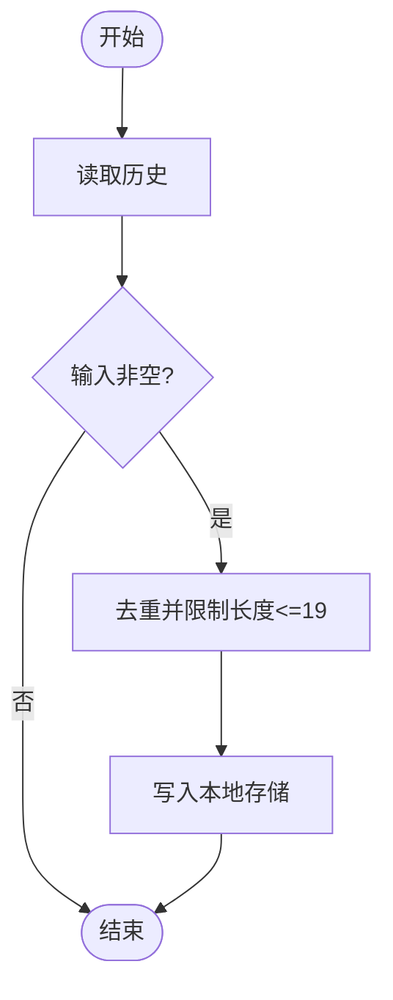
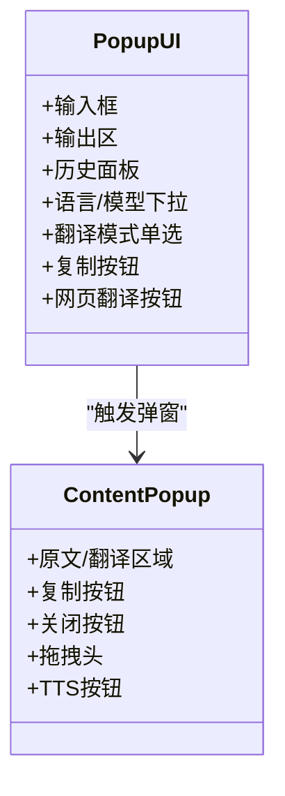
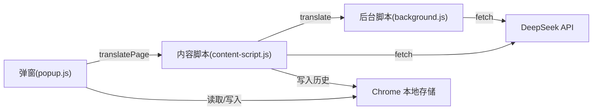

# 核心功能

<cite>
**本文引用的文件**
- [manifest.json](file://manifest.json)
- [background.js](file://background.js)
- [content-script.js](file://content-script.js)
- [popup.js](file://popup.js)
- [popup.html](file://popup.html)
- [popup.css](file://popup.css)
- [content-styles.css](file://content-styles.css)
- [README.md](file://README.md)
</cite>

## 目录
1. [简介](#简介)
2. [项目结构](#项目结构)
3. [核心组件](#核心组件)
4. [架构总览](#架构总览)
5. [详细组件分析](#详细组件分析)
6. [依赖关系分析](#依赖关系分析)
7. [性能考量](#性能考量)
8. [故障排除指南](#故障排除指南)
9. [结论](#结论)
10. [附录](#附录)

## 简介
本项目是一个基于 Chrome 扩展的 AI 翻译器，使用 DeepSeek AI 提供的对话式接口进行文本与网页翻译。其核心功能包括：
- 多语言翻译支持（含互译场景与多语种目标语言）
- 翻译模式管理（图标翻译、即时翻译、关闭划词）
- 网页翻译功能（批量提取可见文本并翻译）
- 翻译历史记录管理（本地存储）
- 用户交互界面（弹窗、复制、TTS 朗读、拖拽）
- 配置与权限（API Key、模型选择、主机权限）

该文档面向不同技术背景的用户，既提供高层概览，也给出关键实现细节与调用路径，帮助理解各功能的协作机制与可扩展点。

## 项目结构
项目采用典型的 Chrome 扩展结构，包含清单文件、后台脚本、内容脚本、弹出页及其样式文件。

图表来源
- [manifest.json](file://manifest.json#L1-L32)
- [background.js](file://background.js#L1-L95)
- [content-script.js](file://content-script.js#L1-L868)
- [popup.js](file://popup.js#L1-L452)
- [popup.html](file://popup.html#L1-L226)
- [popup.css](file://popup.css#L1-L349)
- [content-styles.css](file://content-styles.css#L1-L196)

章节来源
- [manifest.json](file://manifest.json#L1-L32)
- [README.md](file://README.md#L30-L50)

## 核心组件
- 清单与权限
  - 声明 action 弹窗、content_scripts 注入、background service worker、storage 权限与 host 权限。
- 后台脚本（background.js）
  - 监听来自内容脚本的消息，向 DeepSeek API 发起翻译请求，处理响应与错误。
- 内容脚本（content-script.js）
  - 管理翻译模式、图标与弹窗、文本选择与防抖、网页翻译、TTS、复制、历史记录写入。
- 弹窗脚本与界面（popup.js + popup.html + popup.css）
  - API Key 输入与保存、语言与模型选择、即时翻译、历史列表、网页翻译触发、复制输出。
- 页面样式（content-styles.css + popup.css）
  - 控制图标、弹窗、下拉菜单、加载动画、复制按钮等 UI 行为。

章节来源
- [manifest.json](file://manifest.json#L6-L31)
- [background.js](file://background.js#L1-L95)
- [content-script.js](file://content-script.js#L1-L868)
- [popup.js](file://popup.js#L1-L452)
- [popup.html](file://popup.html#L1-L226)
- [popup.css](file://popup.css#L1-L349)
- [content-styles.css](file://content-styles.css#L1-L196)

## 架构总览
整体采用“弹窗配置 + 内容脚本交互 + 后台脚本翻译”的三层协作模式。内容脚本负责页面级交互与翻译请求发起，后台脚本负责与第三方 API 的通信与错误处理，弹窗负责用户配置与历史管理。

图表来源
- [manifest.json](file://manifest.json#L19-L31)
- [background.js](file://background.js#L1-L95)
- [content-script.js](file://content-script.js#L689-L868)
- [popup.js](file://popup.js#L196-L225)

## 详细组件分析

### 翻译模式管理（图标翻译、即时翻译、关闭划词）
- 模式状态
  - 在内容脚本初始化时从本地存储读取翻译模式，默认为“图标翻译”。
- 图标翻译
  - 选中文本后显示悬浮图标，点击图标弹出翻译弹窗并发起翻译。
- 即时翻译
  - 选中文本后自动弹出翻译弹窗并发起翻译。
- 关闭划词
  - 禁用划词翻译功能，不显示图标也不弹窗。

图表来源
- [content-script.js](file://content-script.js#L27-L83)
- [content-script.js](file://content-script.js#L129-L190)
- [content-script.js](file://content-script.js#L192-L204)
- [content-script.js](file://content-script.js#L426-L467)

章节来源
- [content-script.js](file://content-script.js#L8-L13)
- [content-script.js](file://content-script.js#L27-L83)
- [content-script.js](file://content-script.js#L129-L190)
- [content-script.js](file://content-script.js#L192-L204)
- [content-script.js](file://content-script.js#L426-L467)

### 多语言翻译支持与提示构造
- 语言映射与互译判断
  - 对“英汉互译”和“中日互译”两类互译场景，根据文本特征自动判断源语言方向，生成对应提示。
  - 其他目标语言（如印尼语、葡萄牙语、法语、泰语、葡利语）直接按目标语言生成提示。
- 提示构造函数
  - 在内容脚本与后台脚本中分别实现，确保前后端一致的提示格式。

图表来源
- [background.js](file://background.js#L57-L94)
- [content-script.js](file://content-script.js#L531-L562)

章节来源
- [background.js](file://background.js#L57-L94)
- [content-script.js](file://content-script.js#L531-L562)

### 网页翻译功能
- 可见文本提取
  - 使用 TreeWalker 过滤空白、脚本、样式、隐藏元素等，仅保留可见文本节点。
- 批量翻译
  - 分批（默认每批 20 个）拼接提示，调用翻译接口，按分隔符拆分返回结果并替换原文本。
- 进度反馈
  - 在页面右上角显示进度提示，翻译完成后短暂提示完成或失败信息。

图表来源
- [content-script.js](file://content-script.js#L689-L698)
- [content-script.js](file://content-script.js#L700-L802)
- [content-script.js](file://content-script.js#L804-L868)

章节来源
- [content-script.js](file://content-script.js#L689-L698)
- [content-script.js](file://content-script.js#L700-L802)
- [content-script.js](file://content-script.js#L804-L868)

### 翻译历史记录管理
- 历史存储
  - 使用 Chrome 本地存储保存搜索历史，最多保留 20 条，去重并按最近使用排序。
- 历史读取与清空
  - 弹窗界面加载时读取历史，支持一键清空。
- 写入时机
  - 在弹窗即时翻译与内容脚本“立即翻译/图标翻译”之外的场景写入历史（避免重复写入）。

图表来源
- [popup.js](file://popup.js#L319-L328)
- [content-script.js](file://content-script.js#L637-L652)

章节来源
- [popup.js](file://popup.js#L387-L406)
- [popup.js](file://popup.js#L319-L328)
- [content-script.js](file://content-script.js#L637-L652)

### 用户交互与 UI 组件
- 弹窗界面
  - API Key 输入与保存、语言与模型下拉、翻译模式单选、历史列表、复制按钮、网页翻译按钮。
- 内容脚本弹窗
  - 原文与翻译区域、复制按钮、关闭按钮、拖拽头、TTS 朗读按钮（原文/翻译）。
- 加载与错误状态
  - 输出区域在翻译中显示旋转加载动画，在错误时显示错误信息。

图表来源
- [popup.html](file://popup.html#L50-L221)
- [popup.css](file://popup.css#L1-L349)
- [content-styles.css](file://content-styles.css#L1-L196)

章节来源
- [popup.html](file://popup.html#L50-L221)
- [popup.css](file://popup.css#L1-L349)
- [content-styles.css](file://content-styles.css#L1-L196)

### 配置与参数
- API Key
  - 弹窗中输入并保存至本地存储，内容脚本与后台脚本均会读取使用。
- 模型选择
  - 支持 deepseek-chat 与 deepseek-reasoner，弹窗与内容脚本分别维护各自状态。
- 主机权限
  - 通过清单声明对 DeepSeek API 的访问权限。

章节来源
- [popup.js](file://popup.js#L34-L51)
- [content-script.js](file://content-script.js#L30-L53)
- [manifest.json](file://manifest.json#L19-L20)

## 依赖关系分析
- 组件耦合
  - 弹窗与内容脚本通过消息传递（translatePage）进行网页翻译协作。
  - 内容脚本与后台脚本通过消息传递（translate）进行翻译协作。
- 外部依赖
  - DeepSeek API（/v1/chat/completions），需 API Key 与正确主机权限。
- 数据流
  - 用户输入 → 弹窗/内容脚本 → fetch 请求 → API → 返回翻译 → UI 展示。

图表来源
- [content-script.js](file://content-script.js#L689-L698)
- [background.js](file://background.js#L2-L7)
- [manifest.json](file://manifest.json#L19-L20)

章节来源
- [content-script.js](file://content-script.js#L689-L698)
- [background.js](file://background.js#L2-L7)
- [manifest.json](file://manifest.json#L19-L20)

## 性能考量
- 防抖与请求终止
  - 文本选择采用 300ms 防抖，减少频繁弹窗；每次新请求前可终止上一请求，避免并发与资源浪费。
- 批量网页翻译
  - 默认每批 20 个文本，平衡吞吐与响应时间；按分隔符拆分结果，若数量不匹配则回退原文，保证稳定性。
- UI 动画与渲染
  - 加载动画与复制按钮交互使用轻量 CSS 动画，避免阻塞主线程。
- 建议
  - 对长文本翻译可考虑更小批次或分段策略；对频繁切换模型可缓存提示模板以降低拼接成本。

章节来源
- [content-script.js](file://content-script.js#L145-L189)
- [content-script.js](file://content-script.js#L586-L617)
- [content-script.js](file://content-script.js#L764-L793)
- [content-script.js](file://content-script.js#L804-L868)

## 故障排除指南
- API Key 未设置
  - 现象：内容脚本返回“API key not set”错误。
  - 处理：在弹窗中输入并保存 API Key。
- 网页翻译失败
  - 现象：进度提示显示失败信息。
  - 处理：检查网络连接、API Key 是否有效、目标语言是否受支持。
- 翻译结果为空或异常
  - 现象：返回内容不符合预期或数量不匹配。
  - 处理：检查提示构造逻辑与分隔符一致性；必要时减小批次大小。
- 弹窗无法拖拽或点击关闭无效
  - 现象：拖拽头不可用或关闭按钮无响应。
  - 处理：确认弹窗 DOM 已创建且事件绑定正常；检查全局点击处理逻辑。

章节来源
- [content-script.js](file://content-script.js#L567-L569)
- [content-script.js](file://content-script.js#L797-L799)
- [content-script.js](file://content-script.js#L854-L857)
- [content-script.js](file://content-script.js#L382-L420)

## 结论
本项目通过清晰的三层架构实现了从弹窗配置到页面交互再到 API 翻译的完整链路。其核心优势在于：
- 多语言互译与目标语言支持覆盖常见场景；
- 翻译模式灵活，满足不同使用习惯；
- 网页翻译具备可见文本提取与批量处理能力；
- 历史记录与复制、TTS 等增强体验；
- 防抖与请求终止提升交互流畅性与资源利用率。

建议后续可扩展：模型缓存、分段翻译策略、错误重试与日志上报、国际化 UI 等。

## 附录
- 快速开始
  - 在弹窗中输入并保存 API Key；
  - 选择语言与模型；
  - 在任意网页选中文本，按翻译模式进行翻译；
  - 使用“翻译此网页”按钮对整页进行翻译；
  - 查看与清空历史记录。
- 关键调用路径参考
  - 弹窗网页翻译：[popup.js](file://popup.js#L196-L225) → [content-script.js](file://content-script.js#L689-L698)
  - 内容脚本即时翻译：[content-script.js](file://content-script.js#L177-L181) → [content-script.js](file://content-script.js#L564-L665)
  - 后台脚本翻译：[background.js](file://background.js#L10-L55)
  - 提示构造：[background.js](file://background.js#L57-L94)、[content-script.js](file://content-script.js#L531-L562)