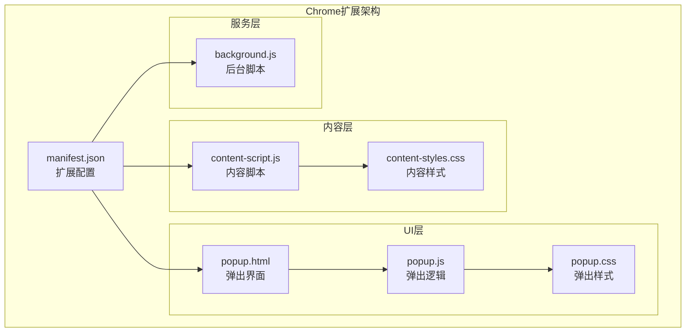
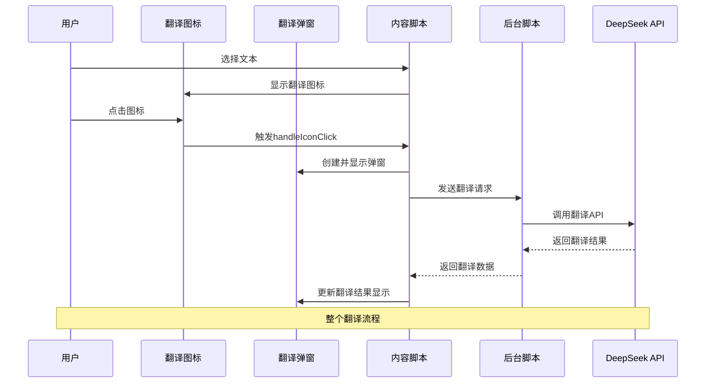
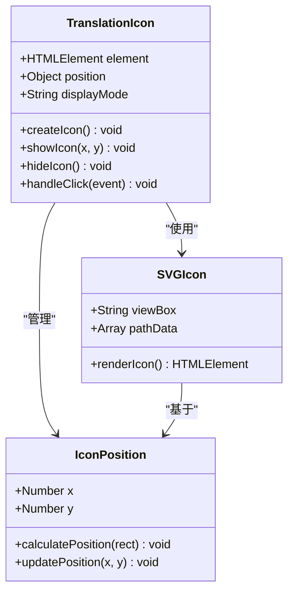
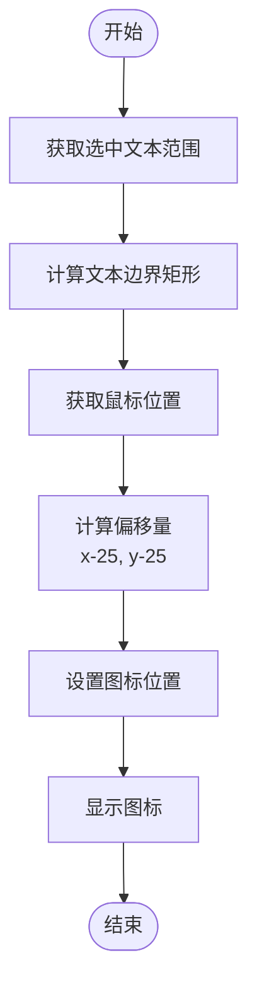
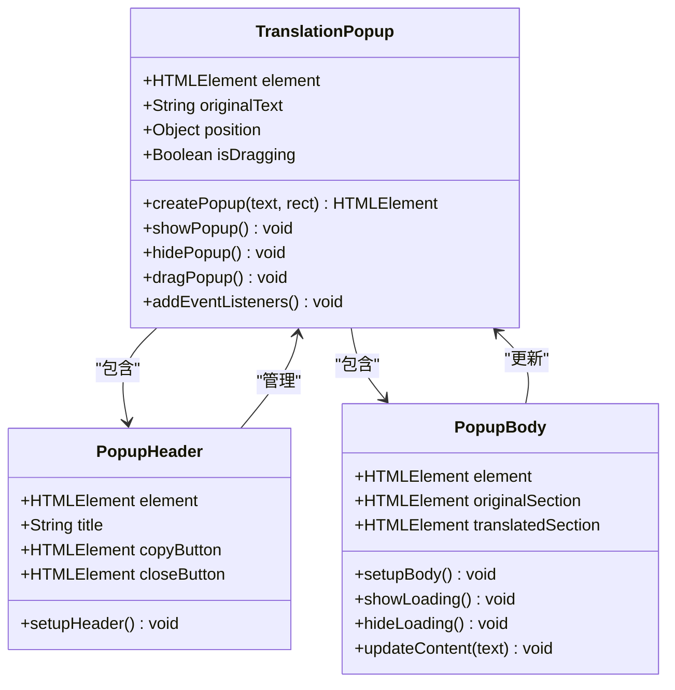
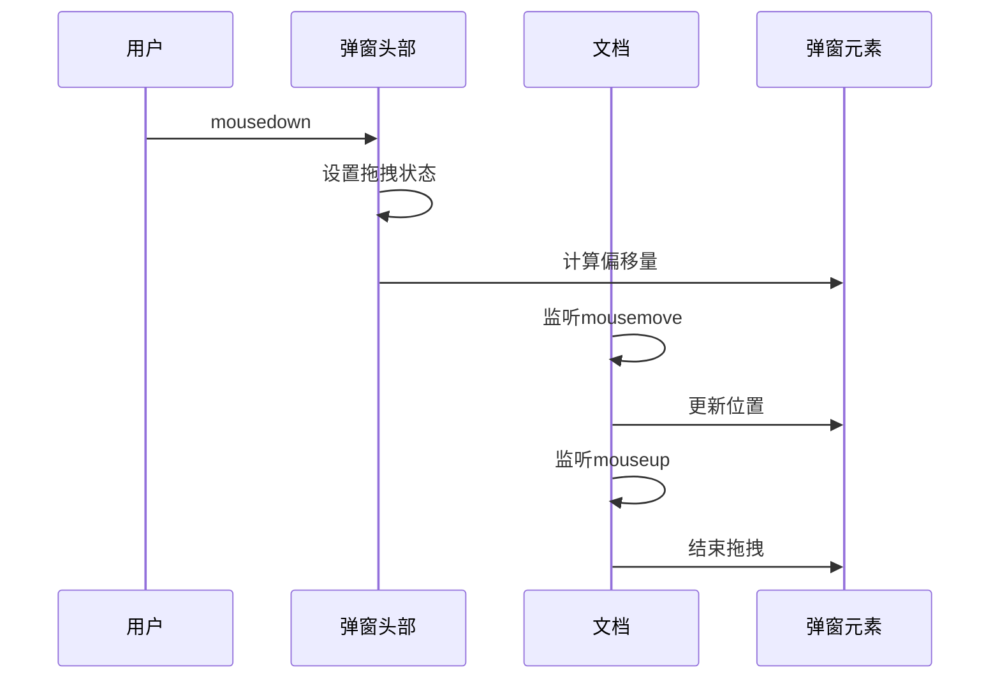
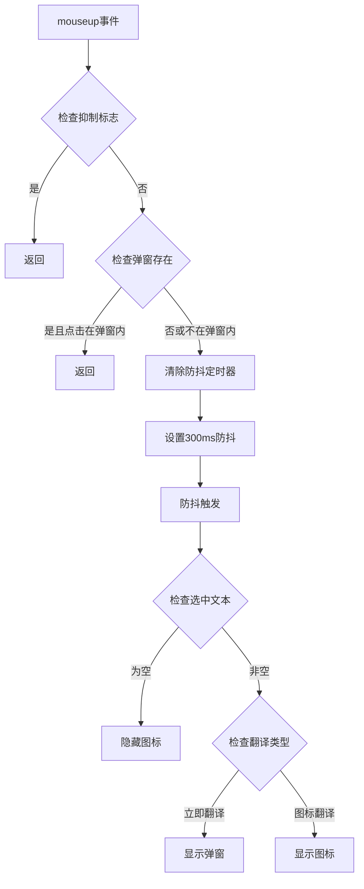
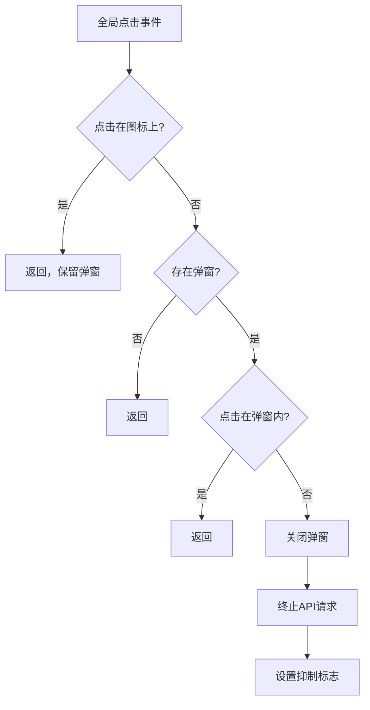
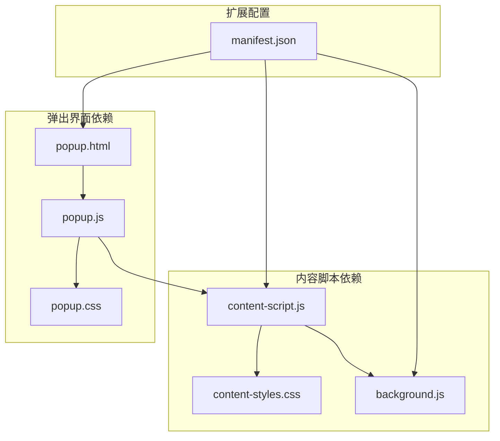

# 用户界面交互

<cite>
**本文档引用的文件**
- [manifest.json](file://manifest.json)
- [content-script.js](file://content-script.js)
- [background.js](file://background.js)
- [content-styles.css](file://content-styles.css)
- [popup.html](file://popup.html)
- [popup.js](file://popup.js)
- [popup.css](file://popup.css)
- [README.md](file://README.md)
</cite>

## 目录
1. [简介](#简介)
2. [项目结构](#项目结构)
3. [核心组件](#核心组件)
4. [架构概览](#架构概览)
5. [详细组件分析](#详细组件分析)
6. [依赖关系分析](#依赖关系分析)
7. [性能考虑](#性能考虑)
8. [故障排除指南](#故障排除指南)
9. [结论](#结论)

## 简介

这是一个基于Chrome扩展的AI翻译器项目，提供了强大的文本选择翻译功能。该系统包含三个主要组件：内容脚本负责网页中的实时翻译交互，弹出式界面提供配置和手动翻译功能，后台脚本处理API通信。项目实现了复杂的用户界面交互机制，包括翻译图标、弹窗系统、拖拽功能、语音朗读等高级特性。

## 项目结构

该项目采用标准的Chrome扩展架构，包含以下关键文件：

**图表来源**
- [manifest.json](file://manifest.json#L1-L32)
- [content-script.js](file://content-script.js#L1-L868)
- [popup.html](file://popup.html#L1-L226)

**章节来源**
- [manifest.json](file://manifest.json#L1-L32)
- [README.md](file://README.md#L1-L50)

## 核心组件

### 翻译图标系统

翻译图标是用户界面的核心交互元素，采用SVG图标渲染技术，具有以下特点：

- **SVG图标渲染**：使用矢量图形确保在不同分辨率下的清晰度
- **动态定位**：根据鼠标位置实时计算显示坐标
- **状态管理**：支持显示/隐藏状态控制
- **样式设计**：采用现代化的圆角边框和阴影效果

### 翻译弹窗系统

弹窗系统提供了完整的翻译结果显示界面，包含：

- **头部区域**：标题、复制按钮、关闭按钮
- **内容区域**：原文显示和翻译结果显示
- **语音朗读**：支持原文和翻译结果的语音播放
- **拖拽功能**：允许用户重新定位弹窗位置

### 事件处理机制

系统实现了多层次的事件处理机制：

- **文本选择监听**：实时监控用户的选择行为
- **全局点击处理**：管理弹窗的显示和隐藏
- **图标点击响应**：处理翻译图标的交互事件
- **防抖处理**：避免频繁的API调用

**章节来源**
- [content-script.js](file://content-script.js#L86-L127)
- [content-script.js](file://content-script.js#L207-L424)
- [content-styles.css](file://content-styles.css#L1-L196)

## 架构概览

**图表来源**
- [content-script.js](file://content-script.js#L129-L190)
- [content-script.js](file://content-script.js#L427-L467)
- [background.js](file://background.js#L1-L95)

## 详细组件分析

### 翻译图标实现

翻译图标采用SVG矢量图形技术，具有以下实现特点：

**图表来源**
- [content-script.js](file://content-script.js#L86-L127)
- [content-styles.css](file://content-styles.css#L1-L25)

#### SVG图标渲染原理

翻译图标使用SVG路径数据定义复杂的几何形状：

- **路径数据**：包含多个路径元素，形成独特的翻译符号
- **矢量优势**：支持任意缩放而不失真
- **样式绑定**：通过CSS类名控制颜色和尺寸

#### 位置计算逻辑

图标的位置计算基于以下算法：

**图表来源**
- [content-script.js](file://content-script.js#L170-L189)
- [content-script.js](file://content-script.js#L193-L204)

**章节来源**
- [content-script.js](file://content-script.js#L86-L127)
- [content-script.js](file://content-script.js#L193-L204)
- [content-styles.css](file://content-styles.css#L1-L25)

### 翻译弹窗系统

翻译弹窗是用户界面的核心组件，提供了完整的翻译结果显示功能：

**图表来源**
- [content-script.js](file://content-script.js#L207-L424)
- [content-styles.css](file://content-styles.css#L27-L185)

#### 弹窗创建和定位机制

弹窗的创建过程包含以下步骤：

1. **DOM元素创建**：动态生成包含完整结构的div元素
2. **样式应用**：设置固定定位、阴影、圆角等视觉效果
3. **内容填充**：包含标题、复制按钮、关闭按钮、原文和翻译区域
4. **位置计算**：基于选中文本的边界矩形确定显示位置

#### 拖拽功能实现

弹窗支持拖拽功能，实现方式如下：

**图表来源**
- [content-script.js](file://content-script.js#L374-L421)

**章节来源**
- [content-script.js](file://content-script.js#L207-L424)
- [content-script.js](file://content-script.js#L374-L421)
- [content-styles.css](file://content-styles.css#L27-L185)

### 事件处理机制

系统实现了复杂的时间处理机制，确保良好的用户体验：

#### 文本选择监听

**图表来源**
- [content-script.js](file://content-script.js#L129-L190)

#### 全局点击处理

全局点击处理确保弹窗的正确显示和隐藏：

**图表来源**
- [content-script.js](file://content-script.js#L492-L511)

**章节来源**
- [content-script.js](file://content-script.js#L129-L190)
- [content-script.js](file://content-script.js#L492-L511)

### 防抖处理和冲突抑制

系统实现了多层次的防抖和冲突抑制机制：

#### 防抖处理实现

防抖机制通过以下方式实现：

- **定时器管理**：使用`setTimeout`和`clearTimeout`控制执行时机
- **参数验证**：确保只有有效文本才会触发翻译
- **状态同步**：防止防抖回调时的状态冲突

#### 冲突抑制机制

冲突抑制通过以下变量实现：

- **shouldSuppressSelection**：抑制紧随其后的弹窗显示
- **abortController**：控制API请求的终止
- **textSelectionDebounceTimeout**：管理文本选择的防抖状态

**章节来源**
- [content-script.js](file://content-script.js#L130-L190)
- [content-script.js](file://content-script.js#L17-L22)

### 复制功能实现

复制功能提供了便捷的文本复制体验：

#### 复制按钮设计

复制按钮采用双层矩形设计，提供视觉反馈：

- **双层矩形**：外层较大，内层较小，形成嵌套效果
- **悬停效果**：通过CSS伪类实现交互反馈
- **即时提示**：复制成功后临时显示"已复制"提示

#### 复制实现逻辑

复制功能通过以下步骤实现：

1. **文本提取**：从翻译结果容器中获取纯文本
2. **剪贴板写入**：使用`navigator.clipboard.writeText()` API
3. **用户反馈**：临时修改按钮标题显示确认信息
4. **状态恢复**：定时器结束后恢复原始标题

**章节来源**
- [content-script.js](file://content-script.js#L274-L301)
- [content-script.js](file://content-script.js#L290-L299)

### 语音朗读功能

系统集成了Web Speech API，提供语音朗读功能：

#### 语言检测机制

语音朗读支持自动语言检测：

- **日文检测**：使用Unicode范围`[\u3040-\u30ff\u31f0-\u31ff]`
- **中文检测**：使用Unicode范围`[\u4e00-\u9fa5]`
- **默认英语**：其他文本使用英语发音

#### 语音合成实现

语音朗读通过以下方式实现：

1. **取消现有语音**：使用`speechSynthesis.cancel()`停止当前播放
2. **创建语音实例**：使用`SpeechSynthesisUtterance`对象
3. **设置语言参数**：根据检测结果设置合适的语言
4. **启动播放**：调用`speechSynthesis.speak()`方法

**章节来源**
- [content-script.js](file://content-script.js#L303-L353)
- [content-script.js](file://content-script.js#L316-L325)

### 样式设计和响应式布局

系统采用了现代化的CSS设计和响应式布局：

#### CSS类名管理

系统使用统一的命名约定：

- **深色主题**：`.deepseek-translation-*`前缀
- **状态管理**：`.loading`、`.translated-result`等状态类
- **交互反馈**：`:hover`、`:active`伪类实现

#### 动态样式应用

样式通过JavaScript动态应用：

- **位置计算**：使用`element.style.left/top`设置绝对定位
- **尺寸调整**：根据内容动态调整弹窗尺寸
- **状态切换**：通过`display`属性控制元素显示

**章节来源**
- [content-styles.css](file://content-styles.css#L1-L196)
- [content-script.js](file://content-script.js#L257-L268)

## 依赖关系分析

**图表来源**
- [manifest.json](file://manifest.json#L21-L31)
- [content-script.js](file://content-script.js#L1-L868)
- [popup.js](file://popup.js#L1-L452)

**章节来源**
- [manifest.json](file://manifest.json#L21-L31)

## 性能考虑

### 事件处理优化

系统在性能方面采用了多项优化策略：

- **防抖机制**：300ms防抖减少不必要的API调用
- **请求终止**：使用AbortController及时终止过期请求
- **内存管理**：及时清理DOM元素和事件监听器

### 渲染性能优化

- **最小化重绘**：通过批量DOM操作减少重绘次数
- **CSS硬件加速**：利用transform和opacity属性启用GPU加速
- **懒加载策略**：仅在需要时创建和显示元素

### 内存泄漏防护

系统实现了完善的内存泄漏防护机制：

- **事件监听器清理**：在元素移除时同时移除监听器
- **定时器管理**：及时清理不再使用的定时器
- **引用清理**：避免循环引用导致的内存泄漏

## 故障排除指南

### 常见问题诊断

#### 翻译图标不显示

可能的原因和解决方案：

1. **权限问题**：检查扩展权限设置
2. **样式冲突**：检查是否有其他CSS覆盖样式
3. **事件监听器**：确认事件监听器正常工作

#### 弹窗无法拖拽

排查步骤：

1. **检查事件绑定**：确认mousedown事件正常绑定
2. **验证CSS样式**：确保cursor: move样式生效
3. **调试位置计算**：检查位置计算逻辑

#### 复制功能失效

解决方案：

1. **检查剪贴板权限**：确认页面有剪贴板访问权限
2. **验证文本提取**：确认正确提取了翻译结果文本
3. **浏览器兼容性**：检查浏览器对Clipboard API的支持

**章节来源**
- [content-script.js](file://content-script.js#L492-L511)
- [content-script.js](file://content-script.js#L274-L301)

### 错误处理机制

系统实现了完善的错误处理机制：

- **API错误处理**：捕获并处理网络请求异常
- **用户友好提示**：向用户提供清晰的错误信息
- **状态恢复**：确保系统在错误后能恢复正常状态

## 结论

这个AI翻译器项目展现了现代Web扩展开发的最佳实践。通过精心设计的用户界面交互系统，实现了流畅的翻译体验。项目的主要优势包括：

1. **优秀的用户体验**：直观的图标交互和智能的弹窗管理
2. **高性能实现**：通过防抖和请求终止机制优化性能
3. **可维护性设计**：清晰的代码结构和模块化设计
4. **扩展性考虑**：易于添加新功能和改进现有功能

该系统为开发者提供了宝贵的参考，展示了如何在Chrome扩展环境中实现复杂的用户界面交互功能。通过深入理解这些实现细节，开发者可以构建出更加优秀和用户友好的扩展应用。