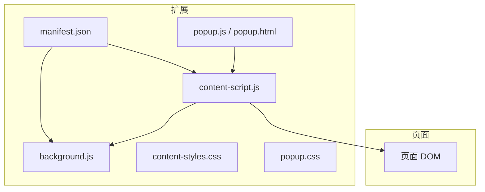
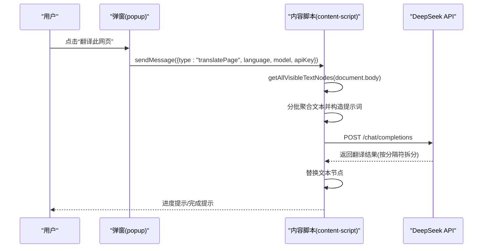
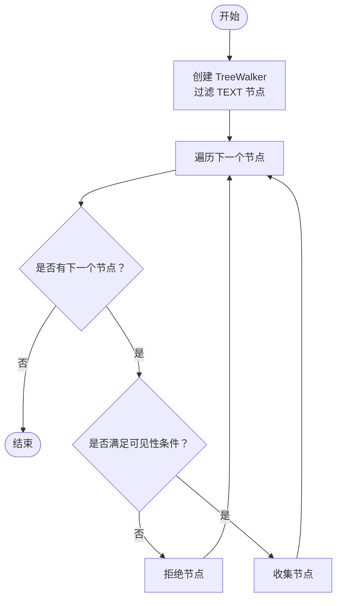
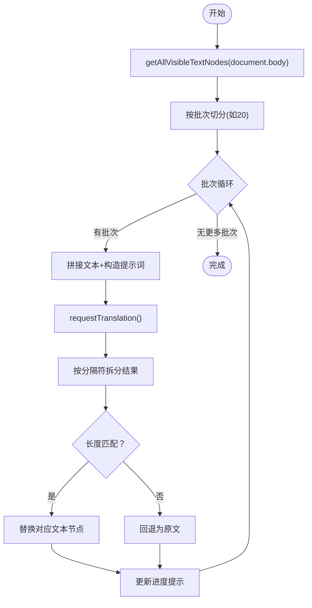
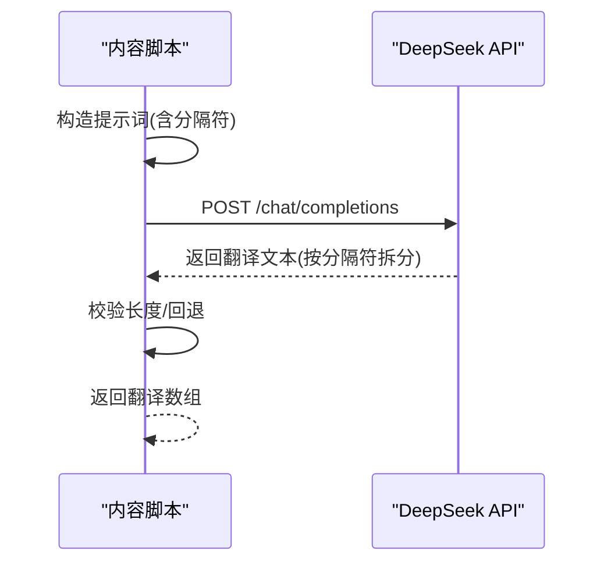
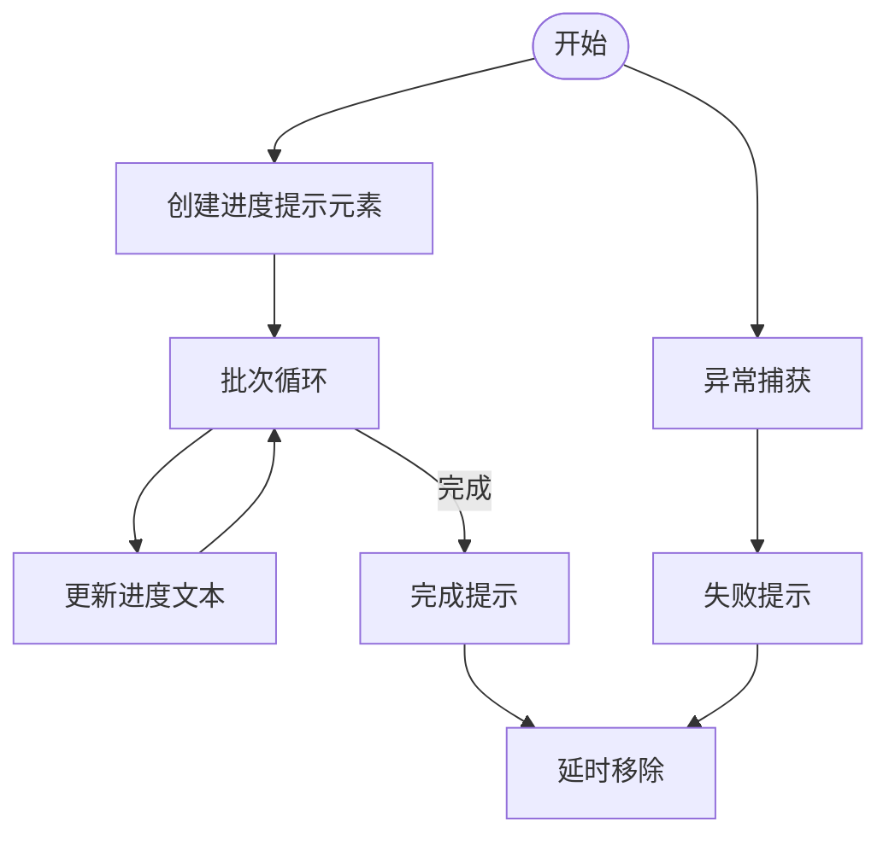
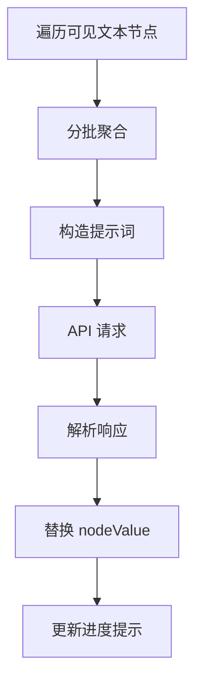
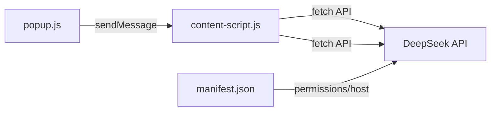

# 网页翻译功能

<cite>
**本文引用的文件**
- [manifest.json](file://manifest.json)
- [content-script.js](file://content-script.js)
- [background.js](file://background.js)
- [popup.js](file://popup.js)
- [popup.html](file://popup.html)
- [content-styles.css](file://content-styles.css)
- [popup.css](file://popup.css)
- [README.md](file://README.md)
</cite>

## 目录
1. [简介](#简介)
2. [项目结构](#项目结构)
3. [核心组件](#核心组件)
4. [架构总览](#架构总览)
5. [详细组件分析](#详细组件分析)
6. [依赖关系分析](#依赖关系分析)
7. [性能考量](#性能考量)
8. [故障排查指南](#故障排查指南)
9. [结论](#结论)
10. [附录](#附录)

## 简介
本项目是一个基于 Chrome 扩展的网页翻译工具，支持：
- 文本划词即时翻译与图标触发翻译
- 整页翻译（批量文本节点翻译）
- 多语言对与模型选择
- 翻译历史、复制、TTS 朗读、拖拽弹窗等交互体验
- 通过 DeepSeek API 完成翻译请求

本文档聚焦于整页翻译的实现原理，包括 DOM 遍历算法、文本节点提取、批量处理机制、进度提示、错误处理与用户反馈、请求翻译的批处理逻辑、结果替换与页面更新、性能优化与内存管理、超时处理等。

## 项目结构
该扩展采用 Manifest V3 结构，主要文件职责如下：
- manifest.json：声明权限、入口、内容脚本与后台脚本
- content-script.js：页面内容脚本，负责 DOM 交互、弹窗、整页翻译流程
- background.js：后台脚本，处理翻译请求（可选，当前内容脚本直接调用 API）
- popup.js / popup.html：弹窗界面与交互逻辑，包含翻译网页按钮
- content-styles.css / popup.css：样式定义
- README.md：使用说明与特性介绍

图表来源
- [manifest.json](file://manifest.json#L1-L32)
- [content-script.js](file://content-script.js#L1-L868)
- [background.js](file://background.js#L1-L95)
- [popup.js](file://popup.js#L1-L452)
- [popup.html](file://popup.html#L1-L226)

章节来源
- [manifest.json](file://manifest.json#L1-L32)
- [README.md](file://README.md#L1-L50)

## 核心组件
- 内容脚本（content-script.js）：负责 DOM 交互、弹窗、整页翻译流程、文本节点提取、批量翻译与结果替换
- 后台脚本（background.js）：处理翻译请求（当前内容脚本也可直接调用 API）
- 弹窗（popup.js / popup.html）：提供翻译网页按钮、语言/模型选择、历史记录等
- 样式（content-styles.css / popup.css）：定义图标、弹窗、加载动画等 UI

章节来源
- [content-script.js](file://content-script.js#L1-L868)
- [background.js](file://background.js#L1-L95)
- [popup.js](file://popup.js#L1-L452)
- [popup.html](file://popup.html#L1-L226)

## 架构总览
整页翻译从弹窗触发，向内容脚本发送消息，内容脚本执行以下流程：
1) 使用 TreeWalker 提取可见文本节点（排除脚本、样式、输入框、隐藏元素等）
2) 分批聚合文本，构造提示词
3) 调用翻译接口，解析响应
4) 将翻译结果按顺序替换回对应文本节点
5) 展示进度提示与完成状态

图表来源
- [popup.js](file://popup.js#L196-L225)
- [content-script.js](file://content-script.js#L690-L802)
- [content-script.js](file://content-script.js#L823-L867)

## 详细组件分析

### DOM 遍历与文本节点提取：getAllVisibleTextNodes
- 使用 TreeWalker 遍历文档树，仅接受 TEXT 节点
- 过滤规则：
  - 空白或纯空白字符
  - 父元素为 SCRIPT/STYLE/NOSCRIPT/TEXTAREA/INPUT/CODE/PRE 或可编辑元素
  - 父元素 CSS 样式为 display:none 或 visibility:hidden
- 返回可见文本节点数组，供后续批量翻译使用

图表来源
- [content-script.js](file://content-script.js#L703-L745)

章节来源
- [content-script.js](file://content-script.js#L703-L745)

### 整页翻译流程与批处理机制
- 步骤概览
  1) 获取可见文本节点列表
  2) 按固定批次大小切分（例如每批 20 个）
  3) 将每个批次文本拼接为多段文本，使用特殊分隔符连接
  4) 构造提示词，调用 requestTranslation
  5) 解析响应，按分隔符拆分得到翻译结果
  6) 逐个替换对应文本节点的 nodeValue
  7) 更新进度提示，完成后清理提示元素

- 批量处理要点
  - 分隔符：使用特定字符串作为分隔，确保响应能正确拆分
  - 数量校验：若拆分数量与批次长度不一致，回退为原文，避免错位
  - 温度与最大 token：控制响应稳定性与长度
  - 进度提示：实时更新已翻译数量/总数

图表来源
- [content-script.js](file://content-script.js#L701-L802)
- [content-script.js](file://content-script.js#L823-L867)

章节来源
- [content-script.js](file://content-script.js#L701-L802)
- [content-script.js](file://content-script.js#L823-L867)

### requestTranslation 批量翻译逻辑
- 输入参数：prompt、model、apiKey、batchTexts、sep、language
- 请求体：系统角色 + 用户提示词，temperature=0.1，max_tokens=2000
- 响应解析：按分隔符拆分，若数量不一致则回退为原文
- 返回值：翻译后的文本数组，按批次顺序一一对应

图表来源
- [content-script.js](file://content-script.js#L823-L867)

章节来源
- [content-script.js](file://content-script.js#L823-L867)

### 翻译进度提示与用户反馈
- 进度提示：创建固定定位的提示层，显示“正在翻译网页... (已翻译/总数)”与最终完成/失败信息
- 失败处理：捕获异常，更新提示文本并在一段时间后移除
- 完成清理：成功后延时移除提示元素

图表来源
- [content-script.js](file://content-script.js#L747-L802)

章节来源
- [content-script.js](file://content-script.js#L747-L802)

### 页面更新机制与性能优化
- 页面更新：直接修改文本节点的 nodeValue，避免重建 DOM
- 性能优化：
  - 使用 TreeWalker 一次性遍历，时间复杂度 O(N)
  - 批量处理降低 API 调用次数
  - 进度提示轻量 DOM 操作，避免阻塞主线程
  - 避免渲染大范围重排，仅替换文本节点

图表来源
- [content-script.js](file://content-script.js#L701-L802)

章节来源
- [content-script.js](file://content-script.js#L701-L802)

### 错误处理与用户体验
- API 错误：捕获响应状态与错误信息，统一格式化错误消息
- 终止控制：AbortController 支持取消请求，避免竞态
- 异常回退：当响应拆分数量与批次不一致时，回退为原文，保证页面稳定
- 用户反馈：弹窗与进度提示明确告知状态，失败时给出可读信息

章节来源
- [content-script.js](file://content-script.js#L565-L665)
- [content-script.js](file://content-script.js#L823-L867)

### 大页面翻译的内存管理与超时处理
- 内存管理建议：
  - 批次大小适中（当前为 20），避免单次处理过多文本导致内存峰值过高
  - 分批处理与逐步替换，减少一次性大对象创建
  - 及时清理进度提示元素与中间变量
- 超时处理建议：
  - 在 fetch 中传入 AbortController 的 signal，支持主动取消
  - 对长文本或网络不稳定场景，可在 UI 上增加“取消”按钮或自动重试策略（当前实现以终止为主）

章节来源
- [content-script.js](file://content-script.js#L586-L617)
- [content-script.js](file://content-script.js#L823-L867)

## 依赖关系分析
- 权限与宿主
  - permissions：storage、activeTab、scripting
  - host_permissions：对 DeepSeek API 的访问
- 内容脚本与弹窗通信
  - 弹窗通过 chrome.tabs.sendMessage 发送“translatePage”消息
  - 内容脚本监听消息并执行整页翻译
- API 调用
  - 内容脚本可直接调用 DeepSeek API，也可由后台脚本代理（当前实现优先内容脚本直连）

图表来源
- [manifest.json](file://manifest.json#L19-L21)
- [popup.js](file://popup.js#L202-L225)
- [content-script.js](file://content-script.js#L590-L617)
- [content-script.js](file://content-script.js#L831-L853)

章节来源
- [manifest.json](file://manifest.json#L19-L21)
- [popup.js](file://popup.js#L202-L225)
- [content-script.js](file://content-script.js#L590-L617)
- [content-script.js](file://content-script.js#L831-L853)

## 性能考量
- DOM 遍历：TreeWalker 适合大规模文档，避免递归或正则全站扫描
- 批处理：降低 API 调用频率，提升吞吐与成本控制
- 文本替换：直接修改 nodeValue，避免重建元素
- UI 更新：进度提示最小化 DOM 操作，避免频繁布局与绘制
- 并发与节流：内容脚本内已具备防抖与终止控制，避免重复请求

## 故障排查指南
- 无法获取 API Key
  - 症状：翻译报错“API key not set”
  - 处理：在弹窗中输入并保存 API Key
- 网络错误或服务端错误
  - 症状：进度提示显示失败信息
  - 处理：检查网络、API Key 有效性与配额
- 翻译结果错位
  - 症状：页面文本与翻译不对应
  - 处理：确认分隔符未出现在原文中；若响应拆分数量与批次不一致，系统会回退为原文
- 页面卡顿
  - 症状：大页面翻译耗时较长
  - 处理：适当增大批次大小或减少页面内容；必要时取消并重新尝试

章节来源
- [content-script.js](file://content-script.js#L567-L569)
- [content-script.js](file://content-script.js#L797-L799)
- [content-script.js](file://content-script.js#L863-L866)

## 结论
本项目实现了完整的网页整页翻译能力，核心在于：
- 使用 TreeWalker 精准提取可见文本节点
- 通过分批聚合与提示词构造，降低 API 成本并提升稳定性
- 基于分隔符的响应解析与回退机制，保障页面一致性
- 轻量级进度提示与错误处理，提供良好用户体验
- 直接内容脚本调用 API 的实现方式，简化了架构并便于调试

建议在生产环境中进一步完善：
- 可配置的批次大小与超时策略
- 更细粒度的错误分类与重试
- 对长文本的分段策略与缓存
- 对动态内容（SPA）的增量刷新支持

## 附录
- 使用说明与特性见 README
- 弹窗界面包含翻译网页按钮、语言/模型选择、历史记录等

章节来源
- [README.md](file://README.md#L39-L50)