# 翻译模式管理

<cite>
**本文档引用的文件**
- [manifest.json](file://manifest.json)
- [background.js](file://background.js)
- [content-script.js](file://content-script.js)
- [popup.js](file://popup.js)
- [popup.html](file://popup.html)
- [content-styles.css](file://content-styles.css)
- [popup.css](file://popup.css)
- [README.md](file://README.md)
</cite>

## 目录
1. [简介](#简介)
2. [项目结构](#项目结构)
3. [核心组件](#核心组件)
4. [架构概览](#架构概览)
5. [详细组件分析](#详细组件分析)
6. [依赖关系分析](#依赖关系分析)
7. [性能考虑](#性能考虑)
8. [故障排除指南](#故障排除指南)
9. [结论](#结论)

## 简介

AI Translator 是一个基于 Chrome 扩展的翻译工具，提供了三种不同的翻译模式：图标翻译模式、即时翻译模式和关闭划词模式。该扩展使用 DeepSeek AI API 进行文本翻译，并提供了丰富的用户界面和交互体验。

该项目采用 Manifest V3 架构，包含后台脚本、内容脚本和弹出式界面三个主要组件，实现了完整的翻译功能生态系统。

## 项目结构

项目采用模块化设计，每个组件都有明确的职责分工：

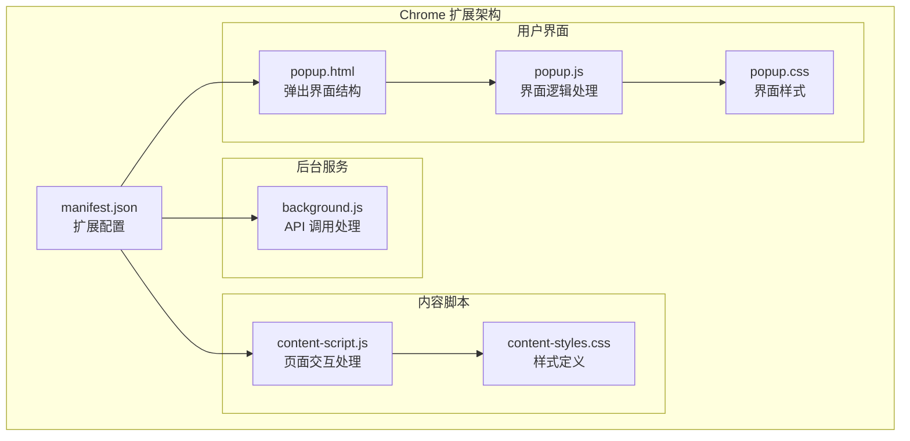

**图表来源**
- [manifest.json](file://manifest.json#L1-L32)
- [content-script.js](file://content-script.js#L1-L868)
- [popup.js](file://popup.js#L1-L452)

**章节来源**
- [manifest.json](file://manifest.json#L1-L32)
- [README.md](file://README.md#L12-L50)

## 核心组件

### 翻译模式配置系统

翻译模式管理系统的核心是 `translationSettings` 对象，它管理着所有翻译相关的配置状态：

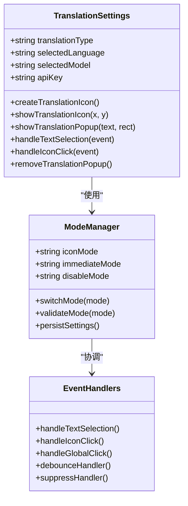

**图表来源**
- [content-script.js](file://content-script.js#L8-L13)
- [content-script.js](file://content-script.js#L129-L190)

### 事件处理机制

系统实现了多层次的事件处理机制，确保不同翻译模式下的响应一致性：

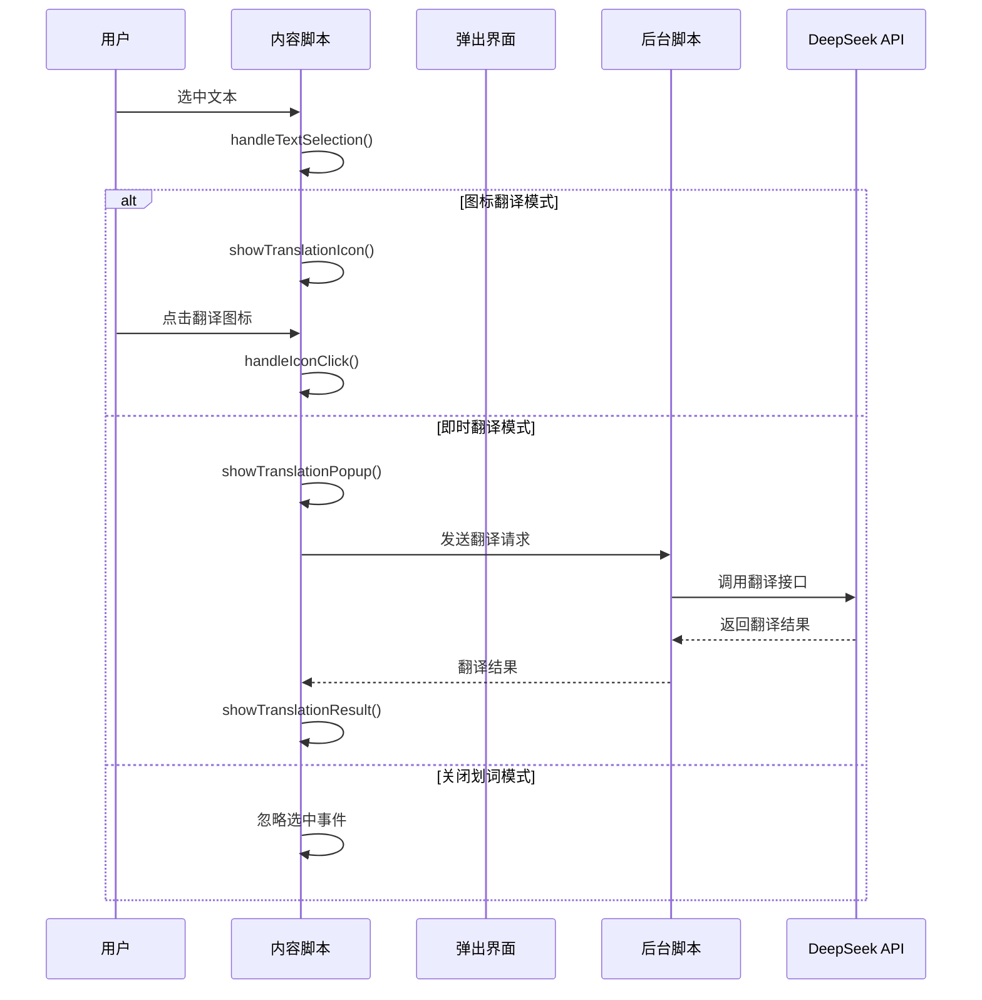

**图表来源**
- [content-script.js](file://content-script.js#L129-L190)
- [content-script.js](file://content-script.js#L426-L467)
- [background.js](file://background.js#L2-L7)

**章节来源**
- [content-script.js](file://content-script.js#L8-L13)
- [content-script.js](file://content-script.js#L129-L190)
- [background.js](file://background.js#L2-L7)

## 架构概览

### 整体架构设计

系统采用分层架构，每个组件都有明确的职责边界：

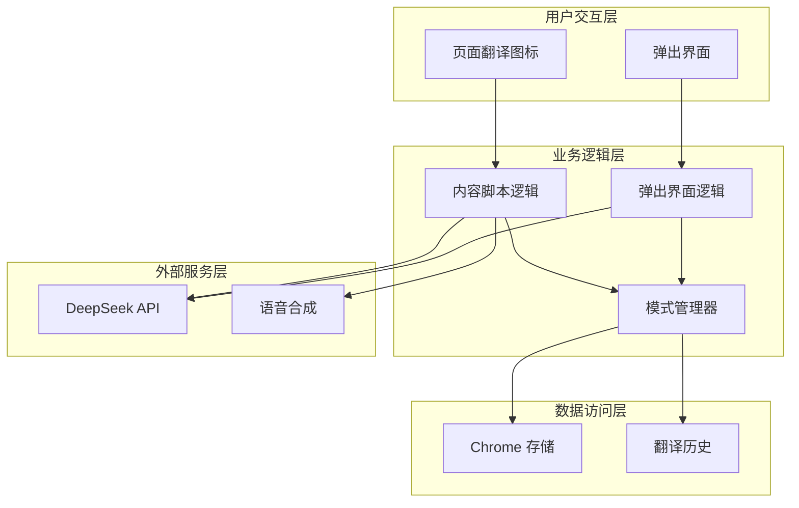

**图表来源**
- [popup.js](file://popup.js#L1-L452)
- [content-script.js](file://content-script.js#L1-L868)

### 数据流管理

翻译模式的数据流遵循统一的处理模式：

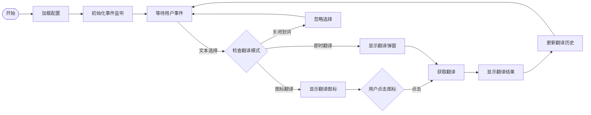

**图表来源**
- [content-script.js](file://content-script.js#L27-L83)
- [content-script.js](file://content-script.js#L129-L190)

**章节来源**
- [content-script.js](file://content-script.js#L27-L83)
- [content-script.js](file://content-script.js#L129-L190)

## 详细组件分析

### 图标翻译模式

图标翻译模式是最常用的翻译方式，用户选中文本后会出现翻译图标，点击图标显示翻译结果。

#### 实现原理

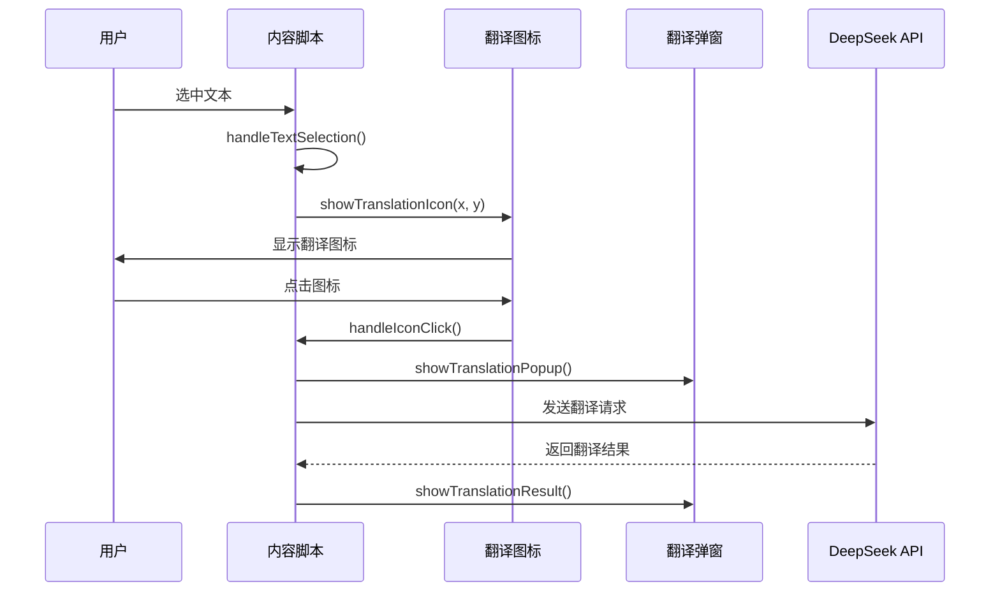

**图表来源**
- [content-script.js](file://content-script.js#L129-L190)
- [content-script.js](file://content-script.js#L426-L467)

#### 关键特性

1. **图标显示逻辑**：根据鼠标松开位置动态计算图标位置
2. **防抖处理**：避免频繁触发导致的性能问题
3. **冲突抑制**：防止图标点击和全局点击事件冲突
4. **状态管理**：维护选中文本和图标状态

**章节来源**
- [content-script.js](file://content-script.js#L86-L127)
- [content-script.js](file://content-script.js#L129-L190)
- [content-script.js](file://content-script.js#L426-L467)

### 即时翻译模式

即时翻译模式在用户选中文本时自动显示翻译结果，无需额外操作。

#### 实现机制

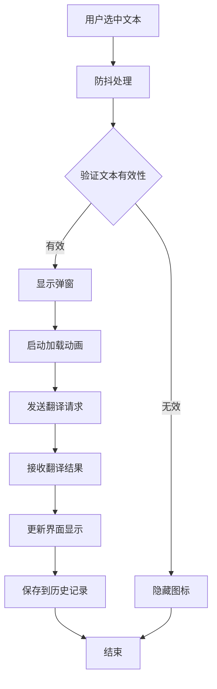

**图表来源**
- [content-script.js](file://content-script.js#L177-L181)
- [content-script.js](file://content-script.js#L207-L424)

#### 核心功能

1. **自动触发**：无需用户交互即可显示翻译结果
2. **实时反馈**：显示加载状态和翻译进度
3. **拖拽支持**：弹窗可拖拽移动
4. **复制功能**：支持一键复制翻译结果

**章节来源**
- [content-script.js](file://content-script.js#L177-L181)
- [content-script.js](file://content-script.js#L207-L424)

### 关闭划词模式

关闭划词模式完全禁用文本选择翻译功能，适合不需要翻译功能的用户。

#### 实现策略

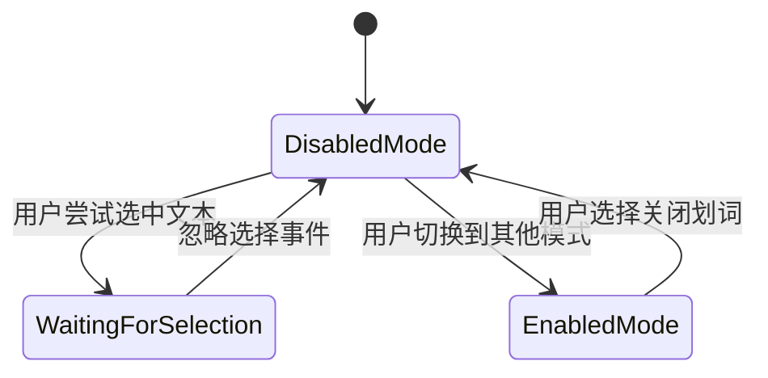

**图表来源**
- [popup.html](file://popup.html#L189-L218)
- [popup.js](file://popup.js#L188-L194)

#### 特殊处理

1. **事件拦截**：完全忽略文本选择事件
2. **状态同步**：确保与其他组件状态一致
3. **用户体验**：提供清晰的模式切换反馈

**章节来源**
- [popup.html](file://popup.html#L189-L218)
- [popup.js](file://popup.js#L188-L194)

### 事件处理机制

系统实现了复杂的事件处理机制来支持不同的翻译模式：

#### 文本选择监听

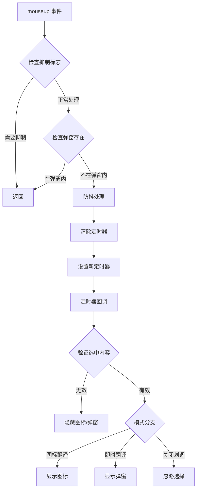

**图表来源**
- [content-script.js](file://content-script.js#L129-L190)

#### 图标点击处理

图标点击事件需要特殊的处理逻辑来避免与全局点击事件冲突：

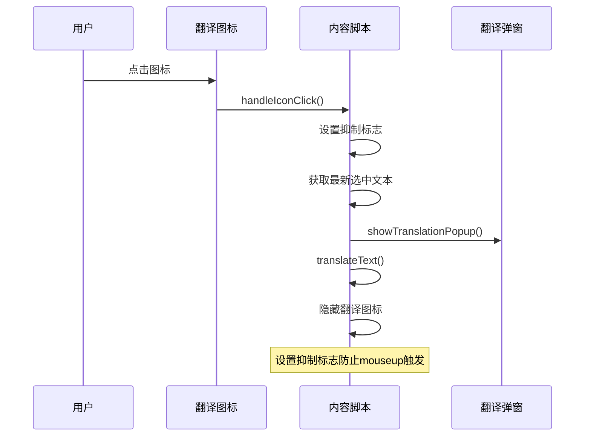

**图表来源**
- [content-script.js](file://content-script.js#L426-L467)

**章节来源**
- [content-script.js](file://content-script.js#L129-L190)
- [content-script.js](file://content-script.js#L426-L467)

### 状态管理和配置存储

#### 配置数据结构

翻译模式的配置信息存储在一个结构化的对象中：

| 配置项 | 类型 | 默认值 | 描述 |
|--------|------|--------|------|
| translationType | string | "图标翻译" | 当前翻译模式 |
| selectedLanguage | string | "英汉互译" | 语言对设置 |
| selectedModel | string | "deepseek-chat" | AI模型选择 |
| apiKey | string | "" | DeepSeek API密钥 |

#### 存储机制

系统使用 Chrome Extension Storage API 进行配置持久化：

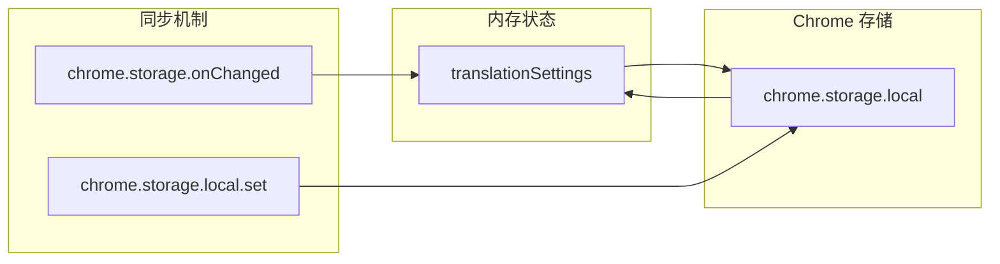

**图表来源**
- [content-script.js](file://content-script.js#L30-L68)
- [popup.js](file://popup.js#L33-L51)

**章节来源**
- [content-script.js](file://content-script.js#L30-L68)
- [popup.js](file://popup.js#L33-L51)

### 模式切换实现

#### 切换流程

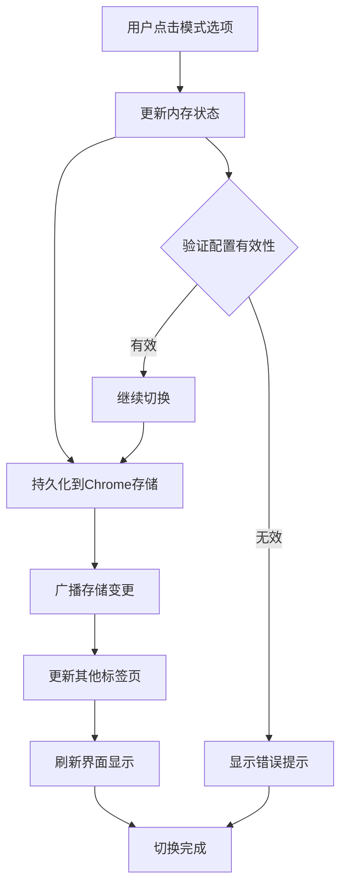

**图表来源**
- [popup.js](file://popup.js#L188-L194)
- [content-script.js](file://content-script.js#L55-L68)

#### 防抖和冲突抑制

系统实现了多层防抖和冲突抑制机制：

1. **文本选择防抖**：300ms延迟避免频繁触发
2. **图标点击抑制**：防止图标点击和mouseup事件冲突
3. **全局点击抑制**：避免误关闭翻译弹窗
4. **请求终止控制**：支持取消正在进行的翻译请求

**章节来源**
- [content-script.js](file://content-script.js#L146-L152)
- [content-script.js](file://content-script.js#L428-L433)
- [content-script.js](file://content-script.js#L509-L510)

## 依赖关系分析

### 组件耦合度

系统采用了合理的组件分离策略，各组件之间的耦合度适中：

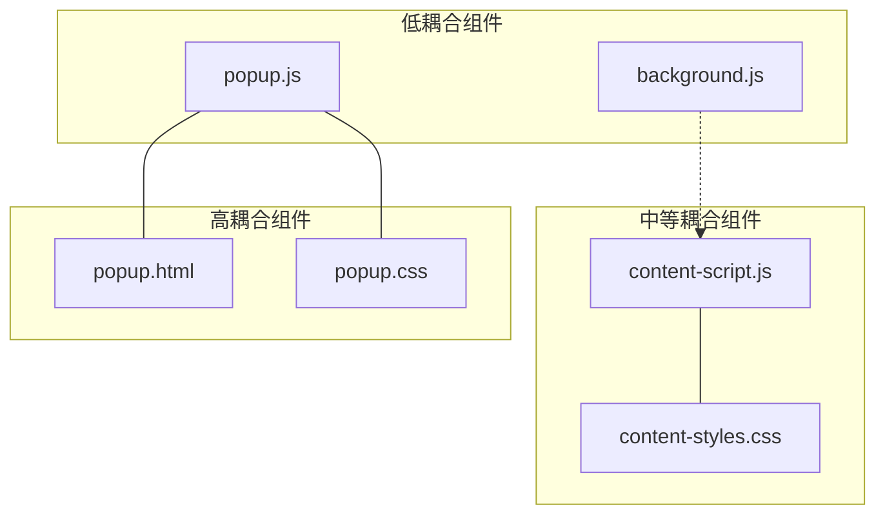

**图表来源**
- [popup.js](file://popup.js#L1-L452)
- [content-script.js](file://content-script.js#L1-L868)

### 外部依赖

系统对外部依赖的管理：

1. **Chrome Extension API**：依赖 Chrome Storage、Runtime、Tabs 等 API
2. **DeepSeek API**：依赖外部翻译服务
3. **Web APIs**：依赖 SpeechSynthesis、Clipboard 等浏览器功能

**章节来源**
- [manifest.json](file://manifest.json#L19-L26)
- [background.js](file://background.js#L12-L37)

## 性能考虑

### 优化策略

1. **防抖处理**：文本选择事件使用300ms防抖，减少不必要的API调用
2. **请求终止**：支持取消正在进行的翻译请求，避免资源浪费
3. **内存管理**：及时清理DOM元素和事件监听器
4. **缓存机制**：利用浏览器存储减少重复配置加载

### 性能监控

系统实现了基本的性能监控机制：

- 日志输出：关键操作都有详细的console日志
- 错误处理：完善的异常捕获和错误反馈
- 资源清理：组件卸载时自动清理相关资源

## 故障排除指南

### 常见问题及解决方案

#### 翻译结果为空

**可能原因**：
1. API密钥未正确配置
2. 网络连接问题
3. 选中文本为空或无效

**解决步骤**：
1. 检查弹出界面中的API密钥设置
2. 确认网络连接正常
3. 重新选中文本并重试

#### 图标不显示

**可能原因**：
1. 图标元素创建失败
2. CSS样式冲突
3. 页面加载时机问题

**解决步骤**：
1. 检查浏览器控制台是否有错误
2. 确认content-styles.css正确加载
3. 刷新页面重新初始化

#### 模式切换无效

**可能原因**：
1. 存储同步问题
2. 事件监听器未正确注册
3. 状态更新失败

**解决步骤**：
1. 检查chrome.storage.local中的配置
2. 重新加载扩展程序
3. 清除浏览器缓存后重试

**章节来源**
- [content-script.js](file://content-script.js#L567-L569)
- [content-script.js](file://content-script.js#L656-L664)

### 调试技巧

1. **启用详细日志**：查看浏览器开发者工具的Console输出
2. **检查存储状态**：使用Chrome Extensions页面查看存储数据
3. **网络监控**：观察API请求和响应状态
4. **事件跟踪**：使用Event Listener Breakpoints调试事件处理

## 结论

AI Translator 的翻译模式管理系统展现了现代浏览器扩展开发的最佳实践。通过精心设计的架构和实现，系统成功地平衡了功能完整性、用户体验和性能表现。

### 主要优势

1. **灵活的模式切换**：三种翻译模式满足不同用户需求
2. **优秀的用户体验**：流畅的交互和直观的界面设计
3. **可靠的稳定性**：完善的错误处理和状态管理
4. **良好的扩展性**：模块化的架构便于功能扩展

### 技术亮点

1. **智能事件处理**：多层防抖和冲突抑制机制
2. **高效的资源管理**：及时清理和优化内存使用
3. **强大的配置系统**：持久化的状态管理和实时同步
4. **完善的错误处理**：从API调用到UI渲染的全链路错误处理

该系统为浏览器翻译扩展提供了一个优秀的参考实现，展示了如何在有限的浏览器环境中构建功能丰富、性能优异的应用程序。