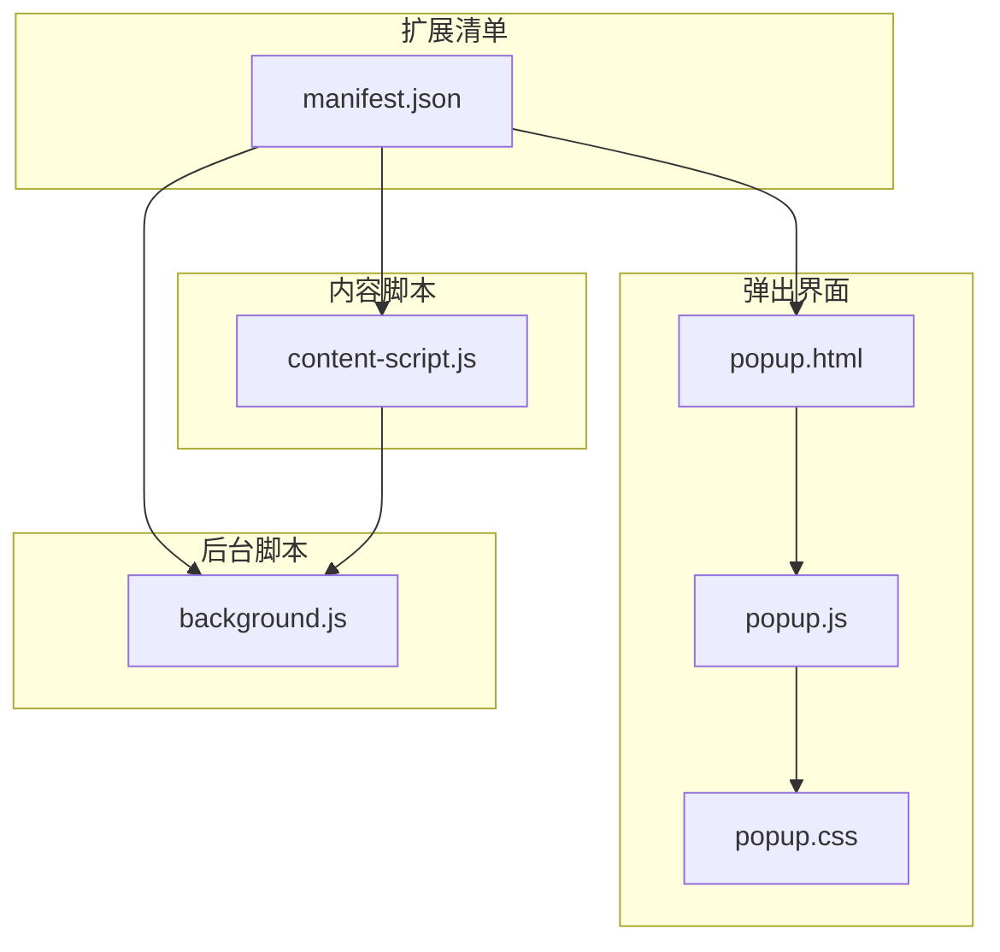
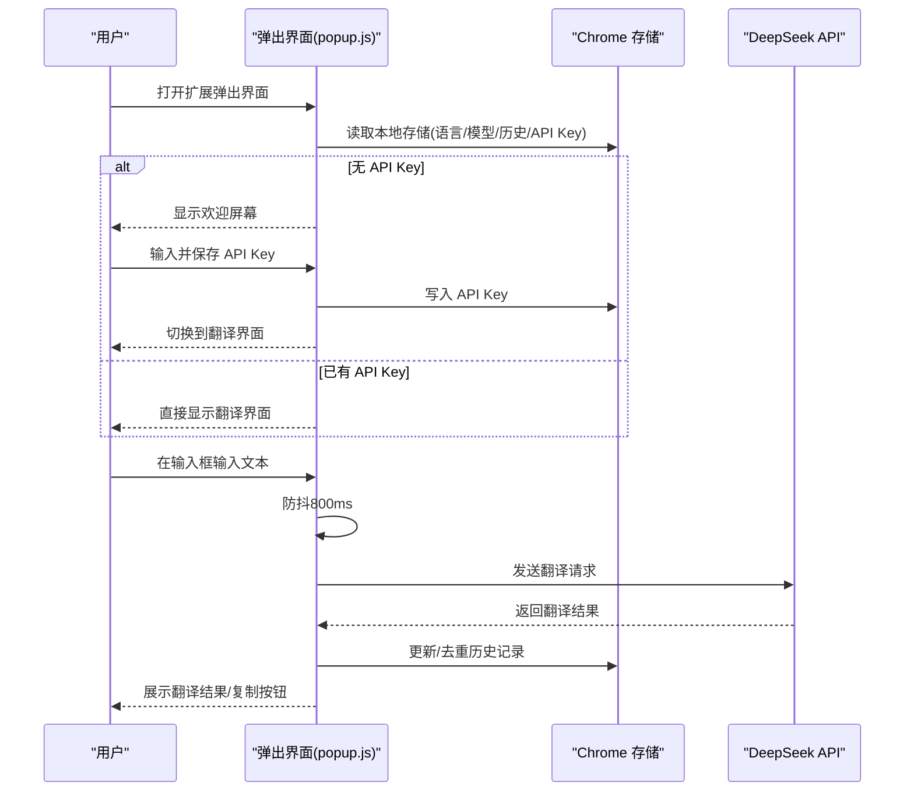
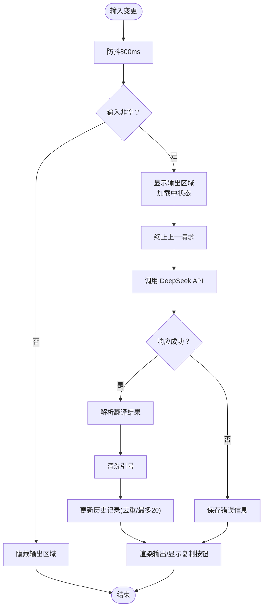
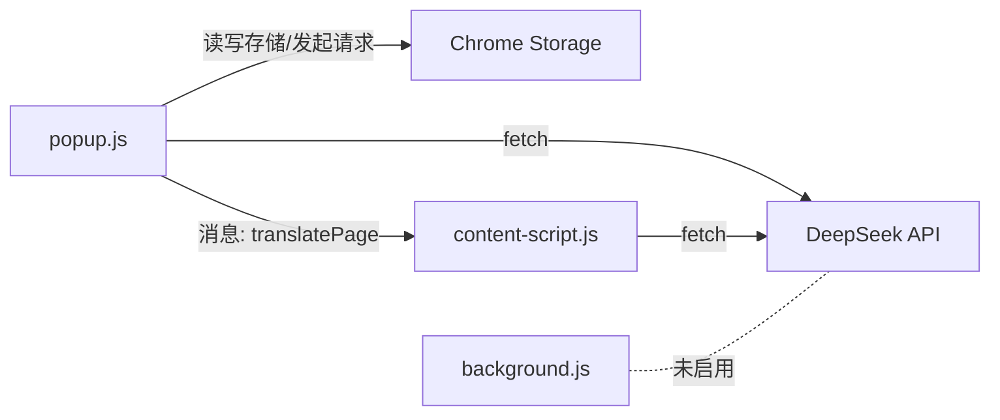

# 弹出界面

<cite>
**本文引用的文件**
- [popup.html](file://popup.html)
- [popup.js](file://popup.js)
- [popup.css](file://popup.css)
- [manifest.json](file://manifest.json)
- [content-script.js](file://content-script.js)
- [background.js](file://background.js)
- [README.md](file://README.md)
</cite>

## 目录
1. [简介](#简介)
2. [项目结构](#项目结构)
3. [核心组件](#核心组件)
4. [架构总览](#架构总览)
5. [组件详细分析](#组件详细分析)
6. [依赖关系分析](#依赖关系分析)
7. [性能考量](#性能考量)
8. [故障排查指南](#故障排查指南)
9. [结论](#结论)
10. [附录](#附录)

## 简介
本文件系统化梳理了弹出界面（popup）的设计与实现，覆盖 HTML 结构、JavaScript 逻辑与 CSS 样式三大部分，并补充与内容脚本（content-script）及后台脚本（background）的交互关系。重点说明：
- 欢迎屏幕与 API 密钥输入
- 翻译界面的输入输出区域、历史记录面板
- 语言选择下拉框、AI 模型选择与翻译模式切换
- JavaScript 的状态管理、事件处理、请求处理与历史记录管理
- CSS 的响应式布局、主题适配、动画与可访问性
- 数据绑定模式、事件处理机制与用户交互流程
- 实际代码示例路径与最佳实践建议

## 项目结构
该扩展采用 Manifest V3 架构，弹出界面由 popup.html、popup.js、popup.css 提供；内容脚本负责网页划词翻译；后台脚本处理跨标签页或服务端通信（本仓库中未启用）。

图表来源
- [manifest.json](file://manifest.json#L1-L32)
- [popup.html](file://popup.html#L1-L226)
- [popup.js](file://popup.js#L1-L452)
- [popup.css](file://popup.css#L1-L349)
- [content-script.js](file://content-script.js#L1-L868)
- [background.js](file://background.js#L1-L95)

章节来源
- [manifest.json](file://manifest.json#L1-L32)
- [popup.html](file://popup.html#L1-L226)
- [popup.js](file://popup.js#L1-L452)
- [popup.css](file://popup.css#L1-L349)
- [content-script.js](file://content-script.js#L1-L868)
- [background.js](file://background.js#L1-L95)

## 核心组件
- 欢迎屏幕与 API 密钥输入：首次使用时引导用户输入 DeepSeek API Key，并本地存储。
- 翻译界面：包含输入区、输出区、历史记录面板、语言选择、模型选择与翻译模式切换。
- 事件与状态：统一的状态对象管理输入文本、输出文本、所选语言、模型、翻译模式、历史记录、加载与错误状态。
- 请求处理：向 DeepSeek API 发起翻译请求，支持取消与防抖。
- 历史记录：本地存储搜索历史，支持清空与点击回填。

章节来源
- [popup.html](file://popup.html#L11-L48)
- [popup.js](file://popup.js#L3-L29)
- [popup.js](file://popup.js#L59-L87)
- [popup.js](file://popup.js#L262-L341)
- [popup.js](file://popup.js#L387-L406)

## 架构总览
弹出界面的控制流从 DOMContentLoaded 初始化开始，根据本地存储决定显示欢迎屏幕还是翻译界面。翻译界面初始化后绑定各类事件，处理输入变更、下拉菜单、单选按钮、历史列表点击与网页翻译按钮。翻译请求通过 fetch 发送到 DeepSeek API，支持中断与错误处理，并更新输出区域与历史记录。

图表来源
- [popup.js](file://popup.js#L1-L452)
- [popup.html](file://popup.html#L50-L221)

章节来源
- [popup.js](file://popup.js#L1-L452)

## 组件详细分析

### HTML 结构设计
- 欢迎屏幕（欢迎图标、标题、API Key 输入与保存按钮、帮助信息）
- 翻译界面容器（输入区、输出区、历史面板、右侧“翻译网页”按钮）
- 功能栏（语言下拉、模型下拉、翻译模式单选组）

关键要点
- 容器与网格布局：翻译区域采用两列网格布局，右侧为历史面板与“翻译网页”按钮。
- 输出区右下角复制按钮：仅在有输出时显示。
- 下拉菜单与单选组：均通过数据属性与事件委托实现交互。

章节来源
- [popup.html](file://popup.html#L11-L48)
- [popup.html](file://popup.html#L50-L221)

### JavaScript 逻辑
- 状态管理：集中于 state 对象，包含输入输出、语言、模型、翻译模式、历史、加载与错误标志。
- 生命周期：DOMContentLoaded 初始化，随后根据 API Key 决定界面显示。
- 事件绑定：输入框防抖、下拉菜单开关与外部点击关闭、历史项点击回填与触发翻译、模型切换即时翻译、复制按钮写入剪贴板。
- 翻译请求：构造系统提示与用户提示，设置温度与最大 token，支持中断（AbortController），错误处理与历史去重。
- 历史记录：最多保留 20 条，去重并按最近在前排序，清空时同步存储。

图表来源
- [popup.js](file://popup.js#L242-L341)
- [popup.js](file://popup.js#L387-L406)

章节来源
- [popup.js](file://popup.js#L3-L29)
- [popup.js](file://popup.js#L59-L87)
- [popup.js](file://popup.js#L127-L241)
- [popup.js](file://popup.js#L262-L341)
- [popup.js](file://popup.js#L387-L406)

### CSS 样式设计
- 基础尺寸与字体：固定宽高、系统字体栈、浅灰背景。
- 布局体系：容器采用 Flex 与 Grid，翻译区域为 3:1 的左右布局，右侧为固定宽度的历史面板。
- 输入输出区：边框圆角、白色背景、输出区浅灰背景与滚动条。
- 复制按钮：绝对定位、阴影、悬停与按下反馈。
- 下拉菜单：绝对定位、阴影、滚动、最小宽度匹配按钮。
- 加载与错误：加载动画（旋转）、错误颜色。
- 响应式与可访问性：字号与行高适中、颜色对比度合理、焦点可见性（通过 outline 控制）。

章节来源
- [popup.css](file://popup.css#L1-L349)

### 组件间数据绑定与事件处理
- 数据绑定模式：通过 state 对象集中管理 UI 状态，UI 元素与 state 同步（如输入框值、选中语言/模型文本、单选按钮选中态），渲染时再更新 DOM。
- 事件处理机制：
  - 输入变更：防抖触发翻译请求。
  - 下拉菜单：点击按钮切换显示/隐藏，文档级外部点击关闭。
  - 历史列表：点击历史项回填输入并触发翻译。
  - 网页翻译：向内容脚本发送消息，内容脚本负责页面文本提取与批量翻译。
  - 复制按钮：写入剪贴板并短暂提示。

章节来源
- [popup.js](file://popup.js#L89-L150)
- [popup.js](file://popup.js#L152-L185)
- [popup.js](file://popup.js#L196-L225)
- [popup.js](file://popup.js#L227-L240)
- [content-script.js](file://content-script.js#L689-L698)

### 用户交互流程
- 首次使用：输入 API Key 并保存，切换到翻译界面。
- 日常使用：输入文本，自动翻译并展示结果；点击历史项可快速回填并翻译；切换语言/模型即时生效；点击复制按钮快速复制结果。
- 高级功能：点击“翻译网页”按钮，内容脚本遍历可见文本节点并批量翻译。

章节来源
- [popup.js](file://popup.js#L69-L87)
- [popup.js](file://popup.js#L127-L241)
- [content-script.js](file://content-script.js#L689-L698)

## 依赖关系分析
- 弹出界面依赖 Chrome Storage 进行本地持久化（语言、模型、历史、API Key）。
- 弹出界面依赖 DeepSeek API 进行翻译请求。
- 内容脚本负责网页划词翻译与网页整体翻译，与弹出界面通过消息传递协作。
- 后台脚本在 Manifest V3 中通常用于长期运行任务，本仓库中未启用，内容脚本直接调用 API。

图表来源
- [popup.js](file://popup.js#L34-L51)
- [popup.js](file://popup.js#L280-L306)
- [content-script.js](file://content-script.js#L586-L617)
- [manifest.json](file://manifest.json#L19-L31)

章节来源
- [popup.js](file://popup.js#L34-L51)
- [content-script.js](file://content-script.js#L586-L617)
- [manifest.json](file://manifest.json#L19-L31)

## 性能考量
- 防抖优化：输入变更防抖 800ms，减少不必要的请求。
- 请求中断：新请求发起前终止上一请求，避免并发与资源浪费。
- 历史记录上限：最多 20 条，降低存储与渲染压力。
- 输出区域懒渲染：加载中显示占位，成功后才显示复制按钮，减少 DOM 操作。
- 下拉菜单滚动：内容过多时启用垂直滚动，避免布局抖动。

章节来源
- [popup.js](file://popup.js#L242-L259)
- [popup.js](file://popup.js#L275-L277)
- [popup.js](file://popup.js#L321-L328)
- [popup.css](file://popup.css#L223-L225)

## 故障排查指南
- API Key 未设置：欢迎屏幕会阻止进入翻译界面。请先在欢迎屏幕输入并保存 API Key。
- 翻译无响应：检查网络连通性与 API Key 是否正确；查看输出区域是否显示错误信息。
- 下拉菜单无法关闭：确保点击了页面空白处或点击了其他下拉按钮；确认外部点击处理逻辑正常。
- 历史记录异常：检查本地存储键名是否一致；清空历史后重新输入测试。
- 网页翻译失败：确认内容脚本已注入；检查当前标签页是否可获取；查看控制台错误信息。

章节来源
- [popup.js](file://popup.js#L69-L87)
- [popup.js](file://popup.js#L329-L340)
- [popup.js](file://popup.js#L430-L444)
- [content-script.js](file://content-script.js#L689-L698)

## 结论
弹出界面以简洁清晰的结构实现了完整的翻译工作流：从 API Key 输入到翻译界面，再到历史记录与网页翻译。JavaScript 通过集中状态管理与事件驱动的方式，提供了良好的用户体验；CSS 采用现代布局与动画，兼顾美观与可访问性。建议后续可考虑：
- 增加更多语言对与模型选项
- 优化错误提示与重试机制
- 增强键盘快捷键与无障碍支持
- 将部分逻辑迁移到后台脚本以提升稳定性

## 附录
- 最佳实践
  - 使用防抖与请求中断，避免频繁请求与资源浪费
  - 本地存储键名统一命名规范，便于维护
  - 输出区域在加载与错误状态下提供明确反馈
  - 下拉菜单与面板尽量使用绝对定位，避免布局抖动
  - 复制按钮提供短暂提示，增强用户感知
- 相关文件路径
  - 弹出界面入口：[popup.html](file://popup.html#L1-L226)
  - 逻辑实现：[popup.js](file://popup.js#L1-L452)
  - 样式定义：[popup.css](file://popup.css#L1-L349)
  - 清单配置：[manifest.json](file://manifest.json#L1-L32)
  - 内容脚本（划词/网页翻译）：[content-script.js](file://content-script.js#L1-L868)
  - 后台脚本（未启用）：[background.js](file://background.js#L1-L95)
  - 项目说明：[README.md](file://README.md#L1-L50)