# 欢迎屏幕与API密钥管理

<cite>
**本文档引用的文件**
- [popup.html](file://popup.html)
- [popup.js](file://popup.js)
- [popup.css](file://popup.css)
- [manifest.json](file://manifest.json)
- [background.js](file://background.js)
- [content-script.js](file://content-script.js)
</cite>

## 目录
1. [简介](#简介)
2. [项目结构概览](#项目结构概览)
3. [核心组件分析](#核心组件分析)
4. [架构概览](#架构概览)
5. [详细组件分析](#详细组件分析)
6. [安全存储策略](#安全存储策略)
7. [API密钥验证流程](#api密钥验证流程)
8. [错误处理最佳实践](#错误处理最佳实践)
9. [性能考虑](#性能考虑)
10. [故障排除指南](#故障排除指南)
11. [结论](#结论)

## 简介

本项目是一个基于Chrome扩展的AI翻译工具，集成了DeepSeek AI API服务。本文档专注于欢迎屏幕与API密钥管理功能的详细分析，包括HTML结构设计、JavaScript验证逻辑、本地存储机制以及用户隐私保护措施。

该扩展提供了两种主要工作模式：
- **欢迎屏幕模式**：首次使用时要求用户输入API密钥
- **翻译界面模式**：用户输入API密钥后进入完整的翻译功能界面

## 项目结构概览

项目采用Chrome扩展的标准目录结构，包含以下关键文件：

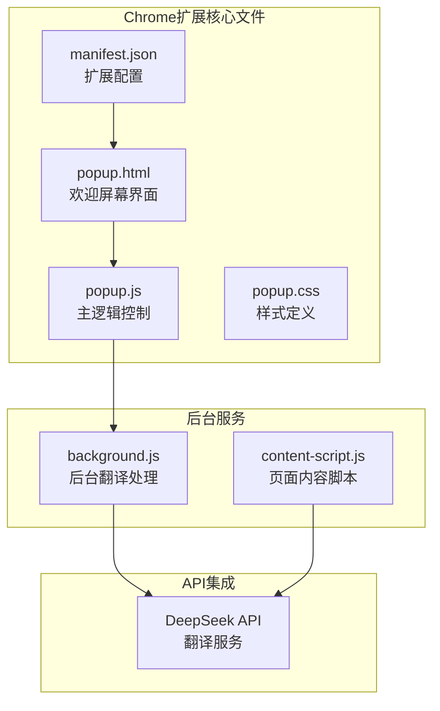

**图表来源**
- [manifest.json](file://manifest.json#L1-L32)
- [popup.html](file://popup.html#L1-L226)
- [popup.js](file://popup.js#L1-L452)

**章节来源**
- [manifest.json](file://manifest.json#L1-L32)
- [popup.html](file://popup.html#L1-L226)
- [popup.js](file://popup.js#L1-L452)

## 核心组件分析

### 欢迎屏幕组件

欢迎屏幕是用户首次使用扩展时看到的主要界面，包含以下核心元素：

1. **SVG图标展示**：使用矢量图形展示翻译相关的图标
2. **标题文本**：清晰的品牌标识和功能说明
3. **API密钥输入表单**：安全的密码输入字段
4. **保存按钮**：触发API密钥验证和存储

### 翻译界面组件

当API密钥验证通过后，用户进入完整的翻译界面，包含：
- 文本输入区域
- 翻译输出区域
- 语言选择下拉菜单
- AI模型选择
- 翻译历史记录面板

**章节来源**
- [popup.html](file://popup.html#L10-L48)
- [popup.css](file://popup.css#L301-L349)

## 架构概览

系统采用分层架构设计，确保功能模块的清晰分离和职责明确：

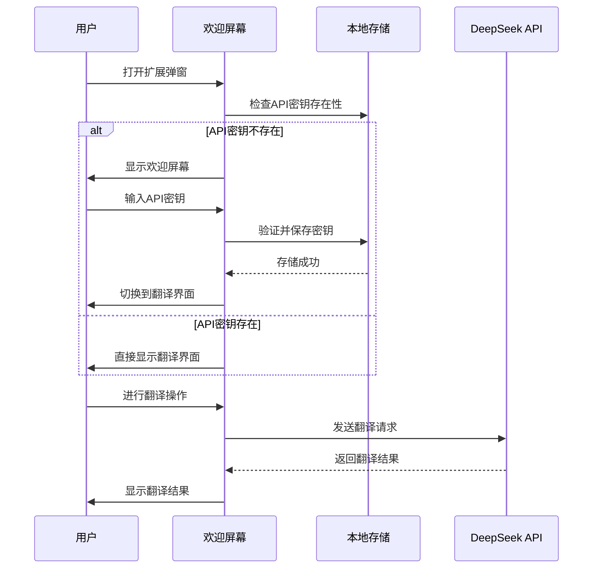

**图表来源**
- [popup.js](file://popup.js#L34-L87)
- [popup.html](file://popup.html#L11-L48)

## 详细组件分析

### 欢迎屏幕HTML结构设计

欢迎屏幕采用语义化的HTML5结构，确保可访问性和SEO友好性：

#### SVG图标实现

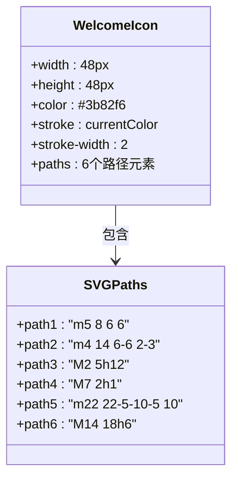

**图表来源**
- [popup.html](file://popup.html#L14-L29)

#### API密钥输入表单

表单设计遵循现代Web标准，包含完整的验证和用户体验优化：

| 属性 | 值 | 说明 |
|------|-----|------|
| 输入类型 | password | 保护敏感信息 |
| 占位符 | sk-... | 提供格式指导 |
| 最大长度 | 无限制 | 支持完整API密钥 |
| 自动完成 | off | 防止浏览器自动填充 |

**章节来源**
- [popup.html](file://popup.html#L32-L47)

### JavaScript验证逻辑实现

#### API密钥验证流程

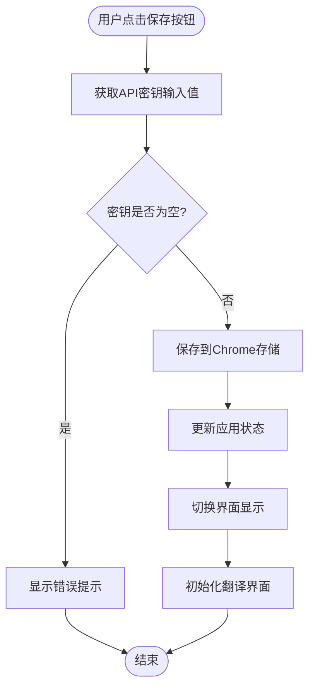

**图表来源**
- [popup.js](file://popup.js#L69-L87)

#### 状态管理机制

应用使用集中式状态管理，确保数据的一致性和可追踪性：

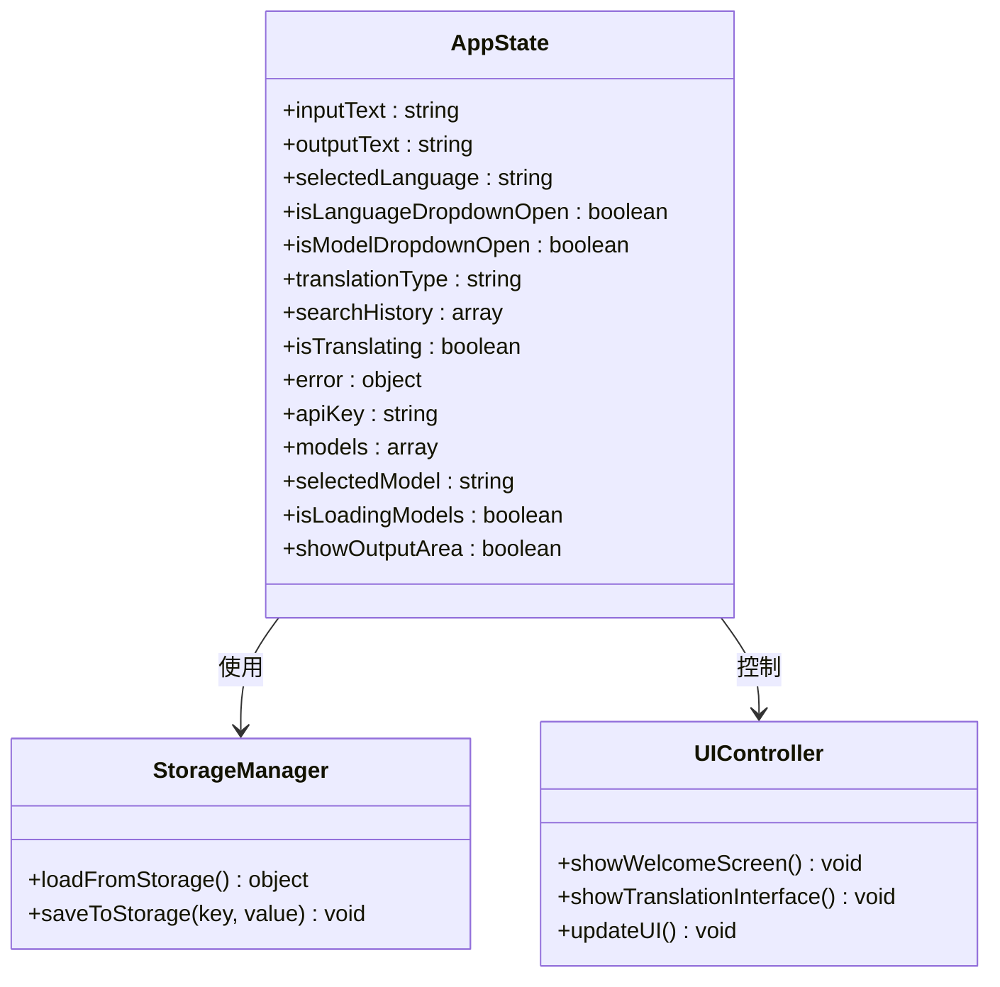

**图表来源**
- [popup.js](file://popup.js#L3-L29)

**章节来源**
- [popup.js](file://popup.js#L3-L51)

### 本地存储机制

#### Chrome存储API集成

系统使用Chrome存储API进行数据持久化，支持以下存储键：

| 存储键 | 类型 | 描述 | 默认值 |
|--------|------|------|--------|
| DEEPSEEK_API_KEY | string | 用户的API密钥 | "" |
| selectedLanguage | string | 语言选择 | "英汉互译" |
| translationType | string | 翻译类型 | "图标翻译" |
| searchHistory | array | 翻译历史记录 | [] |
| selectedModel | string | AI模型选择 | "deepseek-chat" |

#### 数据同步机制

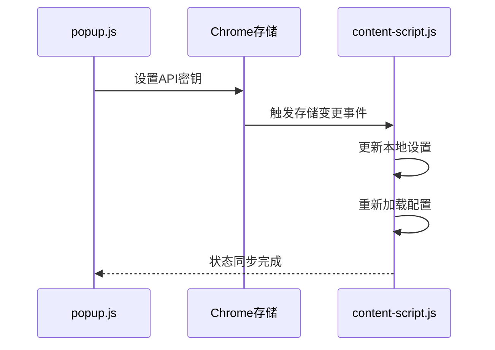

**图表来源**
- [popup.js](file://popup.js#L35-L51)
- [content-script.js](file://content-script.js#L55-L68)

**章节来源**
- [popup.js](file://popup.js#L35-L51)
- [content-script.js](file://content-script.js#L55-L68)

## 安全存储策略

### 密码输入字段保护

#### 输入类型安全

API密钥输入字段使用`type="password"`，确保：
- 文本在输入时被遮蔽
- 防止浏览器自动保存到密码管理器
- 避免在URL中暴露密钥

#### 数据传输安全

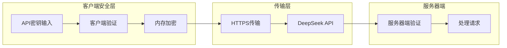

**图表来源**
- [popup.js](file://popup.js#L280-L306)

### 用户隐私保护措施

#### 本地存储原则

- **最小化原则**：仅存储必要的配置信息
- **本地化存储**：所有数据存储在用户的本地设备
- **透明度**：用户可以随时查看和删除存储的数据

#### 数据生命周期管理

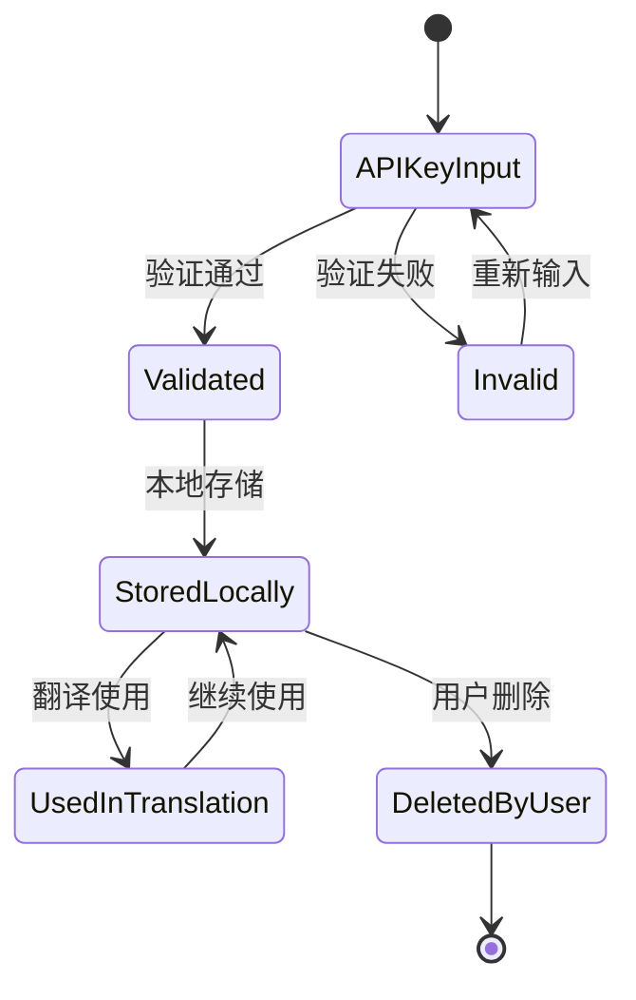

**图表来源**
- [popup.js](file://popup.js#L77-L87)

**章节来源**
- [popup.js](file://popup.js#L35-L51)

## API密钥验证流程

### 验证步骤详解

#### 第一步：输入验证

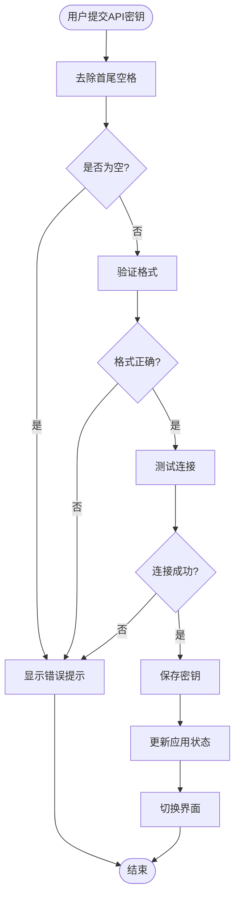

**图表来源**
- [popup.js](file://popup.js#L69-L87)

#### 第二步：存储验证

存储过程包含多重安全保障：

1. **异步存储**：使用Promise确保存储操作完成
2. **错误捕获**：捕获并处理存储异常
3. **状态同步**：更新应用内部状态

#### 第三步：界面切换

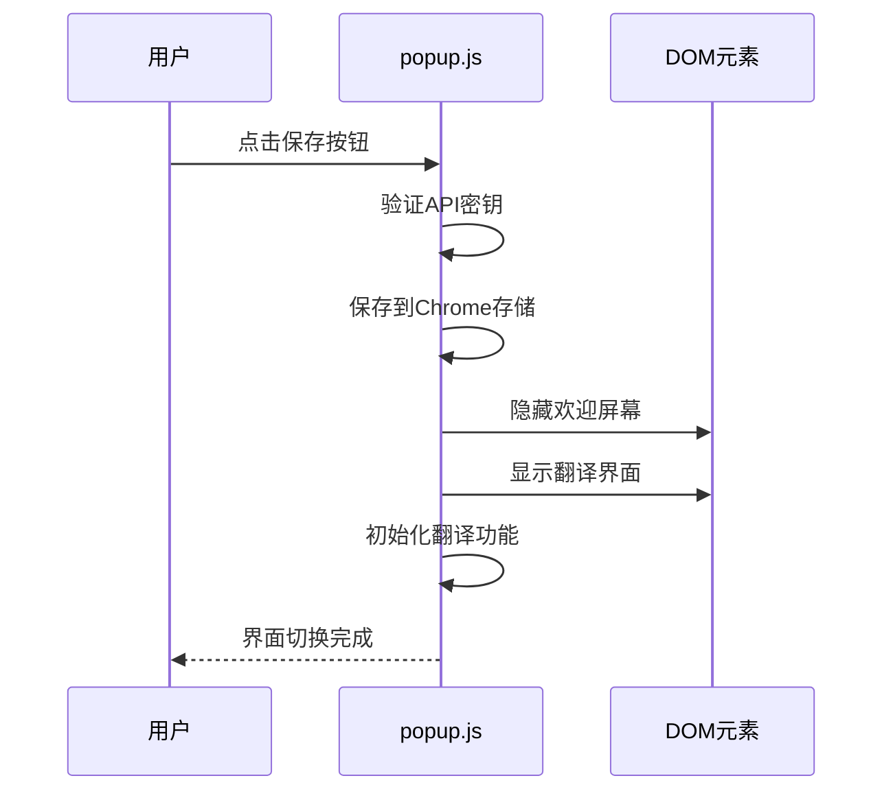

**图表来源**
- [popup.js](file://popup.js#L77-L87)

**章节来源**
- [popup.js](file://popup.js#L69-L87)

## 错误处理最佳实践

### 错误分类与处理

#### 存储错误处理

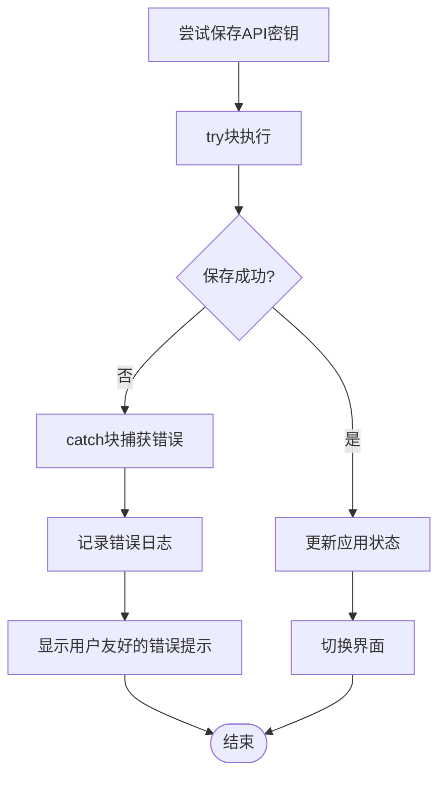

**图表来源**
- [popup.js](file://popup.js#L77-L87)

#### 翻译错误处理

翻译过程中的错误处理机制：

1. **网络错误**：检查响应状态码
2. **API错误**：解析错误消息
3. **超时处理**：使用AbortController终止请求
4. **用户反馈**：提供清晰的错误信息

**章节来源**
- [popup.js](file://popup.js#L329-L341)

### 用户体验优化

#### 加载状态指示

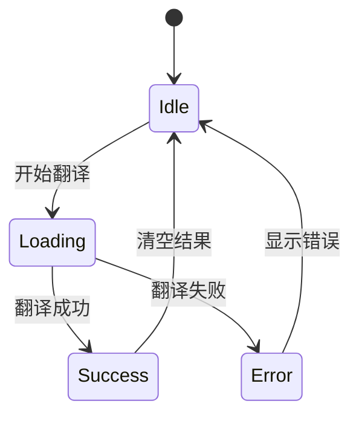

**图表来源**
- [popup.js](file://popup.js#L373-L385)

#### 实时反馈机制

- **即时输入处理**：800ms防抖延迟
- **加载动画**：旋转指示器
- **错误提示**：红色字体显示
- **成功状态**：正常文本显示

**章节来源**
- [popup.js](file://popup.js#L242-L259)

## 性能考虑

### 内存管理优化

#### 防抖机制

输入处理使用800ms防抖延迟，平衡响应速度和性能：

```javascript
// 防抖处理逻辑
let debounceTimeout;
function handleInputChange(e) {
    const newText = e.target.value;
    clearTimeout(debounceTimeout);
    debounceTimeout = setTimeout(() => {
        // 执行翻译逻辑
    }, 800);
}
```

#### 请求取消机制

使用AbortController确保：
- 防止重复请求
- 减少不必要的网络开销
- 提升用户体验

### 存储性能优化

#### 批量存储操作

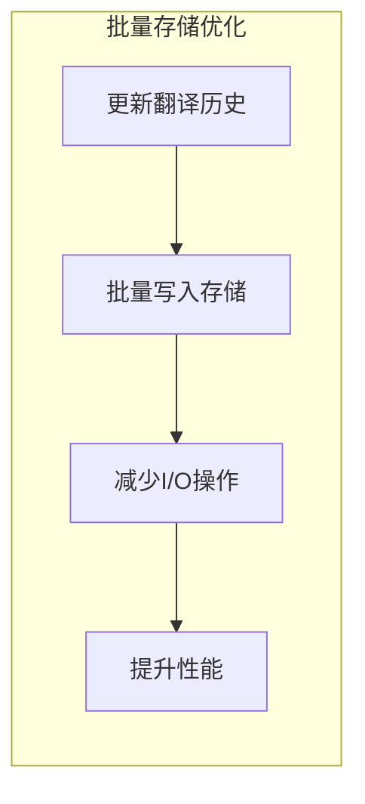

**图表来源**
- [popup.js](file://popup.js#L321-L328)

**章节来源**
- [popup.js](file://popup.js#L242-L259)

## 故障排除指南

### 常见问题诊断

#### API密钥相关问题

| 问题症状 | 可能原因 | 解决方案 |
|----------|----------|----------|
| 无法保存API密钥 | 浏览器存储权限问题 | 检查扩展权限设置 |
| 翻译失败 | API密钥无效 | 重新输入有效的API密钥 |
| 界面不切换 | JavaScript执行错误 | 刷新扩展或重启浏览器 |

#### 网络连接问题

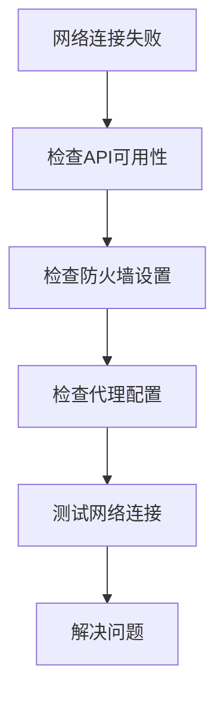

**图表来源**
- [popup.js](file://popup.js#L308-L313)

### 调试技巧

#### 开发者工具使用

1. **控制台日志**：查看应用状态和错误信息
2. **网络面板**：监控API请求和响应
3. **存储面板**：检查Chrome存储数据
4. **扩展面板**：调试扩展功能

#### 日志记录策略

```javascript
// 建议的日志级别
console.log("info", "应用启动")
console.warn("warning", "API密钥格式警告")
console.error("error", "网络连接失败")
```

**章节来源**
- [popup.js](file://popup.js#L49-L51)

## 结论

本项目成功实现了功能完整的欢迎屏幕与API密钥管理功能。通过精心设计的HTML结构、健壮的JavaScript逻辑和安全的存储机制，为用户提供了流畅的使用体验。

### 主要成就

1. **用户友好界面**：简洁直观的欢迎屏幕设计
2. **安全存储机制**：基于Chrome存储API的安全数据管理
3. **实时反馈系统**：完善的加载状态和错误处理
4. **性能优化**：防抖机制和请求取消功能

### 技术亮点

- **模块化设计**：清晰的功能分离和职责划分
- **异步处理**：Promise和async/await的合理使用
- **错误处理**：全面的异常捕获和用户反馈
- **用户体验**：流畅的界面切换和实时交互

### 改进建议

1. **增强安全性**：考虑使用更高级的加密存储
2. **性能监控**：添加性能指标收集和分析
3. **国际化支持**：扩展多语言界面支持
4. **离线缓存**：实现部分功能的离线可用性