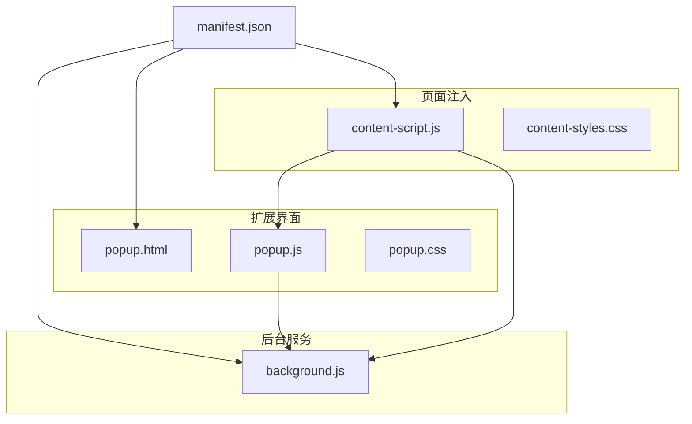
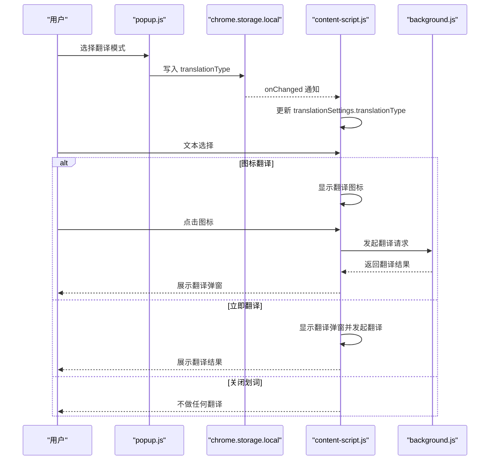
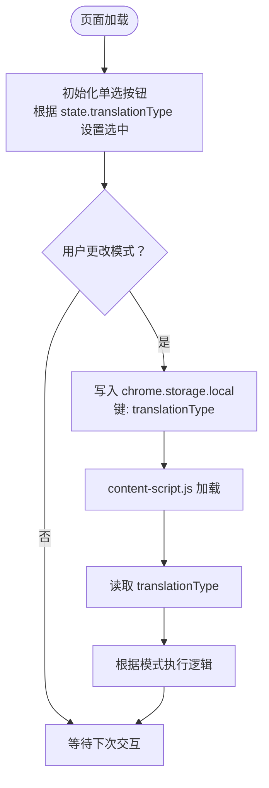
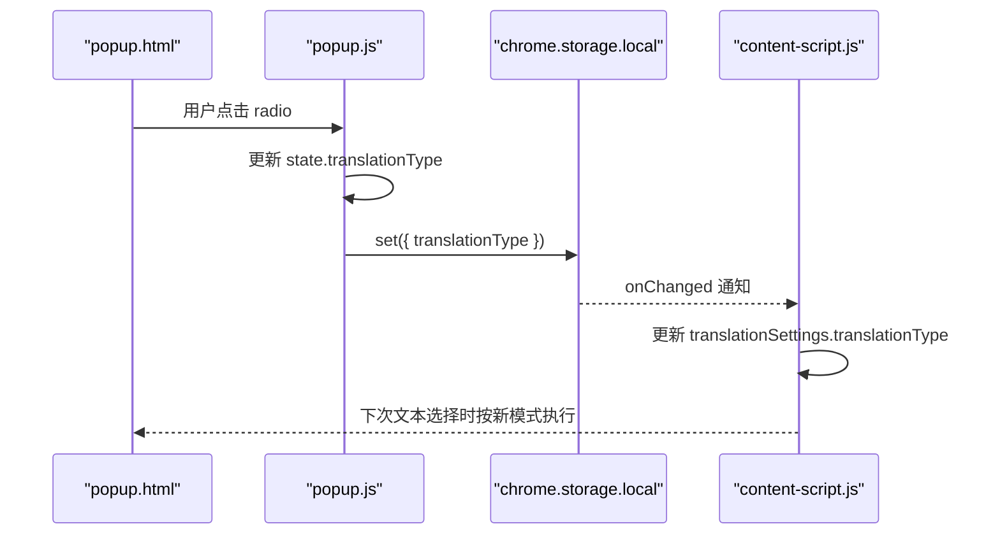
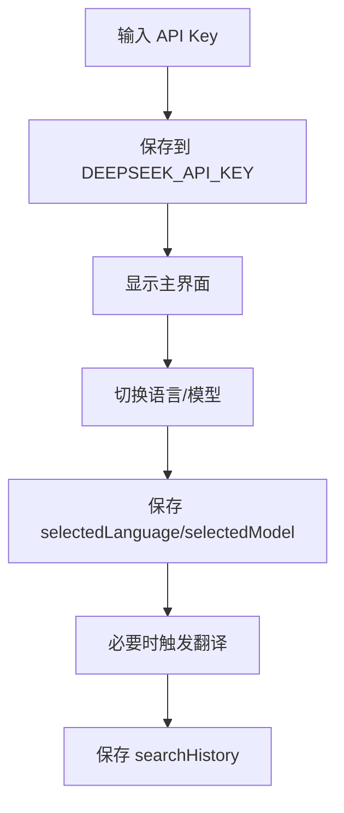
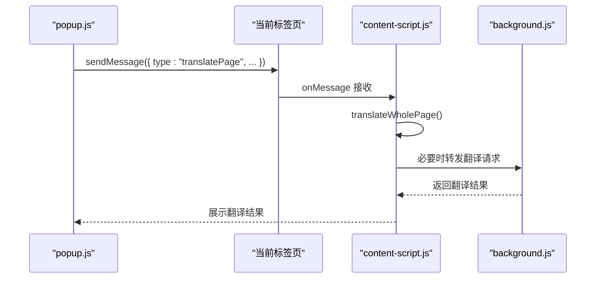
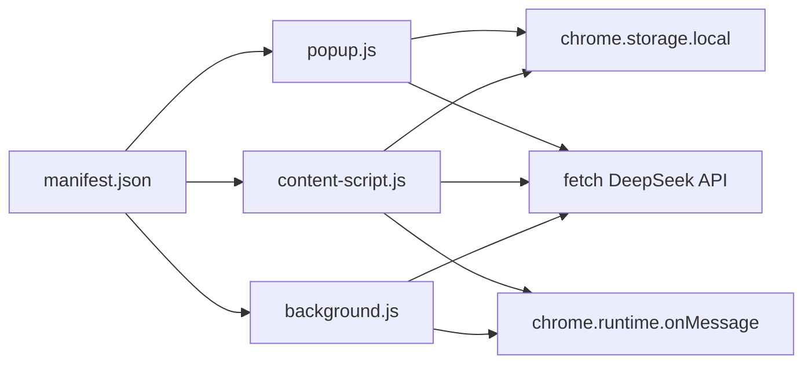

# 翻译模式切换

<cite>
**本文档引用的文件**
- [popup.html](file://popup.html)
- [popup.js](file://popup.js)
- [popup.css](file://popup.css)
- [content-script.js](file://content-script.js)
- [background.js](file://background.js)
- [manifest.json](file://manifest.json)
- [content-styles.css](file://content-styles.css)
</cite>

## 目录
1. [简介](#简介)
2. [项目结构](#项目结构)
3. [核心组件](#核心组件)
4. [架构总览](#架构总览)
5. [详细组件分析](#详细组件分析)
6. [依赖关系分析](#依赖关系分析)
7. [性能考虑](#性能考虑)
8. [故障排除指南](#故障排除指南)
9. [结论](#结论)
10. [附录](#附录)

## 简介
本文件聚焦于翻译模式切换功能，系统性阐述 popup.html 中单选按钮组的 HTML 结构设计，以及 popup.js 中的模式切换逻辑、状态保存机制、用户偏好管理与模式对应的后台脚本通信。文档覆盖三种翻译模式的工作原理、适用场景与用户配置项，并提供用户体验设计、状态指示与配置持久化的详细说明，同时给出实际代码示例路径与模式扩展方法。

## 项目结构
该扩展采用 Manifest V3 架构，主要由以下模块组成：
- popup.html/popup.js/popup.css：扩展弹出界面，负责用户交互、偏好设置与即时翻译。
- content-script.js/content-styles.css：页面注入脚本，负责文本选择、图标/弹窗展示与翻译触发。
- background.js：后台服务脚本，处理跨标签页翻译请求与统一的翻译逻辑。
- manifest.json：声明 action、权限、内容脚本与后台脚本。

图表来源
- [manifest.json](file://manifest.json#L6-L31)
- [popup.html](file://popup.html#L1-L226)
- [popup.js](file://popup.js#L1-L452)
- [content-script.js](file://content-script.js#L1-L868)
- [background.js](file://background.js#L1-L95)

章节来源
- [manifest.json](file://manifest.json#L1-L32)

## 核心组件
- 单选按钮组（图标翻译/立即翻译/关闭划词）：位于 popup.html 的 radio-group 区域，通过 name="translationType" 形成互斥组，初始值为“图标翻译”。
- 状态管理：popup.js 初始化 state，包含 translationType、selectedLanguage、selectedModel、searchHistory、apiKey 等字段；通过 chrome.storage.local 进行持久化。
- 模式切换逻辑：radio-buttons change 事件更新 state.translationType 并保存到存储；content-script.js 读取存储并在 handleTextSelection 中根据模式执行不同行为。
- 用户偏好管理：语言、模型、历史记录均通过存储键维护，支持跨会话恢复。
- 后台通信：popup.js 在翻译网页时向 content-script.js 发送消息；content-script.js 与 background.js 之间通过 runtime.onMessage 通信。

章节来源
- [popup.html](file://popup.html#L189-L218)
- [popup.js](file://popup.js#L3-L29)
- [popup.js](file://popup.js#L187-L194)
- [content-script.js](file://content-script.js#L8-L13)
- [content-script.js](file://content-script.js#L55-L68)

## 架构总览
翻译模式切换贯穿“弹出界面 -> 页面注入 -> 后台服务”的链路，关键流程如下：
- 用户在 popup.html 中选择翻译模式，popup.js 将 translationType 写入 chrome.storage.local。
- content-script.js 初始化时从存储加载 translationType，并监听存储变化以实时更新。
- 当用户在页面中进行文本选择时，content-script.js 根据 translationType 执行相应动作：
  - 图标翻译：显示悬浮翻译图标，点击后弹出翻译结果。
  - 立即翻译：直接在选区下方弹出翻译结果。
  - 关闭划词：禁用划词翻译功能。
- 对于网页翻译，popup.js 通过 chrome.tabs.sendMessage 触发 content-script.js 的 translatePage 流程，content-script.js 再与 background.js 通信完成批量翻译。

图表来源
- [popup.js](file://popup.js#L187-L194)
- [content-script.js](file://content-script.js#L55-L68)
- [content-script.js](file://content-script.js#L177-L188)
- [content-script.js](file://content-script.js#L564-L665)
- [background.js](file://background.js#L10-L55)

## 详细组件分析

### HTML 结构设计：单选按钮组
- 容器与布局：radio-group 容器使用 flex 布局，内部三个 radio-item，分别对应“图标翻译”、“立即翻译”、“关闭划词”。初始选中“图标翻译”。
- 输入与标签：每个 radio-item 包含 input[type="radio"] 与 label，name="translationType" 确保互斥；value 分别为“图标翻译”、“立即翻译”、“关闭划词”。
- 初始状态：popup.js 在初始化时根据 state.translationType 设置 radio.checked。

图表来源
- [popup.html](file://popup.html#L189-L218)
- [popup.js](file://popup.js#L118-L122)
- [popup.js](file://popup.js#L187-L194)
- [content-script.js](file://content-script.js#L30-L53)
- [content-script.js](file://content-script.js#L55-L68)

章节来源
- [popup.html](file://popup.html#L189-L218)
- [popup.js](file://popup.js#L118-L122)
- [popup.js](file://popup.js#L187-L194)
- [content-script.js](file://content-script.js#L30-L53)
- [content-script.js](file://content-script.js#L55-L68)

### 模式切换逻辑与状态保存
- popup.js 状态初始化：state.translationType 默认“图标翻译”，并从 chrome.storage.local 读取现有值。
- 模式变更：radio-buttons 的 change 事件捕获用户选择，更新 state.translationType 并调用 chrome.storage.local.set 保存。
- content-script.js 同步：content-script.js 在初始化时读取存储，随后监听 chrome.storage.onChanged，确保 UI 与运行时一致。
- 存储键：仅保存 translationType，其余如 selectedLanguage、selectedModel、searchHistory、apiKey 由各自逻辑独立持久化。

图表来源
- [popup.js](file://popup.js#L187-L194)
- [popup.js](file://popup.js#L34-L51)
- [content-script.js](file://content-script.js#L55-L68)

章节来源
- [popup.js](file://popup.js#L3-L29)
- [popup.js](file://popup.js#L34-L51)
- [popup.js](file://popup.js#L187-L194)
- [content-script.js](file://content-script.js#L55-L68)

### 用户偏好管理与配置持久化
- API Key：首次使用时在 popup.html 的欢迎界面输入并保存至 DEEPSEEK_API_KEY；后续直接进入翻译界面。
- 语言与模型：通过语言/模型下拉菜单选择，选择后立即保存到存储并在必要时触发翻译。
- 历史记录：搜索历史保存在 searchHistory，最多保留 20 条，去重并按最近使用排序。
- 配置键一览：
  - translationType：翻译模式
  - selectedLanguage：语言对
  - selectedModel：AI 模型
  - searchHistory：翻译历史
  - DEEPSEEK_API_KEY：API 密钥

图表来源
- [popup.html](file://popup.html#L32-L47)
- [popup.js](file://popup.js#L70-L87)
- [popup.js](file://popup.js#L152-L185)
- [popup.js](file://popup.js#L321-L328)

章节来源
- [popup.html](file://popup.html#L32-L47)
- [popup.js](file://popup.js#L70-L87)
- [popup.js](file://popup.js#L152-L185)
- [popup.js](file://popup.js#L321-L328)

### 模式对应的后台脚本通信
- 网页翻译：popup.js 通过 chrome.tabs.sendMessage 发送 { type: "translatePage", language, model, apiKey }，content-script.js 接收后执行 translateWholePage，期间可与 background.js 通信（具体取决于实现细节）。
- 即时翻译/图标翻译：content-script.js 直接调用 fetch DeepSeek API 或通过 background.js 处理，返回翻译结果后在页面弹窗展示。
- 通用提示：当 translationType 为“关闭划词”时，content-script.js 不执行任何翻译逻辑。

图表来源
- [popup.js](file://popup.js#L196-L225)
- [content-script.js](file://content-script.js#L689-L698)
- [background.js](file://background.js#L10-L55)

章节来源
- [popup.js](file://popup.js#L196-L225)
- [content-script.js](file://content-script.js#L689-L698)
- [background.js](file://background.js#L10-L55)

### 三种翻译模式详解

#### 图标翻译（默认）
- 工作原理：用户选择文本后，content-script.js 在鼠标位置显示一个翻译图标；点击图标后在选区下方弹出翻译弹窗，异步请求翻译并展示结果。
- 适用场景：适合需要手动触发翻译、避免频繁弹窗干扰的用户。
- 用户配置：无需额外配置，初始即为默认模式。
- 状态指示：图标显示/隐藏由 content-script.js 控制；弹窗包含加载动画与复制按钮。

章节来源
- [content-script.js](file://content-script.js#L177-L188)
- [content-script.js](file://content-script.js#L426-L467)
- [content-styles.css](file://content-styles.css#L1-L25)

#### 立即翻译
- 工作原理：用户选择文本后，content-script.js 立即在选区下方弹出翻译弹窗并发起翻译请求，无需点击图标。
- 适用场景：适合快速翻译、连续阅读的用户。
- 用户配置：在 popup.html 的 radio-group 中选择“立即翻译”即可生效。
- 状态指示：弹窗内显示加载动画，翻译完成后展示结果与复制按钮。

章节来源
- [content-script.js](file://content-script.js#L177-L181)
- [content-styles.css](file://content-styles.css#L27-L82)

#### 关闭划词
- 工作原理：禁用划词翻译功能，用户选择文本不会触发任何翻译或弹窗。
- 适用场景：用户希望完全关闭划词翻译，避免误触或干扰。
- 用户配置：在 popup.html 的 radio-group 中选择“关闭划词”即可生效。
- 状态指示：无图标/弹窗出现。

章节来源
- [content-script.js](file://content-script.js#L177-L188)

### 用户体验设计与状态指示
- 翻译弹窗：包含原文与翻译两栏，支持复制、关闭、拖拽移动；加载时显示旋转动画，错误时显示错误信息。
- 复制反馈：点击复制按钮后标题短暂变为“已复制”，提升反馈感。
- 图标交互：翻译图标悬停高亮、点击后隐藏，避免遮挡选中文本。
- 响应式布局：popup.css 提供响应式布局与滚动区域，适配不同屏幕尺寸。

章节来源
- [content-styles.css](file://content-styles.css#L27-L185)
- [popup.css](file://popup.css#L69-L90)
- [popup.css](file://popup.css#L267-L299)

### 模式扩展方法
- 新增模式步骤：
  1) 在 popup.html 的 radio-group 中新增一个 radio-item，value 设为新模式名称。
  2) 在 popup.js 的 radio-buttons change 事件中处理新 value，并保存到 chrome.storage.local。
  3) 在 content-script.js 的 translationSettings.translationType 判断中新增分支，实现新模式的行为。
  4) 如新模式涉及后台处理，可在 content-script.js 与 background.js 间增加消息协议或复用现有逻辑。
- 注意事项：
  - 保持 name="translationType" 互斥组不变。
  - 新模式的 UI 与交互应在 content-styles.css/popup.css 中补充样式。
  - 新模式的存储键名需与现有键名区分，避免冲突。

章节来源
- [popup.html](file://popup.html#L189-L218)
- [popup.js](file://popup.js#L187-L194)
- [content-script.js](file://content-script.js#L8-L13)
- [content-script.js](file://content-script.js#L177-L188)

## 依赖关系分析
- popup.js 依赖 chrome.storage.local 进行状态持久化，依赖 fetch 进行翻译请求。
- content-script.js 依赖 chrome.storage.local、chrome.runtime.onMessage、fetch 与 DOM API。
- background.js 依赖 chrome.runtime.onMessage、fetch 与翻译提示词生成。
- manifest.json 声明 action、permissions、content_scripts、background，决定模块加载顺序与权限范围。

图表来源
- [popup.js](file://popup.js#L34-L51)
- [popup.js](file://popup.js#L262-L341)
- [content-script.js](file://content-script.js#L55-L68)
- [content-script.js](file://content-script.js#L564-L665)
- [background.js](file://background.js#L1-L7)
- [background.js](file://background.js#L10-L55)
- [manifest.json](file://manifest.json#L6-L31)

章节来源
- [popup.js](file://popup.js#L34-L51)
- [content-script.js](file://content-script.js#L55-L68)
- [background.js](file://background.js#L1-L7)
- [manifest.json](file://manifest.json#L6-L31)

## 性能考虑
- 防抖与抑制：content-script.js 对文本选择事件使用防抖（约 300ms），并引入 shouldSuppressSelection 抑制弹窗重复触发，减少不必要的渲染与请求。
- 请求终止：每次翻译前检查并终止上一个请求（AbortController），避免并发请求造成的资源浪费。
- 翻译弹窗拖拽：弹窗拖拽时限制边界，避免频繁重排导致卡顿。
- UI 状态：popup.js 在翻译过程中显示 loading 动画，避免空白闪烁；错误时显示错误信息，减少无效渲染。

章节来源
- [content-script.js](file://content-script.js#L129-L190)
- [content-script.js](file://content-script.js#L131-L135)
- [content-script.js](file://content-script.js#L270-L273)
- [content-script.js](file://content-script.js#L398-L421)
- [popup.js](file://popup.js#L275-L278)
- [popup.js](file://popup.js#L373-L385)

## 故障排除指南
- API Key 未设置：content-script.js 在翻译前检查 apiKey，若为空则返回错误提示。请在 popup.html 的欢迎界面输入并保存。
- 翻译请求被终止：当用户快速切换文本或模式时，旧请求会被终止，属于正常行为。若出现持续错误，请检查网络与 API Key。
- 弹窗无法关闭：点击弹窗外区域或图标区域应关闭弹窗；若异常，检查 handleGlobalClick 逻辑与事件冒泡。
- 模式切换无效：确认 chrome.storage.local 中 translationType 是否正确更新；检查 content-script.js 的 onChanged 监听是否生效。

章节来源
- [content-script.js](file://content-script.js#L567-L569)
- [content-script.js](file://content-script.js#L656-L665)
- [content-script.js](file://content-script.js#L491-L511)
- [popup.js](file://popup.js#L34-L51)
- [content-script.js](file://content-script.js#L55-L68)

## 结论
翻译模式切换功能通过 popup.html 的单选按钮组与 popup.js 的状态管理实现，结合 content-script.js 的运行时逻辑与 background.js 的后台处理，形成完整的跨模块协作体系。三种模式分别满足不同用户的使用习惯：图标翻译强调手动控制、立即翻译强调即时反馈、关闭划词强调无干扰。通过合理的状态保存与 UI 指示，用户可以稳定地在不同模式间切换并获得一致的体验。未来扩展新模式时，建议遵循现有的存储键命名、事件处理与样式规范，确保一致性与可维护性。

## 附录
- 实际代码示例路径（不含具体代码内容）：
  - 单选按钮组定义：[popup.html](file://popup.html#L189-L218)
  - 模式切换事件绑定与存储：[popup.js](file://popup.js#L187-L194)
  - 模式加载与监听：[popup.js](file://popup.js#L34-L51)、[content-script.js](file://content-script.js#L55-L68)
  - 图标翻译实现：[content-script.js](file://content-script.js#L177-L188)、[content-script.js](file://content-script.js#L426-L467)
  - 立即翻译实现：[content-script.js](file://content-script.js#L177-L181)
  - 关闭划词实现：[content-script.js](file://content-script.js#L177-L188)
  - 网页翻译触发：[popup.js](file://popup.js#L196-L225)、[content-script.js](file://content-script.js#L689-L698)
  - 翻译弹窗样式：[content-styles.css](file://content-styles.css#L27-L185)、[popup.css](file://popup.css#L69-L90)