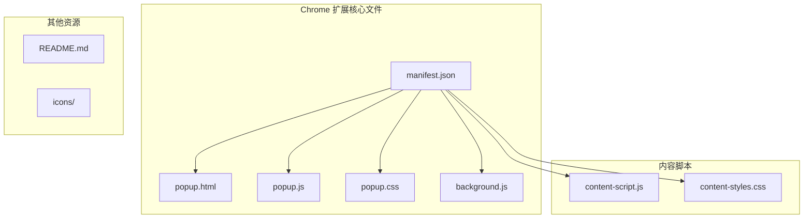
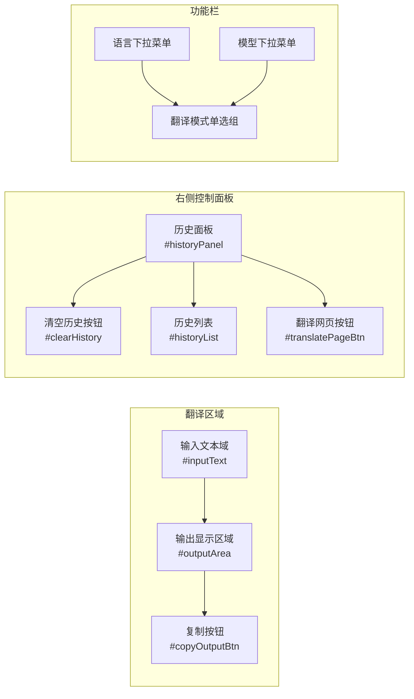
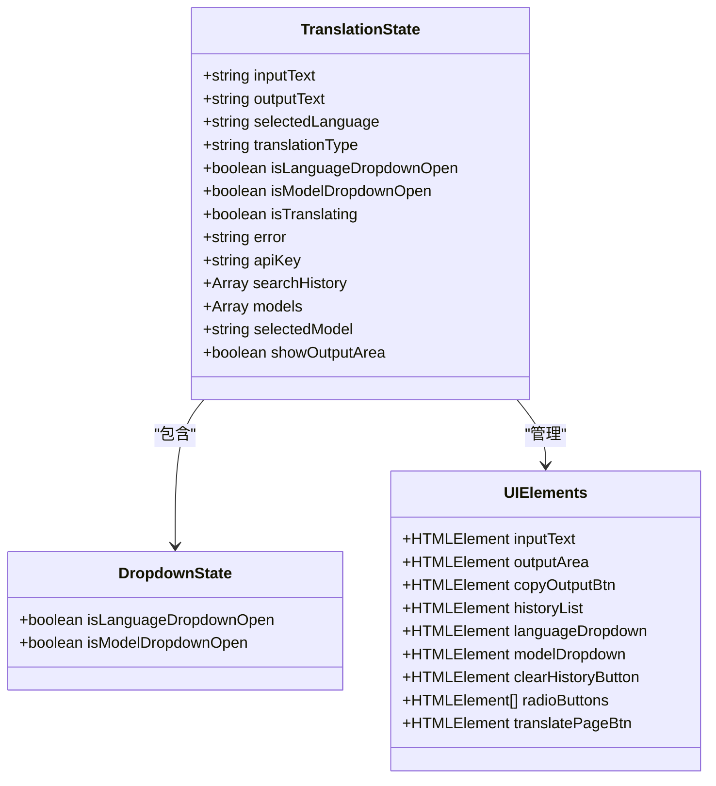
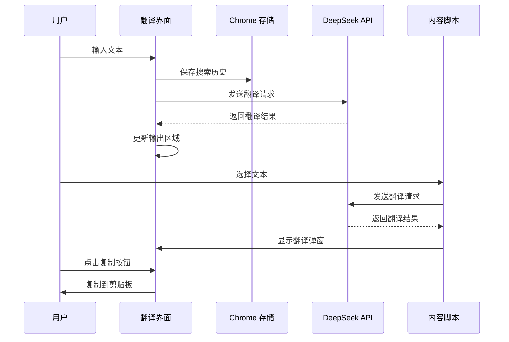
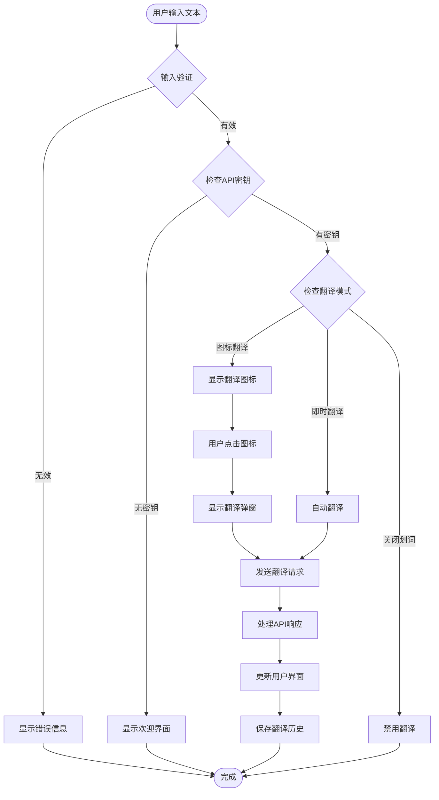
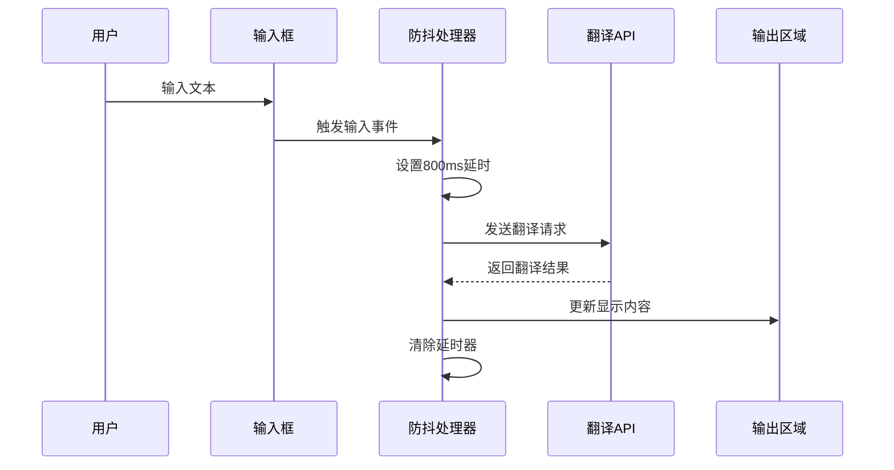
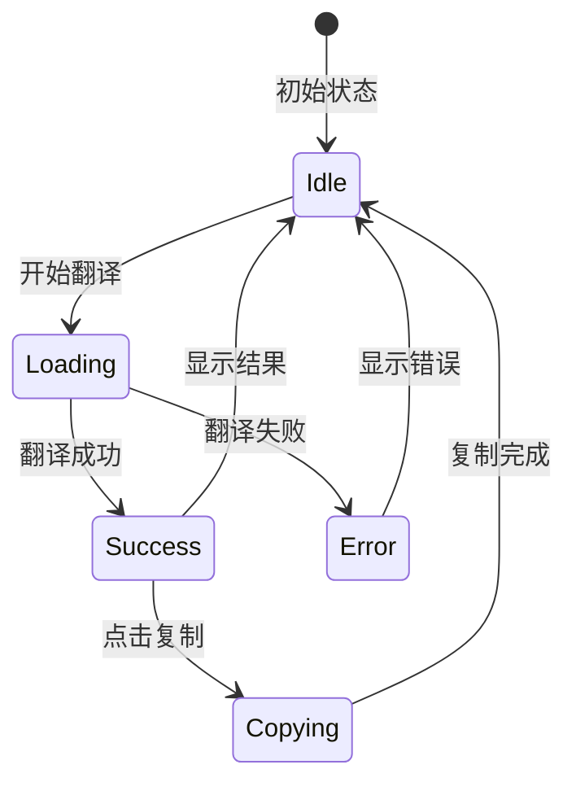
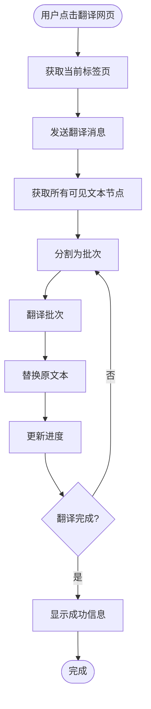
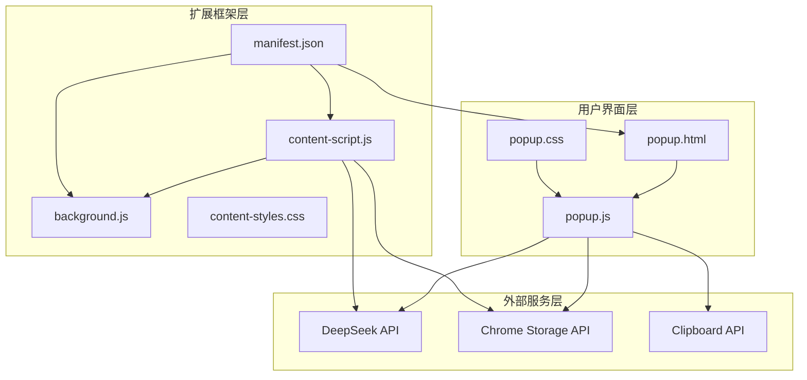
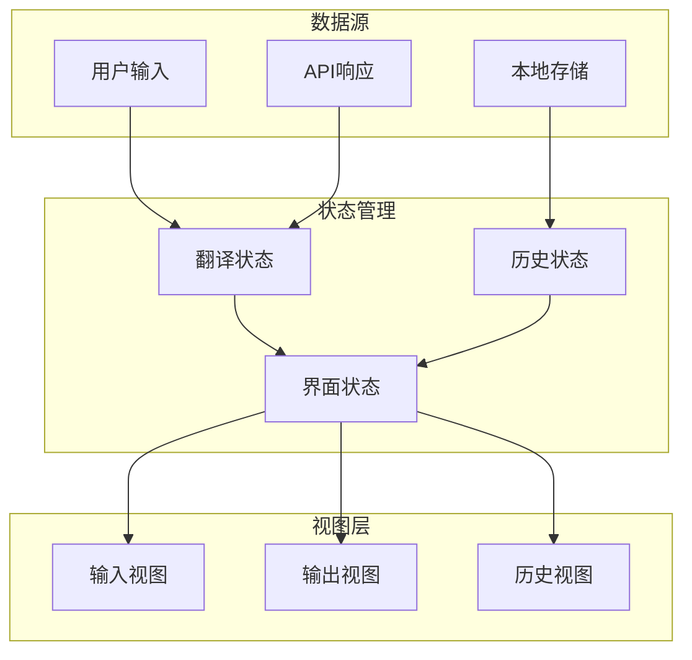

# 翻译界面

<cite>
**本文档引用的文件**
- [popup.html](file://popup.html)
- [popup.js](file://popup.js)
- [popup.css](file://popup.css)
- [manifest.json](file://manifest.json)
- [background.js](file://background.js)
- [content-script.js](file://content-script.js)
- [content-styles.css](file://content-styles.css)
- [README.md](file://README.md)
</cite>

## 目录
1. [简介](#简介)
2. [项目结构](#项目结构)
3. [核心组件](#核心组件)
4. [架构概览](#架构概览)
5. [详细组件分析](#详细组件分析)
6. [依赖关系分析](#依赖关系分析)
7. [性能考虑](#性能考虑)
8. [故障排除指南](#故障排除指南)
9. [结论](#结论)

## 简介

这是一个基于 Chrome 扩展的 AI 翻译工具，使用 DeepSeek AI API 提供文本翻译功能。该扩展支持多种翻译模式，包括图标翻译、即时翻译和关闭划词模式，同时提供网页翻译功能和翻译历史记录管理。

该翻译界面采用现代化的响应式设计，具有直观的用户交互体验，支持实时翻译、历史记录管理和多种语言配置。

## 项目结构

该项目采用标准的 Chrome 扩展程序结构，主要包含以下文件：

**图表来源**
- [manifest.json](file://manifest.json#L1-L32)
- [popup.html](file://popup.html#L1-L226)
- [popup.js](file://popup.js#L1-L452)

**章节来源**
- [manifest.json](file://manifest.json#L1-L32)
- [popup.html](file://popup.html#L1-L226)
- [popup.js](file://popup.js#L1-L452)

## 核心组件

### 翻译界面 HTML 结构

翻译界面由三个主要部分组成：

1. **欢迎屏幕** - 用户首次使用时输入 API 密钥
2. **翻译接口** - 主要的翻译功能区域
3. **历史面板** - 翻译历史记录管理

### 翻译接口布局

**图表来源**
- [popup.html](file://popup.html#L50-L221)

### 核心数据结构

翻译界面使用状态管理模式管理用户界面状态：

**图表来源**
- [popup.js](file://popup.js#L3-L29)

**章节来源**
- [popup.html](file://popup.html#L50-L221)
- [popup.js](file://popup.js#L3-L29)

## 架构概览

该翻译界面采用模块化架构，分为多个独立的功能模块：

**图表来源**
- [popup.js](file://popup.js#L262-L341)
- [content-script.js](file://content-script.js#L565-L665)

### 数据流图

**图表来源**
- [popup.js](file://popup.js#L242-L260)
- [content-script.js](file://content-script.js#L129-L190)

**章节来源**
- [popup.js](file://popup.js#L1-L452)
- [content-script.js](file://content-script.js#L1-L868)

## 详细组件分析

### 1. 翻译区域 HTML 结构设计

#### 输入文本域设计

输入文本域采用全尺寸布局，提供最佳的用户体验：

- **占满容器高度**：使用 Flexbox 布局确保文本域占据可用空间
- **无边框设计**：移除默认边框，使用自定义样式
- **内边距设置**：提供舒适的输入体验
- **字体设置**：使用系统字体，确保跨平台一致性

#### 输出显示区域设计

输出区域采用分层设计，支持多种状态显示：

- **加载状态**：显示旋转动画和半透明背景
- **错误状态**：红色错误信息显示
- **正常状态**：纯文本显示翻译结果
- **复制按钮集成**：右下角固定位置的复制按钮

#### 复制按钮实现

复制按钮采用浮动定位，始终显示在输出区域右下角：

- **浮动定位**：绝对定位，随内容滚动而移动
- **悬停效果**：浅色背景变化
- **点击反馈**：轻微的按下动画
- **状态提示**：点击后显示"已复制"提示

**章节来源**
- [popup.html](file://popup.html#L52-L96)
- [popup.css](file://popup.css#L69-L89)

### 2. 翻译请求处理逻辑

#### 实时翻译功能

实时翻译采用防抖机制，避免频繁的 API 调用：

**图表来源**
- [popup.js](file://popup.js#L242-L259)

#### 翻译请求构建

翻译请求包含完整的上下文信息：

- **API 端点**：DeepSeek Chat Completions API
- **认证头**：Bearer Token 方式
- **消息格式**：包含系统提示和用户消息
- **参数配置**：温度、最大令牌数等

#### 错误处理机制

系统实现了多层次的错误处理：

- **网络错误**：捕获网络异常
- **API 错误**：解析 API 返回的错误信息
- **中断处理**：支持取消正在进行的请求
- **用户反馈**：友好的错误提示信息

**章节来源**
- [popup.js](file://popup.js#L262-L341)

### 3. 输出结果显示和用户交互

#### 动态更新机制

输出区域根据不同的状态显示相应的内容：

**图表来源**
- [popup.js](file://popup.js#L372-L385)

#### 用户交互事件处理

界面支持多种用户交互：

- **输入事件**：实时翻译功能
- **点击事件**：复制按钮、历史记录点击
- **键盘事件**：快捷键支持
- **鼠标事件**：下拉菜单、按钮交互

**章节来源**
- [popup.js](file://popup.js#L127-L150)

### 4. 翻译历史记录管理

#### 历史记录存储

翻译历史采用本地存储方案：

- **存储位置**：Chrome Local Storage
- **存储格式**：数组结构，最多保存20条记录
- **去重机制**：自动去除重复的翻译记录
- **更新策略**：新记录优先，超出数量自动删除最旧记录

#### 历史记录显示

历史记录面板提供直观的浏览体验：

- **滚动列表**：支持垂直滚动
- **标题显示**：完整显示原始文本
- **省略号**：超长文本使用省略号
- **点击交互**：点击可重新翻译

**章节来源**
- [popup.js](file://popup.js#L387-L406)

### 5. 翻译网页功能

#### 网页翻译实现

翻译网页功能支持整页翻译：

**图表来源**
- [content-script.js](file://content-script.js#L700-L800)

#### 网页翻译配置

- **批量处理**：每批20个文本节点
- **进度显示**：实时显示翻译进度
- **错误处理**：单个批次失败不影响整体
- **性能优化**：异步处理，避免阻塞页面

**章节来源**
- [content-script.js](file://content-script.js#L690-L800)

## 依赖关系分析

### 组件间依赖关系

**图表来源**
- [manifest.json](file://manifest.json#L1-L32)
- [popup.js](file://popup.js#L34-L51)

### 数据依赖关系

翻译界面的数据流呈现层次化结构：

**图表来源**
- [popup.js](file://popup.js#L3-L29)

**章节来源**
- [popup.js](file://popup.js#L1-L452)
- [content-script.js](file://content-script.js#L1-L868)

## 性能考虑

### 1. 实时翻译性能优化

#### 防抖机制

- **延迟时间**：800毫秒，平衡响应性和性能
- **请求取消**：新请求自动取消前一个请求
- **内存管理**：及时清理不再使用的资源

#### API 调用优化

- **批量处理**：避免频繁的小请求
- **缓存策略**：合理利用浏览器缓存
- **连接复用**：复用 HTTP 连接

### 2. 内存使用优化

#### DOM 元素管理

- **动态创建**：按需创建 DOM 元素
- **事件委托**：减少事件监听器数量
- **垃圾回收**：及时释放不再使用的对象

#### 存储优化

- **历史记录限制**：最多保存20条记录
- **数据压缩**：存储时进行必要的数据压缩
- **增量更新**：只更新变化的部分

### 3. 用户体验优化

#### 加载状态指示

- **旋转动画**：提供视觉反馈
- **半透明遮罩**：防止用户误操作
- **状态同步**：确保状态显示准确

#### 错误处理

- **优雅降级**：错误时提供替代方案
- **用户友好**：清晰的错误信息
- **恢复机制**：支持自动重试

**章节来源**
- [popup.js](file://popup.js#L242-L259)
- [popup.css](file://popup.css#L267-L295)

## 故障排除指南

### 常见问题及解决方案

#### 1. API 密钥相关问题

**问题症状**：
- 翻译功能无法使用
- 显示 API 密钥错误信息

**解决步骤**：
1. 检查 API 密钥格式是否正确
2. 确认 API 密钥具有翻译权限
3. 验证网络连接是否正常
4. 重新输入并保存 API 密钥

#### 2. 翻译结果为空

**问题症状**：
- 输入文本后无翻译结果
- 输出区域显示空白

**解决步骤**：
1. 检查输入文本是否包含有效字符
2. 确认翻译模式设置正确
3. 验证 API 服务状态
4. 查看浏览器开发者工具中的错误信息

#### 3. 历史记录不显示

**问题症状**：
- 翻译历史面板为空
- 无法查看之前的翻译记录

**解决步骤**：
1. 检查浏览器存储权限
2. 确认 Chrome 存储 API 正常工作
3. 清除浏览器缓存后重试
4. 检查扩展权限设置

#### 4. 复制功能失效

**问题症状**：
- 点击复制按钮无响应
- 翻译结果无法复制到剪贴板

**解决步骤**：
1. 检查浏览器剪贴板权限
2. 确认页面具有写入剪贴板权限
3. 尝试刷新页面后重试
4. 检查是否有其他扩展程序干扰

### 调试方法

#### 开发者工具使用

1. **控制台调试**：查看 JavaScript 错误信息
2. **网络面板**：监控 API 请求和响应
3. **存储面板**：检查本地存储数据
4. **扩展面板**：查看扩展运行状态

#### 日志记录

- **关键操作日志**：记录重要的用户操作
- **API 调用日志**：记录 API 请求详情
- **错误日志**：记录详细的错误信息
- **性能日志**：记录性能指标

### 性能监控

#### 性能指标

- **响应时间**：从输入到显示结果的时间
- **API 响应时间**：翻译 API 的响应时间
- **内存使用**：页面内存占用情况
- **CPU 使用率**：翻译过程中的 CPU 占用

#### 优化建议

1. **合理设置防抖时间**：根据用户习惯调整
2. **优化 API 调用频率**：避免不必要的请求
3. **改进 UI 更新策略**：使用虚拟滚动等技术
4. **增强错误处理**：提供更好的用户体验

**章节来源**
- [popup.js](file://popup.js#L329-L340)
- [content-script.js](file://content-script.js#L656-L665)

## 结论

该翻译界面功能完整，设计合理，具有以下特点：

### 技术优势

1. **模块化设计**：清晰的组件分离和职责划分
2. **响应式布局**：适配不同屏幕尺寸和设备
3. **性能优化**：合理的防抖机制和资源管理
4. **用户体验**：直观的界面设计和流畅的操作体验

### 功能完整性

1. **多语言支持**：支持多种语言对的翻译
2. **多种模式**：图标翻译、即时翻译、关闭划词
3. **历史管理**：完整的翻译历史记录功能
4. **网页翻译**：强大的整页翻译能力

### 扩展性考虑

1. **插件架构**：易于添加新的翻译模式和功能
2. **配置灵活**：支持用户自定义各种参数
3. **API 兼容**：便于迁移到其他翻译服务
4. **性能可调**：可根据需求调整性能参数

该翻译界面为用户提供了一个强大、易用的翻译工具，满足了现代浏览器扩展的各种需求。通过持续的优化和改进，可以进一步提升用户体验和系统性能。