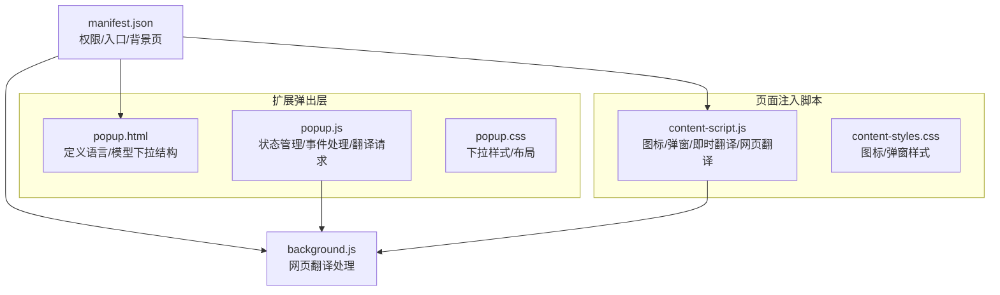
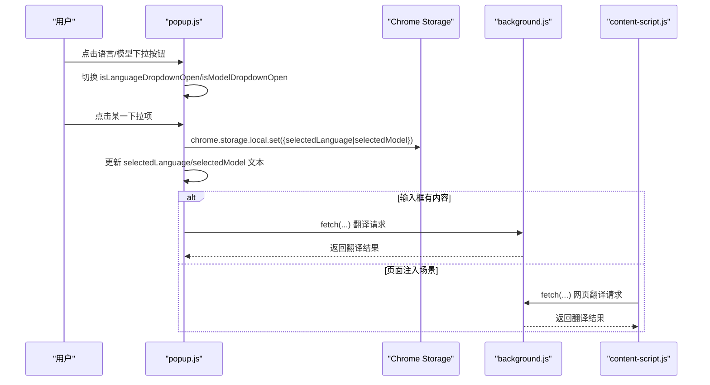
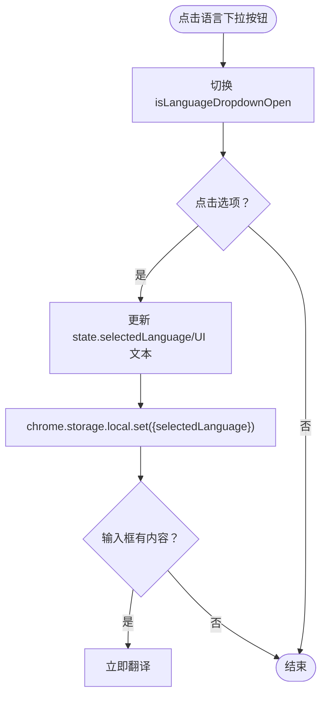
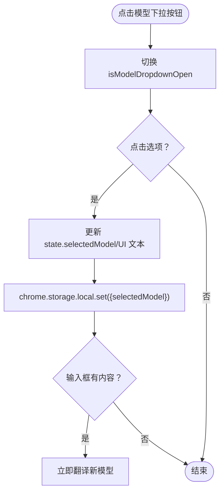
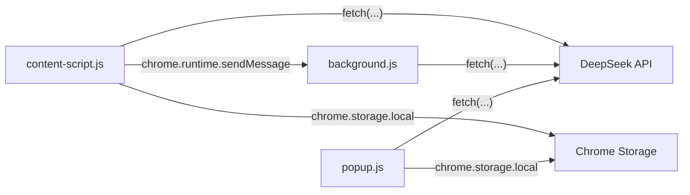

# 语言选择与模型选择

<cite>
**本文引用的文件**
- [popup.html](file://popup.html)
- [popup.js](file://popup.js)
- [popup.css](file://popup.css)
- [manifest.json](file://manifest.json)
- [background.js](file://background.js)
- [content-script.js](file://content-script.js)
- [content-styles.css](file://content-styles.css)
</cite>

## 目录
1. [简介](#简介)
2. [项目结构](#项目结构)
3. [核心组件](#核心组件)
4. [架构总览](#架构总览)
5. [详细组件分析](#详细组件分析)
6. [依赖关系分析](#依赖关系分析)
7. [性能考虑](#性能考虑)
8. [故障排除指南](#故障排除指南)
9. [结论](#结论)
10. [附录](#附录)

## 简介
本文件聚焦于浏览器扩展“AI Translator”的语言选择与模型选择功能，系统性说明：
- popup.html 中语言与模型下拉菜单的 HTML 结构设计
- popup.js 中下拉菜单的展开/收起逻辑、选项选择处理、状态管理与用户交互事件
- 支持的语言对配置、AI 模型切换机制、用户偏好保存与默认值设置
- 下拉菜单的可访问性设计、键盘导航支持与用户体验优化
- 实际代码示例路径与扩展新语言对的方法

## 项目结构
该扩展采用 Manifest V3 架构，主要文件职责如下：
- popup.html/popup.js/popup.css：扩展弹出界面，包含语言与模型选择、翻译输入输出、历史记录与网页翻译入口
- manifest.json：声明 action、权限、host 权限与 background service worker
- background.js：处理网页翻译请求，复用与 popup 相同的提示词生成逻辑
- content-script.js/content-styles.css：页面侧脚本，负责图标/弹窗、选中文本处理、即时翻译与网页翻译

图表来源
- [popup.html](file://popup.html#L114-L188)
- [popup.js](file://popup.js#L1-L452)
- [manifest.json](file://manifest.json#L1-L32)
- [background.js](file://background.js#L1-L95)
- [content-script.js](file://content-script.js#L1-L868)

章节来源
- [manifest.json](file://manifest.json#L1-L32)

## 核心组件
- 语言选择下拉菜单
  - HTML 结构：容器、按钮、选项列表
  - JS 行为：点击切换、外部点击关闭、选项选择更新状态并持久化
  - 默认值：英汉互译
- 模型选择下拉菜单
  - HTML 结构：容器、按钮、选项列表
  - JS 行为：点击切换、外部点击关闭、选项选择更新状态并持久化
  - 默认值：deepseek-chat
- 用户偏好存储
  - 使用 chrome.storage.local 存储 selectedLanguage、selectedModel、translationType、searchHistory、DEEPSEEK_API_KEY
- 翻译提示词生成
  - 根据所选语言对动态生成系统提示与用户提示，支持互译场景与单向语言对

章节来源
- [popup.html](file://popup.html#L114-L188)
- [popup.js](file://popup.js#L3-L29)
- [popup.js](file://popup.js#L344-L370)
- [background.js](file://background.js#L58-L94)
- [content-script.js](file://content-script.js#L532-L562)

## 架构总览
语言与模型选择贯穿弹出层与页面注入脚本两端，二者共享提示词生成逻辑以确保一致性。

图表来源
- [popup.js](file://popup.js#L130-L185)
- [popup.js](file://popup.js#L262-L341)
- [background.js](file://background.js#L10-L55)
- [content-script.js](file://content-script.js#L565-L665)

## 详细组件分析

### 语言选择下拉菜单
- HTML 结构要点
  - 容器与按钮：id 为 languageDropdown，显示当前选中语言
  - 选项列表：id 为 languageDropdownContent，包含多个 .dropdown-item，data-value 对应语言值
- 展开/收起逻辑
  - 点击按钮切换 isLanguageDropdownOpen，并控制 dropdown-content 的 display
  - 外部点击时关闭两个下拉菜单
- 选项选择处理
  - 点击选项后更新 state.selectedLanguage、UI 文本、关闭下拉
  - 将新语言写入 chrome.storage.local
  - 若输入框有内容，立即触发翻译
- 默认值与持久化
  - 初始化时从存储加载 selectedLanguage，默认值为“英汉互译”
  - 保存到本地存储键：selectedLanguage
- 提示词生成
  - 根据语言对生成系统提示与用户提示；互译场景根据内容语言自动判断方向

图表来源
- [popup.html](file://popup.html#L114-L155)
- [popup.js](file://popup.js#L130-L167)
- [popup.js](file://popup.js#L344-L370)

章节来源
- [popup.html](file://popup.html#L114-L155)
- [popup.js](file://popup.js#L3-L29)
- [popup.js](file://popup.js#L130-L167)
- [popup.js](file://popup.js#L344-L370)

### 模型选择下拉菜单
- HTML 结构要点
  - 容器与按钮：id 为 modelDropdown，显示当前选中模型
  - 选项列表：id 为 modelDropdownContent，包含多个 .dropdown-item，data-value 对应模型 ID
- 展开/收起逻辑
  - 点击按钮切换 isModelDropdownOpen，并控制 dropdown-content 的 display
  - 外部点击时关闭两个下拉菜单
- 选项选择处理
  - 点击选项后更新 state.selectedModel、UI 文本、关闭下拉
  - 将新模型写入 chrome.storage.local
  - 若输入框有内容，直接使用新模型进行翻译（不调整输出区域大小）
- 默认值与持久化
  - 初始化时从存储加载 selectedModel，默认值为“deepseek-chat”
  - 保存到本地存储键：selectedModel
- 提示词生成
  - 与语言选择一致，复用同一生成函数

图表来源
- [popup.html](file://popup.html#L156-L188)
- [popup.js](file://popup.js#L159-L185)
- [popup.js](file://popup.js#L186-L194)

章节来源
- [popup.html](file://popup.html#L156-L188)
- [popup.js](file://popup.js#L159-L185)
- [popup.js](file://popup.js#L186-L194)

### 状态管理与用户交互
- 状态对象
  - 包含 inputText、outputText、selectedLanguage、isLanguageDropdownOpen、isModelDropdownOpen、translationType、searchHistory、isTranslating、error、apiKey、models、selectedModel、isLoadingModels、showOutputArea
- 事件绑定
  - 语言/模型下拉按钮点击事件
  - 外部点击事件（关闭下拉菜单）
  - 单选按钮组变更事件（translationType）
  - 翻译输入框输入事件（带防抖）
- 翻译流程
  - 防抖触发后，若输入非空则发起翻译请求
  - 支持取消上一请求（AbortController）
  - 成功后更新输出区域与历史记录，失败则显示错误信息

章节来源
- [popup.js](file://popup.js#L3-L29)
- [popup.js](file://popup.js#L127-L194)
- [popup.js](file://popup.js#L242-L259)
- [popup.js](file://popup.js#L262-L341)

### 可访问性与键盘导航
- 当前实现
  - 下拉菜单通过点击展开/收起，无键盘快捷键或焦点管理
  - 选项为 div + data-value，未使用原生 select/option
- 建议改进
  - 为按钮添加 aria-haspopup、aria-expanded 等属性
  - 为选项添加 tabindex，支持上下键移动、回车确认
  - 为容器添加 role="menu"，选项 role="menuitem"
  - 在外部点击关闭时，若菜单处于打开状态，将焦点移回触发按钮

章节来源
- [popup.html](file://popup.html#L114-L188)
- [popup.js](file://popup.js#L408-L444)

### 用户体验优化
- 防抖与即时反馈
  - 输入防抖 800ms，避免频繁请求
  - 翻译中显示加载动画，错误时显示错误信息
- 输出区域与复制按钮
  - 输出区域仅在有内容时显示复制按钮
- 历史记录
  - 最多保留 20 条，去重并按最近优先排列
- 网页翻译
  - 弹出层提供“翻译此网页”按钮，向 content-script 发送消息
  - content-script 批量提取可见文本并调用翻译接口

章节来源
- [popup.js](file://popup.js#L242-L259)
- [popup.js](file://popup.js#L372-L385)
- [popup.js](file://popup.js#L387-L399)
- [popup.js](file://popup.js#L196-L225)
- [content-script.js](file://content-script.js#L690-L698)
- [content-script.js](file://content-script.js#L700-L802)

## 依赖关系分析
- 弹出层与后台通信
  - popup.js 通过 fetch 调用 DeepSeek API，参数包含 selectedModel 与生成的提示词
  - background.js 复用相同提示词生成逻辑，处理来自 content-script 的网页翻译请求
- 页面注入脚本
  - content-script.js 与 popup.js 共享提示词生成函数，确保两端一致
  - 通过 chrome.runtime.onMessage 接收 popup 的网页翻译指令

图表来源
- [popup.js](file://popup.js#L262-L341)
- [background.js](file://background.js#L10-L55)
- [content-script.js](file://content-script.js#L565-L665)
- [content-script.js](file://content-script.js#L690-L698)

章节来源
- [popup.js](file://popup.js#L34-L51)
- [content-script.js](file://content-script.js#L27-L68)

## 性能考虑
- 请求取消
  - 使用 AbortController 取消上一请求，避免并发与资源浪费
- 防抖策略
  - 输入防抖 800ms，减少不必要的网络请求
- 批量网页翻译
  - content-script.js 将文本分批（batchSize=20），降低单次请求长度与失败风险
- 样式与渲染
  - 下拉列表最大高度与滚动条，避免布局抖动
  - 输出区域懒渲染与条件显示复制按钮，减少 DOM 操作

章节来源
- [popup.js](file://popup.js#L275-L277)
- [popup.js](file://popup.js#L248-L258)
- [content-script.js](file://content-script.js#L765-L793)
- [popup.css](file://popup.css#L213-L226)

## 故障排除指南
- API 密钥问题
  - 弹出层首次进入需输入密钥；若未设置，翻译会提示错误
  - 建议检查 manifest.json 中 host_permissions 是否包含 https://api.deepseek.com/*
- 网络错误
  - 翻译请求失败会捕获错误并显示；检查网络连通性与 API 密钥有效性
- 下拉菜单无法关闭
  - 确认 handleDropdownOutsideClick 未被覆盖；确保点击区域不在下拉菜单内部
- 网页翻译失败
  - content-script.js 会在进度提示中显示失败信息；检查页面是否允许脚本注入与权限

章节来源
- [popup.js](file://popup.js#L70-L87)
- [popup.js](file://popup.js#L308-L313)
- [popup.js](file://popup.js#L430-L444)
- [content-script.js](file://content-script.js#L690-L698)
- [content-script.js](file://content-script.js#L797-L800)

## 结论
本功能通过弹出层的下拉菜单实现语言与模型的灵活选择，并结合本地存储与后台脚本，实现了跨端一致的翻译体验。建议后续增强可访问性与键盘导航，进一步提升可用性与可维护性。

## 附录

### 支持的语言对与模型配置
- 语言对
  - 英汉互译：根据内容语言自动判断方向
  - 中日互译：根据是否包含中文字符自动判断方向
  - 其他单向语言对：印尼语、葡萄牙语、法语、泰语、葡语（利马）
- 模型
  - deepseek-chat
  - deepseek-reasoner

章节来源
- [popup.html](file://popup.html#L138-L153)
- [popup.html](file://popup.html#L179-L186)
- [popup.js](file://popup.js#L14-L26)
- [popup.js](file://popup.js#L357-L370)
- [background.js](file://background.js#L82-L94)

### 扩展新语言对的方法
- 在 HTML 中新增语言选项
  - 在语言下拉列表中添加 .dropdown-item，data-value 设为目标语言名称
- 在 JS 中完善提示词生成
  - 在 getTranslationPrompt 中为新语言添加映射，指定目标语言
  - 如为互译场景，参考现有正则判断逻辑
- 更新默认值与持久化
  - 在初始化时设置默认值（如 selectedLanguage）
  - 确保 chrome.storage.local 中对应键存在
- 样式适配
  - 如需更宽的下拉宽度，可在 popup.css 中调整 .dropdown-button.language 或 .dropdown-content 的最小宽度

章节来源
- [popup.html](file://popup.html#L138-L153)
- [popup.js](file://popup.js#L344-L370)
- [popup.js](file://popup.js#L43-L48)
- [popup.css](file://popup.css#L205-L226)

### 代码示例路径
- 语言下拉菜单 HTML 结构
  - [popup.html](file://popup.html#L114-L155)
- 模型下拉菜单 HTML 结构
  - [popup.html](file://popup.html#L156-L188)
- 语言下拉菜单事件处理
  - [popup.js](file://popup.js#L130-L167)
- 模型下拉菜单事件处理
  - [popup.js](file://popup.js#L169-L185)
- 提示词生成（语言对）
  - [popup.js](file://popup.js#L344-L370)
  - [background.js](file://background.js#L58-L94)
  - [content-script.js](file://content-script.js#L532-L562)
- 翻译请求与状态更新
  - [popup.js](file://popup.js#L262-L341)
- 网页翻译入口与消息传递
  - [popup.js](file://popup.js#L196-L225)
  - [content-script.js](file://content-script.js#L690-L698)