# 界面组件

<cite>
**本文档引用的文件**
- [popup.html](file://popup.html)
- [popup.css](file://popup.css)
- [popup.js](file://popup.js)
- [content-script.js](file://content-script.js)
- [content-styles.css](file://content-styles.css)
- [manifest.json](file://manifest.json)
- [background.js](file://background.js)
</cite>

## 目录
1. [简介](#简介)
2. [项目结构](#项目结构)
3. [核心组件](#核心组件)
4. [架构概览](#架构概览)
5. [详细组件分析](#详细组件分析)
6. [依赖关系分析](#依赖关系分析)
7. [性能考虑](#性能考虑)
8. [故障排除指南](#故障排除指南)
9. [结论](#结论)

## 简介

这是一个基于Chrome扩展的AI翻译器项目，提供了两种主要的界面组件：弹出式翻译界面和页面内集成翻译界面。项目采用现代化的前端技术栈，支持多种翻译语言和AI模型，具备良好的用户体验和可访问性设计。

该系统的核心特点包括：
- **双界面设计**：弹出式翻译面板和页面内翻译弹窗
- **智能状态管理**：完整的应用状态管理和持久化存储
- **响应式布局**：适配不同屏幕尺寸和浏览器环境
- **实时翻译**：支持即时翻译和图标触发翻译
- **网页翻译**：支持整页内容的批量翻译功能

## 项目结构

项目采用Chrome扩展的标准目录结构，包含以下关键文件：

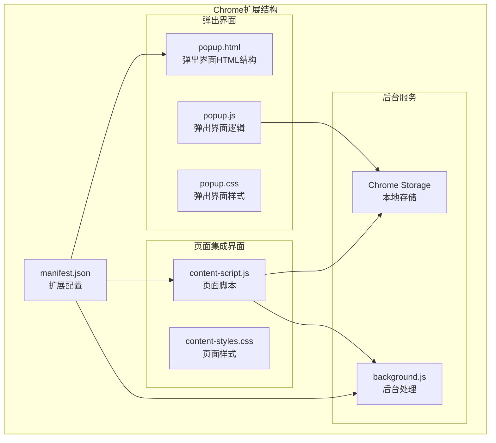

**图表来源**
- [manifest.json](file://manifest.json#L1-L32)
- [popup.html](file://popup.html#L1-L226)
- [content-script.js](file://content-script.js#L1-L868)

**章节来源**
- [manifest.json](file://manifest.json#L1-L32)

## 核心组件

### 弹出式翻译界面

弹出式翻译界面是用户与扩展交互的主要入口，提供完整的翻译功能和设置选项。

#### HTML结构设计

弹出界面采用模块化的HTML结构，包含欢迎屏幕和翻译界面两个主要部分：

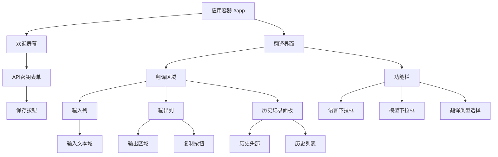

**图表来源**
- [popup.html](file://popup.html#L10-L222)

#### 样式系统架构

弹出界面采用CSS Grid和Flexbox相结合的布局系统，确保响应式设计和良好的视觉层次：

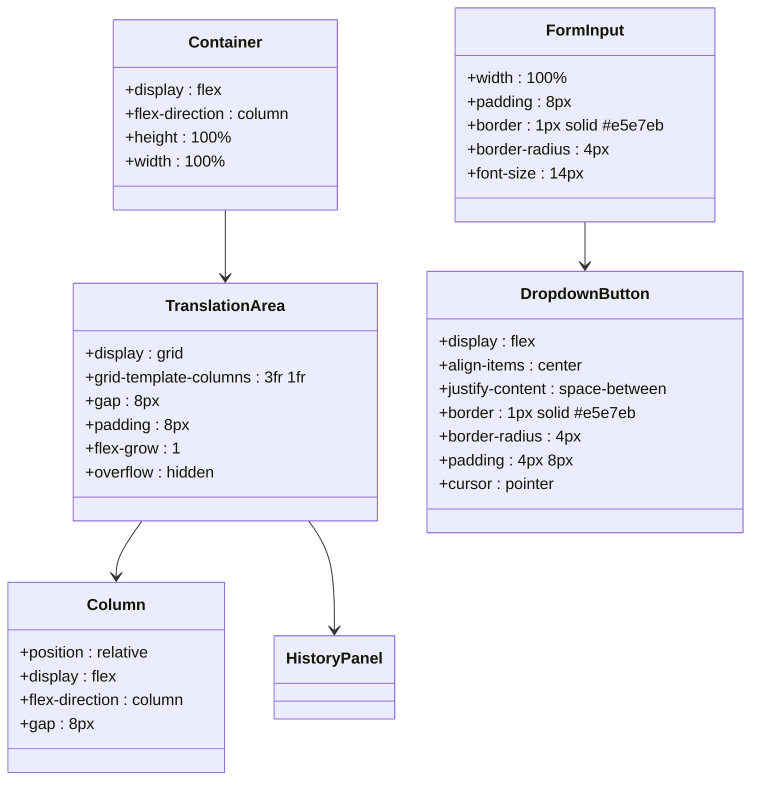

**图表来源**
- [popup.css](file://popup.css#L18-L244)

#### JavaScript交互逻辑

弹出界面使用模块化的JavaScript架构，实现了完整的状态管理和事件处理机制：

**章节来源**
- [popup.js](file://popup.js#L1-L452)

### 页面内翻译弹窗

页面内翻译弹窗是扩展的核心功能组件，提供即时的文本翻译体验。

#### 弹窗创建和定位机制

页面内翻译弹窗采用动态创建和精确定位的机制：

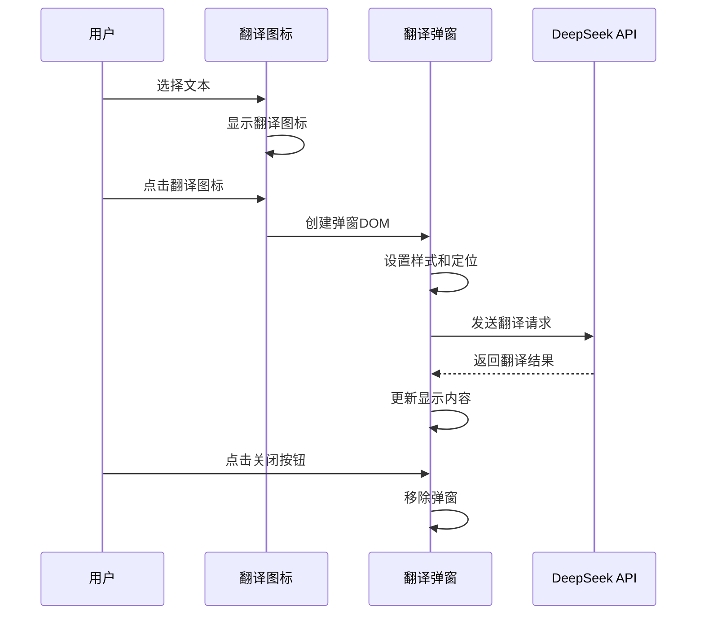

**图表来源**
- [content-script.js](file://content-script.js#L206-L424)

#### 弹窗管理机制

弹窗管理系统包括创建、显示、隐藏和销毁的完整生命周期：

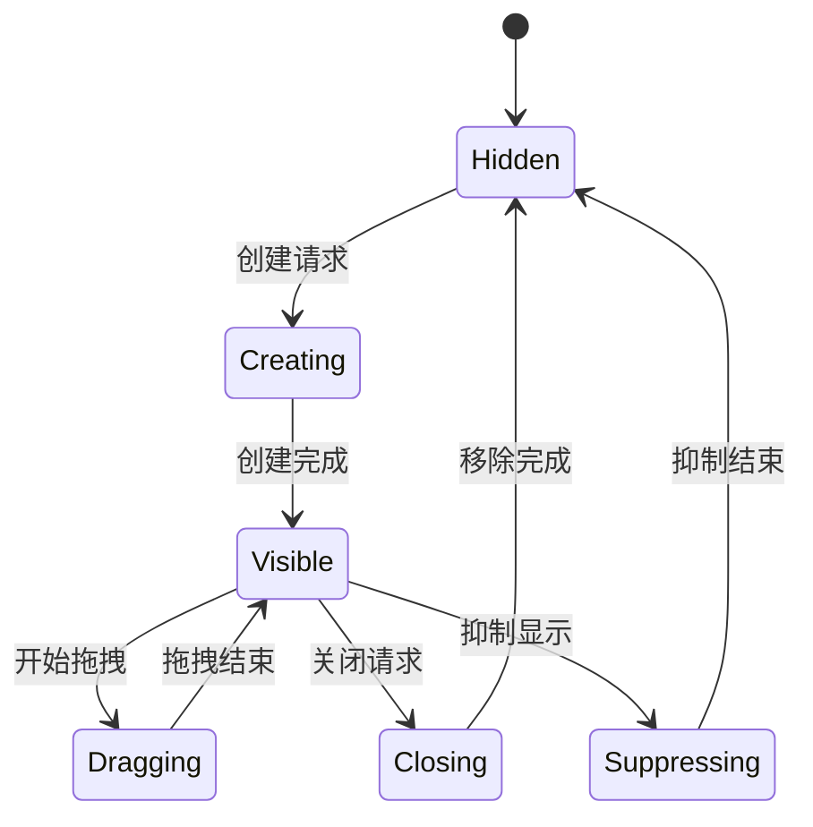

**图表来源**
- [content-script.js](file://content-script.js#L479-L489)

**章节来源**
- [content-script.js](file://content-script.js#L1-L868)

## 架构概览

系统采用分层架构设计，清晰分离了用户界面、业务逻辑和数据存储：

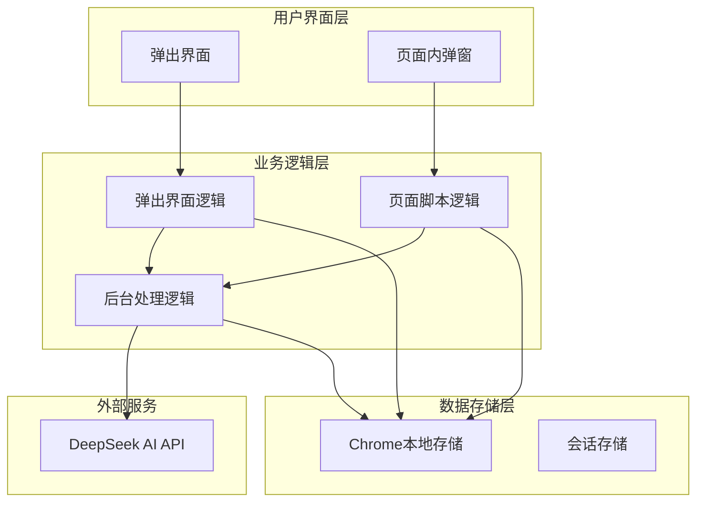

**图表来源**
- [popup.js](file://popup.js#L33-L51)
- [content-script.js](file://content-script.js#L27-L68)
- [background.js](file://background.js#L10-L55)

### 组件间通信机制

系统实现了多种组件间通信方式：

1. **Chrome Extension Messaging**: 用于弹窗和页面脚本之间的消息传递
2. **Local Storage**: 用于持久化用户设置和翻译历史
3. **DOM Events**: 用于组件内部的事件处理和状态同步

**章节来源**
- [manifest.json](file://manifest.json#L19-L31)

## 详细组件分析

### 弹出界面组件分析

#### 状态管理系统

弹出界面实现了完整的状态管理机制，包括用户设置、翻译历史和当前翻译状态：

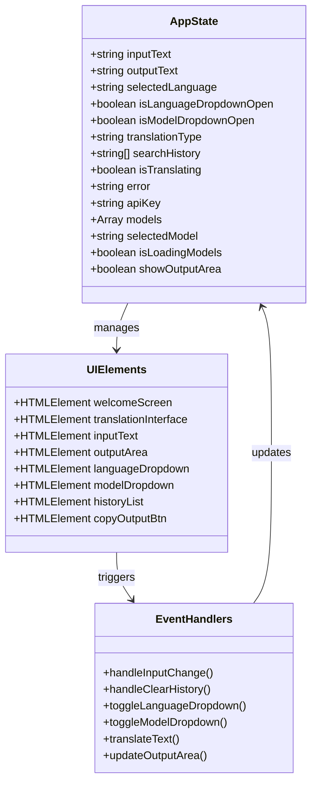

**图表来源**
- [popup.js](file://popup.js#L3-L29)
- [popup.js](file://popup.js#L89-L131)

#### 事件处理机制

弹出界面采用了多层次的事件处理架构：

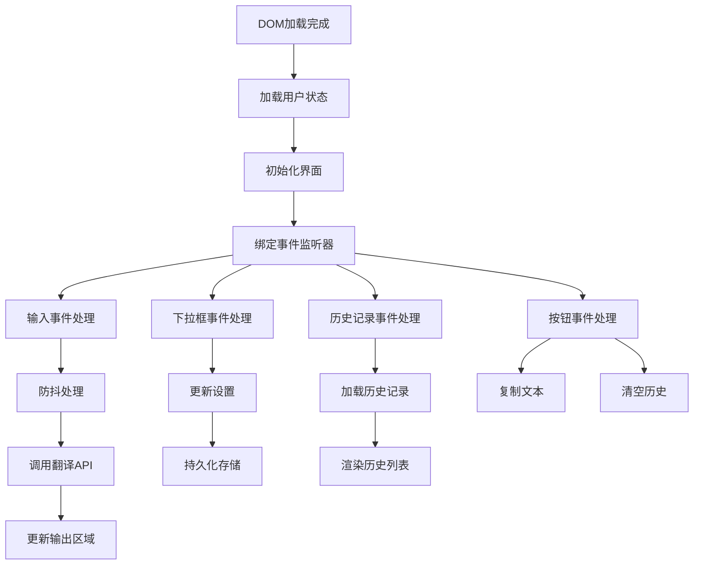

**图表来源**
- [popup.js](file://popup.js#L127-L194)

**章节来源**
- [popup.js](file://popup.js#L1-L452)

### 页面内弹窗组件分析

#### 翻译图标系统

页面内翻译图标系统提供了智能的文本选择和翻译触发机制：

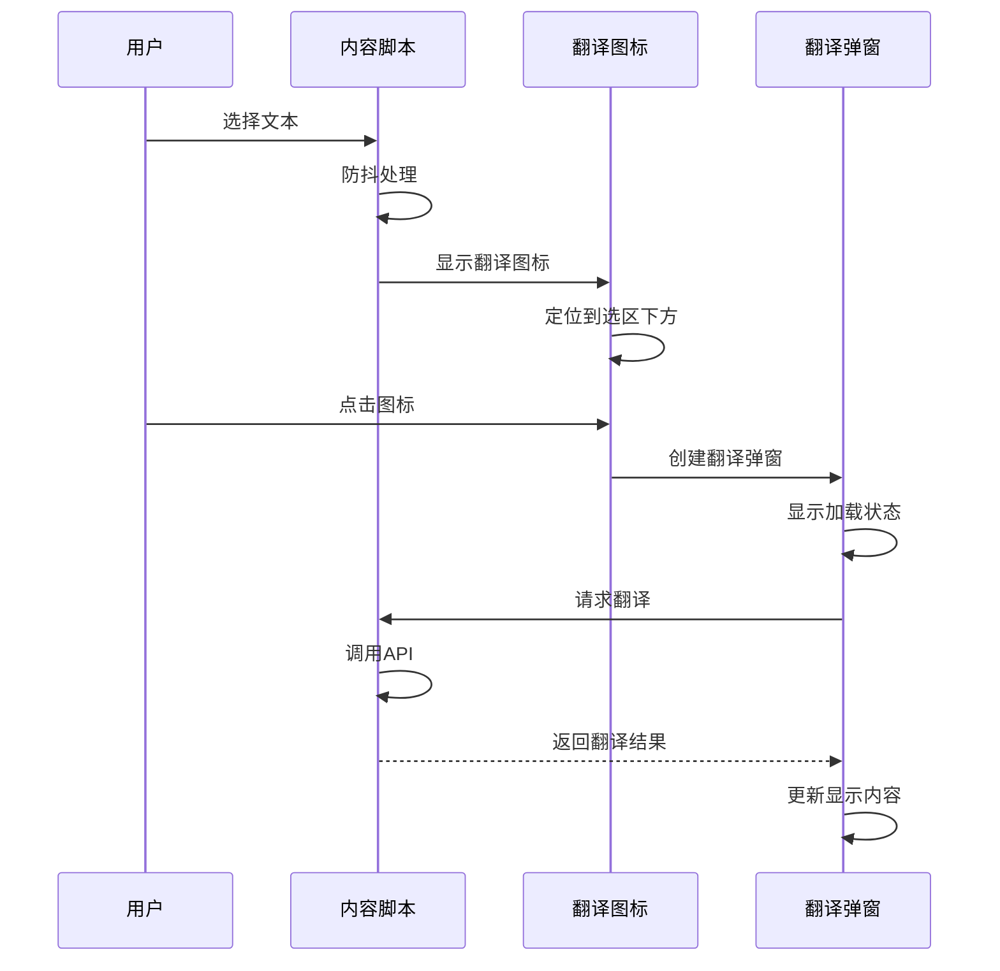

**图表来源**
- [content-script.js](file://content-script.js#L129-L190)
- [content-script.js](file://content-script.js#L426-L467)

#### 弹窗拖拽功能

翻译弹窗支持拖拽功能，提升了用户体验：

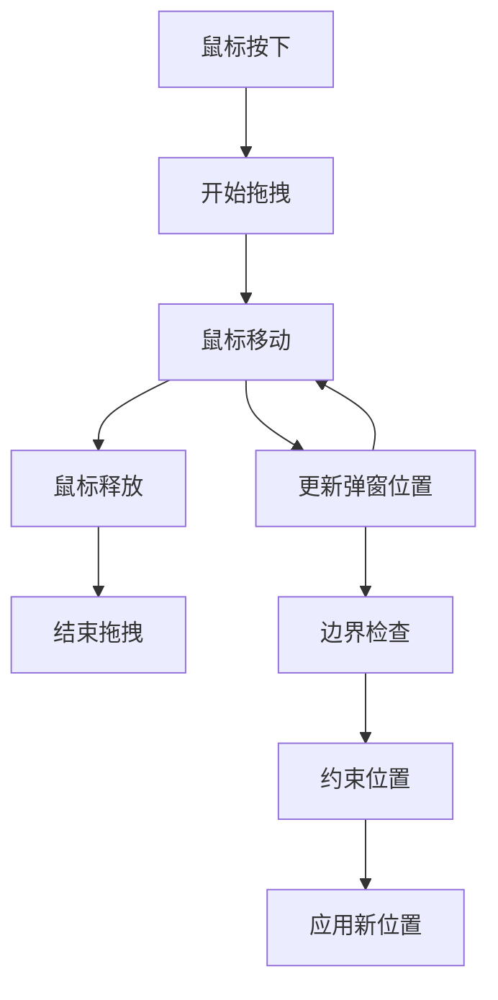

**图表来源**
- [content-script.js](file://content-script.js#L374-L421)

**章节来源**
- [content-script.js](file://content-script.js#L1-L868)

### 样式系统分析

#### 响应式设计实现

样式系统采用了现代的响应式设计原则：

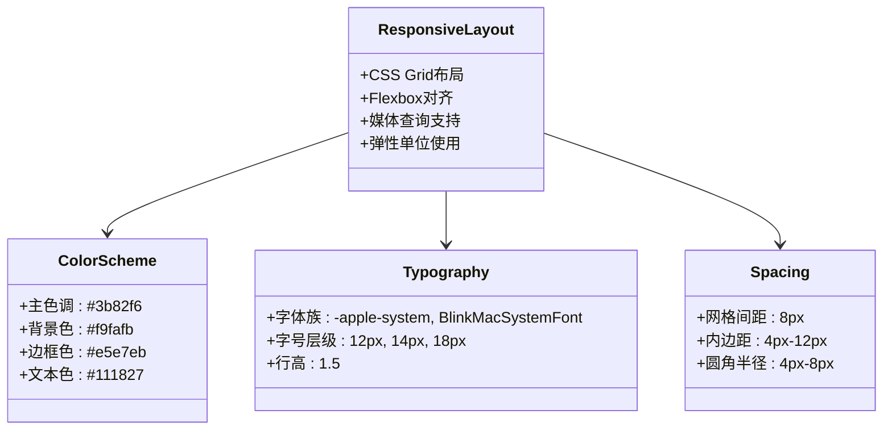

**图表来源**
- [popup.css](file://popup.css#L1-L349)
- [content-styles.css](file://content-styles.css#L1-L196)

#### 动画和过渡效果

系统实现了流畅的动画和过渡效果：

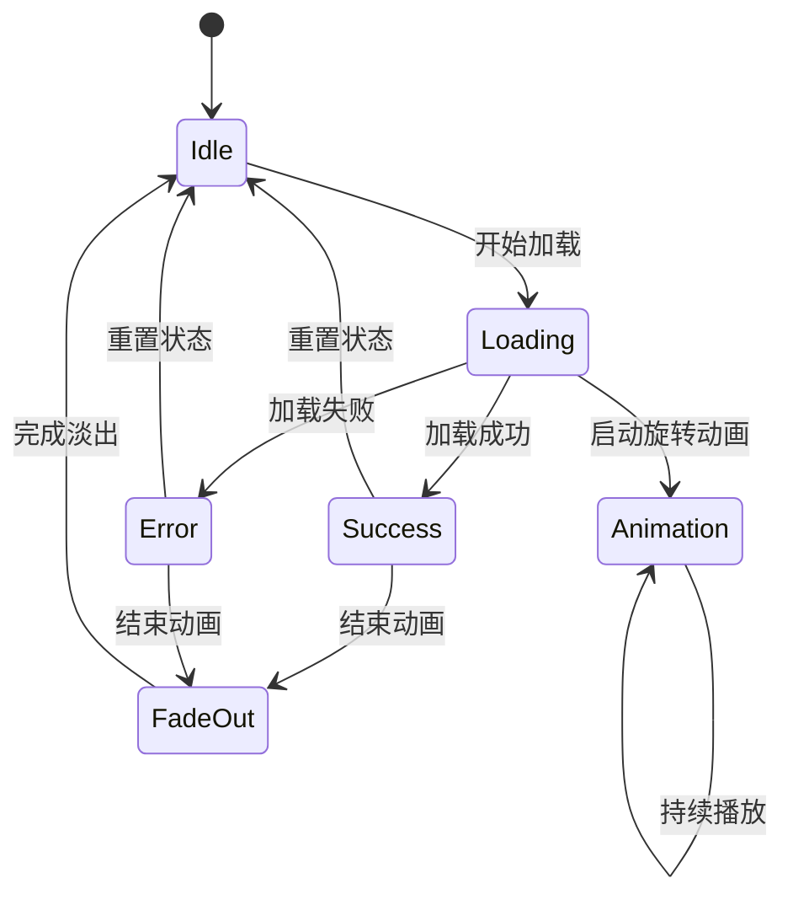

**图表来源**
- [popup.css](file://popup.css#L267-L295)
- [content-styles.css](file://content-styles.css#L129-L149)

**章节来源**
- [popup.css](file://popup.css#L1-L349)
- [content-styles.css](file://content-styles.css#L1-L196)

## 依赖关系分析

### 文件依赖关系

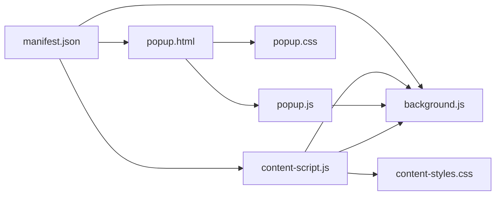

**图表来源**
- [manifest.json](file://manifest.json#L19-L31)

### 外部依赖分析

系统对外部依赖相对较少，主要依赖于：

1. **Chrome Extension APIs**: 用于存储、标签页管理和消息传递
2. **DeepSeek AI API**: 用于文本翻译服务
3. **Web Speech API**: 用于文本朗读功能

**章节来源**
- [manifest.json](file://manifest.json#L19-L21)
- [content-script.js](file://content-script.js#L313-L351)

## 性能考虑

### 代码分割和懒加载

系统采用了合理的代码组织方式，避免了不必要的资源加载：

1. **按需加载**: 弹窗界面仅在需要时加载
2. **事件委托**: 使用事件委托减少内存占用
3. **防抖优化**: 输入处理使用防抖机制减少API调用

### 内存管理

系统实现了完善的内存管理策略：

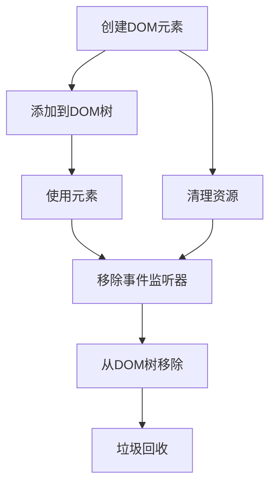

**图表来源**
- [content-script.js](file://content-script.js#L479-L489)

### 缓存策略

系统实现了多层缓存机制：

1. **浏览器缓存**: 静态资源由浏览器自动缓存
2. **本地存储**: 用户设置和翻译历史持久化存储
3. **内存缓存**: 当前翻译结果的临时缓存

## 故障排除指南

### 常见问题诊断

#### API连接问题

当遇到API连接问题时，可以按照以下步骤排查：

1. **检查网络连接**: 确保网络连接正常
2. **验证API密钥**: 确认API密钥格式正确
3. **检查权限设置**: 确认扩展具有必要的权限
4. **查看控制台错误**: 检查浏览器开发者工具中的错误信息

#### 翻译结果显示异常

如果翻译结果显示异常，可以检查：

1. **检查输入文本**: 确认输入文本格式正确
2. **验证语言设置**: 确认选择了正确的翻译语言
3. **检查模型选择**: 确认选择了合适的AI模型
4. **查看错误信息**: 检查是否有具体的错误提示

#### 弹窗显示问题

如果弹窗无法正常显示，可以排查：

1. **检查CSS样式**: 确认样式文件正确加载
2. **验证DOM结构**: 检查弹窗的DOM结构是否正确
3. **检查事件绑定**: 确认事件监听器正常工作
4. **查看浏览器兼容性**: 确认浏览器支持相关API

**章节来源**
- [popup.js](file://popup.js#L329-L340)
- [content-script.js](file://content-script.js#L656-L665)

### 调试技巧

1. **启用开发者模式**: 在Chrome扩展页面启用开发者模式
2. **使用调试工具**: 利用浏览器的开发者工具进行调试
3. **查看控制台**: 注意观察控制台中的错误和警告信息
4. **检查网络请求**: 查看API请求的响应状态和数据

## 结论

这个AI翻译器项目展现了现代Chrome扩展开发的最佳实践，具有以下突出特点：

### 设计优势

1. **模块化架构**: 清晰的组件分离和职责划分
2. **响应式设计**: 适配不同设备和屏幕尺寸
3. **用户体验优化**: 流畅的交互和反馈机制
4. **可维护性**: 良好的代码结构和注释

### 技术亮点

1. **双界面设计**: 满足不同使用场景的需求
2. **智能状态管理**: 完善的应用状态和持久化机制
3. **高效的事件处理**: 防抖和节流优化提升性能
4. **丰富的交互效果**: 动画和过渡增强用户体验

### 改进建议

1. **国际化支持**: 添加多语言界面支持
2. **主题系统**: 实现可定制的主题切换功能
3. **键盘快捷键**: 添加键盘快捷键支持
4. **离线模式**: 考虑实现部分功能的离线支持

该项目为Chrome扩展开发提供了优秀的参考范例，展示了如何构建功能完整、用户体验良好的浏览器扩展应用。