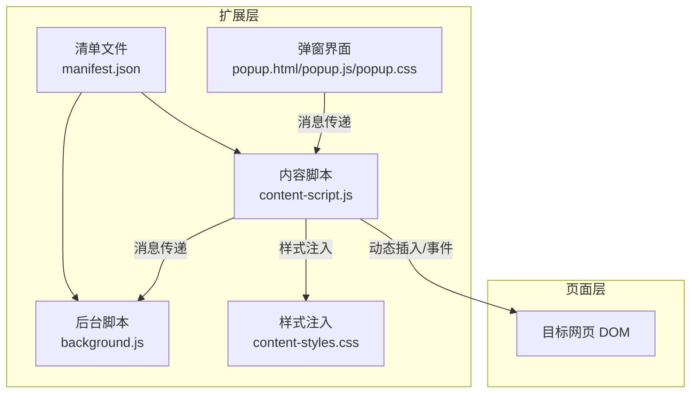
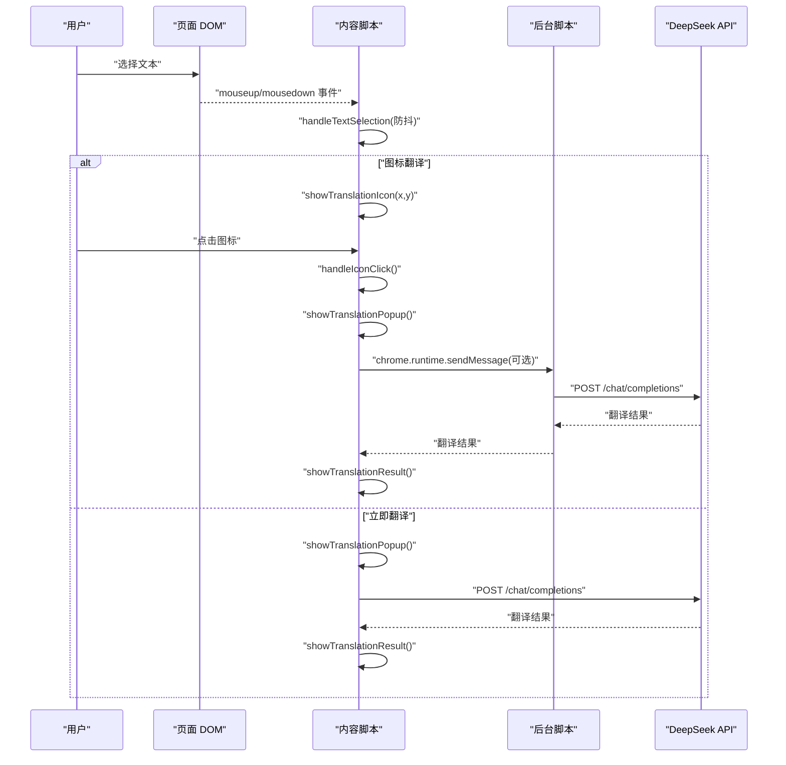
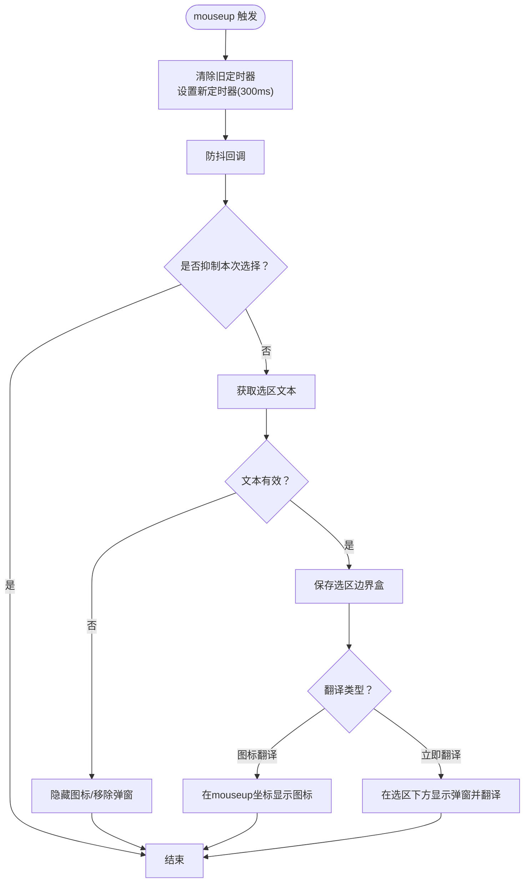
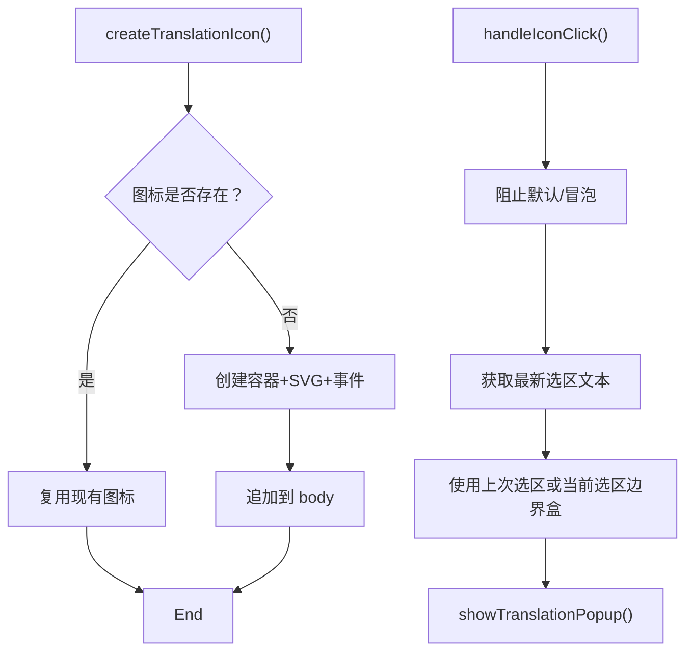
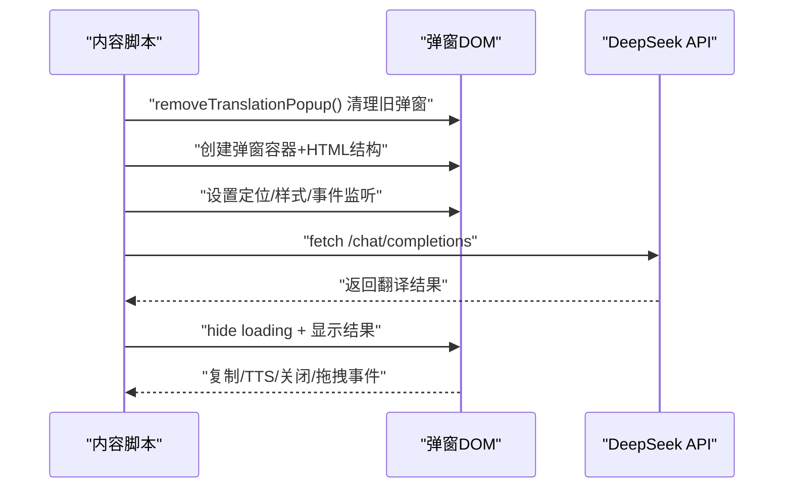
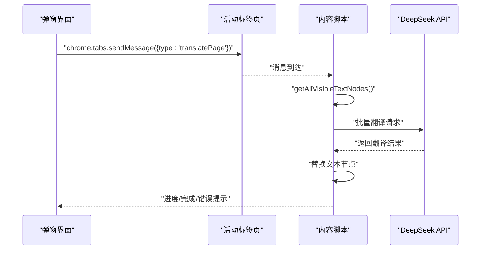
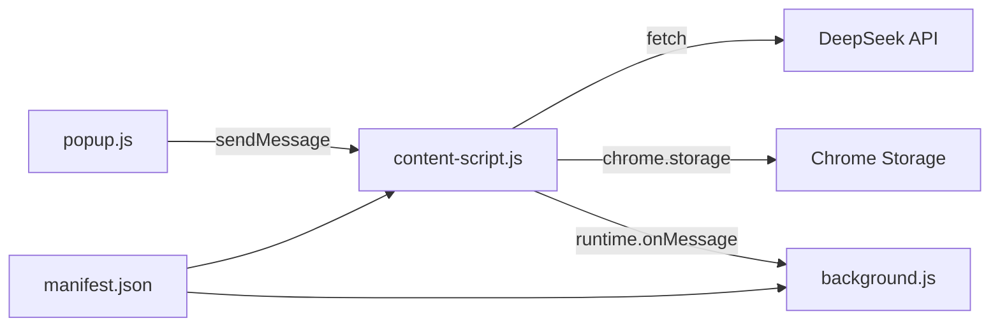

# 页面集成界面

<cite>
**本文引用的文件**
- [content-script.js](file://content-script.js)
- [content-styles.css](file://content-styles.css)
- [manifest.json](file://manifest.json)
- [background.js](file://background.js)
- [popup.html](file://popup.html)
- [popup.js](file://popup.js)
- [popup.css](file://popup.css)
- [README.md](file://README.md)
</cite>

## 目录
1. [简介](#简介)
2. [项目结构](#项目结构)
3. [核心组件](#核心组件)
4. [架构总览](#架构总览)
5. [详细组件分析](#详细组件分析)
6. [依赖关系分析](#依赖关系分析)
7. [性能考量](#性能考量)
8. [故障排查指南](#故障排查指南)
9. [结论](#结论)
10. [附录](#附录)

## 简介
本文件聚焦于页面集成界面，系统性阐述 content-script.js 的文本选择监听机制、翻译图标显示逻辑、翻译弹窗创建与管理流程；同时解析 content-styles.css 的样式设计，包括翻译弹窗的定位、样式定制、响应式布局与跨浏览器兼容策略。文档还覆盖页面元素的动态插入、DOM 操作优化、事件委托机制与性能优化建议，并提供翻译弹窗的创建流程、位置计算算法、样式应用策略与用户交互处理的详细说明，辅以实际代码路径与调试技巧。

## 项目结构
该扩展采用 Manifest V3 架构，content-script 注入到所有页面，负责监听用户选择、创建图标与弹窗、发起翻译请求并与后台通信。popup 提供配置界面与网页翻译入口，background 负责处理翻译请求（可选）。

图表来源
- [manifest.json](file://manifest.json#L21-L27)
- [content-script.js](file://content-script.js#L27-L83)
- [popup.js](file://popup.js#L196-L225)
- [background.js](file://background.js#L1-L7)

章节来源
- [manifest.json](file://manifest.json#L1-L32)
- [README.md](file://README.md#L39-L50)

## 核心组件
- 文本选择监听与防抖：监听鼠标抬起事件，使用防抖避免频繁触发，过滤无效选区，按翻译类型决定图标显示或立即弹窗。
- 翻译图标管理：创建固定定位的图标容器，SVG 图标渲染，点击事件触发弹窗与翻译。
- 翻译弹窗管理：动态创建弹窗 DOM，设置定位、阴影、圆角、拖拽、复制、TTS、关闭等交互；支持中止请求与抑制后续弹窗。
- 样式体系：统一类名命名空间（如 .deepseek-translation-*），固定定位、z-index 层级控制、动画与响应式布局。
- 网页翻译：从 popup 发送消息到 content-script，遍历可见文本节点，批量请求翻译并替换文本。

章节来源
- [content-script.js](file://content-script.js#L130-L190)
- [content-script.js](file://content-script.js#L192-L204)
- [content-script.js](file://content-script.js#L206-L424)
- [content-styles.css](file://content-styles.css#L1-L196)
- [popup.js](file://popup.js#L196-L225)

## 架构总览
页面集成界面的关键交互链路如下：
- 用户在页面中进行文本选择，content-script 通过防抖处理识别有效选区。
- 若为“图标翻译”，在鼠标抬起位置显示翻译图标；若为“立即翻译”，直接在选区下方弹出翻译弹窗并发起翻译。
- 用户点击图标或弹窗头部拖拽移动，复制、TTS、关闭等交互触发相应逻辑。
- 网页翻译由 popup 触发，content-script 遍历可见文本节点，批量请求翻译并替换文本。

图表来源
- [content-script.js](file://content-script.js#L130-L190)
- [content-script.js](file://content-script.js#L192-L204)
- [content-script.js](file://content-script.js#L206-L424)
- [background.js](file://background.js#L1-L55)

## 详细组件分析

### 文本选择监听与防抖机制
- 事件绑定：在捕获阶段监听 document 的 mouseup 与 mousedown，确保优先处理。
- 防抖策略：每次选择更新时清理旧定时器，延时 300ms 执行，避免快速多次选择导致的重复弹窗与请求。
- 有效性校验：去除仅含空白字符的选区；记录 Range 的边界盒用于图标/弹窗定位。
- 类型分支：根据翻译类型分别执行图标显示或立即弹窗。

图表来源
- [content-script.js](file://content-script.js#L130-L190)

章节来源
- [content-script.js](file://content-script.js#L80-L83)
- [content-script.js](file://content-script.js#L130-L190)

### 翻译图标显示逻辑
- 创建与复用：首次创建固定定位的图标容器，设置类名与 SVG 内容，注册点击事件；若已存在则直接复用。
- 显示策略：仅在“图标翻译”模式下显示；点击图标时阻止默认行为与冒泡，避免误触关闭弹窗。
- 定位策略：使用 mouseup 时的鼠标坐标作为图标中心点，减去尺寸得到左上角定位，确保图标位于选区附近。

图表来源
- [content-script.js](file://content-script.js#L86-L127)
- [content-script.js](file://content-script.js#L192-L204)
- [content-script.js](file://content-script.js#L426-L467)

章节来源
- [content-script.js](file://content-script.js#L86-L127)
- [content-script.js](file://content-script.js#L192-L204)
- [content-script.js](file://content-script.js#L426-L467)

### 翻译弹窗创建与管理
- 动态创建：移除旧弹窗后创建新弹窗容器，设置类名与 HTML 结构，包含标题栏、原文、翻译结果、复制与关闭按钮。
- 定位算法：基于选区边界盒，左对齐选区左侧，底部对齐选区底部加 10px，固定定位，z-index 较高，确保覆盖页面元素。
- 交互能力：
  - 复制：点击复制按钮，提取翻译文本写入剪贴板，并短暂修改提示文案。
  - TTS：分别对原文与翻译结果提供朗读按钮，自动识别语言并调用 Web Speech API。
  - 关闭：点击关闭按钮终止请求并移除弹窗，同时抑制随后的 mouseup 弹窗。
  - 拖拽：在标题栏按下时启用拖拽，实时计算新位置并限制在视窗范围内。
- 请求管理：每次弹窗创建前终止上一请求，避免并发与资源浪费；翻译完成后隐藏加载状态并显示结果。

图表来源
- [content-script.js](file://content-script.js#L206-L424)
- [content-script.js](file://content-script.js#L564-L665)

章节来源
- [content-script.js](file://content-script.js#L206-L424)
- [content-script.js](file://content-script.js#L564-L665)

### 样式设计与定位策略
- 图标样式：固定定位、圆角边框、阴影、悬停态变化；SVG 图标占满容器。
- 弹窗样式：固定定位、圆角、阴影、最大宽度与固定宽度、溢出隐藏；标题栏支持拖拽；正文区域分原文与翻译两列。
- 加载动画：旋转动画与占位文本，提升交互反馈。
- 响应式与兼容：使用固定宽高与相对单位，避免绝对像素依赖；通过 z-index 控制层级，减少与页面元素冲突。

章节来源
- [content-styles.css](file://content-styles.css#L1-L196)

### 网页翻译流程
- 触发方式：popup 中“翻译网页”按钮点击后，查询当前活动标签页并发送消息。
- 执行策略：content-script 遍历可见文本节点（排除脚本、样式、隐藏元素等），拼接为批次请求，调用翻译接口并逐批替换节点文本。
- 进度提示：在页面右上角显示进度条，完成后提示完成或错误信息。

图表来源
- [popup.js](file://popup.js#L196-L225)
- [content-script.js](file://content-script.js#L700-L800)

章节来源
- [popup.js](file://popup.js#L196-L225)
- [content-script.js](file://content-script.js#L700-L800)

## 依赖关系分析
- manifest.json 声明 content_scripts 注入 JS 与 CSS，权限包含 storage、activeTab、scripting，主机权限指向 DeepSeek API。
- content-script 依赖 Chrome Storage 读取设置，依赖 fetch 发起翻译请求，依赖 runtime 与 popup 通信。
- background 提供翻译服务（可选），与 content-script 共享翻译逻辑。
- popup 提供 UI 与网页翻译入口，与 content-script 通过消息通信。

图表来源
- [manifest.json](file://manifest.json#L19-L31)
- [content-script.js](file://content-script.js#L27-L83)
- [background.js](file://background.js#L1-L7)
- [popup.js](file://popup.js#L196-L225)

章节来源
- [manifest.json](file://manifest.json#L1-L32)
- [content-script.js](file://content-script.js#L27-L83)
- [background.js](file://background.js#L1-L7)
- [popup.js](file://popup.js#L196-L225)

## 性能考量
- 事件防抖：文本选择使用 300ms 防抖，降低频繁弹窗与请求次数。
- 请求终止：每次创建弹窗前终止上一请求，避免资源浪费与竞态。
- DOM 复用：图标与弹窗按需创建与移除，避免重复构建。
- 事件委托与冒泡控制：在捕获阶段处理关键事件，阻止默认行为与冒泡，减少误触发。
- 批量网页翻译：按批次处理文本节点，避免一次性替换造成卡顿。
- 样式注入：通过 CSS 类名与固定定位，减少复杂计算与重排。

[本节为通用性能建议，无需特定文件来源]

## 故障排查指南
- 图标不显示或位置异常
  - 检查是否处于“图标翻译”模式；确认鼠标抬起事件是否正确触发；查看图标容器是否成功插入到 body。
  - 参考路径：[content-script.js](file://content-script.js#L182-L188)、[content-script.js](file://content-script.js#L192-L204)
- 弹窗无法关闭或拖拽异常
  - 确认关闭按钮事件是否绑定；检查拖拽逻辑中是否正确计算偏移与边界；验证全局点击处理是否抑制了后续弹窗。
  - 参考路径：[content-script.js](file://content-script.js#L355-L368)、[content-script.js](file://content-script.js#L374-L420)
- 翻译结果未显示或加载状态未消失
  - 检查 showTranslationResult 是否正确隐藏加载并显示结果；确认 fetch 返回状态与数据结构。
  - 参考路径：[content-script.js](file://content-script.js#L513-L529)、[content-script.js](file://content-script.js#L564-L665)
- 网页翻译无响应
  - 确认 popup 是否正确发送消息；检查 content-script 的消息监听与文本节点遍历逻辑；关注批次请求与替换过程。
  - 参考路径：[popup.js](file://popup.js#L196-L225)、[content-script.js](file://content-script.js#L689-L698)、[content-script.js](file://content-script.js#L700-L800)
- API 错误或密钥问题
  - 检查 API Key 是否已保存；确认 fetch 请求头与 body 参数；查看错误处理分支与提示文案。
  - 参考路径：[content-script.js](file://content-script.js#L567-L569)、[content-script.js](file://content-script.js#L656-L665)

章节来源
- [content-script.js](file://content-script.js#L182-L188)
- [content-script.js](file://content-script.js#L192-L204)
- [content-script.js](file://content-script.js#L355-L368)
- [content-script.js](file://content-script.js#L374-L420)
- [content-script.js](file://content-script.js#L513-L529)
- [content-script.js](file://content-script.js#L564-L665)
- [popup.js](file://popup.js#L196-L225)
- [content-script.js](file://content-script.js#L689-L698)
- [content-script.js](file://content-script.js#L700-L800)

## 结论
页面集成界面通过 content-script 实现了高效的文本选择监听、图标与弹窗管理、以及与 DeepSeek API 的翻译交互。content-styles.css 提供了稳定一致的视觉与交互体验。整体设计兼顾可用性与性能，支持多种翻译模式与网页批量翻译场景。建议在生产环境中持续关注事件冒泡控制、请求终止与 DOM 复用策略，以进一步提升稳定性与用户体验。

[本节为总结性内容，无需特定文件来源]

## 附录
- 术语
  - 防抖：在连续触发的短时间内仅执行一次的策略。
  - 捕获阶段：事件从文档根节点向目标元素传播的阶段，有利于优先处理。
  - AbortController：用于取消正在进行的请求。
- 调试建议
  - 在浏览器开发者工具中观察 content-script 日志输出，定位事件触发与弹窗创建时机。
  - 使用 Elements 面板检查图标与弹窗的类名与样式是否正确应用。
  - 在 Network 面板监控翻译请求的状态码与响应体，核对 API Key 与模型参数。

[本节为通用补充内容，无需特定文件来源]