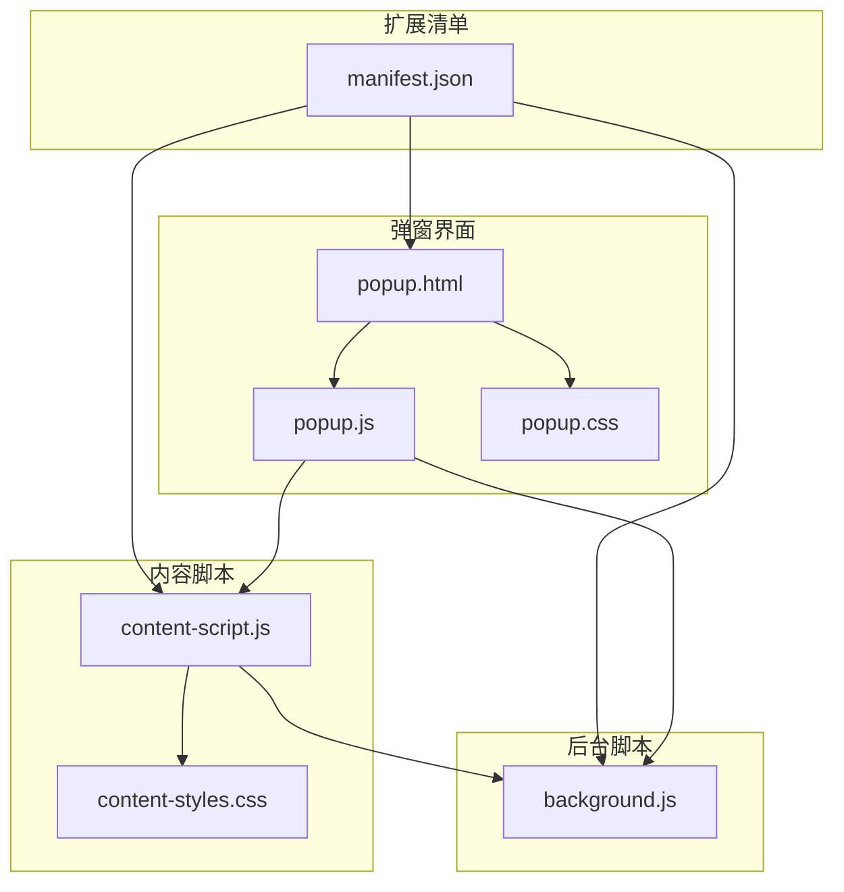
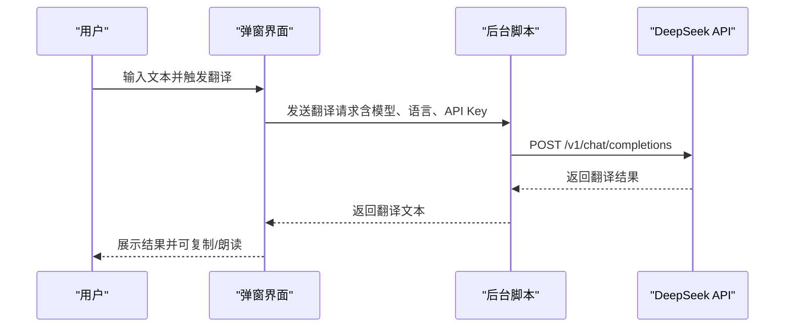
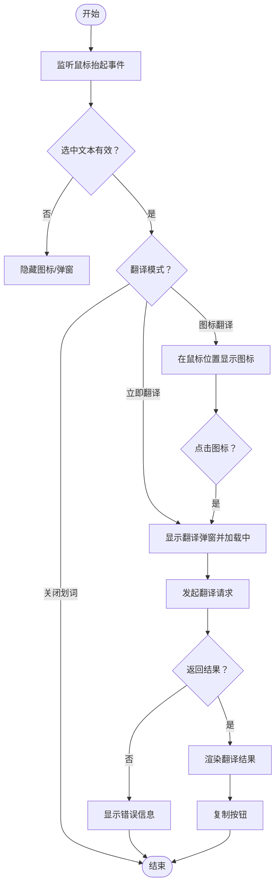
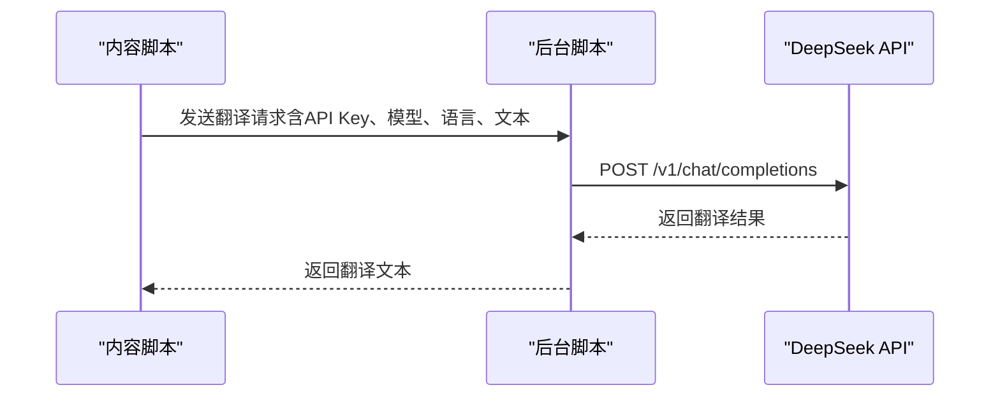
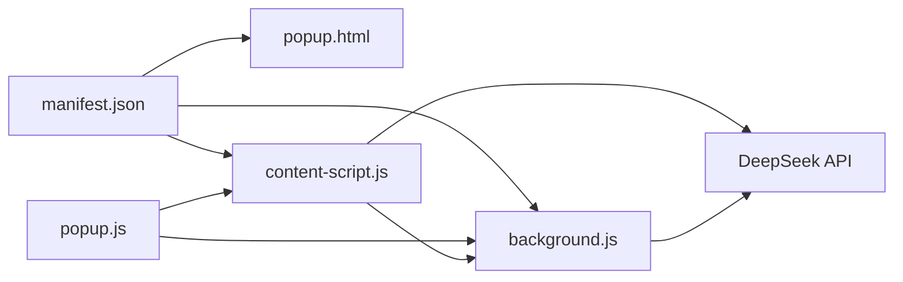

# 项目概述

<cite>
**本文档引用的文件**
- [README.md](file://README.md)
- [manifest.json](file://manifest.json)
- [background.js](file://background.js)
- [content-script.js](file://content-script.js)
- [popup.js](file://popup.js)
- [popup.html](file://popup.html)
- [content-styles.css](file://content-styles.css)
- [popup.css](file://popup.css)
</cite>

## 目录
1. [简介](#简介)
2. [项目结构](#项目结构)
3. [核心组件](#核心组件)
4. [架构总览](#架构总览)
5. [详细组件分析](#详细组件分析)
6. [依赖关系分析](#依赖关系分析)
7. [性能考量](#性能考量)
8. [故障排除指南](#故障排除指南)
9. [结论](#结论)
10. [附录](#附录)

## 简介
本项目是一个基于 Chrome 扩展的 AI 翻译器，利用 DeepSeek AI 的大模型能力为用户提供网页与文本的智能翻译服务。项目采用 Manifest V3 规范，通过内容脚本（content script）在网页中集成划词翻译与弹窗交互体验，通过后台脚本（background service worker）与 DeepSeek API 进行安全可靠的通信，通过弹窗界面（popup）提供配置与历史记录管理。

- 主要目标：为用户提供便捷、可定制的翻译体验，支持多种语言对与模型选择，并在网页中实现即时划词翻译与整页翻译。
- 技术亮点：内容脚本与后台脚本职责分离、前端弹窗与网页内弹窗双交互模式、历史记录持久化、网页整页翻译批处理策略。
- 差异化优势：无需编译、源码透明、API Key 本地存储、支持 TTS 朗读、网页整页翻译批处理、防抖与中断控制优化用户体验。

## 项目结构
项目采用最小但完整的 Chrome 扩展结构，核心文件如下：
- 清单文件：定义扩展元信息、权限、入口页面与内容脚本注入范围
- 弹窗页面与脚本：提供 API Key 输入、翻译配置、历史记录与网页翻译入口
- 内容脚本：在网页中实现划词监听、图标与弹窗渲染、网页整页翻译
- 样式文件：内容脚本弹窗样式与弹窗界面样式
- 后台脚本：处理翻译请求、与 DeepSeek API 通信、语言判断与提示词构造



图表来源
- [manifest.json](file://manifest.json#L1-L32)
- [popup.html](file://popup.html#L1-L226)
- [popup.js](file://popup.js#L1-L452)
- [content-script.js](file://content-script.js#L1-L868)
- [content-styles.css](file://content-styles.css#L1-L196)
- [popup.css](file://popup.css#L1-L349)
- [background.js](file://background.js#L1-L95)

章节来源
- [manifest.json](file://manifest.json#L1-L32)
- [popup.html](file://popup.html#L1-L226)
- [popup.js](file://popup.js#L1-L452)
- [content-script.js](file://content-script.js#L1-L868)
- [content-styles.css](file://content-styles.css#L1-L196)
- [popup.css](file://popup.css#L1-L349)
- [background.js](file://background.js#L1-L95)

## 核心组件
- 清单文件（manifest.json）
  - 定义扩展名称、版本、描述、图标、动作入口（弹窗）、权限（storage、activeTab、scripting）、主机权限（DeepSeek API）、内容脚本注入规则与后台服务工作线程。
- 弹窗界面（popup.html + popup.js + popup.css）
  - 提供 API Key 输入与保存、翻译输入区、输出区、历史记录面板、语言与模型下拉选择、翻译模式（图标翻译/立即翻译/关闭划词）、网页翻译按钮、复制结果按钮。
- 内容脚本（content-script.js + content-styles.css）
  - 在网页中监听选中事件，根据翻译模式显示图标或弹窗；构造 DeepSeek 提示词；调用 DeepSeek API 或通过后台脚本进行翻译；支持 TTS 朗读与复制；实现网页整页翻译的批处理与进度提示。
- 后台脚本（background.js）
  - 接收来自内容脚本的翻译请求，向 DeepSeek API 发起请求，处理响应与错误，构造系统提示词与用户提示词，返回翻译结果。

章节来源
- [manifest.json](file://manifest.json#L1-L32)
- [popup.html](file://popup.html#L1-L226)
- [popup.js](file://popup.js#L1-L452)
- [content-script.js](file://content-script.js#L1-L868)
- [content-styles.css](file://content-styles.css#L1-L196)
- [background.js](file://background.js#L1-L95)

## 架构总览
整体架构分为三层：UI 层（弹窗与网页内弹窗）、业务层（内容脚本与后台脚本）、服务层（DeepSeek API）。内容脚本负责与用户交互与网页集成，后台脚本负责与外部服务通信，弹窗负责配置与历史管理。

```mermaid
graph TB
subgraph "UI 层"
Popup["弹窗界面<br/>popup.html/popup.js"]
ContentPopup["网页内弹窗<br/>content-script.js"]
end
subgraph "业务层"
ContentScript["内容脚本<br/>content-script.js"]
Background["后台脚本<br/>background.js"]
end
subgraph "服务层"
DeepSeek["DeepSeek API<br/>https://api.deepseek.com"]
end
Popup <- --> Background
ContentScript <- --> Background
ContentScript <- --> ContentPopup
Background --> DeepSeek
ContentScript --> DeepSeek
```

图表来源
- [popup.js](file://popup.js#L1-L452)
- [content-script.js](file://content-script.js#L1-L868)
- [background.js](file://background.js#L1-L95)

## 详细组件分析

### 清单文件（manifest.json）
- Manifest V3：声明 action（默认弹窗）、icons、permissions、host_permissions、content_scripts 注入规则、background service worker。
- 权限说明：storage 用于本地持久化配置与历史；activeTab 用于获取当前标签页上下文；scripting 用于动态注入与脚本执行；host_permissions 指向 DeepSeek API。
- 内容脚本：匹配所有 URL，注入 content-script.js 与 content-styles.css，确保在任意网页中启用翻译能力。

章节来源
- [manifest.json](file://manifest.json#L1-L32)

### 弹窗界面（popup.html + popup.js + popup.css）
- 功能概览
  - API Key 管理：首次使用时输入并保存至本地存储，后续自动加载。
  - 翻译输入与输出：输入区支持多行文本，输出区展示翻译结果，支持复制按钮。
  - 历史记录：本地存储最近 20 条翻译历史，支持点击回填与清空。
  - 语言与模型：支持多语言对与两个 DeepSeek 模型选择；切换时自动触发翻译。
  - 翻译模式：图标翻译（选中文本后显示图标）、立即翻译（选中文本自动弹窗）、关闭划词。
  - 网页翻译：向内容脚本发送消息，触发整页翻译流程。
- 交互细节
  - 防抖：输入区变更采用防抖策略，降低频繁请求。
  - 中断：同一时间仅保留一次翻译请求，新请求会中断旧请求。
  - 错误处理：网络异常或 API 返回错误时展示错误信息。
  - TTS：弹窗输出区支持复制与 TTS 朗读（原文/翻译）。



图表来源
- [popup.js](file://popup.js#L262-L341)
- [background.js](file://background.js#L10-L55)

章节来源
- [popup.html](file://popup.html#L1-L226)
- [popup.js](file://popup.js#L1-L452)
- [popup.css](file://popup.css#L1-L349)

### 内容脚本（content-script.js + content-styles.css）
- 功能概览
  - 划词监听：在网页中监听鼠标抬起事件，对有效选中文本进行处理。
  - 图标翻译：在鼠标位置显示翻译图标，点击后弹出翻译弹窗并发起翻译。
  - 立即翻译：选中文本后自动弹出翻译弹窗并发起翻译。
  - 网页整页翻译：遍历可见文本节点，批量拼接后请求翻译，逐批替换原文本，显示进度提示。
  - 历史记录：在特定模式下将历史写入本地存储。
  - TTS 与复制：弹窗内支持复制翻译结果与 TTS 朗读。
- 语言判断与提示词
  - 对“英汉互译”“中日互译”等语言对进行内容语言识别，动态构造系统提示词与用户提示词。
  - 其他语言对直接映射到目标语言。
- 性能与体验
  - 防抖：对选中文本变化进行防抖处理，避免频繁触发。
  - 中断：同一时间仅保留一次翻译请求，新请求会中断旧请求。
  - 弹窗拖拽：支持拖动翻译弹窗，提升可用性。
  - 本地存储：从本地存储加载配置，实时监听变更。



图表来源
- [content-script.js](file://content-script.js#L129-L190)
- [content-script.js](file://content-script.js#L426-L467)
- [content-script.js](file://content-script.js#L564-L665)

章节来源
- [content-script.js](file://content-script.js#L1-L868)
- [content-styles.css](file://content-styles.css#L1-L196)

### 后台脚本（background.js）
- 职责
  - 监听来自内容脚本的消息，处理翻译请求。
  - 构造 DeepSeek API 请求体，发送请求并解析响应。
  - 根据语言对构造系统提示词与用户提示词。
  - 返回翻译结果或错误信息给内容脚本。
- 错误处理
  - 对 API 返回错误进行解析并抛出统一错误格式。
  - 对异常进行捕获并返回错误信息。



图表来源
- [background.js](file://background.js#L2-L55)

章节来源
- [background.js](file://background.js#L1-L95)

## 依赖关系分析
- 清单文件依赖
  - action.default_popup 指向弹窗页面；content_scripts 注入内容脚本与样式；background.service_worker 指向后台脚本。
- 弹窗与内容脚本的双向通信
  - 弹窗通过 runtime.sendMessage 向内容脚本发送“翻译网页”消息；内容脚本通过 runtime.onMessage 监听并执行整页翻译。
- 内容脚本与后台脚本的通信
  - 内容脚本可直接调用 DeepSeek API（调试用途），也可通过 runtime.sendMessage 将请求转发给后台脚本处理。
- 外部依赖
  - DeepSeek API：用于翻译服务；需要有效的 API Key。



图表来源
- [manifest.json](file://manifest.json#L1-L32)
- [popup.js](file://popup.js#L196-L225)
- [content-script.js](file://content-script.js#L689-L698)
- [background.js](file://background.js#L10-L55)

章节来源
- [manifest.json](file://manifest.json#L1-L32)
- [popup.js](file://popup.js#L196-L225)
- [content-script.js](file://content-script.js#L689-L698)
- [background.js](file://background.js#L10-L55)

## 性能考量
- 防抖与中断
  - 选中文本与输入区变更均采用防抖策略，减少不必要的请求。
  - 同一时刻仅保留一次翻译请求，新请求会中断旧请求，避免资源浪费。
- 批处理与进度提示
  - 网页整页翻译采用批处理策略，按批次请求翻译并逐批替换，同时显示进度提示，提升用户体验。
- 本地存储与缓存
  - 配置与历史记录存储于本地存储，减少重复请求与网络开销。
- UI 交互优化
  - 弹窗拖拽、复制按钮、TTS 朗读等交互细节优化，提升易用性。

## 故障排除指南
- API Key 未设置
  - 症状：弹窗提示“API key not set”。
  - 处理：在弹窗中输入并保存 API Key，确保本地存储中存在对应键值。
- 网络错误或 API 返回错误
  - 症状：弹窗或内容脚本弹窗显示错误信息。
  - 处理：检查网络连接、确认 API Key 有效、查看错误信息中的具体原因。
- 翻译结果为空或异常
  - 症状：翻译结果为空或包含引号等多余字符。
  - 处理：后台脚本会对结果进行清洗处理；若仍异常，检查提示词构造与模型选择。
- 网页整页翻译失败
  - 症状：进度提示显示失败并报错。
  - 处理：检查当前页面是否可访问、确认 API Key 有效、尝试减少页面复杂度或分批翻译。

章节来源
- [popup.js](file://popup.js#L329-L340)
- [content-script.js](file://content-script.js#L656-L665)
- [background.js](file://background.js#L51-L54)

## 结论
本项目以简洁清晰的架构实现了基于 DeepSeek AI 的 Chrome 翻译扩展，具备良好的用户体验与可扩展性。通过内容脚本与后台脚本的职责分离、弹窗与网页内弹窗的双重交互、历史记录与 TTS 等增强功能，满足了从简单划词翻译到整页翻译的多样化需求。建议后续可考虑增加模型切换提示、更丰富的语言对支持与错误上报机制，进一步完善产品体验。

## 附录
- 支持的语言对
  - 英汉互译、中日互译、印尼语、葡萄牙语、法语、泰语、葡语（利马）等。
- 模型选择
  - deepseek-chat（对话模型）、deepseek-reasoner（推理模型，速度较慢）。
- 使用场景示例
  - 在任意网页中选中文本，点击图标或等待立即翻译，查看翻译结果并复制或朗读。
  - 在弹窗中输入文本，选择语言与模型，查看翻译结果与历史记录。
  - 点击“翻译此网页”，对当前页面可见文本进行整页翻译。

章节来源
- [README.md](file://README.md#L12-L50)
- [popup.html](file://popup.html#L138-L152)
- [content-script.js](file://content-script.js#L532-L562)
- [background.js](file://background.js#L58-L94)